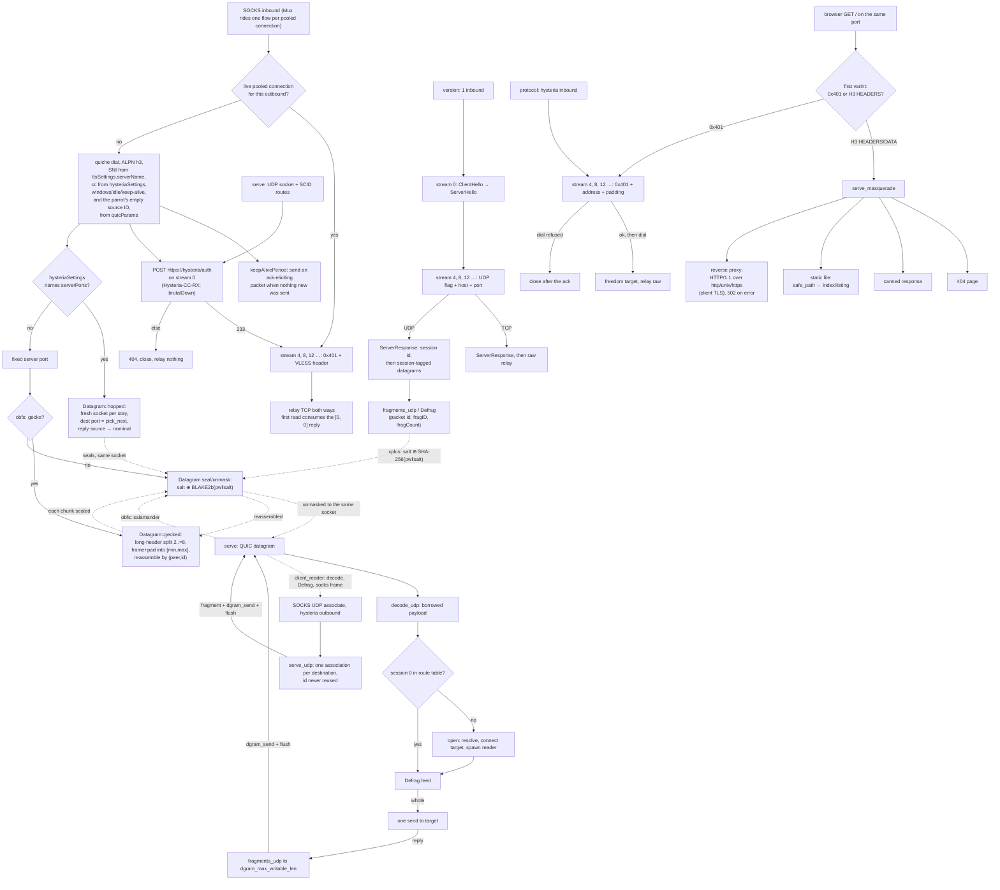

# The Hysteria carrier

Hysteria is a both-roles, both-shapes row: the reference's v1 binary protocol and its v2 HTTP/3 protocol share the `hysteria` transport name. Both run over quiche, the pinned QUIC stack.

The v2 client dials from a SOCKS inbound, with or without Mux, and the server serves a `streamSettings` inbound whose `tlsSettings.certificates` list goes to BoringSSL: the client's SNI picks the entry, `rejectUnknownSni` refuses an absent or unmatched name, and the shared builder gates the refusal. The dial's SNI is `tlsSettings.serverName`, falling back to the address; the auth request's `:authority` is the constant `hysteria`, not the SNI. Each TCP flow is one client-bidirectional stream opening with `0x401`, carrying VLESS or Trojan; a Trojan flow sends no acknowledgement and its UDP association rides the lane's own SOCKS frame. The protocol inbound names its destination as a varint string, acknowledges before dialling, and closes after a refused dial.

Every v2 connection carries the QUIC datagram lane: the auth response advertises `hysteria-udp: true`, one association per `BE32` session is keyed in the route table, relayed through `ferrox-core::hysteria`'s borrowed decode, reassembled by `Defrag`, and reaped after `udpIdleTimeout` or connection close. On Linux the lane writes a whole relay window in one `UDP_SEGMENT` call (or `sendmmsg`) and reads a coalesced burst back; the server answers with one `quic::flush_egress` sweep. A wrong password is refused with `404` then `CONNECTION_CLOSE` and relays nothing.

V1 is the binary handshake: stream 0 carries `ClientHello`/`ServerHello`, TCP flows open on streams 4, 8, 12…, and the UDP lane is one flow stream per association carrying session-tagged, fragmentable datagrams. Its codec is `ferrox-core::hysteria_v1`, bit-exact against the reference; its obfuscation is xplus, not salamander. V1 has no HTTP/3 auth, no `hysteria-udp` header and no masquerade.

Both roles read `udpIdleTimeout` and `finalmask.quicParams` with the reference's bounds and defaults, including congestion (`reno`, `bbr`, `brutal`, `force-brutal`), windows, PMTU, keep-alive and stateless-reset tokens. A tuned block is its own pool key. A browser `GET /` on the same port is answered by the masquerade site: the first varint (`0x401` vs H3 `HEADERS`) or stream 0's request shape splits a flow from a cover request. Four cover answers match the reference: `404`, canned `response`, static `file`, and `proxy` to an http, https or unix origin. A wrong-password hysteria attempt still refuses and closes.

A dial naming `serverPorts`/`mport` and `hopInterval`/`hopIntervalMax` hops its server port: the destination and socket move every random stay, the plan is expanded, deduplicated and sorted once, and the old socket lingers for in-flight replies. An inbound naming `obfs: gecko` fragments and masks long-header packets in 2..=8 chunks, each sealed as a salamander datagram, reassembled by `(peer, id)`. Both live at the `quic::Datagram` seam, so no handshake, frame or stream above changes.

## Data path



## Measured

<!-- counts:begin -->
| key | value | checked by |
| --- | --- | --- |
| ops-retired-instructions | UNBLESSED | scripts/count-ops.sh |
| tcp-flows-per-handshake | 2 | ferrox-app-proxy::tests::hysteria_shares_one_connection_between_two_flows |
| closed-connections-reused | 0 | ferrox-app-proxy::tests::hysteria_redials_when_a_pooled_connection_closes |
| datagrams-per-turn-witnessed | 16 | ferrox-app-hysteria::tests::a_turn_takes_the_datagrams_queued_behind_its_first |
| request-parse-reallocations | 0 | ferrox-app-hysteria::tests::a_parsed_request_leaves_its_payload_where_it_landed |
| request-parse-moves | 0 | ferrox-app-hysteria::tests::a_parsed_request_leaves_its_payload_where_it_landed |
| wrong-password-bytes-relayed | 0 | ferrox-app-proxy::tests::hysteria_refuses_a_wrong_password_without_relaying |
| non-v2-configs-carried | 1 | ferrox-app-proxy::tests::hysteria_settings_parse_with_guarded_fallbacks |
| hysteria-v1-tcp-echo-round-trips | 1 | ferrox-app-proxy::tests::hysteria_v1_carries_a_tcp_echo_over_loopback |
| hysteria-v1-udp-echo-round-trips | 2 | ferrox-app-proxy::tests::hysteria_v1_carries_a_udp_echo_over_loopback |
| hysteria-v1-xplus-round-trips | 1 | ferrox-app-proxy::tests::hysteria_v1_carries_a_flow_through_xplus_over_loopback |
| hysteria-v1-fragments-witnessed | 200 | ferrox-core-hysteria_v1::tests::every_length_survives_fragment_then_defrag_intact |
| hysteria-v1-xplus-masked-bytes | 10 | ferrox-core-hysteria_v1::tests::the_xplus_mask_matches_an_independent_sha256_computation |
| datagram-lane-client-round-trips | 1 | ferrox-app-proxy::tests::hysteria_carries_a_udp_association_over_the_carrier |
| udp-datagram-decode-copies | 0 | ferrox-core-hysteria::tests::a_decoded_datagram_leaves_its_payload_where_it_landed |
| udp-fragments-witnessed | 200 | ferrox-core-hysteria::tests::every_length_survives_fragment_then_defrag_intact |
| udp-fragment-list-allocations-per-datagram | 0 | ferrox-core-hysteria::tests::a_fragment_run_takes_no_heap |
| udp-datagram-reassembly-allocations-per-whole-packet | 0 | ferrox-core-hysteria::tests::an_unfragmented_datagram_is_handed_over_without_a_buffer |
| obfuscated-datagram-heap-copies | 0 | ferrox-core-hysteria::tests::a_sealed_datagram_never_touches_the_heap |
| pinned-hysteria-client-verdicts | 1 | scripts/run-upstream-suite.sh |
| masquerade-answers-browser-on-same-port | 1 | ferrox-app-proxy::tests::hysteria_serves_a_canned_masquerade_response |
| masquerade-answer-allocations-per-response | 0 | ferrox-core-hysteria::tests::an_h3_answer_writes_its_block_straight_into_the_callers_buffer |
| auth-request-allocations-per-block | 0 | ferrox-core-hysteria::tests::an_auth_request_carries_post_auth_and_the_brutal_hint |
| auth-padding-witnessed | 512 | ferrox-app-hysteria::tests::an_auth_padding_is_alphanumeric_inside_the_reference_range |
| masquerade-file-bytes-served | 1 | ferrox-app-proxy::tests::hysteria_serves_a_file_from_the_masquerade_directory |
| masquerade-file-type-allocations | 0 | ferrox-core-hysteria::tests::a_static_files_type_is_decided_without_an_allocation |
| masquerade-chunked-dechunk-allocations | 1 | ferrox-core-hysteria::tests::a_chunked_body_deframes_into_one_buffer |
| masquerade-path-decode-allocations | 0 | ferrox-app-hysteria::tests::a_path_with_no_escape_is_lent_back_undecoded |
| masquerade-static-answer-allocations | 4 | ferrox-app-hysteria::tests::a_static_file_answer_opens_only_the_path_and_the_file |
| masquerade-proxied-round-trips | 1 | ferrox-app-proxy::tests::hysteria_proxies_a_masquerade_request_to_an_origin |
| masquerade-escapes-served | 0 | ferrox-app-proxy::tests::hysteria_refuses_a_masquerade_path_that_escalates_the_directory |
| hop-port-set-expanded | 4 | ferrox-core-hysteria::tests::the_plan_expands_overlapping_ranges_into_one_sorted_set |
| hop-port-expansion-allocations | 1 | ferrox-core-hysteria::tests::every_plan_expands_to_the_bytes_the_contains_scan_wrote |
| hop-config-forms-parsed | 2 | ferrox-app-config::tests::a_hysteria_carrier_reads_a_port_hopping_plan |
| hop-plan-pool-keys | 2 | ferrox-app-hysteria::tests::a_hop_plan_is_its_own_pool_key |
| hopped-datagrams-delivered | 200 | ferrox-app-quic::tests::a_hopped_dial_spreads_its_datagrams_over_more_than_one_server_port |
| hopped-reply-source-normalized | 1 | ferrox-app-quic::tests::a_reply_from_a_hopped_port_reads_back_as_the_nominal_server |
| hop-recv-allocations-per-datagram | 0 | ferrox-app-quic::tests::a_reply_from_a_lingering_socket_is_read_without_an_allocation |
| gecko-frame-bytes-encoded | 10 | ferrox-core-hysteria::tests::a_gecko_frame_is_the_exact_bytes_the_reference_emits |
| gecko-frame-decode-copies | 0 | ferrox-core-hysteria::tests::a_gecko_frame_decodes_its_payload_without_a_copy |
| gecko-packet-reassembled-bytes | 1234 | ferrox-core-hysteria::tests::a_fragmented_long_header_packet_reassembles_bit_identical |
| gecko-window-forms-parsed | 3 | ferrox-app-config::tests::a_hysteria_carrier_reads_a_gecko_window |
| gecko-loopback-reassembled-bytes | 900 | ferrox-app-quic::tests::a_gecko_dial_reassembles_its_split_long_header |
| udp-fragment-reassembly-allocations-per-datagram | 0 | ferrox-core-hysteria::tests::a_fragmented_datagram_assembles_in_one_buffer_without_a_fresh_allocation |
| udp-fragment-reassembly-payload-passes | 1 | ferrox-core-hysteria::tests::a_fragmented_datagram_assembles_in_one_buffer_without_a_fresh_allocation |
| udp-v1-fragment-reassembly-allocations-per-datagram | 0 | ferrox-core-hysteria_v1::tests::a_fragmented_v1_datagram_assembles_in_one_buffer_without_a_fresh_allocation |
| udp-v1-fragment-reassembly-payload-passes | 1 | ferrox-core-hysteria_v1::tests::a_fragmented_v1_datagram_assembles_in_one_buffer_without_a_fresh_allocation |
| udp-v1-reply-payload-copies | 0 | ferrox-app-hysteria_v1::tests::a_reply_is_the_socks_head_and_the_arenas_own_bytes |
| udp-v1-reply-allocations | 0 | ferrox-app-hysteria_v1::tests::a_reply_costs_no_allocation |
| udp-v1-queued-reply-allocations | 0 | ferrox-app-hysteria_v1::tests::a_drained_queue_keeps_the_room_a_steady_lane_needs |
| gecko-message-reassembly-allocations-per-message | 0 | ferrox-app-quic::tests::a_gecko_message_reassembles_without_a_fresh_allocation |
| gecko-message-copies-per-message | 2 | ferrox-app-quic::tests::a_gecko_message_reassembles_without_a_fresh_allocation |
| gecko-table-walks-per-unexpired-datagram | 0 | ferrox-app-quic::tests::a_gecko_table_is_walked_only_when_a_message_can_expire |
| masquerade-https-origin-served-bytes | 6 | ferrox-app-proxy::tests::hysteria_proxies_a_masquerade_request_to_an_https_origin |
| masquerade-https-untrusted-refusals | 1 | ferrox-app-proxy::tests::hysteria_refuses_a_masquerade_https_origin_whose_chain_is_untrusted |
| masquerade-unix-origin-served-bytes | 6 | ferrox-app-proxy::tests::hysteria_proxies_a_masquerade_request_to_a_unix_origin |
| stun-binding-exchange-allocations | 0 | ferrox-core-stun::tests::a_binding_exchange_takes_no_heap |
| realm-punch-allocations | 0 | ferrox-core-realm::tests::an_encoded_and_decoded_packet_takes_no_heap |
| realm-configs-parsed | 3 | ferrox-app-config::tests::a_hysteria_carrier_reads_a_realm_rendezvous |
| realm-candidate-sorts | 1 | ferrox-core-realm::tests::a_candidate_walk_sorts_once_and_an_expansion_sorts_twice |
| realm-expansion-sorts | 2 | ferrox-core-realm::tests::a_candidate_walk_sorts_once_and_an_expansion_sorts_twice |
| upnp-mapped-externals | 1 | ferrox-app-hysteria-realm::tests::a_gateway_maps_the_port_and_names_its_external_address |
| datagram-host-allocations-per-datagram | 0 | ferrox-app-hysteria-v1::tests::a_datagram_host_is_the_address_text_without_the_heap |
| established-destination-allocations-per-datagram | 0 | ferrox-app-hysteria-v1::tests::an_established_destination_costs_no_key_and_no_insert |
| queued-datagram-allocations-per-datagram | 0 | ferrox-app-hysteria_v1::tests::an_established_destination_costs_no_key_and_no_insert |
| established-destination-comparisons-per-datagram | 1 | ferrox-app-hysteria_v1::tests::a_known_destination_is_one_comparison_not_a_walk |
| evicted-association-hint-answers | 0 | ferrox-app-hysteria_v1::tests::a_known_destination_is_one_comparison_not_a_walk |
| waiting-list-scans-per-unqueued-datagram | 0 | ferrox-app-hysteria_v1::tests::a_datagram_that_queued_nothing_does_not_walk_the_waiting_lists |
| waiting-list-flows-per-queued-datagram | 1 | ferrox-app-hysteria_v1::tests::a_datagram_that_queued_nothing_does_not_walk_the_waiting_lists |
| queue-buffer-allocations-after-the-first | 0 | ferrox-app-hysteria_v1::tests::a_drained_queue_keeps_its_buffer_for_the_next_datagram |
| hello-cap-bytes | 16384 | ferrox-app-hysteria_v1::tests::a_hello_chunk_is_kept_to_the_cap_and_a_late_one_is_dropped |
<!-- counts:end -->

## Ops

```bash
./scripts/count-ops.sh report proxy::tests::hysteria_carries_vless_echo_over_loopback \
  'hysteria::serve_loop' 'hysteria::drive_once' 'hysteria::serve_stream' \
  'hysteria::read_request' 'hysteria::auth_exchange' 'hysteria::open_pooled'
```

`UNBLESSED`. `scripts/expected-ops.txt` blesses three exact-count rows tree-wide, none of them hysteria. All six symbols are `scripts/method-ops.txt` rows, so `ops.yml` visits them; an inlined symbol reads `inlined-not-a-frame`. PR #536 (x86_64 Linux, rustc 1.99.1, base `8a5aad0`) read `serve_loop` 2 393 385 → 2 393 188, `drive_once` 171 954 → 173 760, `auth_exchange` 16 870 → 16 870; the other three inlined. The row stays `UNBLESSED` because no `expected-ops.txt` gate resolves the inlined symbols and the loopback `drive_once` count follows the scheduler.

Two probe pairs price the cover rewrites (`ops.yml` run `40877903421`, x86_64 Linux, rustc 1.99.1, branch against main `6428cd7c`): `the_word_extension_key_costs_the_word_and_nothing_else` retires 985 575 instructions against 1 346 151 for the same 64 walks (0.73×), and `the_direct_answer_costs_the_same_bytes_once` 489 598 against 1 169 083 for the same 512 answers (0.42×). Neither is a gate; the gates are `masquerade-file-type-allocations` 0 and `masquerade-answer-allocations-per-response` 0 beside their byte oracles.

`the_binary_pick_and_membership_costs_the_search_and_nothing_else` and `the_linear_scan_costs_the_same_answer` price 512 picks and memberships over a thousand-port plan; their numbers stay `UNBLESSED` until the artefact is read. `xor_tiled` folds four `u64` lanes per word and `demux` screens on `magic_matches` before the punch decode, with the pending map snapshotted outside the lock; no wire byte moves. `a_binding_exchange_takes_no_heap` (4096 STUN exchanges) and `an_encoded_and_decoded_packet_takes_no_heap` (4096 punch packets) stay `UNBLESSED`/`UNMEASURED`; their gates are `stun-binding-exchange-allocations` 0 and `realm-punch-allocations` 0. `the_checked_fragment_costs_the_validate_and_nothing_else` and `the_unchecked_fragment_costs_the_bytes_and_nothing_else` write the same 512 fragment runs of a 3000-byte payload split at 1200.

## Time

The matrix's `vless-hysteria` cells on `ubuntu-latest`, full tier. Down-8 and duplex-8 are three repeats on run `43692104987` at `1814b98a4`; up-1 is five repeats on run `43968769974` at `59e1879`. The client leg is ferrox's median against xray-core's as clients of the xray-core server; the server leg is the same xray-core client on the ferrox server against the xray-core server, each divided by its own cell's harness ceiling.

| cell | client leg | server leg (ceiling-normalized) |
| --- | --- | --- |
| `vless-hysteria-down-8` | 2.77× | 1.04× |
| `vless-hysteria-duplex-8` | 1.25× | 1.14× |
| `vless-hysteria-up-1` | 1.24× | 1.03× |

Up-1 clears both legs: 455 against 368 MiB/s behind the xray server and 694 against 380 MiB/s behind the ferrox server, at 2.16 against 3.92 s/GiB and 19.0 against 37.5 MiB RSS. Its client leg read 0.80× to 1.09× across five earlier full-tier runs, now gone from `scripts/leg-gaps.txt`. Duplex-8's client figure rests on `split` `srv-ferrox` cells in two of five runs, so the stable claim is the three tight runs' 1.22–1.28× (worst CV 10.9%). The earlier runs hold the ferrox server's thread peak at 15 against 11 and 13, and CPU at 1.11× and 1.13× on two runs against 0.58× on another, filed in `scripts/leg-gaps.txt` as a cross-host reading. The down-8 server leg is at parity, so the older `0.04` entry is gone. Remaining filed legs: down-8's 1.50× server threads and duplex-8's 1.11× server CPU and 1.15× server threads, the relay's per-connection thread cost under #696.

`hysteria::serve_loop` retires 2 749 401 → 2 684 380 instructions on the earlier run (`ops.yml` base `3e00131c` against branch run `40258675941`); `drive_once` read 169 974 → 172 708 there. On PR #1414 (`ops.yml` run `42494503241`, x86_64 Linux, rustc 1.99.1) `serve_loop`, `serve_stream` and `read_request` are `inlined-not-a-frame`, `drive_once` 491 127 (scheduler-dependent), `auth_exchange` 29 119 and `open_pooled` 3 649 824.

## What we removed

- **A second certificate reader and its temp file.** Both versions now share `tls_identity_from_settings`, so inline `certificate`/`key` and the whole `certificates` list work as on `security: tls`. `a_carrier_that_owns_tls_reads_the_same_certificate_list`, `hysteria_serves_the_certificate_the_sni_names` and `hysteria_v1_serves_the_certificate_the_sni_names` gate the parse and both serves. The file staging, its PEM pass and the second config reader are gone; BoringSSL still parses each DER entry.

- **V1's own transport stack, UDP session manager and five association maps.** `ferrox-core::hysteria_v1` carries only the binary handshake, request and datagram shape, reusing quiche and the existing `Flow`/`Datagram` seams; xplus is one SHA-256 keystream over the caller's datagram and fragmentation is the same `Defrag`. One `UdpFlow` per association owns the connected target socket, reassembly and idle reap; the dial side is one `Association` and one shared `Lane` per SOCKS front. One flat `Vec<Assoc>` compares its host text in place, so an established datagram costs no allocation and a run for one destination one comparison; a stale eviction hint is rejected by the same host-and-port test. `every_length_survives_fragment_then_defrag_intact` (200 rows), `hysteria_carries_udp_echo_over_loopback`, `hysteria_udp_lane_carries_a_datagram`, `hysteria_carries_a_udp_association_over_the_carrier`, `a_known_destination_is_one_comparison_not_a_walk`, `an_established_destination_costs_no_key_and_no_insert`, `an_idle_destination_is_evicted_at_the_association_cap`, `a_waiting_association_is_not_evicted_for_a_fresh_one` and `a_v1_datagram_association_reaps_on_the_configured_idle` gate it. The idle stamp is one atomic store and one clock read, named rather than counted. V1 still has no masquerade, HTTP/3 or `hysteria-udp`, because the reference v1 has none; `MaxDatagramFrameSize: 1200` is not reimposed, since fragments size to the peer's live `dgram_max_writable_len`.

- **The session map's second probe and the write-once lock.** The v1 server uses the `flows` entry's answer as the membership answer and tests `sessions` only on a miss; the address parse is deferred to a miss. The client's session id is one atomic and its peer a `OnceLock`, so neither path locks; the v2 `source` mutex is the same pin. The reply reader still compares the session and reads the id once per datagram.

- **The decoder's per-datagram copy, staged whole packets and gathered replies.** `decode_udp`'s borrowed payload goes straight to the target's one `send` (`udp-datagram-decode-copies` 0); `Defrag::feed` borrows a whole packet's own address and payload and allocates only for a fragmented one (`udp-datagram-reassembly-allocations-per-whole-packet` 0); the client reply's head is a reused buffer and its payload rides the same `sendmsg`/`WSASendTo` as a second part, so no reply copies the payload behind the head (`a_client_reply_hands_the_payload_over_by_pointer`, 4096 head builds at zero allocations). Quiche's `dgram_recv_buf` still returns an owned `Vec`.

- **The cover path's strings, joined field list and temporary block.** `encode_h3_response` writes the status digits into a stack array and each QPACK line straight into the caller's buffer, sized by `qpack_field_len`; no string, list or block is allocated (`masquerade-answer-allocations-per-response` 0, from 1). `build_auth_request` and `build_auth_response` write `Hysteria-CC-RX` into a 20-byte stack array (`auth-request-allocations-per-block` 0) and now append the reference's `Hysteria-Padding` from one `getrandom` fill into a 2 KiB stack room per handshake (`auth-padding-witnessed` 512). `parse_origin_response` reaches `foxy::head_end`, the tree's one eight-byte-at-a-time scan, with the offsets and `None` unchanged. `an_h3_answer_writes_its_block_straight_into_the_callers_buffer`, `every_answer_is_the_bytes_the_block_assembled`, `an_auth_request_carries_post_auth_and_the_brutal_hint`, `an_auth_response_is_status_233_and_advertises_the_udp_lane` and `the_swar_terminator_scan_is_the_windows_four_scan` gate the bytes. The body's bytes, the frame prefix and one `split` per origin header line still cost their own copies; the padding changes handshake bytes and is cover parity, not an optimisation.
- **The v1 lane lock per datagram of a sweep.** `relay_datagrams` took the inbound's UDP lane mutex inside its `while let Ok(data) = conn.dgram_recv_buf()` walk, so a queue of k datagrams the turn already held paid k lock/unlock pairs and could hand the lock to another thread between two datagrams it was about to give the same lane. The lock is taken once, above the walk, and every datagram of the sweep lands on it; a poisoned lock still returns, and the association, the payload and the wire bytes are unchanged. No row: a lock is not a counter the tree keeps, and the suites that carry the lane drive a real loopback server, where the count is the scheduler's (`hysteria_carries_udp_echo_over_loopback`).
- **A clock read above the lane lock.** `relay_datagrams` stamped the sweep with `now_nanos()` before taking the lane, so a frame that waited on a contended lock could stamp `last` and `used` older than the moment it acted and let the idle reap drop a flow that was still live. The stamp is taken behind the lock now; it is still one read a sweep and one atomic store a datagram. No row: a lock wait is the scheduler's, not a counter the tree keeps.
- **A waiting-list walk for a datagram that queued nothing.** Every datagram on a known v1 session swept every flow's association list for parked payloads, and cloned each host it found, even though only the enqueue path can add one. The sweep is gated on a payload having just queued and narrowed to the sending flow; a freed resolver slot keeps its own lane-wide resume. `a_datagram_that_queued_nothing_does_not_walk_the_waiting_lists` pins zero walks for a datagram that queued nothing and one flow walked for one that did (`waiting-list-scans-per-unqueued-datagram 0`, `waiting-list-flows-per-queued-datagram 1`).
- **A queue buffer handed back and re-grown per completed datagram.** `Assocs::drain` took the waiting list with `std::mem::take`, which left the association a zero-capacity `Vec`, so the next datagram for the same destination allocated it again. The drain consumes in place and keeps the buffer: `a_drained_queue_keeps_its_buffer_for_the_next_datagram` holds `capacity()` steady across two enqueue-and-drain cycles and measures no allocation for the queue itself (`queue-buffer-allocations-after-the-first 0`). The named cost: a destination that resolves keeps its queue's capacity until the association is evicted, which is one small `Vec` per live association, bounded by `MAX_PENDING_DATAGRAMS` per destination.

- **Salamander's key buffer, separate output, byte-at-a-time XOR and inbound copy back.** The key streams into one `BLAKE2b` update and `seal_into` writes salt-then-mask into the caller's datagram frame (`obfuscated-datagram-heap-copies` 0); v1's xplus shares `ferrox_core::keystream`, XORing both sixteen-byte key words per step with no modulo, and the unmask needs no scratch block. Every receive room that can see a masked lane is `RECV_ROOM`, so the read lands in the caller's buffer and the unmask happens in place; one copy per received obfuscated datagram retires. `the_stack_seal_form_matches_the_vec_oracle_form`, `every_length_unshifts_like_the_byte_walk`, `encrypt_and_apply_agree_at_every_length`, `salamander_round_trips_every_length_under_a_fresh_salt` and `an_obfuscated_read_unmasks_where_the_wire_bytes_landed` gate the bytes. The salt still costs one `getrandom` per datagram; a caller narrower than `RECV_ROOM` still takes the scratch path; a relay-framed read still shifts its header with `copy_within`.

- **The hop plan's squares, the hopping socket's async machinery and gecko's expiry thread.** `Hop::ports` opens one buffer sized to the ranges' total capped at 65 536 and sorts once with `dedup`; `pick_next` binary-searches the avoided port and lands the roll with one modulo and one skip; membership is one binary search. The reference's `HoppingSocket` and spawn/replace dance become two pure core functions and one `Mutex<HopState>` behind the existing blocking `Datagram`. Gecko's 8 s TTL, per-source cap and global cap are swept lazily by `retain` on the next frame instead of a `gcLoop` ticker. `hop-port-expansion-allocations` 1, `every_plan_expands_to_the_bytes_the_contains_scan_wrote`, `every_pick_lands_the_survivor_the_two_filters_walked_to`, `every_membership_reads_as_the_linear_scan_read_it`, `gecko-loopback-reassembled-bytes` and `gecko-packet-reassembled-bytes` gate it. A plan whose pushed ports outrun 65 536 can still grow before `dedup`; the binary forms require a sorted distinct set.

- **The shared STUN and realm punch codec.** `ferrox-core::stun` carries the header and one mapped address, writing into the caller's buffer; `ferrox-core::realm` writes and re-XORs the punch in place without a plaintext copy. The Psiphon lane reuses the same decode, candidates are sorted once and deduplicated, and a symmetric-NAT group sorts its merged set once. `realm-candidate-sorts` 1, `realm-expansion-sorts` 2, `stun-binding-exchange-allocations` 0 and `realm-punch-allocations` 0 gate it; `a_punch_packet_is_the_exact_bytes_the_reference_emits` and `a_binding_request_answers_with_its_xor_mapped_address` pin the bytes.

- **The per-flow handshake, the draining hand-out and the blocking opening reply.** One authenticated connection is pooled per outbound (host, address, port, congestion, auth, roots), and each flow takes the next stream id (`tcp-flows-per-handshake` 2, `hysteria_shares_one_connection_between_two_flows`, `hysteria_redials_when_a_pooled_connection_closes`, `closed-connections-reused` 0). `candidates` and `open_pooled` ask `usable` (not closed, not draining, no error), so a drained connection is redialled instead of parking the flow for `HANDSHAKE_TIMEOUT`. The `[0, 0]` reply is owed to the flow's first read (`Flow::reply`, `drain_reply`), so an upload-only flow against a server that buffers the ack returns at once; `hysteria_client_passes_a_hand_rolled_server` completes in 0.10 s, and a refused flow closes its stream so the first read sees FIN (`hysteria_server_ends_a_flow_it_refuses`, 0.12 s). Every read also flushes the egress it unblocked, so `MAX_STREAM_DATA` no longer waits for the next packet or 100 ms tick; a backlog-served read pays no sweep.

- **The v1 private egress, the relay's per-datagram probe and the zeroing passes.** V1 now uses `quic::flush_egress`, so a turn leaves in one `sendmmsg` or one `UDP_SEGMENT` message; the 1350-byte `out` room threaded through four functions is gone, and a refused write is held and retried like v2. Both relay lanes take the inbound once per sweep, read the clock once and reuse one buffer, so k datagrams cost one probe, one read and one clear-less buffer. The receive, packet, output, head, settings and 4096-byte rooms now use `quic::Unfilled`; the aarch64 dev-profile asm of `ferrox-app` goes from 9 `_bzero`/`_memset` calls across `ferrox_app::hysteria` frames to 0 (whole-file 91 → 82). The loopback and pinned-client suites read the same stream.

- **The v1-only outbound and the ignored `allowInsecure`.** The direct outbound now carries both versions: v2 opens `0x401`, reads the status byte and padding before payload, and serves UDP through the same lane (`hysteria_outbound_reads_both_versions`, `a_tcp_response_is_status_message_padding_on_the_wire`). `tlsSettings.allowInsecure` now reaches `Config.insecure` on the direct outbound and every carrier, and the pooled key includes it (`hysteria_v2_accepts_an_untrusted_chain_when_insecure`). The request body is still built once per flow, the standalone client still pools one connection per outbound, and an insecure dial still builds a fresh quiche config.

- **The request path's copies and the outbound fragment list.** The `0x401` prefix stays in the buffer with a cursor, and each parse reads what already arrived (`request-parse-reallocations` 0, `request-parse-moves` 0, `a_parsed_request_leaves_its_payload_where_it_landed`). `fragments_udp` iterates the message's own chunks, so a one-fragment datagram takes no heap (`udp-fragment-list-allocations-per-datagram` 0, `a_fragment_run_takes_no_heap`). Fragments are written by `encode_udp_unchecked` after one whole-message validation; `an_unchecked_fragment_is_the_bytes_the_checked_encode_wrote` and its v1 twin gate the bytes.

- **The Initial route walk and the per-packet route probes.** `Router` keeps `by_client_cid` and `by_initial_dcid` reverse maps filled on `accept` and dropped in `idle`, so `initial_route` is a hash probe (`a_retransmitted_initial_reuses_its_lane_without_a_second_route`, `an_idle_reap_drops_a_closed_routes_reverse_names`). `Router::drive` looks the route up once and carries `&mut Inbound` through the turn; an unauthenticated lane returns before the datagram loop. `Driver::claim` reports whether the stream is new, retiring the served set beside `wakes` (`a_stream_is_claimed_by_the_turn_that_serves_it`). `drive` also reports whether a route carried the packet, so the serve turn hashes the DCID once on a hit. One route probe per packet, one claim probe per readable stream, quiche's own `readable()` walk and a cloned CID per route remain; an invalid packet naming two routes prefers the DCID.

- **The v1 hello buffer's bound is checked per chunk, not after the drain.** `keep_chunk` refuses the chunk that would take stream 0's hello past `HEAD_CAP` (16 KiB), closes with `protocol error` and drops what was kept, so an unauthenticated peer cannot grow the retained hello one chunk at a time; a hello of exactly the cap still decodes (`hello-cap-bytes` 16384, `a_hello_chunk_is_kept_to_the_cap_and_a_late_one_is_dropped`).
- **`idle`'s two passes and the per-packet SETTINGS drain.** One `retain` pass with one lock per route, and a `settings_done` latch retires the per-packet `stream_recv` on stream 2.

- **The turn's one datagram, the narrow masked rooms and the server's per-datagram receive.** A turn takes the queue behind the datagram it waited for: one `recvmmsg` batch of `RECV_SLOTS` (16) on the wire's own read, or 16 single reads behind a 1 ms tail where a mask or relay frame rewrites each datagram (`datagrams-per-turn-witnessed` 16, `a_turn_takes_the_datagrams_queued_behind_its_first`). `pump` and the v1 `serve_loop` use `RECV_ROOM`, so `masked_read` no longer copies every plaintext datagram back. On Linux the server turn is one `recv_batch` of 16, each datagram routed from the batch's own slot; an obfuscated lane keeps the per-datagram `recv_from` and the 100 ms `ROUTE_POLL`. Each datagram still pays one `conn.recv` and quiche processing; a full batch that runs dry pays the tail arm; a masked lane is still one `recv_from` per datagram.

- **Two threads, one socket, each remembering its own wait.** `SO_RCVTIMEO` sits on the file description, so the pump's 5 ms and the reader's 1 s arms used to overwrite each other. The note is now one cell inside `quic::Datagram`, shared by every handle and read before any skip; `a_wait_undone_by_another_handle_is_armed_again_before_the_read` returns at 4.5 ms. No count moves; this is a missed wait, not a saved syscall.

- **The cover page's type, the path decode and the served router's egress.** A static file's type is its extension padded to eight bytes, one `| 0x20` and one length, so the request path allocates nothing (`masquerade-file-type-allocations` 0); `every_extension_answers_as_the_lowercase_match_did` sweeps every case and length trap. `transfer-encoding` is read seven bytes at a time in either case, and `dechunk` opens one buffer of the framed input's size (`masquerade-chunked-dechunk-allocations` 1). `percent_decode` asks for `%` first and lends the request's own text back when there is none (`masquerade-path-decode-allocations` 0); `masquerade-static-answer-allocations` 4 (unix) and 6 (Windows) include the two `canonicalize` calls that confine the path to the root. `Router::{accept, drive, wake, idle}` and `auth_exchange` now call `quic::flush_egress`, one `sendmmsg` or one `UDP_SEGMENT` per burst; the 1350-byte output room and the `out` slice threaded through ten call sites are gone. Origin headers still become `String`s, `dechunk` still parses a hex length per chunk, the answer still copies the file's bytes into its frame, and the path is still built segment by segment and opened by `fs::read` on every request.

- **A custom brutal sender and the random source connection ID.** `brutal` and `force-brutal` pace as quiche `bbr`, capped at `brutalUp` converted to whole megabits; `brutalDown` rides both auth directions as `Hysteria-CC-RX`. The reference's own pacer is not implemented, and no matrix cell sets `brutalUp`. Both client versions use `quic::hysteria_client_cid`: empty for the parrot, sixteen random bytes under `disableChromeParrot: true`, and empty with no `quicParams`, matching xray-core's default (`a_hysteria_dial_presents_the_parrots_zero_length_source_id`, `the_parrot_identifier_costs_no_allocation`). The server already routed an empty client CID; no transport parameter is permuted.

What is **not** removed, and is named rather than claimed: the pool is one process-wide map per outbound key with no eviction policy beyond pruning closed, stale and stream-exhausted entries on the next dial, so an outbound burst holds one connection each for `REUSE_WINDOW` (150 s, half the idle timeout); the client's UDP lane rotates associations on one connection rather than retiring the connection per destination, so a retired flow's late datagrams land on the floor by the never-reuse rule; the masquerade `proxy` cover dials `http`, `unix` and `https` origins — the last through the same client TLS the relayed lane speaks, trusted as presented only when the config names `masq_url_insecure` — and every origin request pays a fresh connection closed after its buffered response; 0-RTT, migration and key updates are quiche's; the server keeps one UDP socket per inbound with a per-connection route map and the two reverse maps an Initial is routed through.

- **The v2 datagram's head store and the v1 field walk.** `encode_udp_unchecked` (v2) writes the fixed eight-byte head as one `u64` store instead of four appends, and the v1 encoder writes its six-byte front and eight-byte tail as two stores where it wrote nine pieces (`an_unchecked_fragment_is_the_bytes_the_checked_encode_wrote`, `an_unchecked_v1_fragment_is_the_bytes_the_checked_encode_wrote`). V1's decoder reads the six-byte front, the host and the eight-byte tail as three slices instead of one `take` per field, so a datagram pays three bounds checks rather than nine (`every_length_survives_fragment_then_defrag_intact`, `the_v1_udp_decode_costs_the_bytes_and_nothing_else`); the v2 decoder already read its eight-byte head as one slice, so nothing is claimed there. The address still arrives as a borrowed `&str`; no byte on the wire changed.
- **The fragmented datagram's `Vec` per chunk and its second assembly buffer.** `Defrag` lands every fragment in one arena and remembers each chunk's `(offset, len)` in its slot array; an in-order message is handed over by swapping the arena into the caller's buffer, so the payload is walked once and nothing is allocated after the first two datagrams (`udp-fragment-reassembly-allocations-per-datagram` 0, `udp-fragment-reassembly-payload-passes` 1, `a_fragmented_datagram_assembles_in_one_buffer_without_a_fresh_allocation`). An out-of-order arrival walks the slots into the caller's buffer instead, and a duplicate fragment still leaves the partial alone. V1's `Defrag` is the same shape over its session, host and port (`udp-v1-fragment-reassembly-allocations-per-datagram` 0, `udp-v1-fragment-reassembly-payload-passes` 1). The named costs: the arena and the caller's buffer each hold the message, so a steady lane keeps both at the high-water length, and the slot array grows to the fragment count.
- **Gecko's `Vec` per chunk and its expiry walk on every datagram.** A fragment lands in the message's arena at its chunk offset, the completed message is copied into the caller's buffer once, and the message returns to a spare pool with its slots and arena capacity intact, so a steady reassembly allocates nothing (`gecko-message-reassembly-allocations-per-message` 0, `gecko-message-copies-per-message` 2, `a_gecko_message_reassembles_without_a_fresh_allocation`). The table keeps its earliest expiry, so a datagram that lands on an unexpired table is one comparison rather than a `retain` over every partial (`gecko-table-walks-per-unexpired-datagram` 0, `a_gecko_table_is_walked_only_when_a_message_can_expire`). The named costs: the spare pool holds up to `GECKO_MAX_MESSAGES` emptied messages, and an out-of-order message still copies chunk by chunk.
- **The reply lane's second lock.** The client association's flow and its reassembly were two mutexes taken one after the other on every reply; one `LaneState` behind one guard retires the old flow and raises the new one together, and the reader holds the pair until it has the source (`a_reply_keeps_the_association_it_selected`, `a_reader_holds_the_flow_until_it_has_the_source`, `a_writer_that_rotates_first_retires_the_session`). No row: an uncontended lock is not a counter the tree keeps; `a_reply_costs_one_lock_and_the_body` is the measured probe in `ops.yml`.
- **The v1 reply's 64 KiB buffer and its payload copy.** `client_reader` built every reply as a 3 + 25 + `MAX_UDP_PAYLOAD` buffer and copied the body into it before `send_to`; the head is now the longest socks head (22 bytes) and the body is the arena's own slice, handed to `send_to_two`'s `sendmsg`, so a reply copies its body zero times and the lane holds no 64 KiB buffer (`udp-v1-reply-payload-copies` 0, `udp-v1-reply-allocations` 0, `a_reply_is_the_socks_head_and_the_arenas_own_bytes`, `a_reply_costs_no_allocation`). The datagrams a named destination accumulated before its resolver answered were a `Vec` per payload; they are one arena with `(offset, len)` spans that keeps 8 KiB across a drain and gives a burst back (`udp-v1-queued-reply-allocations` 0, `a_drained_queue_keeps_the_room_a_steady_lane_needs`). The named costs: an association that queued at least once keeps 8 KiB of arena room (2 MiB for a flow at `MAX_UDP_ASSOCIATIONS`), a burst above it is shrunk on the drain, and the head is still rebuilt per reply.
- **The v1 reply reader's buffer per datagram.** `client_reader` opened a `Vec` for every reply, which defeated the arena's hand-back; one buffer now holds what the arena returns (`a_fragmented_v1_datagram_assembles_in_one_buffer_without_a_fresh_allocation` witnesses the hand-back). The server's host text is still parsed per datagram: one v1 session carries datagrams for several destinations, so a per-session cache paired a reply with the previous destination's address — the loopback suite caught it, and the parse stays.

## CI scope

What a change here owes, read by `scripts/ci-scope.py`; see [`docs/ci-scope.md`](../ci-scope.md).

<!-- scope:begin -->
- paths: crates/ferrox-core/src/hysteria.rs, crates/ferrox-app/src/hysteria.rs, crates/ferrox-core/src/hysteria_v1.rs, crates/ferrox-app/src/hysteria_v1.rs
- symbols: hysteria, hysteria_v1
- scenarios: vless-hysteria, hysteria-v1
- oracle: xray-rust-hysteria=rejects_wrong_auth
- go: ./transport/internet/hysteria/...
<!-- scope:end -->
