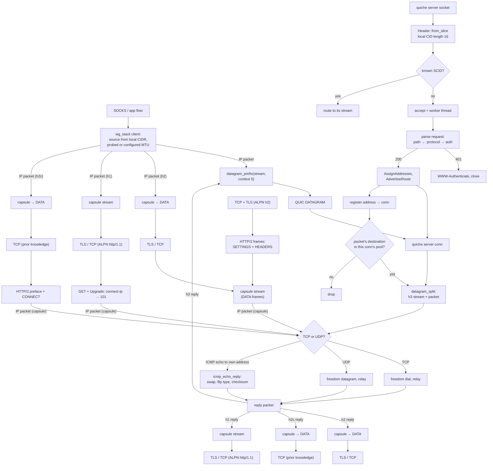

# The MASQUE carrier

MASQUE is the RFC 9484 CONNECT-IP row, carried as the `masque` transport name and as a `protocol: masque` inbound: the client uses quiche/HTTP-3 unless the configured ALPN names `h2` without `h3` (TLS/HTTP-2) or names `http/1.1` with neither `h2` nor `h3` (TLS/HTTP-1.1), and uses cleartext prior-knowledge HTTP/2 only when `security: none` is explicit; a TLS inbound serves HTTP-3 on UDP and, when its ALPN names `h2` or `http/1.1`, HTTP-2/HTTP-1.1 on TCP on the same port, while a cleartext inbound serves only HTTP/2. WARP is refused on the h1 and cleartext carriers. An HTTP/3 `CONNECT` request names the path `/.well-known/masque/ip/*/*/`, `:protocol` `connect-ip` and a Basic credential; the server answers `200` with a Capsule-Protocol header, assigns one address per configured family over the request stream, advertises the default routes, and from then on every IP packet rides a QUIC DATAGRAM frame prefixed with the quarter stream id and a zero context byte. TCP and UDP inside the tunnel feed the same `wg_stack` seams the WireGuard row uses — the client resolves the flow's source from the local CIDR, the server routes each packet through the outbound table — so a packet too wide for the lane's next datagram is answered with the reference's ICMP Packet Too Big and the writing stack narrows to the MTU it names, and an ICMP echo request to the device's own address is answered at both families. `MasqueOut::udp_forwarder` exposes that stack as a fixed-target datagram lane for a tunnel carried inside this one: it binds `127.0.0.1:0`, dials the outer conversation on its first datagram, and passes each payload to the target on one fixed inner source port, which is the seam gool's WireGuard hop rides (row 191); `ferrox-app-wg-stack::tests::a_fixed_datagram_lane_forwards_payloads_verbatim_both_ways` is the payload checker.

The server is the part xray-core owns that row 21 did not: an address pool built from the configured prefixes, one address per family per connection, the 401 challenge with `WWW-Authenticate: Basic realm="masque", charset="UTF-8"`, the 503 when a family is exhausted, and the per-capsule DATA frames the reference writes. A server opts into Cloudflare's dialect with `settings.warp: true`: at `/` it accepts `:protocol cf-connect-ip` without Basic auth and assigns from the same pool, while `connect-ip` on the configured path still authenticates. The default inbound has no `cf-connect-ip` mode, and the WARP block on an outbound remains client-only. Address containment is the reference's `inPool` — the network and broadcast addresses are inside a prefix and are therefore never handed to a stack — and a subnet grant is narrowed to its first host the way `prefix.Masked().Addr().Next()` does. The reference's flat `address`/`port` outbound settings and its `users` (or `clients`) rows with `pass` read the same edge and table; the nested `server` object and `password`/`account.password` stay as the second way. The configured `host` wins over the SNI for the request authority, the path is compared after percent-decoding so `%2A` reads as `*`, and the user's email compares case-insensitively because the reference lowercases it in its validator. A WARP server keeps that split: the Cloudflare request is the only one that may omit the credential, and it must name `/`; `masque::tests::a_warp_server_accepts_the_cloudflare_dialect_without_basic_auth` is the checker for those predicates. A configured WARP block is the Cloudflare dialect of the same row: the client mints a P-256 certificate from `privateKey`, presents it in mutual TLS, pins the edge's `SubjectPublicKeyInfo` to `publicKey`, sends `:protocol cf-connect-ip` with the draft-datagram setting `0x276`, uses a 20-byte connection id, and takes `address` as its static local prefixes instead of asking for an assignment. `tls.insecure` skips the pin while the handshake signature still proves the key, as the reference does. `WARP_HOST` and `/` fill an absent host and path; an explicit one wins. The h2 carrier is the bare variant: `CONNECT` with `Cf-Connect-Proto: cf-connect-ip` and `Pq-Enabled: false`, the authority defaulting to port 443, capsules and datagrams without a context byte, and no address request. The checks are `masque::tests::a_warp_identity_carries_the_key_it_was_given`, `a_sec1_key_is_wrapped_in_the_pkcs8_envelope`, `warp_addresses_are_one_prefix_per_family`, `a_warp_client_config_loads_the_minted_identity`, `warp_h3_settings_name_the_draft_datagram`, and `masque_h2::tests::a_warp_request_names_its_protocol_in_a_header`. The WARP key, the certificate, the credential headers and a server user's password are redacted from every `Debug` rendering, and the P-256 key is zeroized on drop, which `masque::tests::a_debug_rendering_never_names_a_credential_or_a_key` checks; `rustls_backend::tests::a_verifier_that_skips_the_chain_still_rejects_a_forged_handshake_signature` checks that a skipped chain keeps the handshake signature.

The dialer collapses xray's user-agent selector to the pinned Chrome UA for `chrome`, `firefox`, `safari`, `edge` and `curl`; `golang` and an empty value send no user agent, and an absent value sends the same Chrome UA. A configured `remoteDNS` defaults to the four Cloudflare resolvers xray names, two per family, and each name is asked inside the tunnel over an inner UDP flow, filtered to the resolvers whose family the assigned addresses carry; when no tunnel answer arrives the host resolver remains the fallback. `wg_stack::tests::a_name_resolves_through_the_tunnel` is the checker. `enable_dgram` receives quiche's `MAX_DATAGRAM` as the receive queue depth on both roles and `DGRAM_INFLIGHT` (32) as the send queue depth, which is the reference's `maxDatagramSendQueueLen`: a peer drops datagrams above its own receive queue, and an inner TCP that loses a burst backs off for seconds, so a full send queue holds the packet and the caller retries it after a flush instead of dropping it. `dispatch` also wakes the worker whose queue it just wrote, so a burst leaves on arrival rather than on the 10 ms tick that now only drives retransmission timeouts, and a packet the send queue could not take is retried when an arriving acknowledgement frees it rather than on a 1 ms poll, which `masque::tests::a_full_datagram_queue_refuses_the_next_packet` witnesses resuming after a flush. An h2 edge that refuses the first dial because its listener is still binding is dialed again for a second, which is the window the QUIC handshake's retransmission already covers; `masque_h2::tests::a_dial_refused_until_the_edge_binds_is_retried` and the pinned `TestMasqueServerHTTP2` are the checkers. After every received event the worker sweeps a QUIC deadline that has already fallen due, so a peer that keeps datagrams arriving inside the wait cannot defer loss recovery or the draining and idle timers; `ferrox-app-masque::tests::a_due_quic_deadline_is_swept_after_an_event` is the checker.

A lane that closes shortly after it opens no longer turns every packet into a fresh handshake. The first dial is immediate; after that each failed connect, and each lane that closed before it had lived ten seconds, advances a one-second delay that doubles to a minute before the next dial, while a call inside the wait fails with `masque: reconnecting in …` instead of dialling again. A lane that did live past those ten seconds clears the history, so a genuinely established tunnel that later dies reconnects at once. `masque::tests::a_flapping_edge_is_dialled_on_the_backoff_not_per_packet` counts four dials over ten seconds of packet-rate calls (offsets 0, 1005, 3010, 7015 ms) and `masque::tests::a_tunnel_that_stays_up_clears_the_backoff` checks the reset. The reference clears its backoff on any established connect; this tree requires the ten-second hold so an edge that accepts, assigns and closes cannot use the reset to keep flapping.

The HTTP/1.1 carrier is the RFC 9484 §4.2 upgrade: `GET` with an absolute URI, `Connection: Upgrade`, `Upgrade: connect-ip` and `Capsule-Protocol: ?1`; the 101 answer switches the same TLS stream to capsules. The cleartext carrier is prior-knowledge HTTP/2 without ALPN when the config explicitly says `security: none`; both roles refuse WARP there because Cloudflare's endpoint authenticates with TLS. The checks are `masque_h1::tests::an_h1_request_is_the_rfc_upgrade`, `an_h1_answer_is_the_rfc_switch`, `a_tcp_flow_crosses_the_h1_tunnel_to_a_freedom_dial`, and `a_tcp_flow_crosses_the_h2c_tunnel_to_a_freedom_dial`.

Every client carrier holds at most 64 datagrams and 1 MiB of datagram bytes before its stack attaches; the next datagram ends the session, so the unauthenticated window is bounded in memory as well as time. `masque::tests::poll_refuses_a_pre_stack_datagram_flood`, `early_h3_datagrams_are_bounded_by_count_and_bytes`, `masque_h1::tests::a_pre_stack_datagram_flood_is_bounded`, and `masque_h2::tests::a_pre_stack_datagram_flood_is_bounded` plus `a_pre_stack_datagram_byte_flood_is_bounded` are the checkers. The handshake clock starts when the wire is wrapped, stays armed through the preface and the CONNECT/address negotiation, and is checked between frames; `masque_h2::tests::a_cleartext_wire_arms_the_handshake_clock`, `a_due_handshake_clock_ends_before_any_frame`, and `a_handshake_clock_that_falls_due_between_frames_stops_the_next` are the checkers.

The HTTP/2 client and server retain at most 64 queued bodies while a send window is stalled — one capsule per client control answer, one 8 KiB burst frame per server batch — and a full queue parks that role instead of ending it: the pull from its packet channel stops, the packet stays in the channel, and a peer granting credit resumes both. Only a control answer arriving past the cap ends the session. Each DATA frame that leaves straight from a tunnel packet or a reply capsule uses one write — `frame_head` and the body share one buffer, so the head is never a record of its own — and the server gathers every packet already queued into one frame per 8 KiB batch, keeping every body inside h2's 16 KiB default frame limit (a body past it, or a single oversized datagram, takes the queued path that already splits by credit), so the peer parses one frame head per burst instead of one per datagram and the drain continues past a full batch in the same turn: `a_burst_leaves_as_one_data_frame` counts four capsules in one write, `a_burst_keeps_every_body_inside_the_frame_limit` counts a 64-datagram burst into frames no body of which passes 16 384 bytes, and a stalled window therefore holds one queued frame per burst rather than one per datagram, which `a_stalled_send_window_bounds_the_queued_capsules` bounds by entry and byte. A control answer now leaves `Wire::send` as one record when its body is at most 512 octets, head and body written from the same frame; a larger control body keeps the two writes; a body drained from the 64-slot queue now leaves in one write per DATA frame from the reused frame buffer, which `queued_capsules_flush_when_the_peer_grants_window` counts for a whole capsule and `a_partially_credited_capsule_leaves_one_write_per_frame` counts across a split credit. The handshake clock is cleared only once the queue is empty, so a flush that still holds capsules keeps the deadline armed. The read a burst takes waits the 250 µs tail rather than the 10 ms idle wait: a stack one hop behind the tunnel replies on the next visit, so the visit's read, its flush and the peer's answer are not parked behind an idle timer, and a read that timed out restores the idle wait so a quiet session still sleeps. `masque_h2::tests::a_landed_read_arms_the_tail_and_a_timeout_restores_the_idle_wait` witnesses the arm and the restore; what this did not remove is the idle wait itself and one read per visit — the tail lowers how long a busy session waits, not how many syscalls it takes. `masque_h2::tests::a_stalled_client_window_bounds_its_answers`, `a_stalled_send_window_bounds_the_queued_capsules`, `an_overflow_stops_draining_the_packet_channels`, `a_data_frame_leaves_the_wire_in_one_write`, `a_burst_leaves_as_one_data_frame`, `queued_capsules_flush_when_the_peer_grants_window` and `a_partially_credited_capsule_leaves_one_write_per_frame` check the boundary, the parking, the framing, the burst, the recovery and the split credit. Ended or closed sessions leave pending capsules and packet channels untouched, checked by `ended_or_closed_sessions_leave_capsules_and_channels_untouched`. The capsule encoding is unchanged; the cap counts queued frames rather than datagrams, and their retained payload allocations remain. What this did not remove: the 64-slot queue and the `Vec` each queued frame owns, and one `write` per DATA frame — the frame build saves the head's separate write, the server's per-datagram allocation and one frame head per burst, not the frame itself.

The download returns its receive credit in a batch: the dialer accumulates the wire length of every DATA frame and sends one connection and stream `WINDOW_UPDATE` pair, both frames in one write, once 64 KiB has arrived, where it used to send a pair per frame through two writes each. The 4 MiB initial window keeps the peer from stalling, and `a_download_credits_a_batch_of_frames_in_one_write` holds the one-write pair and the 64 KiB increment. The client leg's gate is CI's `masque-h2-down-8` cell in run `44131425942` (ubuntu, standard, three repeats, this head), which read 0.93x, 239.5 against 258.8 MiB/s, with 3 280 against 4 720 ms/GiB; run `44018646109` on `main` read 0.55x before the change. The same cell's server leg is still red there, 0.15x against the xray-core server at 3.10x its CPU, which is the stack's cost and not this credit return.

The transport seams around the tunnel are shared with the carriers that already own them. `finalmask.udp` wraps the h3 socket: the client encodes each datagram before `Datagram` applies its relay or obfuscation, the server decodes after those layers are stripped, a serving-side `filter` stage checks the source before the bytes reach the stack, and every stage's header rides outside the QUIC payload, as the reference's wrapped packet conn carries it, so the probe measures the same payload xray's `MaxPacketSize` does. `finalmask.tcp` is the `Connection::Masked` chain under TLS for h1/h2 and over bare TCP for h2c; a serving-side filter is checked at accept, before the handshake, and a stage this tree cannot carry refuses the carrier by name. `finalmask.quicParams` replaces the fixed QUIC transport shape on both roles, and a lane with no block runs the reference's BBR at the standard profile (`masque::tests::a_masque_lane_without_params_runs_the_references_bbr`): `congestion` selects `reno`, `cubic`, `bbr` or a named Brutal profile (mapped to BBR because the pinned quiche has no Brutal sender), `bbrProfile` sets the exposed `BbrParams` knobs, the four receive windows, `maxIdleTimeout`, `maxIncomingStreams`, `disablePathMTUDiscovery` and `disableGSO` are applied, `keepAlivePeriod` wins over `xmux.hKeepAlivePeriod`, and `disableStatelessReset` suppresses the per-accept token the server otherwise mints afresh. `streamSettings.sockopt` reaches the h3 UDP socket, the h2/h1 client dial, and the server's listeners through the same reader; `mark`, `interface`, keepalive, congestion, the three TCP bounds, `customSockopt`, `domainStrategy` and `addressPortStrategy` apply, `dialerProxy` routes the edge dial through its tagged outbound, while `happyEyeballs`, `penetrate`, `tcpMptcp`, `receiveOriginalDestAddress`, `acceptProxyProtocol`, `v6only` and `trustedXForwardedFor` warn by name. After establishment the lane's MTU is `dgram_max_writable_len()` less the quarter-stream-id prefix; a probed value below xray's 1280-byte minimum refuses the lane rather than advertising a packet the tunnel cannot carry, while a config-named `mtu` replaces the probe, clamped to 576..1350, so nested WARP keeps its inner budget under the outer overhead. The selected value feeds the stack MSS and the ICMP Packet Too Big on both ends; h2/h1 keep the 65 535 capsule ceiling. `xmux` opens one CONNECT-IP request per lane under xray's parsed defaults for an empty block (`maxConnections` 1..1, `hMaxReusableSecs` 1800..3000 s, `maxConcurrency`, `cMaxReuseTimes` and `hMaxRequestTimes` empty; a partial block keeps its zero fields as no cap and no expiry), fills lanes under `maxConcurrency`, spreads flows across a wider `maxConnections` pool, reassigns a flow once `cMaxReuseTimes`/`hMaxRequestTimes` is spent, and retires a lane at its `hMaxReusableSecs` window; `maxConnections` beside `maxConcurrency` is refused as the reference refuses it. A `brutal` block keeps quiche's BBR sender and adds the reference's token bucket in the lane pump, paced at `brutalUp` on the client and `brutalDown` on the server, because the pinned quiche has no Brutal sender; `brutalDisableLossCompensation` and `disableChromeParrot` are accepted and ignored. `masque::tests::xmux_names_the_lane_pool_and_the_reuse_window` is the checker.

## Data path

<!-- counts:begin -->
| key | value | checked by |
| --- | --- | --- |
| ops-retired-instructions | UNBLESSED | scripts/count-ops.sh |
| tcp-echo-round-trips | 1 | ferrox-app-masque::tests::a_tcp_flow_crosses_the_tunnel_to_a_freedom_dial |
| ipv6-tcp-echo-round-trips | 1 | ferrox-app-masque::tests::a_tcp_flow_crosses_the_tunnel_over_ipv6 |
| udp-echo-round-trips | 1 | ferrox-app-masque::tests::a_datagram_flow_crosses_the_tunnel_to_a_freedom_dial |
| wrong-password-status | 401 | ferrox-app-masque::tests::a_wrong_password_is_refused_with_401 |
| path-forms-witnessed | 5 | ferrox-app-masque::tests::a_request_path_reads_the_way_xray_parses_it |
| reference-edge-spellings | 2 | ferrox-app-masque::tests::the_reference_settings_spellings_read_the_same_edge |
| reference-user-spellings | 4 | ferrox-app-masque::tests::the_reference_user_spellings_serve_the_same_table |
| pool-contained-addresses-witnessed | 2 | ferrox-app-masque::tests::a_pool_holds_every_address_its_prefix_covers |
| pool-outside-addresses-witnessed | 1 | ferrox-app-masque::tests::a_pool_holds_every_address_its_prefix_covers |
| subnet-grants-witnessed | 2 | ferrox-app-masque::tests::a_subnet_grant_names_its_first_host |
| datagram-prefix-round-trips | 1 | ferrox-app-masque::tests::the_datagram_prefix_round_trips |
| assignment-outcomes-witnessed | 5 | ferrox-app-masque::tests::an_address_capsule_withdraws_what_it_no_longer_grants |
| icmp-too-big-shapes | 2 | ferrox-core-foxy::connectip::tests::a_packet_too_big_swaps_the_addresses_and_verifies_at_both_versions |
| icmp-too-big-edges | 5 | ferrox-core-foxy::connectip::tests::a_packet_too_big_copies_options_and_refuses_a_narrow_mtu |
| icmp-mtu-narrows | 2 | ferrox-app-wg-stack::tests::a_packet_too_big_narrows_the_device_mtu |
| icmp-too-big-responses | 1 | ferrox-app-masque::tests::a_packet_wider_than_one_datagram_is_answered_with_icmp |
| datagram-send-queue-depth | 32 | ferrox-app-masque::tests::a_full_datagram_queue_refuses_the_next_packet |
| dials-per-ten-second-flap | 4 | ferrox-app-masque::tests::a_flapping_edge_is_dialled_on_the_backoff_not_per_packet |
| echo-replies | 2 | ferrox-core-connectip::tests::an_echo_request_is_answered_at_both_families |
| echo-refusals | 3 | ferrox-core-connectip::tests::a_message_that_is_not_an_echo_request_leaves_the_buffer_alone |
| echo-answers-on-the-client | 2 | ferrox-app-wg-stack::tests::an_echo_to_the_devices_own_address_is_answered_on_the_tunnel |
| echo-answers-on-the-server | 1 | ferrox-app-wg-stack::tests::a_server_answers_an_echo_to_its_own_address |
| h2-datagram-round-trips | 1 | ferrox-app-masque-h2::tests::an_h2_tunnel_assigns_and_carries_a_datagram |
| h2-dialer-round-trips | 1 | ferrox-app-masque::tests::a_datagram_flow_crosses_the_h2_tunnel_to_a_freedom_dial |
| h2-tcp-echo-round-trips | 1 | ferrox-app-masque::tests::a_tcp_flow_crosses_the_h2_tunnel_to_a_freedom_dial |
| h1-tcp-echo-round-trips | 1 | ferrox-app-masque::tests::a_tcp_flow_crosses_the_h1_tunnel_to_a_freedom_dial |
| h2c-tcp-echo-round-trips | 1 | ferrox-app-masque::tests::a_tcp_flow_crosses_the_h2c_tunnel_to_a_freedom_dial |
| carrier-alpn-choices-witnessed | 8 | ferrox-app-masque::tests::the_carrier_follows_the_alpn_list |
| h3-datagram-send-allocations | 0 | ferrox-app-masque::tests::a_queued_datagram_is_the_buffer_the_caller_built |
| h3-forward-buffer-reallocations | 0 | ferrox-app-masque::tests::a_forwarded_datagram_is_the_buffer_that_arrived |
| h3-deliver-buffer-reallocations | 0 | ferrox-app-masque::tests::a_delivered_datagram_is_the_buffer_that_arrived |
| h3-forward-stack-prefix-bytes-moved | 0 | ferrox-app-masque::tests::a_forwarded_datagram_is_the_buffer_that_arrived |
| h3-deliver-stack-prefix-bytes-moved | 0 | ferrox-app-masque::tests::a_delivered_datagram_is_the_buffer_that_arrived |
| h2-frame-body-allocations | 0 | ferrox-app-masque-h2::tests::a_frame_body_is_read_where_it_landed |
| h2-capsule-staging-allocations | 0 | ferrox-app-masque-h2::tests::a_whole_capsule_is_read_where_it_landed |
| h2-datagram-packet-queue-copies | 0 | ferrox-app-masque-h2::tests::a_datagram_capsule_goes_straight_to_its_lane |
| h2-queued-capsule-cap | 64 | ferrox-app-masque-h2::tests::a_stalled_send_window_bounds_the_queued_capsules |
| h2-capsules-in-a-four-packet-burst | 4 | ferrox-app-masque-h2::tests::a_burst_leaves_as_one_data_frame |
| h2-downlink-frame-body-cap | 16384 | ferrox-app-masque-h2::tests::a_burst_keeps_every_body_inside_the_frame_limit |
| h2-writes-per-immediate-data-frame | 1 | ferrox-app-masque-h2::tests::a_data_frame_leaves_the_wire_in_one_write |
| h2-writes-per-queued-data-frame | 1 | ferrox-app-masque-h2::tests::a_partially_credited_capsule_leaves_one_write_per_frame |
| early-datagram-cap | 64 | ferrox-app-masque::tests::poll_refuses_a_pre_stack_datagram_flood |
| early-datagram-byte-cap | 1048576 | ferrox-app-masque::tests::early_h3_datagrams_are_bounded_by_count_and_bytes |
| quic-v2-generic-default | off | ferrox-app-masque::tests::the_quic_v2_setting_is_opt_in_for_generic_masque |
| quic-v2-bait-bytes | 1200 | ferrox-app-masque::tests::the_bait_is_a_v2_versioned_long_header_of_the_minimum_size |
| quic-v2-bait-answer | consumed | ferrox-app-masque::tests::the_bait_triggers_a_version_negotiation_from_a_v1_only_server |
| h3-lane-prefix-bytes-moved-per-datagram | 0 | ferrox-app-masque::tests::a_lane_datagram_keeps_its_prefix |
<!-- counts:end -->

The row 194 noise hook is the HTTP/3 client's: `masqueSettings.noize` is read into `ClientSpec`, and `attempt` sends that profile's junk and `i1`/`i2` before `quiche::connect`, so the QUIC ClientHello follows them. The default is `off` when the setting is absent; WARP-generated MASQUE settings always write `firewall` unless the operator chooses another profile. HTTP/2 and HTTP/1.1 have no pre-handshake UDP datagrams and take no noise, and the server role is unchanged. `noize::tests::masque_signatures_follow_the_reference_order` and `noize::tests::an_off_profile_sends_nothing` are the checkers.

The row 195 opener is the HTTP/3 client's too: `masqueSettings.quicV2` is read into `ClientSpec`, and `attempt` sends one 1200-byte long header carrying QUIC v2 `0x6b33_43cf` before the noise and `quiche::connect`, waits up to 600 ms (twice; 500 ms once on a probe) for Version Negotiation, consumes the answer, and runs the ordinary v1 handshake on the same socket. The setting is off for generic MASQUE; WARP writes `true` and `--no-quic-v2` or `AETHER_QUIC_V2` turns it off. HTTP/2 and HTTP/1.1 send no pre-handshake datagram, and the MIM inner hop carries none. `ferrox-app-masque::tests::the_bait_is_a_v2_versioned_long_header_of_the_minimum_size` and `ferrox-app-masque::tests::the_bait_triggers_a_version_negotiation_from_a_v1_only_server` are the checkers.

## Time

No duration is quoted here. The matrix's `masque-down-8` h3 cell (ferrox and xray-core as servers; ferrox, xray-core and Aether as clients, with Aether only against ferrox's WARP server mode), the `masque-h2` cell (ferrox and xray-core servers) and the ferrox-only `masque-h1`/`masque-h2c` cells, plus the `TestMasque` / `TestMasqueHTTP2` / `TestMasqueServer` / `TestMasqueServerHTTP2` / `TestMasqueServerClientToClient` conformance run are CI-only (`parity.yml`, `conformance.yml`); a local number would measure this machine's tunnel, not the code, so the page carries `UNBLESSED` for the retired-instruction count until the `ops.yml` artefact is read and the gate moves only with that measurement. The server leg's 0.15x ack clock points at the inner congestion window: the peer coalesces acknowledgements, and a window that grows by one segment per acknowledgement turns this tree's slow start into a linear ramp. Removing that window collapsed the server leg on its first `masque-down-8` run (no engine landed a number); bounding it at 64 KiB lifted the ferrox client to 176.67 MiB/s but left the xray-core client at 1.46 against 64.78 (0.02x, run `42609428370`), so the accepted socket keeps Cubic. The rerun after the worker-wakeup fix measured 9.56 MiB/s against 70.94 on the reference server (0.13x, run `42599287743`), still below the 0.15x floor. What the counts above witness is shape, not speed: one TCP echo per family through the full tunnel, one UDP datagram, the 401 on a wrong password, and the pool's containment rule, five post-establish assignment outcomes, the Packet Too Big the two families compose, the echo answers the two families render and the three messages they refuse, one HTTP/2 tunnel's assigned address and echoed datagram, the h2 dialer's assignment, echoed datagram and TCP echo, the eight ALPN lists that choose between h1, h2 and h3, one TCP echo through the h1 and h2c tunnels, the reference's flat `address`/`port` and nested `server` outbound spellings, and its `users`/`clients` rows with `pass`, `password` or `account.password`. The allocation rows are the handoff's before/after: the queued h3 datagram, the forwarded and delivered buffers, the h2 frame body, a whole capsule and the h2 packet queue all allocate zero, where the copied forms allocated one buffer each. The two prefix-move rows are the stack handoff's before/after: the h3 stack receives the prefix and its offset, where the drained form moved every byte of the packet to the front of the buffer.

## What we removed

- **The terminating server's separate packet forwarder.** The reference carries a dedicated CONNECT-IP server with its own netstack; this tree feeds the same `wg_stack` the WireGuard row already owns, so the server has no packet loop of its own — the capsule parser, the pool and the demux are the only new code. The shared stack also gives the download direction the reference's large-segment shape: a client that opts in with `largeSegments` advertises 65,495/65,475, the server keeps that MSS, writes 65 KiB TCP segments, and splits them into 1,344-byte inner IP fragments the client reassembles (the peer must write and fragment those segments; the opt-in alone does not); the default is the tunnel's conservative 1,240/1,220; the SYN-ACK advertises 1,240 bytes for IPv4 and 1,220 for IPv6 at the default 1,280-byte MTU, so uploads stay inside one datagram. `wireguard.md` carries the counts and checkers.
- **A copy of the flow source.** The client's stack resolves the source from the local CIDR once per flow and the datagram prefix borrows the packet it was handed; no byte of the IP packet is copied to add the prefix.
- **The reference's per-request address manager.** The pool is one masked prefix per family, assigned and released under the same lock, with no goroutines or retry timers; a request whose family is exhausted is answered 503 rather than queued.
- **The reference's HTTP/2 transport, both halves.** `golang.org/x/net/http2` is replaced by this tree's own frame head and HPACK decoder: the preface, SETTINGS with `ENABLE_CONNECT_PROTOCOL`, the extended CONNECT head, DATA and WINDOW_UPDATE frames are handwritten for the listener and the dialer, the dialer keeps the stream and connection send windows apart, and the capsule bodies reuse the same `connectip` encoders the h3 path writes. What is not removed: the dialer reads on the listener's 10 ms wait, so a packet queued while the socket is quiet leaves on that turn rather than from a writer thread.
- **The reference's missing HTTP/1.1 and cleartext carriers.** Neither xray-core's masque transport nor aether's connect-ip path implements the RFC's `Upgrade: connect-ip` or h2c; this tree adds both behind the same request and capsule path, so a config that names `http/1.1` or `security: none` is served instead of refused.
- **The h3 handoff copy and the h2 frame staging.** `send_datagram` hands quiche the prefixed buffer it built (`dgram_send_buf`) instead of a slice quiche copies into a second `Vec`, and a packet too wide for the lane is answered before that buffer is built, which `masque::tests::a_packet_wider_than_one_datagram_is_answered_with_icmp` witnesses through the allocation window; `read_datagrams`, `io` and `Stream::poll` take quiche's owned receive buffer (`dgram_recv_buf`) and carry the prefix offset into the stack, so the packet the stack receives is the allocation quiche dequeued; the UDP lane keeps the prefix where it arrived and hands its offset in the lane packet, while the tunnel-to-tunnel handoff still drains the prefix to the front. The h2 reader returns a frame body's range instead of copying it out, and the dialer parses a whole capsule where it landed; only a capsule split across reads is staged there. `Wire::fill` reads straight into the tail of `pending` with `proxy::read_into_tail_room`, so a received h2 frame lands in the buffer the frame walk already owns instead of a 16 KiB stack room it was then copied out of; `init` carries the room's watermark so only growth zeroes new bytes. The bytes, the read quantum and the frame walk are unchanged. The listener still stages its capsules. A WARP block is client-only, as in the reference; the separate `settings.warp` server flag is the only way an inbound answers `cf-connect-ip`, and it still routes through the same userspace stack, not a privileged `tun` write. `masqueSettings.user`/`pass` write the Basic header xray builds, and are refused with `warp` or a configured Authorization exactly where the reference refuses them; the `{target}`/`{ipproto}` path templates expand to the wildcard query before the request is written; and `xmux.hKeepAlivePeriod` sets the quiet-period keepalive, with a negative value disabling it. The checks are `the_reference_user_and_pass_write_the_basic_header`, `the_reference_path_variables_become_the_wildcards`, `the_reference_keepalive_period_reaches_the_carrier` and `masque_h2::tests::a_quiet_client_pings_at_the_configured_period`.
- **The WARP server dialect Aether needs.** Aether's client speaks `cf-connect-ip` and assigns itself an address; the server mode here accepts that request at `/` without Basic auth while leaving the default inbound credential-gated. It is off unless `settings.warp` names it. The WARP outbound block is still client-only.
- **What was not removed, named.** On h3 the tunnel-to-tunnel handoff still moves the packet to the front of its buffer; the UDP lane hands the prefix offset instead. On h2 a datagram still crosses one `Vec` into its lane or stack, and the server still stages a split capsule until its tail arrives. A wide server segment is copied into each of its 1,344-byte fragments and reassembled into one buffer on the client; `wireguard.md` names that path and its counts. A packet too wide for one datagram is answered with the reference's ICMP Packet Too Big instead of dropped: the composer swaps the addresses, copies the header and eight bytes (or 1,232 for v6), and the v6 checksum covers the pseudo-header. The stack that wrote the packet narrows to the named MTU, so later segments fit; an echo request to the device's own address is answered by the same composer at both families, and any other ICMP message is left unanswered. A post-establish `ADDRESS_ASSIGN` that omits or refuses an address closes the lane, as the reference closes its tunnel; the next flow opens a new lane, and a newly granted family is only used then. The h2 listener keeps one thread per connection and a 10 ms read wait: a packet queued for a peer this tunnel does not own leaves on the next turn, so a cross-connection forward is bounded by that wait rather than pushed by a writer thread. It admits at most 256 live connections; an accept past that is dropped before a thread starts. The HTTP/1.1 and cleartext carriers share that listener and cap; cleartext exposes the tunnel and any configured headers on the wire, so it is reachable only by an explicit `security: none`.

<!-- scope:begin -->
- paths: crates/ferrox-app/src/masque.rs, crates/ferrox-app/src/masque_h1.rs, crates/ferrox-app/src/masque_h2.rs
- symbols: masque
- go: ./proxy/masque/...
<!-- scope:end -->
