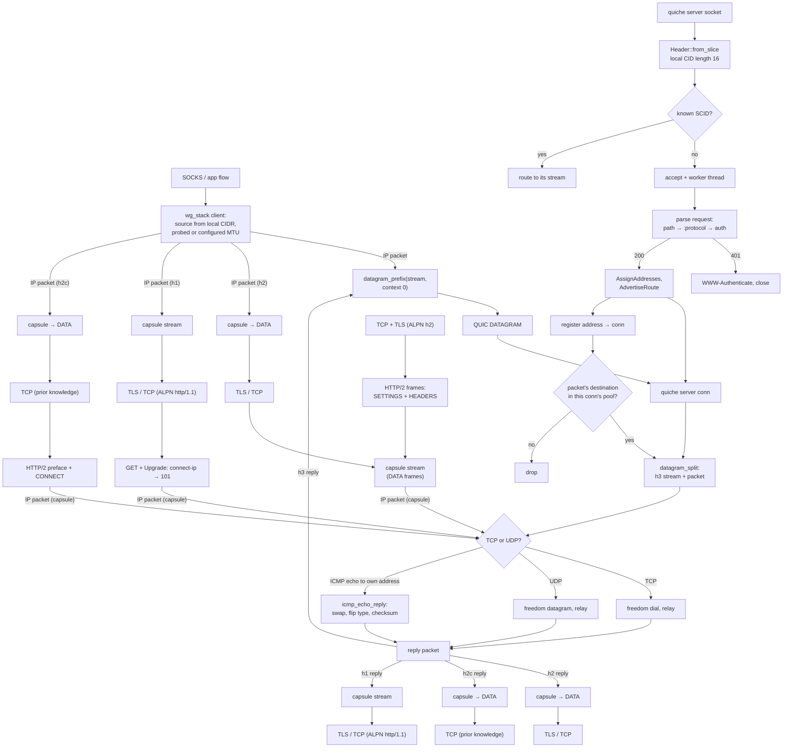

# The MASQUE carrier
MASQUE is the RFC 9484 CONNECT-IP row, carried as the `masque` transport and as a `protocol: masque` inbound. The client uses quiche/HTTP-3 unless the configured ALPN names `h2` without `h3` (TLS/HTTP-2) or `http/1.1` with neither (TLS/HTTP-1.1), and uses cleartext prior-knowledge HTTP/2 only when `security: none` is explicit. A TLS inbound serves HTTP-3 on UDP and, when its ALPN names `h2` or `http/1.1`, HTTP-2/HTTP-1.1 on TCP on the same port; a cleartext inbound serves only HTTP/2. WARP is refused on h1 and cleartext.

An HTTP/3 `CONNECT` names `/.well-known/masque/ip/*/*/`, `:protocol connect-ip` and a Basic credential; the server answers `200` with Capsule-Protocol, assigns one address per configured family, advertises default routes, and every IP packet then rides a QUIC DATAGRAM prefixed with the quarter stream id and a zero context byte. TCP and UDP feed the same `wg_stack` seams the WireGuard row uses, so a too-wide packet is answered with the reference's ICMP Packet Too Big and the writer narrows to the named MTU; an ICMP echo to the device's own address is answered at both families. `MasqueOut::udp_forwarder` exposes the stack as a fixed-target datagram lane for a tunnel inside this one (row 199).

The server owns an address pool from the configured prefixes, one address per family per connection, the 401 challenge, the 503 on exhaustion, and the per-capsule DATA frames. `settings.warp: true` opts into Cloudflare's dialect: `/` accepts `:protocol cf-connect-ip` without Basic auth from the same pool, while `connect-ip` on the configured path still authenticates. Address containment is the reference's `inPool` (network and broadcast addresses included, never handed out), and a subnet grant narrows to its first host. The reference's flat `address`/`port` settings and `users`/`clients` rows with `pass` read the same edge and table; the nested `server` object and `password`/`account.password` remain the second way. The configured `host` wins over SNI for the request authority, the path is compared after percent-decoding, and the user's email compares case-insensitively. A WARP block is client-only: it mints a P-256 certificate from `privateKey`, presents it in mutual TLS, pins the edge's `SubjectPublicKeyInfo`, sends `:protocol cf-connect-ip` with draft-datagram setting `0x276`, uses a 20-byte connection id, and takes `address` as static local prefixes.

The dialer maps the user-agent selector to the pinned Chrome UA for `chrome`, `firefox`, `safari`, `edge` and `curl`; `golang` and empty send none, absent sends Chrome. `remoteDNS` defaults to Cloudflare's four resolvers, two per family, each asked inside the tunnel over an inner UDP flow filtered by the assigned families; the host resolver remains the fallback. `enable_dgram` sets quiche's `MAX_DATAGRAM` receive depth and `DGRAM_INFLIGHT` (32) send depth; a full send queue holds the packet and the caller retries after a flush, and `dispatch` wakes the worker whose queue it wrote so a burst leaves on arrival rather than on the 10 ms retransmission tick. An h2 edge refused while its listener binds is redialled for a second, the window QUIC retransmission already covers; after every received event the worker sweeps a due QUIC deadline.

A lane that closes shortly after opening no longer turns every packet into a handshake. The first dial is immediate; after that each failed connect, and each lane that closed before living ten seconds, advances a one-second delay doubling to a minute, while a call inside the wait fails with `masque: reconnecting in …`. A lane that lived past ten seconds clears the history, so an established tunnel that later dies reconnects at once. The reference clears on any established connect; this tree requires the ten-second hold so an edge that accepts, assigns and closes cannot keep flapping.

The HTTP/1.1 carrier is the RFC 9484 §4.2 upgrade: `GET` with an absolute URI, `Connection: Upgrade`, `Upgrade: connect-ip` and `Capsule-Protocol: ?1`; the 101 answer switches the same TLS stream to capsules. The cleartext carrier is prior-knowledge HTTP/2 without ALPN when `security: none` is explicit; both roles refuse WARP there because Cloudflare's endpoint authenticates with TLS.

Every client carrier holds at most 64 datagrams and 1 MiB of datagram bytes before its stack attaches; the next datagram ends the session. The handshake clock starts when the wire is wrapped, stays armed through the preface and CONNECT/address negotiation, and is checked between frames. The h2 roles retain at most 64 queued bodies while a send window is stalled; a full queue parks that role, and only a control answer past the cap ends the session. Each immediate DATA frame is one write (`frame_head` and body share one buffer); the server gathers queued packets into one frame per 8 KiB batch, keeping every body inside h2's 16 KiB limit. A stalled window holds one queued frame per burst rather than per datagram. The download returns receive credit in a batch: one connection and stream `WINDOW_UPDATE` pair, both frames in one write, once 64 KiB arrives. The read after one that landed bytes waits a 250 µs tail rather than the 10 ms idle wait, so the reply a stack one hop behind the tunnel owes leaves on the next visit; a read that timed out restores the idle wait, and `masque_h2::tests::a_landed_read_arms_the_tail_and_a_timeout_restores_the_idle_wait` witnesses both.

The transport seams are shared. `finalmask.udp` wraps the h3 socket (encode before the relay/obfuscation layers, decode after they are stripped, serving-side filter before the stack); `finalmask.tcp` is the `Connection::Masked` chain under TLS for h1/h2 and over bare TCP for h2c; `finalmask.quicParams` replaces the fixed QUIC shape, with no block running the reference's BBR at the standard profile. `congestion` selects `reno`, `cubic`, `bbr` or a named Brutal profile (mapped to BBR because pinned quiche has no Brutal sender); `bbrProfile`, the four receive windows, `maxIdleTimeout`, `maxIncomingStreams`, `disablePathMTUDiscovery`, `disableGSO`, `keepAlivePeriod` and `disableStatelessReset` apply. `streamSettings.sockopt` reaches the h3 UDP socket, the h2/h1 dial and the server listeners; `mark`, `interface`, keepalive, congestion, the three TCP bounds, `customSockopt`, `domainStrategy` and `addressPortStrategy` apply, `dialerProxy` routes the edge dial, and `happyEyeballs`, `penetrate`, `tcpMptcp`, `receiveOriginalDestAddress`, `acceptProxyProtocol`, `v6only` and `trustedXForwardedFor` warn by name. After establishment the lane's MTU is `dgram_max_writable_len()` less the prefix.
=======
The HTTP/2 client and server retain at most 64 queued bodies while a send window is stalled — one capsule per client control answer, one 8 KiB burst frame per server batch — and a full queue parks that role instead of ending it: the pull from its packet channel stops, the packet stays in the channel, and a peer granting credit resumes both. Only a control answer arriving past the cap ends the session. Each DATA frame that leaves straight from a tunnel packet or a reply capsule uses one write — `frame_head` and the body share one buffer, so the head is never a record of its own — and the server gathers every packet already queued into one frame per 8 KiB batch, keeping every body inside h2's 16 KiB default frame limit (a body past it, or a single oversized datagram, takes the queued path that already splits by credit), so the peer parses one frame head per burst instead of one per datagram and the drain continues past a full batch in the same turn: `a_burst_leaves_as_one_data_frame` counts four capsules in one write, `a_burst_keeps_every_body_inside_the_frame_limit` counts a 64-datagram burst into frames no body of which passes 16 384 bytes, and a stalled window therefore holds one queued frame per burst rather than one per datagram, which `a_stalled_send_window_bounds_the_queued_capsules` bounds by entry and byte. A control answer now leaves `Wire::send` as one record when its body is at most 512 octets, head and body written from the same frame; a larger control body keeps the two writes; a body drained from the 64-slot queue now leaves in one write per DATA frame from the reused frame buffer, which `queued_capsules_flush_when_the_peer_grants_window` counts for a whole capsule and `a_partially_credited_capsule_leaves_one_write_per_frame` counts across a split credit. The handshake clock is cleared only once the queue is empty, so a flush that still holds capsules keeps the deadline armed. The read a burst takes waits the 250 µs tail rather than the 10 ms idle wait: a stack one hop behind the tunnel replies on the next visit, so the visit's read, its flush and the peer's answer are not parked behind an idle timer, and a read that timed out restores the idle wait so a quiet session still sleeps. `masque_h2::tests::a_landed_read_arms_the_tail_and_a_timeout_restores_the_idle_wait` witnesses the arm and the restore; what this did not remove is the idle wait itself and one read per visit — the tail lowers how long a busy session waits, not how many syscalls it takes. `masque_h2::tests::a_stalled_client_window_bounds_its_answers`, `a_stalled_send_window_bounds_the_queued_capsules`, `an_overflow_stops_draining_the_packet_channels`, `a_data_frame_leaves_the_wire_in_one_write`, `a_burst_leaves_as_one_data_frame`, `queued_capsules_flush_when_the_peer_grants_window` and `a_partially_credited_capsule_leaves_one_write_per_frame` check the boundary, the parking, the framing, the burst, the recovery and the split credit. Ended or closed sessions leave pending capsules and packet channels untouched, checked by `ended_or_closed_sessions_leave_capsules_and_channels_untouched`. The capsule encoding is unchanged; the cap counts queued frames rather than datagrams, and their retained payload allocations remain. What this did not remove: the 64-slot queue and the `Vec` each queued frame owns, and one `write` per DATA frame — the frame build saves the head's separate write, the server's per-datagram allocation and one frame head per burst, not the frame itself.

## Data path

<!-- counts:begin -->
| key | value | checked by |
| --- | --- | --- |
| ops-retired-instructions | UNBLESSED | scripts/count-ops.sh |
| tcp-echo-round-trips | 1 | ferrox-app-masque::tests::a_tcp_flow_crosses_the_tunnel_to_a_freedom_dial |
| ipv6-tcp-echo-round-trips | 1 | ferrox-app-masque::tests::a_tcp_flow_crosses_the_tunnel_over_ipv6 |
| udp-echo-round-trips | 1 | ferrox-app-masque::tests::a_datagram_flow_crosses_the_tunnel_to_a_freedom_dial |
| wrong-password-status | 401 | ferrox-app-masque::tests::a_wrong_password_is_refused_with_401 |
| path-forms-witnessed | 5 | ferrox-app-masque::tests::a_request_path_reads_the_way_xray_parses_it |
| reference-edge-spellings | 2 | ferrox-app-masque::tests::the_reference_settings_spellings_read_the_same_edge |
| reference-user-spellings | 4 | ferrox-app-masque::tests::the_reference_user_spellings_serve_the_same_table |
| pool-contained-addresses-witnessed | 2 | ferrox-app-masque::tests::a_pool_holds_every_address_its_prefix_covers |
| pool-outside-addresses-witnessed | 1 | ferrox-app-masque::tests::a_pool_holds_every_address_its_prefix_covers |
| subnet-grants-witnessed | 2 | ferrox-app-masque::tests::a_subnet_grant_names_its_first_host |
| datagram-prefix-round-trips | 1 | ferrox-app-masque::tests::the_datagram_prefix_round_trips |
| assignment-outcomes-witnessed | 5 | ferrox-app-masque::tests::an_address_capsule_withdraws_what_it_no_longer_grants |
| icmp-too-big-shapes | 2 | ferrox-core-foxy::connectip::tests::a_packet_too_big_swaps_the_addresses_and_verifies_at_both_versions |
| icmp-too-big-edges | 5 | ferrox-core-foxy::connectip::tests::a_packet_too_big_copies_options_and_refuses_a_narrow_mtu |
| icmp-mtu-narrows | 2 | ferrox-app-wg-stack::tests::a_packet_too_big_narrows_the_device_mtu |
| icmp-too-big-responses | 1 | ferrox-app-masque::tests::a_packet_wider_than_one_datagram_is_answered_with_icmp |
| datagram-send-queue-depth | 32 | ferrox-app-masque::tests::a_full_datagram_queue_refuses_the_next_packet |
| dials-per-ten-second-flap | 4 | ferrox-app-masque::tests::a_flapping_edge_is_dialled_on_the_backoff_not_per_packet |
| echo-replies | 2 | ferrox-core-connectip::tests::an_echo_request_is_answered_at_both_families |
| echo-refusals | 3 | ferrox-core-connectip::tests::a_message_that_is_not_an_echo_request_leaves_the_buffer_alone |
| echo-answers-on-the-client | 2 | ferrox-app-wg-stack::tests::an_echo_to_the_devices_own_address_is_answered_on_the_tunnel |
| echo-answers-on-the-server | 1 | ferrox-app-wg-stack::tests::a_server_answers_an_echo_to_its_own_address |
| h2-datagram-round-trips | 1 | ferrox-app-masque-h2::tests::an_h2_tunnel_assigns_and_carries_a_datagram |
| h2-dialer-round-trips | 1 | ferrox-app-masque::tests::a_datagram_flow_crosses_the_h2_tunnel_to_a_freedom_dial |
| h2-tcp-echo-round-trips | 1 | ferrox-app-masque::tests::a_tcp_flow_crosses_the_h2_tunnel_to_a_freedom_dial |
| h1-tcp-echo-round-trips | 1 | ferrox-app-masque::tests::a_tcp_flow_crosses_the_h1_tunnel_to_a_freedom_dial |
| h2c-tcp-echo-round-trips | 1 | ferrox-app-masque::tests::a_tcp_flow_crosses_the_h2c_tunnel_to_a_freedom_dial |
| carrier-alpn-choices-witnessed | 8 | ferrox-app-masque::tests::the_carrier_follows_the_alpn_list |
| h3-datagram-send-allocations | 0 | ferrox-app-masque::tests::a_queued_datagram_is_the_buffer_the_caller_built |
| h3-forward-buffer-reallocations | 0 | ferrox-app-masque::tests::a_forwarded_datagram_is_the_buffer_that_arrived |
| h3-deliver-buffer-reallocations | 0 | ferrox-app-masque::tests::a_delivered_datagram_is_the_buffer_that_arrived |
| h3-forward-stack-prefix-bytes-moved | 0 | ferrox-app-masque::tests::a_forwarded_datagram_is_the_buffer_that_arrived |
| h3-deliver-stack-prefix-bytes-moved | 0 | ferrox-app-masque::tests::a_delivered_datagram_is_the_buffer_that_arrived |
| h2-frame-body-allocations | 0 | ferrox-app-masque-h2::tests::a_frame_body_is_read_where_it_landed |
| h2-capsule-staging-allocations | 0 | ferrox-app-masque-h2::tests::a_whole_capsule_is_read_where_it_landed |
| h2-datagram-packet-queue-copies | 0 | ferrox-app-masque-h2::tests::a_datagram_capsule_goes_straight_to_its_lane |
| h2-queued-capsule-cap | 64 | ferrox-app-masque-h2::tests::a_stalled_send_window_bounds_the_queued_capsules |
| h2-capsules-in-a-four-packet-burst | 4 | ferrox-app-masque-h2::tests::a_burst_leaves_as_one_data_frame |
| h2-downlink-frame-body-cap | 16384 | ferrox-app-masque-h2::tests::a_burst_keeps_every_body_inside_the_frame_limit |
| h2-writes-per-immediate-data-frame | 1 | ferrox-app-masque-h2::tests::a_data_frame_leaves_the_wire_in_one_write |
| h2-writes-per-queued-data-frame | 1 | ferrox-app-masque-h2::tests::a_partially_credited_capsule_leaves_one_write_per_frame |
| early-datagram-cap | 64 | ferrox-app-masque::tests::poll_refuses_a_pre_stack_datagram_flood |
| early-datagram-byte-cap | 1048576 | ferrox-app-masque::tests::early_h3_datagrams_are_bounded_by_count_and_bytes |
| quic-v2-generic-default | off | ferrox-app-masque::tests::the_quic_v2_setting_is_opt_in_for_generic_masque |
| quic-v2-bait-bytes | 1200 | ferrox-app-masque::tests::the_bait_is_a_v2_versioned_long_header_of_the_minimum_size |
| quic-v2-bait-answer | consumed | ferrox-app-masque::tests::the_bait_triggers_a_version_negotiation_from_a_v1_only_server |
| h3-lane-prefix-bytes-moved-per-datagram | 0 | ferrox-app-masque::tests::a_lane_datagram_keeps_its_prefix |
| paced-write-clock-reads | 1 | ferrox-app-masque::tests::a_paced_write_reads_one_clock |
<!-- counts:end -->

The row 202 noise hook is the HTTP/3 client's: `masqueSettings.noize` is read into `ClientSpec`, and `attempt` sends that profile's junk and `i1`/`i2` before `quiche::connect`, so the QUIC ClientHello follows them. The default is `off` when the setting is absent; WARP-generated MASQUE settings always write `firewall` unless the operator chooses another profile. HTTP/2 and HTTP/1.1 have no pre-handshake UDP datagrams and take no noise, and the server role is unchanged. `noize::tests::masque_signatures_follow_the_reference_order` and `noize::tests::an_off_profile_sends_nothing` are the checkers.

The row 203 opener is the HTTP/3 client's too: `masqueSettings.quicV2` is read into `ClientSpec`, and `attempt` sends one 1200-byte long header carrying QUIC v2 `0x6b33_43cf` before the noise and `quiche::connect`, waits up to 600 ms (twice; 500 ms once on a probe) for Version Negotiation, consumes the answer, and runs the ordinary v1 handshake on the same socket. The setting is off for generic MASQUE; WARP writes `true` and `--no-quic-v2` or `AETHER_QUIC_V2` turns it off. HTTP/2 and HTTP/1.1 send no pre-handshake datagram, and the MIM inner hop carries none. `ferrox-app-masque::tests::the_bait_is_a_v2_versioned_long_header_of_the_minimum_size` and `ferrox-app-masque::tests::the_bait_triggers_a_version_negotiation_from_a_v1_only_server` are the checkers.

## Time

No duration is quoted here. The matrix's `masque-down-8` h3 cell, the `masque-h2` cell, the ferrox-only `masque-h1`/`masque-h2c` cells, and the `TestMasque*` conformance runs are CI-only; a local number would measure this machine's tunnel, so the page carries `UNBLESSED` for the retired-instruction count until the `ops.yml` artefact is read.

The server leg's 0.15x ack clock points at the inner congestion window: the peer coalesces acknowledgements, and a window that grows by one segment per acknowledgement turns slow start into a linear ramp. Removing that window collapsed the server leg on its first `masque-down-8` run; bounding it at 64 KiB lifted the ferrox client to 176.67 MiB/s but left the xray-core client at 0.02x (run `42609428370`), so the accepted socket keeps Cubic. The rerun after the worker-wakeup fix measured 9.56 against 70.94 MiB/s (0.13x, run `42599287743`), still below the 0.15x floor. What the counts above witness is shape, not speed: one TCP echo per family, one UDP datagram, the 401, the pool's containment rule, five assignment outcomes, the Packet Too Big at both families, the echo answers and refusals, one h2 tunnel's assignment and echoed datagram, the h2 dialer's assignment and TCP echo, the eight ALPN choices, the h1 and h2c TCP echoes, the reference's flat and nested outbound spellings, and the ICMP shapes.

## What we removed

- **A second clock read per paced write.** `Pacer::account` read `Instant::now()` to earn tokens and read it again to move `last`, so an h3 datagram the pacer held back cost two reads; a write that does not sleep reads once now, and a sleeping one re-reads only after the sleep it must not credit to the next write. `a_paced_write_reads_one_clock` accounts three writes against a full token bucket and pins three reads (`paced-write-clock-reads 1`); the tokens earned and the sleep are the same.

- **A clock read per drained h2 frame.** `Client::pump` stamped `last_frame` inside the per-frame handler, so a burst of k frames read the clock k times. The stamp is one read per pump, after the drain; the keepalive compare only asks whether a frame arrived since the ping, so the gated value is unchanged. No row: a clock read the tree does not count.

- **The terminating server's separate packet forwarder.** The reference carries a dedicated CONNECT-IP server with its own netstack; this tree feeds the same `wg_stack` the WireGuard row owns, so the capsule parser, the pool and the demux are the only new code. A client opting into `largeSegments` advertises 65,495/65,475, the server writes 65 KiB TCP segments and splits them into 1,344-byte inner fragments; the default is 1,240/1,220, and the SYN-ACK advertises 1,240 for IPv4 and 1,220 for IPv6 at the default 1,280-byte MTU. `wireguard.md` carries the counts.

- **A copy of the flow source.** The client's stack resolves the source from the local CIDR once per flow, and the datagram prefix borrows the packet it was handed; no byte of the IP packet is copied to add the prefix.

- **The reference's per-request address manager.** The pool is one masked prefix per family, assigned and released under one lock, with no goroutines or retry timers; an exhausted family is answered 503 rather than queued.

- **The reference's HTTP/2 transport, both halves.** `golang.org/x/net/http2` is replaced by this tree's frame head and HPACK decoder: the preface, SETTINGS with `ENABLE_CONNECT_PROTOCOL`, the extended CONNECT head, DATA and WINDOW_UPDATE are handwritten for the listener and dialer, the dialer keeps stream and connection send windows apart, and capsule bodies reuse the `connectip` encoders. The dialer still reads on the listener's 10 ms wait, so a packet queued while the socket is quiet leaves on that turn.

- **The reference's missing HTTP/1.1 and cleartext carriers.** Neither xray-core's masque transport nor aether's connect-ip path implements the RFC's `Upgrade: connect-ip` or h2c; this tree adds both behind the same request and capsule path, so a config naming `http/1.1` or `security: none` is served instead of refused.

- **The h3 handoff copy and the h2 frame staging.** `send_datagram` hands quiche the prefixed buffer it built instead of a slice quiche copies into a second `Vec`; `read_datagrams`, `io` and `Stream::poll` take quiche's owned receive buffer and carry the prefix offset into the stack; the UDP lane keeps the prefix where it arrived. The h2 reader returns a frame body's range, the dialer parses a whole capsule where it landed, and `Wire::fill` reads into the tail of `pending` with `proxy::read_into_tail_room`, so a frame lands in the buffer the walk owns. The bytes, the read quantum and the frame walk are unchanged; the listener still stages its capsules and a split capsule is staged until its tail arrives.

- **The WARP server dialect Aether needs.** Aether's client speaks `cf-connect-ip` and assigns itself an address; the server mode accepts that request at `/` without Basic auth while leaving the default inbound credential-gated. It is off unless `settings.warp` names it; the WARP outbound block is still client-only.

What is **not** removed, named: on h3 the tunnel-to-tunnel handoff still moves the packet to the front of its buffer, while the UDP lane hands the prefix offset; on h2 a datagram still crosses one `Vec` into its lane or stack. A wide server segment is copied into each 1,344-byte fragment and reassembled into one buffer on the client; `wireguard.md` names that path. A too-wide packet is answered with the reference's ICMP Packet Too Big: the composer swaps the addresses, copies the header and eight bytes (or 1,232 for v6), and the v6 checksum covers the pseudo-header; the writer narrows to the named MTU. An echo to the device's own address is answered at both families, and any other ICMP is left unanswered. A post-establish `ADDRESS_ASSIGN` that omits or refuses an address closes the lane; the next flow opens a new lane. The h2 listener keeps one thread per connection and a 10 ms read wait, admits at most 256 live connections, and the HTTP/1.1 and cleartext carriers share that listener and cap; cleartext is reachable only by an explicit `security: none`.

<!-- scope:begin -->
- paths: crates/ferrox-app/src/masque.rs, crates/ferrox-app/src/masque_h1.rs, crates/ferrox-app/src/masque_h2.rs
- symbols: masque
- go: ./proxy/masque/...
<!-- scope:end -->
