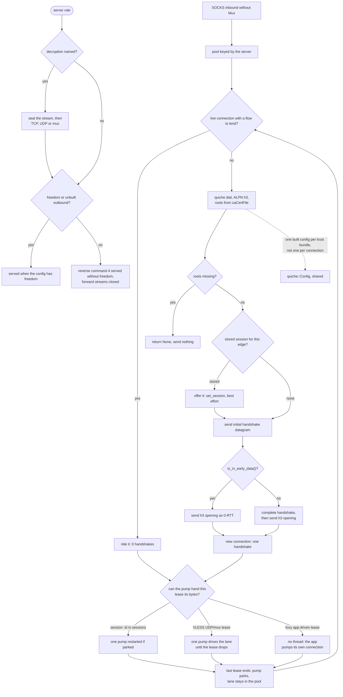

# The QUIC carrier

QUIC is the default transport for VLESS, VMess, Trojan, Hysteria and MASQUE lanes. The server serves a `vless` inbound on `security: tls` with a certificate (`serve_vless_quic`) when the config has a `freedom` outbound or an unbuilt one; a config without either still serves a reverse account's command 4 and closes every forward stream. Each bidirectional stream is one VLESS session: TCP, UDP (`[0,0]` then length-framed datagrams) or mux (`serve_sealed_mux_split`). The UUID and flow check runs before accept; a stranger or Vision flow closes the stream, while a reverse account attaches the reverse session instead of relaying a target. The client dials the same three; `dial_quic_udp_uplink` and `open_vless_mux_quic` take a `pumped_stream_within` lease, and the lane's pump drives the connection while the lease reads its own stream. ALPN is `h3`.

The server serves every `tlsSettings.certificates` entry by SNI. With `rejectUnknownSni` off an absent name answers the first entry; with it on an absent or unmatched name is refused. A Trojan inbound on the same lane reads its header off the stream and adds no acknowledgement. Hysteria v2 and v1 share the same builder. quiche is the default QUIC stack.

One handshake per server is shared by N streams, including the N that arrive one after another. A lane that outlives its last lease is parked, not closed: the connection, its stream ids and its bound socket stay in the pool. `lend` starts a pump only when the pump can serve the lease; a foxy h3 tunnel is app-driven and starts no second reader. Two bounds keep a parked lane from becoming a pin: quiche's idle timeout, read at lookup, and `flows-per-lane-before-it-is-handed-back` (64, inside the 100-stream `MAX_STREAMS` grant).

Every `bind_datagram` socket asks for a 256 KiB receive buffer at bind, one `setsockopt` off the hot path. The outbound's `streamSettings.sockopt` lands before the bind that fixes the route, and the interface goes on before the mark on Linux. The lane's opening credit is `MAX_DATA` 16 MiB across a connection and `MAX_STREAM_DATA` 4 MiB per stream. The autotuning ceiling is `in_flight(1 Gbit/s, 256 ms)` = 32,000,000 bytes across a connection and `in_flight(1 Gbit/s, 64 ms)` = 8,000,000 per stream: one flow can saturate a gigabit at 64 ms, four can share the connection at that distance. A window is a rate times a delay, so a 1 MiB window is 80 Mbit/s at 100 ms. Under load the process holds the bandwidth-delay product; a lane nobody reads grows nothing.

`quic::apply_lane_congestion` selects the controller from the lane's `congestion`: `reno`, `cubic`, `bbr`, `brutal` or `force-brutal`. `bbr` and `brutal` both land on quiche's BBR2. `bbrProfile` maps onto BBR2's published gains: standard overrides nothing, conservative uses 1.75/2.25 and two rounds, aggressive uses 2.25/3.0 and four. The choice is config-time because quiche cannot swap a controller after the handshake. MASQUE and the xhttp h3 client default to BBR; raw VLESS, VMess and Trojan keep CUBIC. Not reproduced: the reference's own BBR sender, which `upstream/xray-rust/tools/bbr-oracle` can drive, and `brutalDisableLossCompensation`, which names a sender this lane does not have. `every_controller_carries_the_same_bytes` is the byte-identity gate: 64 KiB over a loopback lane under each controller.

Roots are required. A dial without `caCertFile` returns `None` and sends nothing, which `quic_outbound_reads_ca_cert_file` covers. A lane that has lent its whole grant leaves the pool so the caller dials a fresh one, and only a lane no lease rides gets the `done` frame. A refused datagram that clears (`EWOULDBLOCK`, `EINTR`, `ENOBUFS`) is held on the lane in quiche's order and retried before the next sweep, bounded at 256 datagrams. The pump takes up to 64 datagrams per visit and up to 16 receives per `recvmmsg`. A 1 MB h3 read moved `recvfrom` 617 → 242, `sendto` 619 → 222, `setsockopt` 621 → 65, `getsockname` 161 → 4, and `foxy::H3::read` 140,460 → 119,175 Ir; the `ops` artefact is informational, not a gate. 0-RTT keeps one resumption blob per edge, and the h3 opening rides early. Client migration follows the route generation on a direct lane the pool drives.

## Data path



## Measured

<!-- counts:begin -->
| key | value | checked by |
| --- | --- | --- |
| ops-retired-instructions | UNBLESSED | scripts/count-ops.sh |
| zero-filled-bytes-per-relayed-frame | 3 | ferrox-app-quic::tests::a_relayed_datagram_frames_its_target_ahead_of_its_payload |
| handshakes-per-server | 1 | ferrox-app-proxy::tests::quic_pool_shares_one_connection_between_two_streams |
| streams-left-open-per-flow | 0 | ferrox-app-proxy::tests::quic_pool_shares_one_connection_between_two_streams |
| server-roles | 1 | ferrox-app-proxy::tests::quic_serves_vless_echo_over_loopback |
| dialled-without-ca-cert-file | 0 | ferrox-app-proxy::tests::quic_outbound_reads_ca_cert_file |
| lanes-held-after-the-last-lease | 1 | ferrox-app-foxy::loopback::a_lane_outlives_its_leases_and_the_next_flow_rides_it |
| pump-threads-owned-by-an-idle-lane | 0 | ferrox-app-proxy::tests::quic_dials_loopback_echo |
| pump-threads-started-by-an-app-driven-lease | 0 | ferrox-app-foxy::loopback::a_lane_outlives_its_leases_and_the_next_flow_rides_it |
| flows-per-lane-before-it-is-handed-back | 64 | ferrox-app-foxy::loopback::a_lane_that_lent_its_whole_grant_of_flows_is_handed_back |
| receive-buffer-floor-bytes-armed-per-lane | 262144 | ferrox-app-quic::tests::a_quic_socket_arms_both_of_its_buffers |
| send-buffer-floor-bytes-armed-per-lane | 262144 | ferrox-app-quic::tests::a_quic_socket_arms_both_of_its_buffers |
| quic-bytes-parked-per-unread-stream | 4194304 | ferrox-app-proxy::tests::an_edge_cannot_park_more_than_the_window_unread |
| quic-bytes-parked-per-unread-connection | 16777216 | ferrox-app-proxy::tests::an_edge_cannot_park_more_than_the_window_unread |
| stream-window-ceiling-bytes | 8000000 | ferrox-app-quic::tests::the_window_ceiling_leaves_the_autotuner_room |
| connection-window-ceiling-bytes | 32000000 | ferrox-app-quic::tests::the_window_ceiling_leaves_the_autotuner_room |
| send-datagram-bytes | 1350 | ferrox-app-quic::tests::the_lane_sends_the_datagram_its_buffer_holds |
| route-key-copies-per-packet | 0 | ferrox-app-quic::tests::a_route_key_is_a_window_into_the_packet |
| send-slot-buffer-borrows-per-empty-sweep | 0 | ferrox-app-quic::tests::a_sweep_borrows_a_buffer_only_where_quiche_writes |
| send-slot-buffer-borrows-per-written-slot | 1 | ferrox-app-quic::tests::a_sweep_borrows_a_buffer_only_where_quiche_writes |
| route-key-allocations | 0 | ferrox-app-quic::tests::the_route_key_replaces_the_allocating_header_parse |
| quic-config-builds-per-warm-dial | 0 | ferrox-app-quic::tests::one_trust_bundle_shares_its_built_config |
| quic-config-lookup-allocations | 0 | ferrox-app-quic::tests::a_warm_config_lookup_allocates_nothing |
| quic-resumed-dials-before-each-cold-one | 1 | ferrox-app-quic::tests::a_second_dial_to_an_edge_leaves_with_early_data |
| client-migrations | 1 | ferrox-app-quic::tests::a_stream_migrates_its_connection_to_a_new_local |
| congestion-controllers | 3 | ferrox-core-hysteria::tests::congestion_spellings_map_to_the_paced_default |
| bbr-profiles | 3 | ferrox-app-quic::tests::the_three_profiles_move_the_gains_and_nothing_else |
| bbr-knobs-set-by-a-profile | 8 | ferrox-app-quic::tests::the_three_profiles_move_the_gains_and_nothing_else |
| standard-profile-overrides | 0 | ferrox-app-quic::tests::the_three_profiles_move_the_gains_and_nothing_else |
<!-- counts:end -->

## Ops

```bash
./scripts/count-ops.sh report proxy::tests::quic_pool_shares_one_connection_between_two_streams 'quic::dial_pooled'
./scripts/count-ops.sh report foxy::loopback::the_quic_carrier_rides_a_socks5_upstream_and_carries_the_bytes 'quic::flush_egress' 'quic::pump_once'
./scripts/count-ops.sh report proxy::tests::quic_dials_loopback_echo 'quic::pump'
./scripts/count-ops.sh report foxy::loopback::a_lane_outlives_its_leases_and_the_next_flow_rides_it 'quic::pooled_stream_within'
./scripts/count-ops.sh report quic::tests::a_quic_socket_arms_its_receive_buffer 'quic::bind_datagram'
./scripts/count-ops.sh report foxy::loopback::the_h3_downlink_hands_the_caller_the_frame_without_staging_it 'quic::flush_egress' 'quic::flush_burst'
./scripts/count-ops.sh report proxy::tests::quic_serves_vless_echo_over_loopback 'quic::serve_loop'
./scripts/count-ops.sh report quic::tests::a_two_entry_identity_builds_every_context 'quic::tls_config'
```

`UNBLESSED`: the carrier's ops row stays open until a Linux run reads `append_pem`; `scripts/count-ops.sh` needs valgrind, which has no macOS/aarch64 build. The other commands read `flush_egress` and `pump_once`, the pump thread, the per-lane `setsockopt`, `flush_burst`, `serve_loop` and `tls_config`. CI `ops` artefacts are informational, not blessed. The receive batch is 16 and the send batch is 64. `quic::serve_loop` moved 3,395,264 → 3,273,322 Ir with `recvfrom` 84 → 15 and `recvmmsg` 74 → 88; `quic::tls_config` read 520,125 Ir on a two-entry identity. No number here is a gate.

## Time

QUIC throughput is measured only by CI (`speedtest.yml`, `foxy-relay.yml`); a local run measures the tunnel. `foxy-relay.yml` restarts the lane for every carrier row and takes one flow per row, so every row is a cold lane: `carrier h3` reads 1.04–2.40 MiB/s and `carrier h3 bulk` 1.48–5.65 where `carrier h2 bulk` reads 24.68–88.41, and h3's 200 KiB warm legs take 0.36–0.58 s where h2's take 0.08–0.21 s. After the second-reader removal, `carrier h3 bulk` answered the same 10 MiB in 0.46 s instead of 6.68 s. That is a duration, not a gate. A sequential-flow rate needs a row that takes N flows on one lane; none exists, so reuse is gated by pointer identity and its rate is an open claim. The window ceiling is invisible to a 1 MB leg, which is inside the opening credit; the 10 MiB bulk leg is the one that sees it.

## What we removed

- **A handshake per stream.** The pool is the only way in, so there is no per-stream dial path to regress into. Gates: `quic_pool_shares_one_connection_between_two_streams`, `sixteen_flows_at_once_all_arrive_whole`.
- **The 24 MiB an edge could spend against the process.** The opening credit is 16 MiB per connection and 4 MiB per stream, and the autotuning ceiling is 32,000,000 and 8,000,000 bytes. `an_edge_cannot_park_more_than_the_window_unread` observes both parked rows and shows the cap rolls back when the lane drains.
- **A thread per idle lane and a second reader of a flow's socket.** `pump` parks when the socket is quiet and no lease rides the table; `lend` asks before it spawns, so an app-driven foxy lease starts no thread. Gates: `a_lane_outlives_its_leases_and_the_next_flow_rides_it`, `pump-threads-started-by-an-app-driven-lease 0`, `pump-threads-owned-by-an-idle-lane 0`.
- **A PEM round trip and a temp file before every serve.** The identity goes to BoringSSL as DER through `tls_config`, and one context is built per certificate entry for the SNI callback. The three SNI tests are the correctness gates.
- **A trust bundle staged once per connection.** The config is built once per trust bundle and dialed under its own lock; `quic-config-builds-per-warm-dial 0` and `quic-config-lookup-allocations 0` are the gates, asserted by address.
- **Three zero passes per datagram.** `flush_egress`, `pump_once` and a relayed `Datagram::send_to` use `quic::Unfilled`, so the first store is the writer's. The relay frame's three reserved bytes are filled explicitly; `a_relayed_datagram_frames_its_target_ahead_of_its_payload` holds the whole frame.
- **A syscall per datagram in each direction.** Sends use `sendmmsg` and receives use `recvmmsg`, with the Linux-only receive batch. The `ops` artefact's syscall table is the witness; no row is blessed.
- **A refused datagram dropped.** A refusal that clears is held in quiche's order and retried, bounded at 256; `a_refusal_that_clears_is_the_only_one_held` and `a_held_datagram_is_retried_in_order` are the gates.
- **A FIN that was a reset.** The server relays through `relay_shared_then`, closes only the TCP uplink, and runs the FIN after both lanes. `quic_serves_vless_echo_over_loopback` reads the FIN and the bytes.

- **A pool buffer taken for every send slot.** A slot holds no bytes until quiche writes it, so n datagrams borrow n buffers and an empty sweep borrows none. Gates: `a_sweep_borrows_a_buffer_only_where_quiche_writes` (`send-slot-buffer-borrows-per-empty-sweep` 0, `...-per-written-slot` 1).
- **A pool entry pinned by a finished flow, and a wait note per holder.** `PooledStream::Drop` returns the stream id, and one arm record per file description replaces one per handle. Gates: `a_lane_outlives_its_leases_and_the_next_flow_rides_it`, `a_clone_carries_the_socket_it_was_cloned_from_one_arm_record`, `a_wait_undone_by_another_handle_is_armed_again_before_the_read`.
- **A `dup` per downlink burst and a stream lock between directions.** Flow handles live behind `Arc` and the drain writes through `&Connection`; a stream's two halves are independent handles. The release disassembly and `the_socket_half_reads_on_the_armed_handle` are the checkers.
- **A cold handshake per edge and a caller-driven migration.** One resumption blob per edge offers 0-RTT, and the pool follows the route's generation. Gates: `a_second_dial_to_an_edge_leaves_with_early_data`, `a_route_generation_is_followed_once_per_change`, `a_stream_migrates_its_connection_to_a_new_local`.

Not removed, and named: quiche's copy of every delivered byte into its stream buffer, the per-datagram `conn.recv`, the pump's per-connection scratch, the `setsockopt` a receiving visit pays, the VLESS encryption handshake and framing on a sealed stream, and the park latency (`PUMP_POLL`). The window cap trades a bound for a rate: a lane that reads slower than one 16 MiB opening credit per round trip paces its edge.

## Pins

| what | where |
| --- | --- |
| the QUIC and HTTP/3 stack for this rung | `upstream/quiche` @ `3fc9bc1c` |
| connection pooling, 0-RTT, migration | `upstream/sing-box/common/` |
| multiplexed QUIC schedulers, reorder and reinjection | `upstream/mqvpn` |

## CI scope

What a change here owes, read by `scripts/ci-scope.py`; see [`docs/ci-scope.md`](../ci-scope.md).

<!-- scope:begin -->
- paths: crates/ferrox-app/src/quic.rs
- symbols: quic
- scenarios: vless-quic, vmess-quic, trojan-quic
- engines: xray-core, sing-box, xray-core-rust
<!-- scope:end -->
