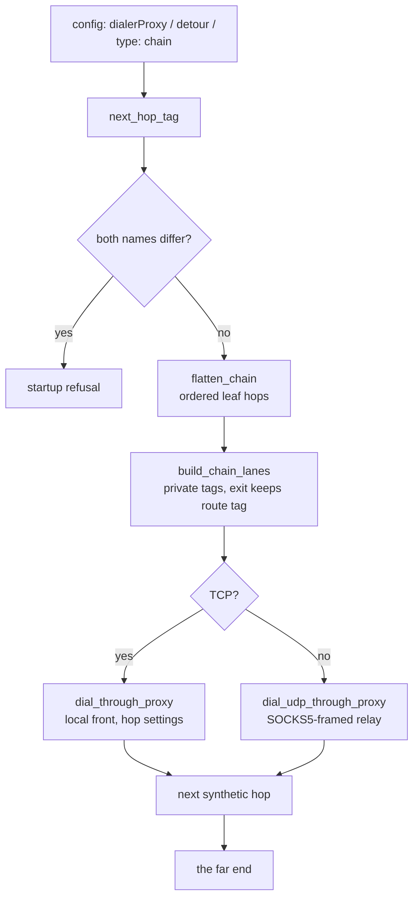

# The detour graph and ordered chains

<!-- scope:begin -->
- paths: -
- symbols: next_hop_tag, flatten_chain, ChainLane, chain_lane_tag, build_chain_lanes
<!-- scope:end -->
Row 155: an outbound may name the outbound it dials through with xray's
`streamSettings.sockopt.dialerProxy`, sing-box's top-level `detour`, or an LxBox ordered
`type: "chain"` list. All three are one hop graph. [`engine-tagged`](engine-tagged.md) is the
one-hop socket seam this page extends; [`engine-router`](engine-router.md) chooses the outbound that
starts the graph.

## The two spellings of one edge

`next_hop_tag` reads `dialerProxy` and `detour`. They are the same edge, so a config that names both
with different tags is refused; either name is accepted alone. `parse_outbound_sockopt` turns a
top-level `detour` into the same socket options `dialerProxy` already used, so the TCP dial seam and
every UDP carrier see it without a second path. `dialer_proxy` protobuf field 9 still decodes into
the same key.

A missing hop, a self-reference, and a walk that returns to an earlier tag are startup refusals.
The refusal runs before any lane is built, so the process stops rather than a flow recursing.

## The ordered chain

An LxBox chain names `outbounds` in client-to-exit order:

```json
{"tag":"chain","type":"chain","outbounds":["first","second"]}
```

`flatten_chain` enforces the list rules before a lane exists: at least two hops, no duplicate, no
missing tag, no self-reference, and a nested chain only in the first position. A chain nested first
is replaced by its own ordered hops, in place; a nested chain anywhere else and a chain cycle are
refusals. The list is the route, so a hop's own `detour` is not carried inside the chain; the
position before it is the edge.

`build_chain_lanes` builds each leaf outbound once. The exit keeps the chain's route tag. Every
earlier hop gets a private tag, and its socket options name the hop before it. The chain's route tag
carries the exit's source, options and target strategy, so a rule that names the chain reaches the
exit with the same settings it would have had directly. The private lanes are also inserted into the
route registry, which is what lets `dial_through_proxy` resolve the next edge by tag.

The first hop's socket options are kept except for the upstream edge, which the chain list already
names. A hop that cannot relay, such as `freedom`, `blackhole`, `dns`, `loopback`, `route`, the
metrics lane or the API, is refused before the exit when it appears in an intermediate position. A
hop whose carrier binds its own socket — `wireguard`, `warp`, `hysteria`, `foxy`, `veepn`, or a
QUIC/KCP/hysteria carrier — is refused after the first position rather than reaching its peer
from this machine; MASQUE takes the hop in its own spec because its carrier reads no thread-local.
A raw Shadowsocks hop without mux is refused after the first position too: its datagram lane opens
its own socket, so a hop above it would be silently lost.

## TCP and UDP

The TCP arm is the existing local-front recursion: the exit's `dial` sees its hop tag, calls
`dial_through_proxy`, and the spawned lane enters that hop's own source, socket options, target
strategy and `OutboundTag` before serving the next CONNECT. Repeating the synthetic tags walks the
list in order.

The datagram arm is the same recursion over `dial_udp_through_proxy`: the terminal freedom or carrier
lifts each destination into the named hop's UDP lane, and the hop's own options name the next hop.
A hop without a datagram lane refuses the datagram instead of falling back to the machine's route.

## Data path



## What was removed

- **Against Xray-core: an unbounded recursive `dialerProxy` walk.** Xray resolves the hop by
  recursively dialing the named outbound with no visited set, so a cycle is a runtime recursion.
  Here the same edge is flattened and cycle-checked once, before any lane exists.
- **Against sing-box: a single-resolution `detour`.** Sing-box reads one `DetourDialer` and resolves
  it once, which cannot spell an ordered list and leaves the second hop uninspected. The `detour`
  key now normalises into the same edge as `dialerProxy`, and the ordered list is the route.
- **Against ZeroNet/LxBox: a per-flow chain walk and out-of-place nesting.** The ordered list is
  flattened and built once at startup, each earlier hop gets a private registry tag, and a nested
  chain outside the first position, a missing, self, duplicate or cyclic hop is refused before the
  route table is built.
- **Against this tree's previous behaviour: a `detour` that started the process and was ignored.**
  It now reaches the existing TCP and UDP seams through the same socket options.

What is **not** removed: each hop still pays the local-front loopback pipe on TCP and the shim's
threads and SOCKS5 framing on UDP; the chain is not a pooled carrier; and a chain whose intermediate
hop has no UDP lane refuses datagrams rather than synthesising one.

## Time

Nothing here is timed by a local run. `bench.yml` and `parity.yml` have no detour-chain cell, so
this page carries no duration and quotes none. The ordered TCP and UDP walks are gated by local
tests; the instruction, syscall and copy counts are `UNBLESSED` until an `ops.yml` artefact measures
this method, and `scripts/count-ops.sh` is CI-only on macOS/aarch64.

## Gated counts

<!-- counts:begin -->
| key | value | checked by |
| --- | --- | --- |
| ops-retired-instructions | UNBLESSED | scripts/count-ops.sh |
| syscalls-per-detour-dial | UNBLESSED | scripts/count-ops.sh |
| copies-per-detour-dial | UNBLESSED | scripts/count-ops.sh |
| seconds-per-chain-dial | UNBLESSED | CI (no chain cell yet) |
| detour-tcp-hops | 1 | ferrox-app-proxy::tests::a_detour_hop_carries_the_outbound_dial |
| ordered-tcp-hops | 2 | ferrox-app-proxy::tests::an_ordered_chain_carries_tcp_through_each_hop |
| ordered-udp-hops | 1 | ferrox-app-proxy::tests::an_ordered_chain_carries_udp_through_its_hop |
<!-- counts:end -->
