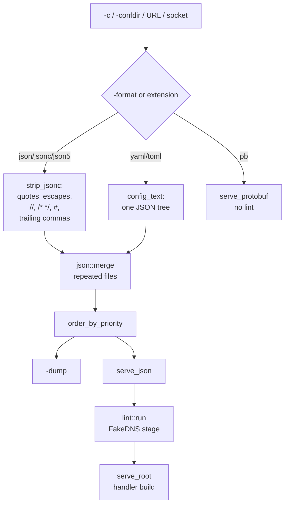

# Config formats and lint

<!-- scope:begin -->
- paths: -
- symbols: strip_jsonc, order_by_priority, source_format, config_text, strict_json, fakedns
<!-- scope:end -->

Row 178: the same configuration file xray-core reads is read here, whatever its spelling. A file is JSON, JSONC, YAML or TOML by extension, by `-format`, or by the source's own name when it is a URL or socket; `.json5` selects the same permissive reader as JSONC. The permissive reader strips the reference's comments unless `xray.json.strict` is true; repeated `-c`/`-confdir` files merge and `_priority` orders the result; and the FakeDNS post-processing stage runs before the handler build. The merge itself is [`engine-router`](engine-router.md)'s sibling row 176; this page is the reader, the format switch and the lint registry.

## The reader

`source_format` resolves an explicit `-format` first (`pb`/`protobuf`, `json`, `jsonc`, `json5`, `yaml`/`yml`, `toml`, `auto`), then the extension of the local path, URL path or socket target. JSON, JSONC and `.json5` all reach `strip_jsonc`, the reference's `infra/conf/json/reader.go` state machine: a double- or single-quoted string protects everything inside it from comment stripping (only double-quoted strings survive to the strict parser), a backslash copies the next byte outside a string, `#` and `//` run to the next LF or CR, and `/* ... */` runs to its close while keeping the newlines. Trailing commas are removed in a second pass; that is a superset, since the reference's reader rejects them. `.json5` is an alias for this reader, not full JSON5: unquoted keys, single-quoted values and extended numbers are refused by the strict parser, matching the references, none of which ships a JSON5 parser. `xray.json.strict` (or `XRAY_JSON_STRICT`) equal to `"true"` bypasses the reader and hands the bytes to the strict parser.

YAML and TOML never reach that reader. `config_text` converts either to the same JSON tree with the one writer `json::write` uses, including YAML's `<<` merge keys and duplicate-key refusal, so every later stage sees one dialect. A protobuf source is not a JSON tree and keeps its own loader.

## Merging and priority

`serve_files` decodes every file, then `json::merge` lays each over the one before: `inbounds`/`outbounds` merge by tag (a new outbound goes to the front unless the file's name contains `tail`), `env` merges by key, and every other top-level key replaces the earlier value, arrays included. Null values are skipped. After the last file, `order_by_priority` sorts each array whose items carry `_priority` smallest-first with ties in file order and drops the marker, so a rule in a late file can still be tried first. `dump_config` performs the same merge and ordering without building or serving, and exits before lint.

## The lint registry

`lint::run` walks the registry in the reference's shape. `STAGES` currently holds the one built-in stage the reference registers, `FakeDNS`, and a failure is reported as `Rejected by Postprocessing Stage <name>: <error>`. `serve_json` calls the registry before `serve_root`, so JSON, JSONC, `.json5`, YAML and TOML configs see it; `serve_protobuf` does not, matching the reference's loader.

The FakeDNS stage looks for a `fakedns` DNS server, reads `dns.queryStrategy` for the address families it permits, and injects the reference's pools only when `fakeDns` is absent or null: both families get `198.18.0.0/15` and `2001:2::/48` at 32768 entries, one family gets its own pool at 65535. An explicit pool is left alone; an explicit empty object is treated as no pool, so the resolver uses the same strategy defaults. If no inbound enables sniffing with `fakedns` or `fakedns+others` in `destOverride` (or its `destinationOverride` alias), it prints the reference's one-line warning.

## Data path

## What was removed

- **A second config dialect for YAML and TOML.** Xray-core already converts both into its JSON tree in `infra/conf/serial/loader.go`; keeping that shape means the merge, priority ordering and lint stages are written once and see the same keys. Sing-box and ZeroNet read JSON only, so no reference gains a second dialect here.
- **A comment reader that stopped at `//` and `/* */`.** The reader follows Xray-core's `infra/conf/json/reader.go` state machine: `#`, `//`, `/* */`, single-quoted strings, a backslash outside a string, and newlines inside a block comment. Trailing commas are ferrox's superset; the reference's reader rejects them.
- **A late-file rule that could not run first.** `_priority` is read after the merge and removed from the tree, so a rule appended by a later file can be ordered ahead of an earlier one. Xray-core, sing-box and ZeroNet have no `_priority`; this is ferrox's addition.
- **A `fakedns` nameserver with no pool.** The FakeDNS stage supplies Xray-core's defaults from `infra/conf/fakedns.go` by query strategy and warns when no inbound sniffs it, instead of starting with a nameserver that cannot answer. Sing-box has no equivalent lint stage, and ZeroNet's pool is its own range with settings that are not read here.

What is **not** removed: the reader walks the text twice (comments, then trailing commas); every file is parsed into an owned tree and the merged tree is serialized again for `serve_json`; `_priority` is found by a name scan rather than carried beside the value; the FakeDNS stage reads the tree by key after the merge rather than during it; and `.json5` is the permissive JSONC reader, not a full JSON5 parser — unquoted keys, single-quoted values and extended numbers are refused by the strict parser. No instruction, syscall or copy count for this path is measured yet.

## Time

Nothing here is timed by a local run — a contributor's tunnel would measure the file read, not this code. `bench.yml` and `parity.yml` have no config-format cell, so this page carries no duration and quotes none. `conformance.yml` has no reference suite that runs this binary's config loader; the format and lint behaviour is held by the unit tests named below. The instruction, syscall and copy counts are `UNBLESSED` until an `ops.yml` artefact measures this method, and `scripts/count-ops.sh` does not exist on macOS/aarch64, so that gate is CI-only here.

## Gated counts

<!-- counts:begin -->
| key | value | checked by |
| --- | --- | --- |
| ops-retired-instructions | UNBLESSED | scripts/count-ops.sh |
| syscalls-per-megabyte | UNBLESSED | scripts/count-ops.sh |
| user-space-copies-per-megabyte | UNBLESSED | no copy checker yet |
| seconds-per-megabyte | UNBLESSED | CI bench.yml (gate 3) |
<!-- counts:end -->
