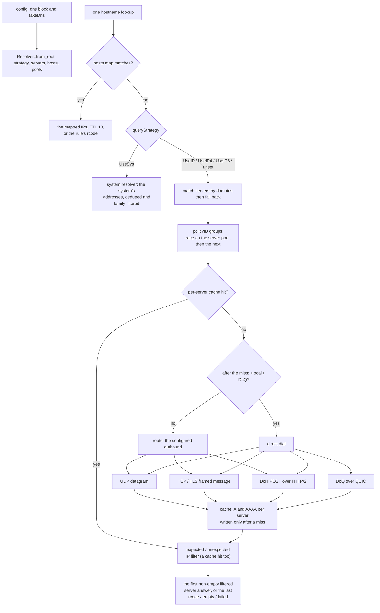

# The built-in DNS app

<!-- scope:begin -->
- paths: crates/ferrox-app/src/dnsapp.rs, crates/ferrox-app/src/dnsnet.rs
- symbols: build_query, parse_answer, resolve_endpoint
- go: ./app/dns/..., ./app/dns/fakedns/..., ./infra/conf/...
<!-- scope:end -->
Row 126: a `dns` block builds the resolver the relay's own lookups use. A question rides one server's transport — UDP, length-framed TCP, that stream under TLS, an HTTP/2 POST, or one QUIC stream — and reuses the DNS outbound's `build_query`/`parse_answer` (row 29), already replayed against pinned Go. The app keeps A and AAAA per server, honours the reference cache policy, serves `hosts` with a 10 s TTL, and allocates fake addresses from configured pools. `expectedIPs`/`unexpectedIPs` filter an answer before it can win, with `*` raising a filter to a narrowing priority; hosts `#rcode` answers that rcode instead of falling through. A protobuf `xray.app.dns.Config` decodes to the same block, filters and `actPrior`/`actUnprior` included. Server addresses dispatch through the configured route; `+local` and DoQ keep the direct dial, and a UDP server hostname resolves locally before the datagram frame is addressed. `enableParallelQuery` starts every group, returns the first non-empty answer of the earliest `policyID` group, and consults the next only when all before failed; a JSON block derives each policy ID from the reference key. The Lua `script` is named on stderr and servers are queried in order. A routed query carries its server's `tag`, or the config's, as the inbound tag rules see.

Routing's `IpIfNonMatch` and `IpOnDemand` resolve through this resolver, so a static host can steer a route before the dial.

Server forms are Xray's: bare address (UDP), `udp://`, `tcp://`, `tls://`, `https://`, `h2c://`, `quic://`, `localhost`, `fakedns`, and the `+local` spelling where pinned. DoH keeps the configured path; an empty path becomes `/`, never `/dns-query`. DoH/DoQ pin the message id to zero and carry the reference EDNS0 record — 1350-byte UDP size, class `0xfe00`, `clientIp` subnet option, random 100–300 byte DoH padding. UDP/TCP take an increasing per-server id. Per-server `domains`, `queryStrategy`, `clientIp`, `timeoutMs`, `disableCache`, `serveStale`, `serveExpiredTTL`, `skipFallback`, `finalQuery`, `port` and the root `queryStrategy`, `hosts`, `useSystemHosts`, `disableFallback`, `disableFallbackIfMatch` decode with reference spellings.

Fake pools follow the pinned allocator: network base, offset from current ms modulo pool room, first unused address, wrap, and an LRU of the configured size. The LRU is a slot arena with recency threaded through slots, so the oldest name is the head and a hit is a few index writes, not a walk. Defaults are `198.18.0.0/15` and `2001:2::/48`, 32768 names each when both families are on, 65535 for single-family, TTL 1. The family-aware lookup is what a routing script's `xray.dns.Query` calls; `domain_of` is the reverse seam. A normal `lookup` skips `fakedns` unless fake mode is asked, matching `DisableFakeDNS`.

## Data path

## What was removed

- **A walk of every held name on every fake hit.** The pool held each name three times and a hit walked a `VecDeque`, then pushed a fresh copy: `O(held)` string comparisons and one allocation. Recency is now a linked list threaded through one slot arena; a hit is the map index and four index writes, eviction is the head, and a freed slot is reused. Each name is one `Arc<str>` shared by key and slot. `a_fake_hit_allocates_nothing` holds zero allocations over 4096 names; `a_fake_name_is_held_once` holds one buffer (`fake-name-allocations` 1); `the_slot_pool_is_the_queue_pool_at_every_request` is the oracle over 3000 draws / 200 names / 64-name pool. `ops.yml` `40883882281`: 23 206 471 instructions through the queue vs 12 812 327 through slots — 0.552×, 1.81× fewer. Neither is a gate; the oracle is.
- **A thread and a socket per server per lookup.** With `enableParallelQuery`, `ask_parallel` spawned a thread per server per lookup, each holding its transport to `timeoutMs`, so unique names multiplied threads and descriptors. One pool now serves every parallel lookup: one worker per configured server, created once, so a burst queues instead of multiplying. `a_parallel_lookup_runs_on_a_pool_bounded_by_its_servers` holds `peak_queries` at 3 over eight lookups and three servers; the pool closes with the resolver. Not removed: a losing query runs to its own timeout on a worker, and a server hostname resolved through this resolver still nests.
- **A cache key allocation per lookup.** The cache was one map keyed by `(server, name.to_owned())`, so a hit built a `String`. Each server now owns a map keyed by name, and a hit borrows the caller's. The answer vector is still copied, and routing vectors still open: `allocations-per-cached-lookup 4`.
- **A lowercase copy with no rules to match.** `lookup_inner`/`host_lookup` folded unconditionally; they now fold only when a host rule or server matcher exists, so the common lookup reaches the cache without a fold.
- **A second DoH client.** `ech_dns` carried its own UDP/TCP/H2 exchange; it now calls the same `dnsnet` functions, so one place owns framing, preface and response read.
- **A query for the proxy's own server name routed through that proxy.** Outbound addresses resolve through the resolver's local dial, so opening the tunnel never asks the tunnel to resolve its far end.

What is **not** removed: the cache record owns its `Vec<IpAddr>` and answers clone it; routing order and focus vectors allocate per lookup; DoQ ignores configured socket options; the Lua `script` warns and falls back to ordered queries; slower parallel requests run to timeout after the first answer; a UDP server hostname resolves through the system; the routed datagram pays a loopback relay and a thread per uncached query; a fake answer is still a one-element `Vec<IpAddr>` plus one name allocation on the miss that first holds it.

## Time

No duration is claimed: a local run would measure the tunnel, and neither `bench.yml` nor `parity.yml` has a DNS cell. Ops and syscall counts are `UNBLESSED` until `ops.yml` measures this method; `scripts/count-ops.sh` is CI-only on macOS/aarch64.

## Gated counts

<!-- counts:begin -->
| key | value | checked by |
| --- | --- | --- |
| ops-retired-instructions | UNBLESSED | scripts/count-ops.sh |
| syscalls-per-udp-exchange | UNBLESSED | scripts/count-ops.sh |
| allocations-per-cached-lookup | 4 | ferrox-app-dnsapp::resolver_tests::a_cache_hit_copies_only_the_answer_vector |
| fake-hit-allocations | 0 | ferrox-app-dnsapp::resolver_tests::a_fake_hit_allocates_nothing |
| fake-name-allocations | 1 | ferrox-app-dnsapp::resolver_tests::a_fake_name_is_held_once |
| seconds-per-lookup | UNBLESSED | CI bench.yml (no cell yet) |
<!-- counts:end -->
