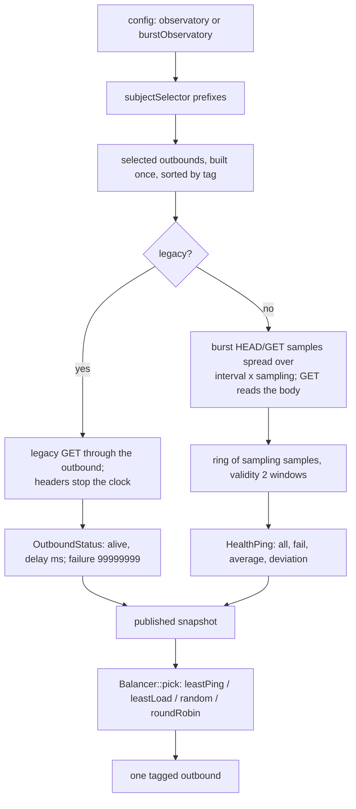

# The health observatory

<!-- scope:begin -->
- paths: crates/ferrox-app/src/observatory.rs
- symbols: probe_stream, tunnel_stream, observatory_settings, burst_observatory_settings, healthping_settings
- scenarios: vless-raw, vmess-raw, trojan-raw, shadowsocks-raw
<!-- scope:end -->
Row 132's engine half: xray's `observatory`/`burstObservatory` probe the outbounds a balancer selects, and the strategy reads that history. This page is the probe loop and its published status; [`engine-router`](engine-router.md) is the rule scan that picks a balancer.

Either app may be named top-level, as JSON or as protobuf `xray.app.observatory.Config`/`...burst.Config`, which decodes to the same keys. `observatory` is legacy: `subjectSelector` prefixes pick outbounds, `probeURL` defaults to `https://www.google.com/generate_204`, `probeInterval` to 10 s, and `enableConcurrency` probes all tags at once instead of sorted. The legacy probe is one HTTP `GET`; any response means alive, and header time is delay in ms. A burst sample follows `httpMethod` (default `HEAD`); a `GET` reads its body before the clock stops. Failure publishes `99999999`. `burstObservatory.pingConfig` is required in JSON; a protobuf app with none takes `destination` = Chromium connectivity URL, `interval` = 1 min (floor 10 s), `sampling` = 10, `timeout` = 5 s, `httpMethod` = `HEAD`; whitespace-only method sends `GET` but stops at the head. A failed sample is stored unless `connectivity` is set and that URL also fails, meaning the network is down.

When both blocks exist the legacy app runs, as the reference's first-of-type lookup does; both parse first, so a malformed burst block is still a startup refusal. The burst history is a ring of `sampling` samples valid for twice the sampling window; a sample expires on read, failures count in `fail`, and `average`/`deviation` are reference integer nanoseconds. An outbound with no reading is unknown to the balancer, not dead.

## Data path

## The probe

The probe speaks through the selected outbound, never around it. There is no dial-to-stream seam for an arbitrary outbound, so `probe_stream` opens a loopback TCP pair and runs `serve_connect` on the server half with a front that writes no grant; the client half is the HTTP connection. A probe therefore pays the outbound's own handshake and carrier, and a SOCKS-only lane is not bypassed.

The request is HTTP/1.1 with browser-shaped headers, `Connection: close`, and the URL authority as `Host` (a default port is omitted unless named). `https` wraps the stream in the tree's rustls client with `system_roots`; SNI is the URL host. The head is read to `\r\n\r\n` with a 64 KiB cap by `ferrox_core::foxy::head_end` — the tree's one terminator scan — asked only about the octets that just arrived, from three octets before the seam so a split terminator is found. A `GET` consumes `Content-Length` or drains to EOF; a `HEAD` stops at the head, and a blank method sends `GET` without reading the body. Status is not consulted: any response means alive. The clock starts before the dial and stops when the reference's read is done.

## The strategies

`leastPing` keeps the smallest `delay_ms` among alive candidates and returns the first minimum (`99999999` is the floor). `leastLoad` takes only alive candidates, rejects a sample at or over `maxRTT` when non-zero, and a health ratio above `tolerance` when both are non-zero. Cost is `deviation * sqrt(weight)`, weight from the first cost whose `match` is a non-empty substring/regexp hit, its positive `value`, else the first number in the match, else 1. Sort is cost, average, fewer failures, more samples, tag. `baselines` walk the sorted list until `expected` (at least one) is met; a non-positive expected with baselines that never reach selects nothing and the fallback answers. The final pick is uniform.

`random`/`roundRobin` see only candidates whose status is absent or alive, and only when `fallbackTag` is set: the reference injects the observatory under that condition. Without it they do not filter. The round-robin counter is per balancer.

## What was removed

- **A head re-walked after every read by a second terminator scan.** The reader compared four octets at every offset after every read, so an 8 KiB head arriving as sixteen 512-octet windows paid 69 632 comparisons for a terminator in its last four. `read_head` asks `ferrox_core::foxy::head_end` only about the new octets, from three before the seam, so the walk is one pass however the head splits. `an_answer_head_is_found_at_every_split_of_its_arrival` drives every arrival width; the two scan tests are priced apart in `ops.yml`.
- **A per-probe HTTP client and pool.** The reference builds `http.Client`/`Transport` per probe; this tree writes one request into the tunnel it already opened, so there is no idle pool, redirect machinery or cookie jar. Redirects are not followed either way.
- **A second copy of the response body.** A `GET` reads only enough for `Content-Length` (or drains to EOF); the reference's `io.Copy(io.Discard, resp.Body)` does the same without a transport buffer.
- **A status map rebuilt on every read.** The burst ring stores each sample's value and instant in slots fixed at construction; a read walks slots and allocates no vector. `a_burst_ring_holds_the_sampling_window_and_puts_without_allocating` holds the slot count and zero allocations. Legacy statuses are one in-place vector, not a map plus a parallel vector.
- **A per-flow observatory lookup.** The route plan takes one snapshot reference per decision and hands its slice to the balancer; a flow never clones the status vector. The per-balancer weight cache holds computed weights by tag, as the reference's `WeightManager` does.

What was not removed: a selected outbound is built at startup even if no balancer reads it, as the reference's handler exists before the observatory starts; the probe loop still owns one thread per check, as the reference's goroutine does; the legacy status vector keeps every selected tag after a failure because `leastPing` ranks the sentinel. A loopback tag is skipped with one warning: a re-inject has no stream. The Leaf healthcheck door is row 131's other half on [`front-healthcheck`](front-healthcheck.md).

## Time

No duration is claimed: benchmarks are CI-only, and a local probe measures this machine's path to a connectivity URL. The ops gate needs valgrind, absent on macOS/aarch64, so the ops row is `UNBLESSED` and the gate is the `ops.yml` artefact. Tests here see the ring window and the zero allocations of a sample put.

## Measured

<!-- counts:begin -->
| key | value | checked by |
| --- | --- | --- |
| ops-retired-instructions | UNBLESSED | scripts/count-ops.sh |
| burst-ring-samples | 10 | ferrox-app-observatory::tests::a_burst_ring_holds_the_sampling_window_and_puts_without_allocating |
| sample-allocations-per-put | 0 | ferrox-app-observatory::tests::a_burst_ring_holds_the_sampling_window_and_puts_without_allocating |
| failed-legacy-delay-ms | 99999999 | ferrox-app-observatory::tests::a_failed_legacy_probe_keeps_the_reference_delay |
| default-burst-samples | 10 | ferrox-app-observatory::tests::burst_settings_default_to_ten_samples_and_head |
<!-- counts:end -->

The ring's ten slots and zero allocations are `a_burst_ring_holds_the_sampling_window_and_puts_without_allocating`, which puts ten samples under `ferrox_core::alloc_count`; a per-sample buffer fails it. `a_failed_legacy_probe_keeps_the_reference_delay` publishes a failed status and reads `99999999`. `burst_settings_default_to_ten_samples_and_head` pins an empty `pingConfig`'s defaults.

The two probe pairs on `ops.yml` `40883882281` (x86_64 Linux, `method-ops`, this branch): `the_front_scan_costs_every_window_it_has_already_walked` retires **35 909 345** instructions vs `the_seam_scan_costs_the_octets_it_has_not_walked`'s **1 775 408** for the same 8 KiB head in sixteen windows, answered 64 times — 0.049×, **20.2×** fewer. Neither is a gate; the gate is `an_answer_head_is_found_at_every_split_of_its_arrival`, which drives every arrival width and asserts end, kept octets and terminator, so the count reads against a scan already bit-identical.

## Pins

| what | where |
| --- | --- |
| legacy probe loop, status, sentinel | `upstream/xray-core/app/observatory/{observer.go,config.proto}` |
| burst scheduler, sampling defaults, ring validity, connectivity | `upstream/xray-core/app/observatory/burst/{healthping.go,healthping_result.go,ping.go,burstobserver.go,config.proto}` |
| JSON shapes and defaults | `upstream/xray-core/infra/conf/{observatory.go,router_strategy.go}`, `upstream/xray-core/infra/conf/xray.go` |
| leastPing, leastLoad, weight matching | `upstream/xray-core/app/router/{strategy_leastping.go,strategy_leastload.go,weight.go}` |
| browser headers | `upstream/xray-core/common/utils/browser.go`, `upstream/xray-core/app/observatory/{observer.go,burst/ping.go}` |

## CI scope

What a change here owes, read by `scripts/ci-scope.py`; see [`docs/ci-scope.md`](../ci-scope.md).

There is no harness that runs this loop against a pinned reference: the xray observatory tests are in-process Go and `testing/scenarios` has no observatory family. The scenarios named above are the relay cells that must still start with routing present; the exact bytes of a probe are covered by the local loopback test, not by a reference suite.
