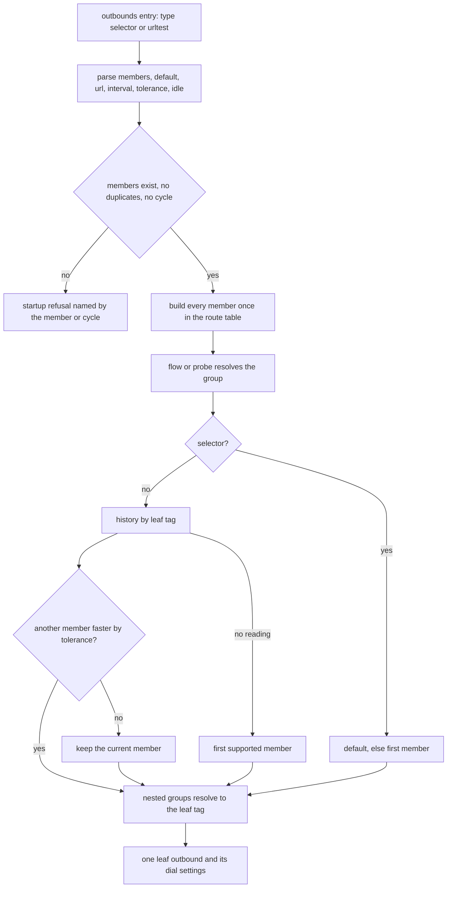

# Selector and urltest groups

<!-- scope:begin -->
- paths: crates/ferrox-app/src/group.rs
- symbols: outbound_supports_network
<!-- scope:end -->
Row 125's group half: a sing-box `selector` outbound dials one member until the selection changes, and a `urltest` outbound probes its members and dials the fastest one it has a reading for. The four xray balancer strategies on the same row stay in [`engine-router`](engine-router.md) and read the observatory in [`engine-observatory`](engine-observatory.md); this page is the `protocol/group` half.

A group is an ordinary entry in `outbounds`, named by `type` or by `protocol` as `selector` or `urltest`. Its `outbounds` is an ordered list of member tags; the list or its `settings.outbounds` twin is non-empty, a repeated tag is refused, and a member that no outbound names is refused by that name. The tag is required, because that is how a rule reaches the group. A group holding itself, directly or through another group, is refused before startup completes; membership and `detour`/`dialerProxy` edges are checked as one graph, so a group holding a leaf that detours back to the group is refused too.

`selector` reads `default`, which must be one of its members; with no default it starts on the first member. There is no cache file and no Clash API here, so the selection does not change after startup. `urltest` reads `url` (default `https://www.gstatic.com/generate_204`), `interval` (default 3 minutes), `tolerance` (default 50 ms, a zero is read as the default) and `idle_timeout` (default 30 minutes). An interval longer than the idle timeout is refused, as the reference's `NewURLTestGroup` refuses it. `interrupt_exist_connections` is not carried: the line is named once and existing flows keep their lane, because this tree has no connection-interruption registry.

A member may itself be a group. Resolution follows the selected member to a leaf, so the tag a flow, a probe and the `OutboundTag` dial seam see is the leaf's. A `urltest` walk also visits every leaf under a nested `selector`, including the members it is not currently dialling, exactly as the reference's `URLTestOutbounds` walks `All()`; the probes are deduplicated by leaf tag. A nested `urltest` keeps its own loop, url and interval, so its leaves are probed through that loop and the outer group reads its selected leaf's reading, as the reference calls the nested group's own `urlTest`.

The probe is the observatory's own HTTP path: one `HEAD`, the configured URL, a 15-second budget, through the member's real outbound and its source, socket options and target strategy. Any response is a reading; the delay is stored by leaf tag, and a failure deletes that leaf's reading. The history is one map shared by every group.

Selection is network-aware. The fastest member with a reading is compared with the current member, and it takes over only when it is faster by more than `tolerance`, so a small change does not move flows and an intermediate candidate cannot hide a later winner. A member without a reading never displaces one that has one. The first supported member answers when no member has a reading, which is the reference's `Select` fallback. An explicitly configured `Block` counts as supported for both networks, so a `urltest` can select it and drop traffic; it is not a usable fallback, but it stays eligible because the reference still selects it. TCP and UDP keep separate selections; a `urltest` skips a member that cannot carry the network, while a `selector` dials its stored, default, or first member. Selecting a group touches its activity clock, and a `urltest` that has been idle for `idle_timeout` stops probing until a flow touches it again. A probe's reads and writes share one deadline measured from the start of the probe, so a peer that drips its response head cannot extend a 15-second probe. A direct-only inbound refuses a group target: its handler dials a fixed lane and cannot observe a member removed after the route proof, so only a concrete Freedom tag is proved direct.

## Data path

## What was removed

Each bullet names its comparison. Sing-box's `protocol/group` is the only one of the three pins with a `selector`/`urltest` outbound. Xray-core has no equivalent group outbound: its nearest construct is a router balancer with leastPing/leastLoad/roundRobin/random, kept on this row in [`engine-router`](engine-router.md), and that balancer has no per-group HTTP client, leaf pointer, or group history. ZeroNet's `zero-observatory` publishes probe status but does not implement an outbound group, so its comparison is the same as Xray-core's: none of these group structures exist to remove.

- **A second HTTP client per probe.** The group calls the observatory's one `probe`, so there is no per-probe sing-box `http.Client`, pool, redirect machinery or cookie jar. Xray-core's balancer also has no such client, and ZeroNet's observatory has no group of its own to give one. The bytes are the same request the observatory already sends, and the connection is the member's own lane.
- **A selected-outbound pointer per group.** The route table already holds one instance per tag; a group stores member tags and resolves through that table, so two groups naming the same leaf share its state rather than each building a private copy. Sing-box stores a selected outbound per group; Xray-core's balancer and ZeroNet's observatory have no group object to store one in.
- **A per-flow history map.** One `Mutex<HashMap<String, u16>>` is shared by every group at startup, allocated once, not once per dial. A reading is a `u16` in the reference's milliseconds, and a failed probe removes exactly that leaf's entry. Sing-box keeps a per-outbound history in its URL-test group; Xray-core's observatory is the nearest status store, and ZeroNet's `zero-observatory` likewise publishes status rather than a group's private map.
- **A tag String per dial, and its hash.** `Selected` held the member's tag and hashed it into the route table on every dial, and a url-test re-wrote it on every sweep even when the winner had not moved. It holds the member's position in the group's list, written only when the choice moves, so a dial reads a slice. Sing-box's selector stores the selected outbound's tag and looks the outbound up by name on each dial; Xray-core's balancer tracks its selection by index in a list, so no group here keeps a tag to hash.
- **A history lock per member.** A url-test took the shared map once for the current member and once for every member in the sweep, four windows for three members; resolution now finishes first and the readings are read under one window. Sing-box's per-group history sits behind its own mutex, one hit per `Select`; Xray-core's observatory is the nearest status store and has no group sweep to take several.
- **A group reached only through a rule.** `routing_for` builds the empty table when any group is configured, so a group that is the default outbound reaches the same route plan as a tagged rule target rather than needing a second dispatch path. Neither Xray-core's balancer nor ZeroNet's observatory is an outbound, so neither has this second dispatch path.

What was not removed: one sleeping thread exists per `urltest` group for the life of the process; the idle loop keeps sleeping at the probe interval rather than stopping its thread, so an idle group costs a wake-up, not a probe; each collection walk visits a nested selector once, though different outer groups still collect separately; a selector has no runtime setter because the cache file and Clash API that drive one are outside this row; and `interrupt_exist_connections` is warned about rather than carried.

## Time

No duration is claimed here. Benchmarks are CI-only, and a local probe measures this host's path to a connectivity URL, not the reference's. The operation-count gate needs valgrind, which does not exist for macOS/aarch64, so the ops and syscall rows are `UNBLESSED`. No selector test is wired to `count-ops.sh` yet; until one exists the only signal is the `ops.yml` artefact. The selection hysteresis and the cycle refusals are exact and are held by the in-tree tests. `a_selector_dial_allocates_only_the_tag_it_returns` counts heap traffic around one dial through two chained selectors and requires exactly the one leaf tag the dial returns; `a_urltest_reads_its_history_under_one_lock` counts `History` lock windows around one three-member sweep and requires one. Memory copies are not counted yet: the probe request is formatted once per probe and the response head is read into a fixed window, but no checker observes copies.

## Measured

<!-- counts:begin -->
| key | value | checked by |
| --- | --- | --- |
| ops-retired-instructions | UNBLESSED | no selector workload yet |
| syscalls-per-flow | UNBLESSED | no selector workload yet |
| copies-per-flow | UNBLESSED | no copy checker yet |
| dial-allocations | 1 | `ferrox-app-proxy::tests::a_selector_dial_allocates_only_the_tag_it_returns` |
| sweep-lock-windows | 1 | `ferrox-app-proxy::tests::a_urltest_reads_its_history_under_one_lock` |
| seconds-per-flow | UNBLESSED | CI bench.yml (no cell yet) |
<!-- counts:end -->

`dial-allocations` and `sweep-lock-windows` are measured by the two counting tests named beside them. The remaining four are open claims. `a_selector_dials_its_default_then_its_first_member` and `a_urltest_picks_the_fastest_history_and_keeps_it_inside_the_tolerance` hold the selection rules; `a_broken_group_is_refused_by_name` holds the missing-member, outside-default and cycle refusals.

## Pins

| what | where |
| --- | --- |
| selector options, default, member list | `upstream/sing-box/option/group.go`, `upstream/sing-box/protocol/group/selector.go` |
| urltest options, defaults, selection, nested walk | `upstream/sing-box/option/group.go`, `upstream/sing-box/protocol/group/urltest.go`, `upstream/sing-box/common/urltest/urltest.go` |
| defaults and timeout | `upstream/sing-box/constant/timeout.go` |
| probe shape and history storage | `upstream/sing-box/common/urltest/urltest.go`, `upstream/xray-core/app/observatory/observer.go` |
| balancer strategies on the same row | `upstream/xray-core/app/router/{balancing.go,strategy_random.go,strategy_leastping.go,strategy_leastload.go}` |

## CI scope

What a change here owes, read by `scripts/ci-scope.py`; see [`docs/ci-scope.md`](../ci-scope.md).

There is no pinned-reference group harness in this tree: the sing-box group tests are in-process Go, and a live URL test is a dial to a connectivity URL, which is CI-only. The matrix has no selector or urltest scenario yet, so a group change has no matrix coverage; the in-tree tests hold the selected tag, the tolerance boundary and the startup refusals without opening a socket.
