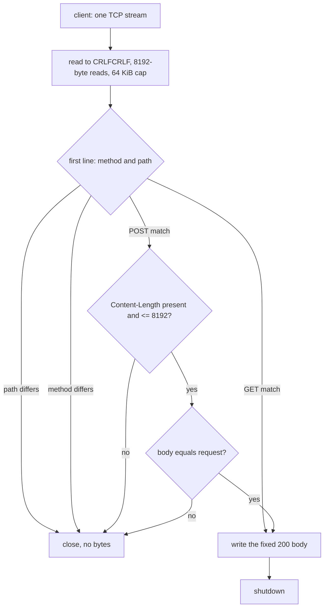

# The healthcheck inbound

<!-- scope:begin -->
- paths: -
- symbols: serve_hc_inbound, HcHandler, hc_content_length
- scenarios: vless-raw, vmess-raw, trojan-raw, shadowsocks-raw
<!-- scope:end -->
Row 131's front half: an `hc` inbound answers one HTTP path with one fixed body, so a remote urltest or `leastPing` probe can ask whether the server is up without a real destination. The config is Leaf's shape:

```json
{"protocol": "hc", "settings": {"path": "/health", "request": "optional body", "response": "ok"}}
```

`path` and `response` are required; `request` is optional. The inbound binds TCP on its `listen`/`port` like every front. `GET path` is expected when `request` is absent; when present the expected method is `POST` and the body must equal `request` exactly. The answer is fixed, whatever the request headers after the first line:

```
HTTP/1.1 200 OK
Content-Length: <response bytes>
Content-Type: text/plain
Connection: close

<response>
```

A path, method or POST-body mismatch closes with no bytes; a head over 64 KiB also closes. This is the reference's refusal minus its random delay before close: a gate holding a socket up to 10 s is a DoS surface, so this tree closes at once. Timing differs only; a successful peer sees the reference's bytes.

## Data path



## The exchange

The reader keeps one growing head buffer and one 8192-byte read buffer. It stops at the first `\r\n\r\n`, keeps following bytes as the body prefix, and reads the declared `Content-Length`. `ferrox_core::foxy::head_end` — the tree's one terminator scan — is asked only about new octets, from three before the seam so a split terminator is found, so a head in sixteen windows is walked once. Length is read case-insensitively from any header; a POST with no length, zero, or over 8192 closes without reading a body, as the reference leaves it empty. The answer is one prebuilt string and one write.

## What was removed

- **A head re-walked for every window.** The reader compared four bytes at every offset after every read, so a 16-window 8 KiB head paid 69 632 comparisons. `read_hc_head` asks the one `\r\n\r\n` scan about new octets from three before the seam, so one pass however split. `an_hc_head_is_found_at_every_split_of_its_arrival` drives every arrival width; the two scan tests are priced under **Measured**.
- **The per-request answer allocation.** The reference formats on every successful probe; this tree formats once at build and writes that buffer, so an answer allocates nothing.
- **A body buffer beyond the signature.** The reference allocates a fresh `Vec` per remaining-body read; this tree reuses one 8192-byte stack buffer and appends into the body it has. The head grows only as far as the request sends; a 64 KiB cap ends a peer that never terminates.
- **A per-connection copy of configured strings.** Path, request and prebuilt answer live once in `HcHandler`; each accepted stream takes one `Arc` instead of cloning three `String`s and reparsing settings.
- **The reference's failure delay.** The random delay before a refused close is not carried: it changes no successful response or refusal byte, only how long a refused socket lives.

What was not removed: the inbound accepts one connection per probe and closes it after one answer; it keeps no pool. A malformed request is still read up to 64 KiB before close, as the reference's `read_until_eoh` is.

## Time

No duration is claimed. The answer is one write of a fixed string; benchmarks are CI-only and no matrix cell names this front. The refusal path is bounded by the request and the 64 KiB cap, not a timer.

## Measured

<!-- counts:begin -->
| key | value | checked by |
| --- | --- | --- |
| ops-retired-instructions | UNBLESSED | scripts/count-ops.sh |
| syscalls-per-answer | UNBLESSED | scripts/count-ops.sh |
| answer-copies-per-byte-written | UNBLESSED | no copy checker yet |
| seconds-per-answer | UNBLESSED | CI bench.yml (no cell yet) |
| answer-allocations | 0 | ferrox-app-proxy::hc_tests::an_hc_answer_is_prebuilt_without_allocating |
| answer-bytes | 85 | ferrox-app-proxy::hc_tests::an_hc_answer_is_prebuilt_without_allocating |
<!-- counts:end -->

`an_hc_answer_is_prebuilt_without_allocating` reads the empty-body `"ok"` answer under `ferrox_core::alloc_count`: zero allocations, 85 bytes including head and body. The returned slice starts at the handler's buffer, whose pointer and capacity do not change across reads, so a retrieval-side copy or reallocation fails the identity assertions; a changed header or body fails the byte count. That test does not write an answer, so the per-byte write-copy row stays `UNBLESSED`. GET and POST round trips are gated by `an_hc_get_answers_the_configured_body_after_the_exact_path` and `an_hc_post_checks_the_body_and_a_mismatch_answers_nothing`.

The two probe pairs on `ops.yml` `40883882281` (x86_64 Linux, `method-ops`, this branch): `the_front_scan_costs_every_window_it_has_already_walked` retires **35 909 473** instructions vs `the_seam_scan_costs_the_bytes_it_has_not_walked`'s **2 022 915** for the same 8 KiB head in sixteen windows, answered 64 times, at the same offset — 0.056×, **17.8×** fewer. Neither is a gate; the gate is `an_hc_head_is_found_at_every_split_of_its_arrival`, which drives every arrival width and asserts offset, handed-on octets and terminator, so the count reads against a scan already bit-identical.

## Pins

| what | where |
| --- | --- |
| settings shape, request parsing, body rule, response bytes, refusal delay | `upstream/leaf/leaf/src/proxy/hc/inbound/{mod.rs,stream.rs}` |
| JSON settings | `upstream/leaf/leaf/src/config/common.rs` |
| registration | `upstream/leaf/leaf/src/app/inbound/manager.rs` |

## CI scope

What a change here owes, read by `scripts/ci-scope.py`; see [`docs/ci-scope.md`](../ci-scope.md).

No pinned suite drives a `hc` inbound: Leaf's tests are in-process and no `testing/scenarios` cell names it. The scenarios above are the relay cells that must keep starting while the front exists; the exact answer and refusal are local tests.
