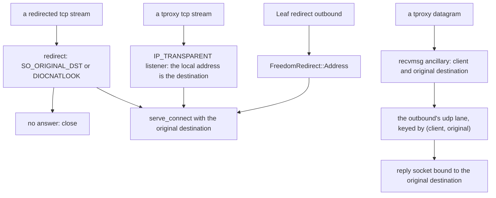

# redirect + tproxy transparent inbounds

Matrix row 135 of table A: sing-box's `redirect` and `tproxy` inbounds, plus Leaf's `redirect` outbound. Both inbounds are the kernel's original-destination spellings, already behind `dokodemo-door`'s `followRedirect`; this slice gives them their own protocol names, their own network defaults, and Leaf's outbound spelling. The kernel lookups, the transparent udp door and the reply socket are the ones [`front-dokodemo`](front-dokodemo.md) carries; this page names what the dedicated spelling adds.

## What the inbounds do

`redirect` is the kernel's REDIRECT target. The listener is ordinary — a REDIRECT rule is set up outside this process, so the inbound must not demand `CAP_NET_ADMIN` — and each accepted tcp stream asks the kernel where it was going: `SO_ORIGINAL_DST` on Linux, `DIOCNATLOOK` on macOS and FreeBSD. A flow the kernel has no answer for closes, as sing-box's `protocol/redirect/redirect.go` closes it. On macOS and FreeBSD the lookup opens `/dev/pf`, which only root may open, so startup refuses a redirect inbound when that open fails and names the privilege; Linux reads the answer from the accepted socket. It is tcp only.

`tproxy` is the TPROXY target. The listener is bound with `IP_TRANSPARENT` on Linux or `IP_BINDANY` on FreeBSD, the tcp destination is the accepted socket's local address, and on Linux udp is read with `recvmsg` ancillary data. Its network list defaults to `[tcp, udp]`, as sing-box's `NetworkList.Build()` defaults an empty list; `settings.network` (or the legacy `allowedNetwork`) narrows it. A host with no transparent udp listener (FreeBSD) serves tcp only and drops udp from the list rather than arming tcp and failing the udp bind behind it, warning once in the log. On a host with no TPROXY the inbound is refused by name rather than reading a conntrack table no TPROXY rule populates.

Both reuse `serve_dokodemo`'s transparent path: the same `Role::Dokodemo`, the same `dokodemo_redirected` loopback close, the same udp association and reply socket. The one new switch is `arm`: a REDIRECT lookup reads conntrack on an ordinary listener, while TPROXY must own the foreign address. `dokodemo-door` keeps arming its listener for either named mode, matching xray.

The outbound is Leaf's `redirect`: `{"protocol":"redirect","address":"…","port":…}`. The xray-shaped `settings.address`/`settings.port` spelling reads too, an absent port keeps the requested one as xray's freedom override does, and a missing address is refused. It is a freedom lane with `FreedomRedirect::Address`, so tcp and udp both rewrite the requested destination. A udp reply names the rewritten target, which is what xray's `DestinationOverride` writes into `b.UDP`; Leaf reports the session destination instead, and that difference is named below.

## Data path



## Measured

<!-- counts:begin -->
| key | value | checked by |
| --- | --- | --- |
| ops-retired-instructions | UNBLESSED | scripts/count-ops.sh |
| syscalls-per-flow | UNBLESSED | scripts/count-ops.sh |
| user-space-copies-per-flow | UNBLESSED | no copy checker yet |
| seconds-per-flow | UNBLESSED | CI bench.yml (no cell yet) |
| dedicated-inbound-protocols-registered | 2 | ferrox-app-proxy::tests::transparent_inbounds_name_their_networks |
| transparent-networks-classified | 5 | ferrox-app-proxy::tests::transparent_inbounds_name_their_networks |
| leaf-redirect-outbounds-decoded | 2 | ferrox-app-proxy::tests::a_leaf_redirect_outbound_names_its_target |
| redirect-outbounds-rewriting | 1 | ferrox-app-proxy::tests::a_redirect_outbound_rewrites_the_requested_target |
| redirect-inbounds-closing-without-a-lookup | 1 | ferrox-app-proxy::tests::a_redirect_inbound_closes_without_a_kernel_answer |
<!-- counts:end -->

`transparent_inbounds_name_their_networks` pins the registered names and the network defaults: `redirect` is tcp only, `tproxy` with no list is both on a host with a transparent udp listener and tcp alone without one, and `network: "tcp"` or `["udp"]` narrows it. `a_leaf_redirect_outbound_names_its_target` pins both outbound spellings, the refusal of a target with no address, and the refusal of a present port that is not a `u16` (a nonnumeric string, a fraction, a negative, or an overflow; a numeric string like `"443"` is read as its number) instead of treating it as absent. `a_redirect_outbound_rewrites_the_requested_target` asks a SOCKS front for a closed port and reads the echo the redirect target answers, so the rewrite is the lane's and not the client's. `a_redirect_inbound_closes_without_a_kernel_answer` arms the ordinary listener and proves a direct connection with no REDIRECT answer closes instead of dialling the listener's own address; a timeout is not a close.

The four required counts stay `UNBLESSED`. A loopback test cannot gate a syscall total, and `scripts/count-ops.sh` is CI-only on this host; no local check counts the datagram's copies; `scripts/lib-matrix.sh` has no redirect or tproxy cell, so `bench.yml` measures nothing here. The Linux and FreeBSD transparent paths are shared with `front-dokodemo`, whose page names the same gap.

## Ops

```bash
./scripts/count-ops.sh report \
  proxy::tests::a_redirect_outbound_rewrites_the_requested_target 'proxy::freedom_socket'
```

`UNBLESSED` — macOS/aarch64 ships no `valgrind`, so the count is CI-only there and has not been read. It is not a number and is not quoted as one.

## Time

**Not measured yet.** Durations come from CI runners (`bench.yml`, `parity.yml`); no CI artefact has been read. `scripts/lib-matrix.sh` carries no redirect or tproxy cell, so the workflows gate nothing here, and a local dial would measure a tunnel rather than this code.

## What we removed

- **The refusal of the two names.** `redirect` and `tproxy` were unserved protocol names; they are now in the served set and reach the same transparent path as `dokodemo-door`.
- **The listener arming a REDIRECT lookup does not need.** `dokodemo-door` arms `IP_TRANSPARENT` for a named REDIRECT, as xray does. The dedicated `redirect` inbound binds ordinarily, so it works when the REDIRECT rule is installed by a privileged setup and the proxy itself is not privileged. TPROXY still arms, because it owns the foreign address.
- **A second udp NAT and a second outbound lane.** `tproxy`'s datagrams ride the door's existing association and reply socket, and Leaf's outbound is the freedom lane with one field set rather than a new dial path.
- **A second spelling of the outbound target.** Leaf's `address`/`port` and xray's `settings.redirect` both resolve to `FreedomRedirect`, so one rewrite applies to tcp and udp.

## What was not removed

Named rather than claimed, with the worst input worked out first:

- **`tproxy`'s udp policy options are accepted but not carried.** sing-box's `udp_mapping`, `udp_filtering`, `udp_nat_max` and `udp_timeout` tune its userspace NAT. This tree keys a leg by `(client, original destination)`, which is address-and-port dependent, and uses the door's idle budget; it does not ask for endpoint-independent mapping, so a peer that needs that mapping — P2P or NAT traversal — can fail, while an ordinary flow keeps the stricter mapping.
- **`redirect` is tcp only.** sing-box's redirect inbound carries no udp; a `network` list naming udp is ignored there rather than served.
- **Transparent udp is Linux only.** `bind_udp`, `receive_original` and `reply_socket` are Linux arms; FreeBSD has the TPROXY tcp bind but no original-destination ancillary read, so a `tproxy` inbound there serves tcp and names the missing udp once. A config that asks for udp alone is refused by the existing "no flow to serve" rather than served partially.
- **The transparent flows have no kernel gate in CI.** The tests prove the listener arms, the outbound rewrites, and a no-answer flow closes. They do not install iptables or pf rules, so `SO_ORIGINAL_DST`, `DIOCNATLOOK` and `IP_RECVORIGDSTADDR` success paths are the shared `front-dokodemo` paths and remain CI-only.
- **A direct-server inbound applies one redirect.** The VLESS direct paths — raw (plain and encrypted), websocket, xhttp, gRPC, httpupgrade, httpheader, QUIC, and their Mux.Cool substreams — read the startup lane's `redirect` and apply it before resolving the requested name, so a name that does not resolve still reaches the configured target; a port-only redirect resolves that name at the new port, and `finalRules` match the redirected address on tcp and udp. VMess, Trojan and Shadowsocks dial their requested target. A rule or a management replacement naming a tagged freedom lane whose redirect differs from the startup lane's is refused at startup: the direct handler has no per-lane route, and taking another lane's redirect (or dropping this one's) silently is worse than a refusal. A config that needs two direct redirects on one server inbound does not start.
- **Leaf's udp reply source differs.** Leaf reports the session destination; this tree reports the rewritten target, matching xray's `DestinationOverride`. The bytes on the wire are the SOCKS UDP frame either way, but the address field is not the same.
- **No matrix cell or upstream suite seam.** `scripts/lib-matrix.sh` has no redirect or tproxy scenario, and the pinned suites expose no `ferrox-app` seam for them: sing-box's tests are disabled at the pin, and xray-core's scenario map names only `TestDokodemoTCP`/`TestDokodemoUDP`. `conformance.yml`, `bench.yml` and `parity.yml` therefore stay unchanged, and the Linux kernel behaviour is the shared door's CI-only arm.
- **FreeBSD is not a CI target.** The `IP_BINDANY` and `/dev/pf` arms compile only on a FreeBSD host; no workflow builds that target.

## Pins

| what | where |
| --- | --- |
| sing-box's redirect and tproxy inbounds | `upstream/sing-box/protocol/redirect/redirect.go`, `tproxy.go` |
| their options and network default | `upstream/sing-box/option/redir.go`, `option/types.go` |
| Leaf's redirect outbound and its reply source | `upstream/leaf/leaf/src/proxy/redirect/{stream.rs,datagram.rs}` |
| Leaf's outbound config spelling | `upstream/leaf/leaf/src/config/conf/config.rs` |
| xray's freedom override and udp source rewrite | `upstream/xray-core/proxy/freedom/freedom.go`, `infra/conf/freedom.go` |
| xray's tproxy listener arming | `upstream/xray-core/transport/internet/sockopt_linux.go` |
| the compact transparent socket layer | `upstream/zeronet/crates/zero-net/src/transparent.rs` |

## CI scope

What a change here owes, read by `scripts/ci-scope.py`; see [`docs/ci-scope.md`](../ci-scope.md).

<!-- scope:begin -->
- paths: -
- symbols: transparent_networks
<!-- scope:end -->
