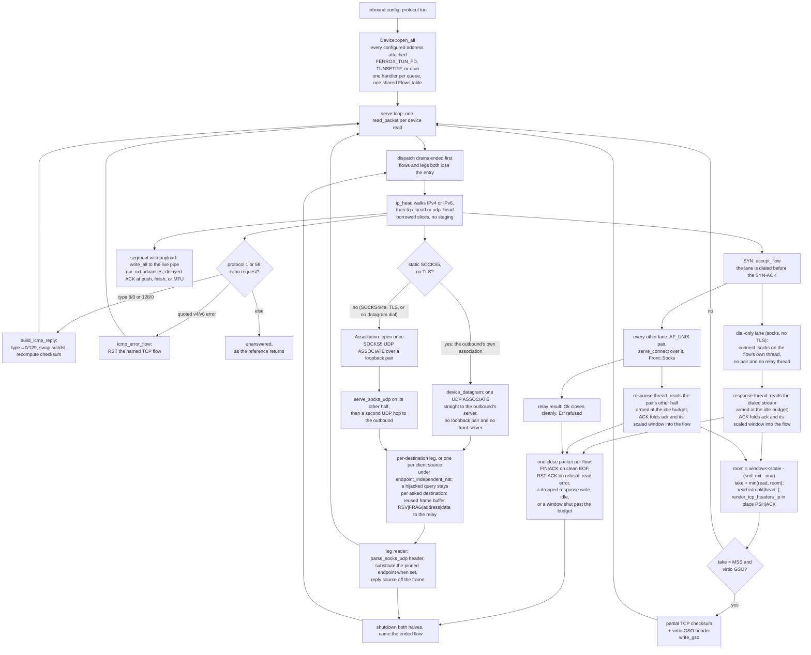

# TUN device inbound (native)

A `tun` inbound opens a virtual network device and reads raw IPv4 or IPv6 packets off it — this native handler is the default engine (`stack: "hev"`, also `loopback`, `native` and `tun2socks`), while `smoltcp`/`gvisor` and the Linux `system`/`hybrid` stacks are the alternatives in `front-tun-smoltcp.md`; every TCP flow the packets form becomes a proxy dial through the machinery the tree already had, every UDP flow becomes a datagram dial through a SOCKS5 UDP association — a static SOCKS5 outbound with no TLS hands the handler the association's own relay address, so each datagram goes straight to the server the outbound names, while every other lane rides the association the same front layer serves — one leg per destination, or one per client source under `endpoint_independent_nat` except a hijacked query, which keeps its own leg per asked destination even when the mapping is source-only, and each leg opens its own association on the front lane, because that lane pins the first datagram source an association sees — an ICMP or ICMPv6 echo request is answered as the device's own destination would rather than dropped, and the bytes that come back leave again as IP packets on the same descriptor. Both roles the row has are served and both are proved: device-to-dial and dial-to-device. A flow also *ends*: the response read is armed at the idle budget, so a peer that stops speaking hands its thread and whatever pipe it holds back instead of parking them for the life of the process, and when the last queue stops the handler joins every response worker it spawned before it returns; a clean proxy close finishes the device's half with `FIN | ACK`, and a refused leg or a broken pair resets it with `RST | ACK` instead of leaving an established socket with no peer. A quoted v4 or v6 ICMP error ends the TCP flow it names the same way, except a packet-too-big report, which lowers the flow's segment size instead; A Linux descriptor whose builder enabled TSO carries TCP GSO on the way back to the device: one large response read is rendered as one packet with a partial checksum and the kernel splits it at the MSS, while a non-GSO read is capped at the MSS so one read is one packet. The response direction is paced by the peer's own window: every device ACK folds `ack` and its window — shifted by the scale the SYN asked for — into the flow, a write waits while `snd_nxt - una` fills the advertised room instead of flooding past a receive buffer this handler cannot retransmit into, and a closed flow wakes a parked writer so it resets rather than hangs. The handshake negotiates the two options a window needs: the SYN-ACK carries this device's MSS, so a peer stops clamping its uploads to the 536-byte RFC 879 default, and — only when the SYN offers a window scale — a scale of five, so both directions leave the sixty-four-kilobyte ceiling; a SYN with no options is answered with the MSS alone and stays unscaled. A multi-queue descriptor opens one handler per configured queue, and every handler passes the same flow table, so a segment the kernel hashes onto another queue still finds the flow its handshake opened instead of stalling it; only Linux exposes more than one queue, and a datagram leg stays on the queue its first datagram arrived on, because the association it frames onto is that handler's.

A device carries no wire byte-stream to diff, so this row's identity claim is the (target, payload) dial set: the pairs the inbound produces from a pinned packet stream must equal the pairs the pinned reference stack produces from it. The oracle is `scripts/tun-oracle` — smoltcp 0.12, the userspace stack the pinned zero-tun crate builds on — run over `script.txt`, and `the_dial_set_matches_the_pinned_stream` diffs the handler's own dials against the golden `expected.txt` that run recorded. The convention the golden pins (dial on handshake, deliver the reassembled payload in order, EOF at FIN) is also what xray's `proxy/tun/tcp_lightweight.go` reaches at `input`, `receive` and `ReadMultiBuffer`, and the SYN-ACK numbers follow its `newTCPConn` rule. The datagram half now rides the same oracle: `scripts/tun-oracle` also binds smoltcp's UDP socket and records the (target, datagram) set the reference stack delivers from `script.txt`, and `the_datagram_dial_set_matches_the_pinned_stream` diffs the (target, datagram) pairs the inbound hands its association against that golden. So the cases where UDP and TCP part ways — two bodies to one port staying two dials rather than one concatenated stream, a body shaped like a frame header surviving verbatim, an odd length delivered whole — are pinned against the reference run, not merely against the RFC 1928 frame `a_datagram_flow_frames_the_association_and_returns_the_echo` already asserts byte-for-byte.

A static SOCKS5 outbound with no TLS skips that association entirely: `device_datagram` opens the outbound's own `UDP ASSOCIATE` once and hands the handler the relay the server named, so every leg frames straight at the outbound's server — no loopback pair, no `serve_socks_udp`, and no second SOCKS client between the device and the lane. A route plan resolves its datagram lane from the live table when the handler opens it, and asks the same table before opening, so a catch-all `network: udp` rule that names such an outbound takes the same direct lane while TCP keeps the plan's first outbound unless a TCP rule selects another; a split association has no one lane and stays on the front's association. `a_direct_datagram_lane_frames_the_relay_without_the_association` drives one such leg with a relay that echoes the frame it was handed, requires the identical RFC 1928 request the association path writes, and requires the answer back as a device packet; the association path stays for every lane whose datagram dial needs the front — a TLS, mux or freedom lane, or a route plan whose UDP rule names no static SOCKS outbound — and `the_datagram_dial_set_matches_the_pinned_stream` still gates that path's (target, datagram) set against the oracle. The leg socket is also asked for 4 MiB in each direction when the host has the option, because the few-kilobyte default drops a burst the reader has not yet drained. The dial and its `UDP ASSOCIATE` run on a worker: a datagram that finds the lane still opening is dropped like any unroutable packet, instead of parking the queue on a server that is slow or down, and a refused direct lane is retried no sooner than one handshake budget, so a dead server costs one worker per budget rather than one per datagram. A direct leg's socket outlives one query so a later query for the same destination reuses the lane instead of opening another, but its reader expires it after `udp_timeout` without a reply and the next device packet reaps it; the handler's shared control connection stays open, while a front-lane leg opens its own association and ends with it. A relay ends its association by closing the control connection, so a watcher parks on that socket: the lane and every leg on its dead relay address are dropped, and the next datagram takes the front's association until the retry budget allows a fresh direct lane.

The platform opens go through the same `tun-rs` builder the userspace stack uses, so the interface gets every configured address and prefix on Linux and macOS — the builder's single IPv4 slot takes the first, and every other address, of either family, is attached to the open device so a refused one is a line rather than a failed open, and a config that names one address per family is carried whole instead of narrowed to its first; the builder enables Linux `IFF_VNET_HDR` with `TUN_F_CSUM|TUN_F_TSO4|TUN_F_TSO6` when the kernel takes it, and an offload refusal retries the same spec without offload instead of failing the inbound. macOS and iOS utun packets keep their four-byte family word in front, and the Linux virtio header is stripped on read and rebuilt on write. An inherited descriptor bypasses the builder — zero-tun's `inherited.rs` seam, which the ordinary tests exercise through an `AF_UNIX` socket pair (Linux `SOCK_SEQPACKET`, macOS and other Unix hosts `SOCK_DGRAM`, because Unix-domain socket pairs are supported there through `SOCK_DGRAM`), while the privileged tests in `ci.yml` open a real Linux TUN or macOS `feth` under `sudo`; it arrives from `FERROX_TUN_FD`, which hands the descriptor over and is closed with the device, or from the config's own `fd` (`file_descriptor`, `file-descriptor`), which a VpnService or utun host sets after it opens the device and which is `dup`ed so the host keeps its own and survives this process leaving — `dup` shares the file-status flags, so a nonblocking descriptor (Android's `VpnService.Builder.establish` default) stays nonblocking on both and the serve loop retries `WouldBlock` after its readability poll instead of ending the inbound; `a_spec_fd_opens_the_inherited_descriptor_once` requires one device, an empty name, a distinct descriptor and the shared nonblocking mode untouched on the host; `TUNGETIFF` tells it whether the Linux descriptor carries a virtio header, and because `IFF_VNET_HDR` does not say `TUNSETOFFLOAD` was accepted, an inherited descriptor strips the header on read but never emits GSO. An inherited descriptor also carries no interface name, so `auto_route` warns and installs no capture routes even when the config names one; the host that opened the descriptor must install those routes. The privileged opens run under `sudo` in `ci.yml` on Linux and macOS, and the ordinary tests drive an `AF_UNIX` socket pair through the same `read_packet`/`write_packet` pair the device does — `SOCK_SEQPACKET` on Linux and `SOCK_DGRAM` on the other Unix hosts, because Unix-domain socket pairs are supported there through `SOCK_DGRAM`.

## Config

The reference TUN blocks are read in full. Applied: `name` or `interface_name` for the device; `mtu`; `address` as a string or a list with `inet4_address`/`inet6_address` as the older spellings and `prefix` filling a missing CIDR; `queues`, or `multi_queue` where `false` narrows to one queue and `true` keeps the platform's count; `fd` (or `file_descriptor`/`file-descriptor`) on a Unix host for a descriptor the host already opened, which is one queue so a larger `queues` says so in one line, and which rides this handler only when `stack` is omitted or names the native engine, because a userspace/system stack or Windows rejects it before opening a device; `tap`, which opens a macOS `feth` pair instead of a `utun` and makes the native engine carry Ethernet frames — the bridge answers ARP for every configured IPv4 address and IPv6 neighbour solicitation for every configured IPv6 address — and, when `auto_route` captured the table with no gateway on the routes, for every destination, so the kernel's on-link lookup finds this side instead of stalling in ARP — learns the peer's link address from the first frame, answers an unspecified-source solicitation to all-nodes with the solicited flag clear, strips the link header on read and writes it back on emit, so the IP path above is unchanged; `peer` (or `peer_feth`) names the pair's kernel half and defaults to a fresh unique `feth` interface, while a named pair is opened without reuse so a collision fails instead of taking ownership of another inbound's peer; a `tap` config is served by the native engine because the userspace and system engines take IP packets, and both say so in one line, as does a `queues` above one; `stack`, where an omitted value, `hev`, `loopback`, `native` and `tun2socks` select this native handler while `gvisor` maps to the userspace engine, `mixed` to the hybrid one, and an explicit empty string takes the unknown-stack fallback to userspace; `udp_timeout` as seconds or a Go-style duration (`500ms`, `1m30s`), which is the idle budget each datagram leg arms; `endpoint_independent_nat`, which keys a leg on the client source alone; and `gso: false`, which opens the device without the TCP offloads. `auto_route` installs the captured default route as two half-default routes per family the device carries, pins the outbound's own server edges in the families the device captures (and any `route_exclude_address`) where they already routed so the proxy's dials cannot re-enter the device, binds a dial to the live underlay that carries its destination instead of adding a host route, binds the relay leg a `UDP ASSOCIATE` answer names to the underlay because it can differ from the server the config names, shares underlay pins between live inbounds while a second capture of the same half-default on another interface is refused, and leaves a shared route to the last guard that closes, and `route_address` (or the deprecated `inet4_route_address`/`inet6_route_address`) adds the named prefixes; a bare `route_address` or `route_exclude_address` entry names one host (`/32` or `/128`), while a bare device `address` keeps its family default prefix; a kept default prefix suppresses the halves it contains, and an outbound that dials destinations directly is named in one line because no edge can be pinned. `dns_mode: "hijack"` sends every port-53 query to the first `dns_address`; `system`, `none`, `forward` and the empty mode leave DNS to the device, and any other word is refused rather than read as a silent forward. xray's `DNS` list is its Windows interface resolver and does not redirect port-53 traffic; this build reads it, names it in one line and leaves queries to the routing rules. The `gvisor` userspace stack hijacks port-53 datagrams too, dialing the resolver while rendering the answer from the address the device asked: `a_hijacked_datagram_dials_the_resolver_and_keeps_the_asked_address_per_lane` reads the SOCKS header and the lane key, and a second asked server keeps a second lane. The kernel-NAT `mixed` and `system` stacks rewrite a port-53 TCP dial target in `tun_system::accept_loop` to the configured resolver while passing the original destination to `serve_device_flow`, so the TCP half takes the hijack too. A routing key without `auto_route` says so in one line. xray's own spelling reads too: `gateway` names the same device addresses when `address` names none, its `DNS` list is read as the Windows interface resolver it is and named in one line, and a non-empty `auto_system_routing_table` captures the default into the main table, with a named table other than `main`/`254` said aloud; `auto_system_dns_to_gateway` without a resolver, `auto_outbounds_interface`, `auto_system_wfp_block_leak`, `user_level` and `desc` are accepted and named in one startup line. Every other key the reference accepts — `auto_redirect`, `strict_route`, `netns`, `iproute2_*`, the `include_*`/`exclude_*` interface, UID, package and MAC filters, `udp_mapping`/`udp_filtering`/`udp_nat_max`, `platform` — loads and is named in one startup line as accepted but not applied, so a config written for another TUN front runs instead of being refused. What is refused is a malformed value: a non-boolean switch, a non-string or unparseable address entry, or a zero or unparseable `udp_timeout` fails before the device opens. Every `address` entry is parsed and attached: `address` is the list every spelling defers to, both deprecated `inet4_address` and `inet6_address` are read together when it names no address (an empty list is read as absent), the builder's single IPv4 slot carries the first and every other address goes on the open device, and a platform that cannot attach one says so in a line rather than refusing the inbound. The limits are named rather than silent: `udp_timeout` and `endpoint_independent_nat` configure this handler, a `gvisor`/`mixed` stack says so in one line and keeps its own datagram idle, the kernel-NAT `system` stack translates towards the first address, which it names when the config carries more, and the `gvisor`/`mixed` interface keeps its own `/24` and `/64` on-link prefixes because the shared device config carries addresses without prefixes, so a custom prefix reaches the kernel device and not those interfaces; an address the userspace interface's eight slots cannot take is named in a line; and a leg whose reader timed out keeps its socket until the next packet drains the end notice, so a silent device holds one descriptor per source. With `queues` above one every queue reads one leg table, so a client source keeps one socket wherever the kernel hashes its datagrams; the table is a mutex a datagram takes once to test for an existing leg and once to enter it, and a source whose leg vanished between those takes it again after selecting a lane. `the_tun_spec_accepts_the_reference_spellings` loads a config carrying every key of the pinned sing-box block, `the_reference_stack_names_map_to_the_engines` pins the `gvisor`/`mixed` mapping, and `a_tun_field_with_the_wrong_type_is_refused` pins the refusals, `a_tun_inbound_reads_an_inherited_descriptor` pins all three `fd` spellings and the `2` refusal.

Steering is the routing table's, not a second TUN layer: a rule's `network` sends one flow's TCP and another's UDP to different outbounds, a domain, IP or geodata rule names sites for their own lane, and a `balancerTag` draws per flow from a `roundRobin`, `random`, `leastPing` or `leastLoad` balancer with its `fallbackTag` and the observatory's health readings. A device dial asks `resolved_lane_with_protocol` with `Network::Tcp` and a datagram asks the front with `Network::Udp`, so both halves read the same rules. `auto_route` pins every lane a route plan can dial, balancer candidates included, because `Outbound::edges` walks the plan's tagged table; `a_rule_splits_tcp_and_udp_and_a_named_site_across_lanes` pins the per-network and per-site picks, and `a_route_plan_names_an_edge_for_every_lane_it_can_dial` pins the multi-server pin set. A direct lane that refuses a datagram falls back to the front's association and the retry budget (`a_refused_direct_datagram_lane_falls_back_to_the_association`); the TCP half reuses the lane it selected through `serve_device_flow` on the same fallback, so a per-flow balancer is consulted once on that path, and it has no count of its own here.

## Feature matrix

| capability | this tree | checker | references |
|---|---|---|---|
| native packet handler, default | an omitted `stack`, or `hev`/`loopback`/`native`/`tun2socks`, serves IP packets without a netstack; an explicit empty string takes the unknown-stack fallback | `the_reference_stack_names_map_to_the_engines`; tun-bench cells `ferrox-native` | xray `proxy/tun` has one lightweight stack and no selection; sing-box selects `system`/`gvisor`/`mixed` |
| userspace stack | `gvisor` runs smoltcp, `mixed` hands TCP to the kernel, `system` uses kernel NAT for TCP and keeps UDP and ICMP in userspace | `the_reference_stack_names_map_to_the_engines`; tun-bench `ferrox` against `singbox-gvisor` and `singbox-system` | sing-box ships the same three names; xray ships one |
| macOS TAP | `tap: true` opens a `feth` pair through tun-rs `Layer::L2`, and the bridge answers ARP and IPv6 neighbour solicitation (proxy-ARP/NDP for every destination once `auto_route` captured the table), strips and writes the link header | bridge tests `a_tap_answers_an_arp_request_for_an_address_it_carries_and_ignores_another`, `a_tap_answers_a_unicast_solicitation_and_a_proxy_one_for_an_address_it_does_not_carry`, `a_tap_leaves_a_duplicate_probe_for_the_hosts_address_to_the_host`, `a_tap_leaves_a_frame_for_another_address_alone`, `a_spec_carries_the_tap_and_the_peer_half`; `a_real_feth_pair_carries_an_arp_request_to_the_bridge` opens a real pair under `sudo` in `ci.yml` on macOS, which a contributor machine does not run | xray's Darwin `tun_darwin.go` is a utun; sing-box has no TAP |
| inherited descriptor (mobile) | `fd`/`file_descriptor` on Unix (Linux, macOS, Android, iOS) with the native stack, `dup`ed with `FD_CLOEXEC`, shared nonblocking mode retried in the serve loop; Windows rejects it before Wintun opens | `a_spec_fd_opens_the_inherited_descriptor_once`, `a_tun_inbound_reads_an_inherited_descriptor`; `mobile.yml` compiles android and ios | xray reads `XRAY_TUN_FD` on Linux; sing-box takes a platform fd |
| per-network and per-lane routing | the shared routing table picks a lane per flow, so TCP can leave one outbound and UDP another, and a rule naming a site splits it the same way | `a_rule_splits_tcp_and_udp_and_a_named_site_across_lanes`, `a_route_plan_names_an_edge_for_every_lane_it_can_dial`, `a_balancer_rule_picks_its_lane_per_flow` | both references read rule tables; neither routes the device's TCP and UDP to different outbounds from one rule in their shipped tun block |
| concurrent inbounds | each `auto_route` handler keeps its own capture, underlay pins are shared with a later dial, a conflicting capture of the same half-default on another interface is refused, and a shared route is deleted by the last guard that closes | the capture list is `Mutex<Vec<Weak<Guard>>>`, `Plan` containment is the pure gate, and `a_real_guard_installs_pins_and_retires_a_route` checks the table by installing, sharing and deleting routes under `sudo` in `ci.yml` on Linux | not a reference feature: both expect one tun inbound |
| several servers per lane | a balancer tag picks one of its servers per flow | `a_balancer_rule_picks_its_lane_per_flow` | same rule vocabulary in both |
| dual-stack device | every `address` entry is attached, v4 and v6 captured independently, a v4-only tunnel leaves v6 alone | `a_spec_carries_every_address_its_config_names`, `a_v4_device_captures_only_the_v4_halves`, `a_dual_device_captures_both_halves` | both |
| xray config spelling | `gateway`, `DNS` and `auto_system_routing_table` are read; the switches this build cannot install are named in one line | `the_tun_spec_accepts_the_reference_spellings` | — |
| measured against both | tun-bench runs `xray` as an engine beside `hev-socks5-tunnel` and sing-box; a default dispatch measures the sing-box HEAD builds (`singbox-head-system`, `singbox-head-gvisor`), while the workflow downloads pinned `1.14.4` for `singbox-system`/`singbox-gvisor` | `tun-bench.yml`; the numbers are under Time | — |

## Data path



`auto_route` is the one part of the TUN front that touches state outside the process. The plan is built from the device's own addresses — a v4 address captures both /1 halves of the v4 space, a v6 address both /1 halves of the v6 space, so a v4-only tunnel never blackholes v6 — plus the config's prefixes, with a route inside a kept prefix dropped rather than installed and duplicates installed once. `tun_route::Guard::install` pins every kept prefix at the route boundaries that already carried it (gateway, interface name and index read back from the table), its underlay lookup ignores every live capture interface so one device cannot pin another device's edge back into a TUN, adds the plan's prefixes on the device's interface through `route_manager`, and deletes everything it added in reverse when it drops — a handler removed by a config reload puts the table back. A run with no removable handler holds its guard for the life of the process instead; a successful Linux `system` or `hybrid` start returns stoppable workers, so its caller joins them and drops the guard before signalling closure. Paths that return no workers keep the capture until the process exits, and a killed process can leave the halves behind. When the handler returns worker handles, those workers are joined and the guard drops before closure is signalled; when another route operation holds the lock, that drop hands cleanup to a deferred helper and closure waits only for the queue clones below, not for the helper; when it returns none, the guard is held for the process lifetime, because a stop-triggered drop could remove routes under a handler that still serves, so `mark_closed` does not wait for those routes. With more than one queue, each queue can hold a guard clone: the last native queue waits on `released` before it calls `mark_closed`, and every other queue increments `released` only after dropping its clone, so closure waits for those clones; a kernel route deletion that fails with anything but `NotFound` is queued silently and a cleanup thread retries it, so an operator sees no diagnostic for it and removing another inbound does not clear it. The platform route API is synchronous on Linux, macOS and Windows, so this is the same code on all three rather than netlink or IP Helper by hand. A mobile host routes in its own app — Android's `VpnService` and iOS's utun both own the table — so `route_manager` is not compiled there and `auto_route` answers with one line naming the host instead; `mobile.yml` compiles `ferrox-app` for `aarch64-linux-android` and `aarch64-apple-ios`, and `fd` is the device those hosts hand over. `a_v4_device_captures_only_the_v4_halves`, `a_route_default_captures_two_halves_per_family`, `a_named_route_inside_a_kept_prefix_is_dropped`, `a_duplicate_route_is_installed_once` and `containment_is_masked_bits_not_bytes` gate the plan; `a_real_guard_installs_pins_and_retires_a_route` gates the table, installing a prefix, pinning a dialled address above it, keeping a route while a second guard lives and removing it with the last, under `sudo` in `ci.yml` because a contributor runner holds no `CAP_NET_ADMIN`.

`dns_mode: "hijack"` rewrites only the destination the leg frames: a port-53 datagram or flow to any address is sent to the configured resolver, and the leg's render target stays the address the device asked for, so the answer arrives from the server it queries instead of the resolver it actually reached. The SOCKS relay peer is parsed and the reply is rendered with the address the device asked for; the native leg does not compare the header source with the configured resolver, so the resolver address is not a validation check. `a_hijacked_query_rides_the_dns_server_and_the_answer_keeps_its_address` is the checker: the association sees `203.0.113.53` where the device wrote `198.51.100.7`, and the reply packet's source is `198.51.100.7` again. A hijacked query keeps its own leg even under `endpoint_independent_nat`, because its answer names the address the device asked rather than the last frame a shared socket sent: `a_hijacked_query_keeps_its_own_leg_under_endpoint_independent_nat` drives two asked addresses from one source and requires two legs and two answers, each sourced from the address its own query asked.

## Measured

<!-- counts:begin -->
| key | value | checked by |
| --- | --- | --- |
| ops-retired-instructions | UNBLESSED | scripts/count-ops.sh |
| syscalls-per-tun-packet | UNBLESSED | no syscall checker yet |
| dial-set-flows-matching-the-pinned-stack | 3 | ferrox-app-tun::tests::the_dial_set_matches_the_pinned_stream |
| reverse-role-response-round-trips | 1 | ferrox-app-tun::tests::the_response_bytes_come_back_as_ip_packets |
| parse-copies-per-packet | 0 | ferrox-app-tun::tests::the_payload_is_borrowed_from_the_read_buffer |
| flows-handed-back-at-the-idle-budget | 2 | ferrox-app-tun::tests::a_quiet_tun_flow_hands_its_threads_back |
| flows-finished-with-fin-on-proxy-close | 1 | ferrox-app-tun::tests::a_closed_proxy_leg_sends_fin_after_its_bytes |
| refused-proxy-legs-reset | 1 | ferrox-app-tun::tests::a_refused_proxy_leg_resets_the_device_flow |
| datagram-association-round-trips | 1 | ferrox-app-tun::tests::a_datagram_flow_frames_the_association_and_returns_the_echo |
| datagram-parse-copies-per-packet | 0 | ferrox-app-tun::tests::the_datagram_is_borrowed_from_the_read_buffer |
| datagram-reply-packets-checksummed | 1 | ferrox-app-tun::tests::the_reply_packet_verifies_at_the_reference_reader |
| writes-after-a-refused-packet | 2 | ferrox-app-tun::tests::a_refused_packet_does_not_end_the_flow |
| datagram-dial-set-flows-matching-the-pinned-stack | 5 | ferrox-app-tun::tests::the_datagram_dial_set_matches_the_pinned_stream |
| icmp-echo-replies-verified | 1 | ferrox-app-tun::tests::an_icmp_echo_request_is_answered_as_a_reply |
| icmp-non-echo-messages-refused | 3 | ferrox-app-tun::tests::a_non_echo_icmp_message_is_refused |
| ipv6-tcp-packets-parsed | 1 | ferrox-app-tun::tests::an_ipv6_tcp_packet_parses_and_renders_with_its_checksum |
| ipv6-extension-headers-walked | 1 | ferrox-app-tun::tests::an_ipv6_extension_header_is_walked_to_the_transport |
| icmpv6-echo-replies-verified | 1 | ferrox-app-tun::tests::a_v6_echo_request_flips_to_a_v6_reply |
| icmp-error-quoted-flows-named | 1 | ferrox-app-tun::tests::an_icmp_error_quotes_the_flow_it_ends |
| virtio-gso-headers-written | 1 | ferrox-app-tun::tests::a_virtio_gso_header_names_the_tcp_segment |
| gso-frames-per-large-response-read | 1 | ferrox-app-tun::tests::a_large_response_read_leaves_as_one_gso_frame |
| emit-packet-reallocations-per-render | 0 | ferrox-app-tun::tests::an_emitted_packet_reuses_its_render_buffer |
| response-payload-copies-per-read | 0 | ferrox-app-tun::tests::a_response_is_rendered_where_the_relay_read_landed |
| flows-served-off-the-queue-that-opened-them | 1 | ferrox-app-tun::tests::a_flow_opened_on_one_queue_is_served_from_another |
| direct-lane-flows-without-a-pair | 1 | ferrox-app-tun::tests::a_direct_lane_carries_the_flow_without_the_pair |
| direct-datagram-lanes-without-the-association | 1 | ferrox-app-tun::tests::a_direct_datagram_lane_frames_the_relay_without_the_association |
| time-tcp-up-1 | ferrox=26.737Gbit/s,hev=23.474Gbit/s,ratio=1.14 | tun-bench.yml |
| time-tcp-up-10 | ferrox=43.763Gbit/s,hev=40.103Gbit/s,ratio=1.09 | tun-bench.yml |
| time-tcp-down-1 | ferrox=26.873Gbit/s,hev=16.039Gbit/s,ratio=1.68 | tun-bench.yml |
| time-tcp-down-10 | ferrox=48.259Gbit/s,hev=43.298Gbit/s,ratio=1.11 | tun-bench.yml |
| time-rr | ferrox=25801tps,hev=17785tps,ratio=1.45 | tun-bench.yml |
| time-rr-8x1k | ferrox=95637tps,hev=93763tps,ratio=1.02 | tun-bench.yml |
| time-udp-100k | ferrox=99296pps,hev=99301pps,ratio=1.00 | tun-bench.yml |
| route-default-halves-per-family | 2 | ferrox-app-tun_route::tests::a_route_default_captures_two_halves_per_family |
| kept-prefixes-excluded-from-the-capture | 1 | ferrox-app-tun_route::tests::a_named_route_inside_a_kept_prefix_is_dropped |
| hijacked-queries-riding-the-resolver | 1 | ferrox-app-tun::tests::a_hijacked_query_rides_the_dns_server_and_the_answer_keeps_its_address |
| hijacked-tcp-flows-dialing-the-resolver | 1 | ferrox-app-tun::tests::a_hijacked_tcp_flow_dials_the_resolver_and_answers_from_the_asked_address |
| cpu-cores-at-tcp-down-10 | ferrox=1.79cores,hev=2.06cores | tun-bench.yml |
| rss-mb-at-tcp-down-10 | ferrox=15.2MB,hev=2.5MB | tun-bench.yml |
| rss-above-start-mb-at-tcp-down-10 | ferrox=1.0MB,hev=0.7MB | tun-bench.yml |
<!-- counts:end -->

The first row is the identity claim itself: three flows — a request line, a four-byte blob, and a two-chunk payload whose lengths are not a segment boundary — dialed with exactly the (target, payload) pairs the smoltcp run recorded. The reverse-role row sends bytes out through the relay and requires them back as an IP packet carrying those bytes on the same descriptor. The copies rows are gated by pointer identity, not bytes: `the_payload_is_borrowed_from_the_read_buffer` and `the_datagram_is_borrowed_from_the_read_buffer` assert each parsed payload's base *is* the read buffer plus the fixed headers, because a byte test passes with a parsing copy and without one. The emit-reuse row is the same discipline on the other side of the device: `an_emitted_packet_reuses_its_render_buffer` warms one render and then requires the reused buffer's base pointer and `capacity()` to hold steady across a run of TCP and ICMP renders — the gate that a steady-traffic emit allocates nothing — and requires each reused render's bytes to equal a fresh build, which is what proves the reuse leaks no stale byte a throwaway vector would not have carried. The flows-handed-back row is the lifetime claim: two flows opened against a relay that reads to EOF and reports back — one ended by silence past the armed idle budget, one ended by the client's RST inside it — and both must report back, with the quiet flow's entry already gone from the table at the next packet and the reset flow's gone at once. Before the arm, a peer that stopped speaking left the response thread parked in an untimed `read(2)` for the life of the process: one thread, one pair, one relay leg and — under a `foxy` outbound — one tunnel and its lane, per dead flow, which is what a long `--vpn` session's thread count was climbing.

The close rows are the other half of that lifetime: `a_closed_proxy_leg_sends_fin_after_its_bytes` requires the proxy's payload first, then a `FIN | ACK` carrying the response cursor, and accepts the device's own `FIN` afterward; `a_refused_proxy_leg_resets_the_device_flow` requires a refused relay to produce `RST | ACK` rather than silence. The relay seam returns `io::Result<()>`, so the response thread reads a clean close as `FIN` and an error as `RST`; an upload into a proxy half the relay already closed is written for whatever the pair accepts and the cursor follows that acceptance, not the relay's consumption, so the device can be acked for bytes a relay that then closed never read, while the read leg finishes the flow at its next EOF so a reply the relay wrote before closing still reaches the device, and one shared flag keeps a flow to a single close packet whichever thread sees the end first. The refusal is observed through the same dial entry every other front uses (`dial_or_report`), so a device flow whose TCP dial is refused is reset instead of reported as a clean close. Both upload writes are bounded — the direct stream and the fallback's `write_half` take a `relay_quantum` write timeout, so a peer that stops reading returns a short result instead of parking the queue — and the direct lane's SYN-ACK is written only after the stream exists, retried for one `relay_quantum` when the device refuses the frame and reset at once on any other error, so a full ring cannot leave a half-open handshake behind.

A packet the device refuses is the packet that is lost, not the flow. `write_packet_to` writes one packet with `write`, or `write_pair` with one `writev` when a utun/virtio header rides in front, retries an `Interrupted` signal, drops a short write or an `EINVAL`/`EMSGSIZE` refusal, and returns the error only for a device-level failure; every control emit ignores the verdict, so a dropped SYN-ACK, ACK or close packet does not end the flow it belongs to, and the datagram leg reader breaks only on that error because a dropped datagram is only that datagram. A response cannot take that verdict: the bytes are already consumed off the relay's socket into the packet's payload hole and this handler keeps no retransmit buffer, so continuing would send the next read's bytes at the dropped segment's sequence — that is a hole no retransmit buffer here can fill, so the response loop resets the flow instead. `a_refused_packet_does_not_end_the_flow` refuses the first write and carries the second, which is the row `writes-after-a-refused-packet 2` — the same verdict the smoltcp stack's `a_refused_packet_is_dropped_and_the_next_still_goes_out` pins on the other front; `an_interrupted_packet_write_is_retried` covers the transient signal.

The multi-queue row is the shared table's gate: a SYN opens a flow on the first handler, a payload segment arrives on a second handler's descriptor, and that second queue must hand the bytes to the first flow's relay and acknowledge the segment itself — a queue with its own table would drop both. The payload's trim and its receive-cursor store sit inside the pair's lock, so two queues handed the same flow at the same moment cannot write its bytes twice; `an_ack_at_the_sent_cursor_moves_the_window` pins the pacing side of it — a partial ACK moves the acknowledged cursor, an ACK naming bytes the device was never handed does not. The datagram rows are the same claim on the other front: one flow that frames onto the association and returns the echo, with the frame asserted byte-for-byte (`[0,0,0,1,198.51.100.7,0,53] ++ b"who-is"`) and the answer required to carry both checksums a peer's stack verifies. The dial-set row is the reference half of it: five datagrams rendered from `script.txt` are handed to a recording association, each frame parsed back to its (target, datagram) pair, and that set required to equal the five `UDIAL` lines smoltcp's UDP socket recorded — the no- coalescing case (`61626364`, `6566` staying two dials where the TCP flow above concatenates them) is the one this row and no frame-only test can see. A leg is reaped by the same channel: silent past `budgets::udp_idle()`, its reader shuts, names its key, and `dispatch` drops the socket it held.

The ICMP rows are the third protocol `dispatch` answers: an IPv4 or IPv6 echo request (type 8/0 or 128/0) is returned as an echo reply — the message's type flipped to 0 or 129, its identifier, sequence and data carried back unchanged, its checksum recomputed and its IP header rebuilt with source and destination swapped — witnessed by `an_icmp_echo_request_is_answered_as_a_reply` and `a_v6_echo_request_flips_to_a_v6_reply`. A reply to a non-request, a message with a non-zero code, or one shorter than the eight-byte ICMP header is left unanswered, the same three refusals `a_non_echo_icmp_message_is_refused` pins — matching the reference's `handleICMP`, which returns without writing anything it would not answer as an echo. The IPv6 rows walk an extension header to the transport and render a v6/TCP packet whose checksum a receiver verifies, while `an_icmp_error_quotes_the_flow_it_ends` and `a_v4_icmp_error_quotes_the_flow_it_ends` name the flow a v4 type 3 or v6 type 1/2 error quotes — the quote is the router-to-device packet this handler wrote, so its source and ports are read in reverse. A type 3 code 4 or type 2 report is a path-MTU verdict, not a death: `reported_mtu` clamps it to 576 or 1280, `path_mss` leaves the headers and the 48-byte floor, and `shrink_flow` only lowers the flow's segment size, so later responses fit the path while the flow stays open; `a_packet_too_big_shrinks_the_response_segment` drives a real handshake, sends the report, and requires the flow's MSS to fall from 1460 to 1160. Other v4 type 3 and v6 type 1 errors still reset the flow. `a_virtio_gso_header_names_the_tcp_segment` pins the native-endian virtio fields a Linux GSO write carries, and `a_large_response_read_leaves_as_one_gso_frame` drives a real handshake through the response thread: a 4 000-byte read off a 100-byte-MTU flow must leave as one frame with `NEEDS_CSUM`, `GSO_TCPV4`, its MSS as the split size, the whole payload, and a partial field equal to the pseudo-header sum in network order — the field value a header-only test cannot see because it never carries a segment for the kernel to add.

Syscalls: on a Unix host, when a stop flag is set and the device is not a TAP bridge, the loop waits for readiness with one `poll(2)` before each `read(2)`/`readv(2)`, unless a frame is already queued. The serve loop is one `read(2)` per raw packet, or one `readv(2)` that strips a utun or virtio header, and one framed `write(2)`/`writev(2)` per emitted packet — SYN-ACK, pure ACK, response, ICMP reply — plus one `socketpair(2)` per flow whose lane falls back to the pair (a listener plus `connect`/`accept`, three sockets, on a non-Unix host); a lane the direct dial answers opens one upstream socket and no pair, one `setsockopt` per flow to arm the response read at the idle budget, one close `write(2)` (`FIN` or `RST`, never both) and one `shutdown` per flow when it dies. A GSO write adds one header to the same write; it does not split the packet. A window-blocked response parks on the thread's own parker and is woken by the next ACK, so pacing adds no syscall and no timer. A response on a lane the handler holds is read by whichever thread gets there first: an upload whose answers have been landing asks the device with one `poll(2)` and no timeout, skips the wait when a packet is already queued for another flow, and otherwise waits one exchange window on its own queue and takes the answer with one non-blocking `recv(2)`, so the transaction pays one socket syscall and no thread wake, where the response thread's parked read would cost the same `recv(2)` plus the wake; an upload whose peer answers once a segment pays that window on four of its segments and then one non-blocking read each, with no clock read and no poll at all. A loopback socketpair test cannot gate a syscall total, so the row stays `UNBLESSED` and the shape is prose. The one allocation the emit path makes is named under what was not removed. Time: not measured locally; `tun-bench.yml` is the checker, and both sing-box engines' `udp-100k` cells are unmeasured because their client never answers there (`scripts/tun-bench.sh` and `scripts/tun-raw-bench.sh` name the hole in the summary and fail only on this tree's own engines), so that cell is a comparison against hev alone.

## Ops

```bash
./scripts/count-ops.sh report \
  tun::tests::the_dial_set_matches_the_pinned_stream 'tun::Handler::dispatch'
```

`UNBLESSED`, as above — macOS/aarch64 ships no `valgrind`, so this count is CI-only there and has not been read; it is not a number and is not quoted as one.

## Time

The `ferrox-native` engine rides `tun-bench.yml` with four queues over one shared flow table, 8 s and three repeats, medians. Run 44507153079 read tcp-up-1 `26.737 Gbit/s` against hev `23.474` (1.14), tcp-up-10 `43.763` against `40.103` (1.09), tcp-down-1 `26.873` against `16.039` (1.68), tcp-down-10 `48.259` against `43.298` (1.11), rr `25 801 tps` at p50 `27 µs` against `17 785` at `49` (1.45), rr-8x1k `95 637` at `76 µs` against `93 763` at `80` (1.02), and udp-100k `99 296 pps` delivered (100.0 %) against `99 301` (100.0 %). No cell in that run reads below parity. A runner is not a constant, so the ratio inside one run is the comparable figure and the absolute median belongs to the machine that produced it.

Later runs against hev HEAD, xray-core and sing-box are not quoted here because those cells are not rows in `scripts/method-counts.txt`; their shapes are named instead. With the comparator at hev HEAD, single-flow upload and the resident-memory cell stayed below hev, and no cell improved enough to become a new claim. Against xray the handler kept a single-flow upload deficit while its memory stayed lower; against sing-box its throughput stayed higher and its memory lower, and neither sing-box stack answered the UDP echo. The registered run above remains the numeric claim; a later run is added only when its cell gets a row in that file.

What moved these cells across the row's life is the method, not the runner: the SYN-ACK carrying the MSS and the RFC 7323 window scale, the direct TCP lane that hands the handler the outbound's own stream instead of an `AF_UNIX` pair, the direct datagram lane that opens the outbound's own association, and a queue taking the answer it earned instead of parking on the response thread. This section quotes only runs on the current client, so the registered run above is the whole of the numeric claim.

What remains is named rather than averaged away. A fallback flow whose lane needs the client's own bytes still crosses the pair, so its path is three descriptors deep where an inline translator's is two, and the down cells carry that cost plus no congestion control and no retransmit behind a drop; the static socks lanes the bench drives skip it. Pacing follows the peer's advertised window and a response that cannot be written resets the flow, because this handler keeps no retransmit buffer. Before the matrix moved to sing-box 1.14.4, both sing-tun stacks ran below this handler and neither answered the `udp-100k` echo at all, which the summary names as a hole and the gate fails only on this tree's engines. `tun-bench.yml` now fetches the pinned release `1.14.4`, and upstream `testing` at `4ad555d7` (2026-11-17) is the newest TUN change read against: it adds `NewDNSPacket` to the auto-redirect handler so a link-local source is hijacked too, while this handler's hijack keys on the destination port alone and never filtered by source, so that case is already caught. Its parent `582e23fc` (2026-11-08) is the pinned `upstream/pins.toml` revision, so the tree between the pin and that fix is empty apart from the DNS line.
Two of the deficits these runs measured were not structural at all: the handler once answered every SYN with no options, so a Linux client clamped its upload MSS to the 536-byte RFC 879 default and both directions ran against a 64 KiB window; the SYN-ACK now carries the MSS and, when the SYN offers it, an RFC 7323 scale of five. The other was the pair: every flow once rode one `AF_UNIX` pair (a loopback TCP pair only on a non-Unix host) onto `serve_connect`, so each byte crossed two extra descriptors; the static socks lanes now use the direct seam described above, while `serve_connect_at` keeps the pair for every lane it reports `Fallback` for. The datagram lane's direct form — the outbound's own association, no loopback pair and no front server — is the same seam, and what remains there is the leg thread, the handler's per-datagram table lock, and the outbound's own server hop, all named below. A device read over a real interface involves the kernel routing the packet, and every contributor machine sits behind a VPN — a local dial would measure that, not this code.

## What we removed

Against the pinned references, which is where the bar is:

- **The whole userspace stack, for the traffic a relay can answer without one.** Xray's `proxy/tun/tcp_lightweight.go` is ~1 000 lines: `hold`/`loss` reassembly lists, SACK blocks, an RTO timer goroutine per connection, delayed-ACK and PTO timers, and window growth. zero-tun instantiates a real smoltcp `TcpSocket` per flow with 32 KiB rx/tx buffers, and sing-box's tun runs its own netstack over its device API. This inbound keeps three sequence numbers and a window scale per flow — `rcv_nxt`, `snd_nxt`, `last_acked` — one delayed-ACK rule (answer at a push, at the finish, or once a full MTU has gone unacknowledged, never for a segment that brought nothing), and no timer at all. What was kept is the convention the differential can see and the handshake-number rule of `newTCPConn`; the stack machinery was removed down to the smallest thing that still produces the reference's dial set, and the removed reassembly and retransmit are named below rather than claimed away. The same rule holds the flow's *lifetime*: xray keeps a reassembly list and an RTO goroutine per connection and smoltcp a socket timer per flow, here one armed `SO_RCVTIMEO` on the pair's read half plus a channel of ended keys expires a quiet flow and reaps it — no timer, no reaper thread, and no clock read in the serve loop.
- **A second dialer.** The tun2socks shape this tree could have grown is a bespoke outbound call from the packet handler. It does not: a lane that reaches its edge with the destination alone hands `accept_flow` its connected stream, and a fallback lane opens one `AF_UNIX` socket pair (a loopback TCP pair only where the host has no `AF_UNIX`) whose far half calls the same `serve_connect(conn, out, dest, Front::Socks, &[])` every other front reaches, while `handle_udp` either opens the outbound's own association once or falls back to one loopback association whose other half runs the same `serve_socks_udp` the SOCKS inbound reaches — the greeting, the `UDP ASSOCIATE` request and the relay-address reply are the bytes a SOCKS5 client writes, so the outbound's UDP arms cannot tell a device from a proxy client. The destination from the IP header rides the existing front either way and no protocol code is duplicated — the idea a tun2socks engine sells (translate the device onto the SOCKS machinery, do not re-implement it), taken without its translator thread. The pair carries no IP tuple, so a front that asks its client for a peer address — an access log's source, a process-owner rule — now gets none for a fallback lane instead of the pair's `127.0.0.1`, which named the handler's own far end rather than the device's source. `is_device` refuses `utun`/`wintun`/`tun2socks` as *protocol* names while serving `tun` with all three device spellings, so the config surface keeps one way in.
- **The loopback pair and the relay thread, where the lane can skip them.** A socks outbound with no TLS reaches its edge with the destination alone, so `device_dial` hands `accept_flow` the connected stream: the device's bytes cross the upstream socket directly, the response thread reads that same stream, and the flow opens no `socketpair`, spawns no relay thread and holds no second descriptor in either direction. The SYN-ACK now leaves after the stream exists, so a lane whose edge refuses is reset without a half-open handshake, and an upstream EOF closes only the download: the device's upload stays live until its own `FIN` or a stall budget that a segment moving the receive window extends, where the pair's EOF is the whole flow; the download's `FIN` takes a sequence number, so the upload's later ACKs name the one after it. `a_direct_lane_carries_the_flow_without_the_pair` drives one such flow end to end, including an upload after the download's `FIN`, and is the `direct-lane-flows-without-a-pair` row; the pair remains for every lane whose handshake reads the client's own bytes, and the syscall row stays `UNBLESSED` because a loopback test cannot count what the seam saves.
- **The response thread's wake on a ping-pong.** A request-and-reply on a direct lane paid two wakes: the queue wrote the request, and a second thread had to be scheduled to read the answer and render it. `serve_inline` lets the queue take the answer it earned, because a flow's read side is one stream and the thread already holding it is the cheapest reader. A flow learns whether an answer is due rather than being told by its size, which was the first attempt and the wrong one: a kilobyte request on a queue that carries a second flow spun a window it never got, and eight one-kilobyte conversations fell to half a comparator. So the flow counts answers that did not arrive, may wait `PING_PONG_MISSES` of them once, and then reads once per segment with no wait and no clock — a ping-pong keeps hitting and keeps waiting, a bulk upload stops after four windows that cost it under a millisecond. A flow that would wait also asks the device first, with one `poll(2)` and no timeout: a packet already in the ring belongs to another flow, and waiting for this one's answer would hold that packet back for a wait that helps only the flow that spun. The answer leaves as one segment carrying the segment's ack, so the standalone ACK is skipped and the client is acknowledged by the data; what it carried is what `last_acked` stores, not whatever another queue had advanced by then. Two readers over one stream need one rule, so `Flow::read_gate` covers the dequeue, the `snd_nxt` reservation and the room the peer's window leaves, and the response thread parks on the descriptor with the gate released — a limit counted before the gate would let both readers spend one window twice. A device that refuses the segment ends the flow, as the response thread's own refusal already did: those bytes left the stream and no retransmit buffer here can replay them. The gates are `an_armed_flow_serves_the_answer_the_lane_already_holds` (an answer already in the lane leaves as one `PSH | ACK` with the request's ack, the cursor advances by what it carried, a miss is counted, and a flow at the miss limit is not waited on), `each_ready_segment_takes_the_cursor_the_one_before_it_left` (two reads through the gate number the stream in order), `a_read_whose_window_closed_under_it_spends_nothing` (a shut window is read as `None`, not as an empty socket), and `a_refused_inline_answer_ends_the_flow`. What it costs is named where it is paid: waiting burns a core for as long as the answer takes, which is why the window is one measured answer long, the wait is bounded, learned, and gone the moment a flow stops landing answers, and a queue with a packet already in the ring does not wait at all.
- **The loopback association and the front's own SOCKS server, where the lane can skip them.** A static SOCKS5 outbound with no TLS answers `UDP ASSOCIATE` itself, so `device_datagram` opens one control connection and hands the handler the relay address the server names; every leg frames its datagram at that address and the leg reader renders the framed answer, exactly the bytes the association path writes, with one socket hop and one thread fewer in each direction. The association the front serves stays for every other lane and is still gated by the oracle differential; the direct lane is `direct-datagram-lanes-without-the-association`, and `a_direct_datagram_lane_frames_the_relay_without_the_association` drives it with a relay that echoes the frame it was handed and requires the answer back as a device packet.
- **The 64 KiB window and the 536-byte upload MSS.** A SYN-ACK with no options is legal and costs nothing to write, and it was costing both directions: a peer with no MSS option must assume 536 bytes, and one with no scale is held to the sixteen-bit window no matter how much bandwidth the path has. The handshake now answers the device's MSS and, only when the SYN offered one, a scale of five — four bytes on one packet per connection, eight when it also carries the scale, and no option the peer did not ask for, and no reassembly, SACK or timestamp machinery to carry. The gates are `a_syn_that_offers_a_scale_is_answered_with_one`, `a_syn_flow_replies_syn_ack_over_a_socketpair` (the MSS alone for a SYN without options), `a_window_scale_is_read_past_the_options_a_client_sends`, `a_scaled_peer_window_is_room_in_bytes`, and `a_tiny_mtu_still_answers_the_syn_with_options` for a device small enough that the eight-byte option set is longer than its own MSS.
- **The parsing copy.** The references stage each packet: xray's stack reads through a `buf.Buffer` it copies into segments, smoltcp parses into its own `IoBuffers`. Here `ip_head` (IPv4 or IPv6) and `tcp_head` hand back slices *of the read buffer*, the payload goes from that borrowed slice straight into the pair's `write_all`, and the pointer-identity rows above are the gate. A segment with TCP options parses at its real data offset (`a_syn_with_options_leaves_the_payload_where_the_header_ends`), and a forged length or short header is refused, not repaired (`a_forged_packet_is_refused_not_repaired`, `udp_head_refuses_a_forged_length`).
- **The extra datagram leg under `endpoint_independent_nat`.** A per-destination mapping opens one UDP socket, one reader thread and one `udp_buffer()` for every (source, destination) pair; the reference's endpoint-independent mode keys the mapping on the source alone, so a client talking to five destinations holds one leg and five framed destinations. `an_endpoint_independent_leg_serves_every_destination` drives two destinations from one source and requires one entry in the leg table and one reply per destination, with each reply's IP source read off the frame the association wrote; `the_default_datagram_leg_is_per_destination` pins the default shape at two legs. A hijacked query is the exception: `a_hijacked_query_keeps_its_own_leg_under_endpoint_independent_nat` requires two asked destinations from one source to keep two legs.

- **The datagram reply's buffer.** `open_leg` renders each answer with `connectip::udp_datagram` into one `Vec` allocated before the thread starts and `clear()`ed per packet, and `handle_udp` frames onto the association through the handler's reused buffer, so a steady-state datagram both ways reuses those buffers; the full datagram path's allocation count is `UNBLESSED`, because no counting-allocator test drives both legs. Reusing the read buffer for the outbound frame would need a vectored send, and the row does not count that yet.
- **The emitted packet's allocation, zero-fill, and pseudo-header copy.** Every device-bound packet — SYN-ACK, pure ACK, response, ICMP reply — used to render into a fresh `vec![0u8; ip_len]`, and the TCP builder materialised the twelve-byte pseudo-header into a *second* heap `Vec` and copied the whole segment into it just to take the checksum. Now `render_tcp_packet`/`render_icmp_reply` extend stack-built headers and the payload into one caller-owned reused buffer — the handler's `emit`, the per-flow response thread's `pkt` — so steady-traffic emit neither mallocs nor reallocates, gated by `an_emitted_packet_reuses_its_render_buffer` (`emit-packet-reallocations-per-render 0`: capacity and base pointer held across a run of TCP and ICMP renders, each byte-identical to a fresh build). The pseudo-header is not written at all: the segment is checksummed in place by the streaming `connectip::tcp_checksum`, which `the_tcp_checksum_is_the_materialised_pseudo_header_words` requires to equal the old materialised-header sum at every segment length, odd tail and all-ones carry chain included. The GSO field followed: `partial_tcp_checksum` stacked a forty-octet pseudo-header, copied both addresses into it and summed it a second time, and it now hands `connectip::pseudo_header_checksum` the address runs alone — the same term, uncomplemented because the kernel folds the segment's bytes onto it before it complements the total — with `a_gso_frame_carries_the_folded_pseudo_sum` requiring the field to equal the materialised header's at both families. The address sums that term starts from are four or sixteen octets, shorter than `word_sum`'s block, so they no longer pay the vector kernel's feature probe and zeroed accumulators. This row's retired-instruction count is `UNBLESSED`: `ops.yml` run 44345699821 priced an earlier renderer, and `render_tcp_packet_ip` now resizes through `proxy::resize_scratch`, so the figure needs a measurement on this head. It is not a before/after pair: the buffer and the kernel setup were already gone in that earlier run. No pass got worse — the only bytes still written are the payload `extend` every reference also does, and the one-per-buffer growth is an establishment cost, not a per-packet one. `render_tcp_packet_ip` asks `proxy::resize_scratch` for `header + payload.len()` rather than clearing the buffer first, so a warm render buffer keeps its initialized prefix and zeroes only a grown tail before the payload copy and the header writes fill it; a render that refuses after growth zeroes the header it could not fill. The packet bytes are unchanged, and the pointer-and-capacity gate above is the checker that the buffer is the caller's own reused one.
- **The ICMP responder, trimmed to echo and the errors a flow needs.** The references grew a wider ICMP surface — the Windows WFP path carries neighbour and multicast-listener discovery (types 130–137, 143), and smoltcp runs a full `Ipv4RawSocket`/ICMP socket per interface. This inbound answers the thing a `ping` off the device needs, over either version: an echo request reflected as an echo reply, reusing the lane's own `checksum`/`ipv4_checksum` and a single borrowed message read — no socket object, no discovery protocols, no rate limiter. It also reads the quoted packet in a v4 type 3 or v6 type 1/2 error: a packet-too-big report lowers the TCP flow's MSS as xray's `undelivered` does, and any other error resets the flow. The reply rides the reused emit buffer `render_icmp_reply_ip` extends into, so an answer allocates nothing per ping beyond the buffer the handler already holds.

## What was not removed

Named rather than claimed, with the worst input worked out first:

- **Per-flow and per-handler buffers, grown once.** The response thread holds one buffer for its flow's life — the packet itself, its payload read straight into the hole the headers leave — sized for one IPv6/TCP header past the MSS when GSO is off, or the full packet window when it is on; the handler's reused `emit` grows to a first oversized packet. These are per-flow and per-handler, not per-packet — the steady-traffic emit the reuse row counts is allocation-free, and only flow establishment pays. A shared slab across the handler and its response threads would need an owner and a lifetime the single-`emit`-per-thread shape does not carry, and nothing here has justified that yet, so it stays a named cost.

- **The pair, for the lane that still needs it.** The pair is now one `AF_UNIX` socket pair on a Unix host rather than a loopback TCP listener plus `connect`/`accept`, which is one `socketpair(2)` per flow instead of three sockets and four calls, and a byte path with no loopback TCP stack, no Nagle and no receive-window pacing of its own; the payload bytes and the half-close still travel as the stream the relay expects. What is *not* removed is the crossing for the lane that cannot skip it: a flow that falls back still crosses the pair in each direction, so its response path is three descriptors deep (outbound, pair, device) where a translator that owned the socket would be two, and its upload path is the same shape. That is two extra `read`/`write` calls and two extra copies per byte against an inline translator's stack. Two back-to-back CI runs on the same defaults measure the swap itself flat — run 43677090881 without it against 43674964575 with it: `tcp-down-10` 18.593→19.481 Gbit/s, `rr-8x1k` 25 392→26 402 tps, `tcp-up-10` 17.541→16.207 Gbit/s, — so what this step banks is the per-flow socket count. The direct seam is `device_dial`, and `serve_connect_at` still owns every lane it reports `Fallback` for, so the front keeps one dialer: a TLS carrier, a mux, a loopback or block rule, freedom's redirect/proxy-protocol/fragment arms, and every datagram lane that keeps the front's association still pays the crossing, while the static socks lane the bench's `ferrox-native` engine lands on does not. Run 43772460360 is that dispatch for both lanes.
- **Reply-side coalescing and inherited GSO.** A builder-enabled Linux descriptor coalesces one response read into one GSO write and lets the kernel split it at the current MSS; a non-GSO descriptor writes one MSS-sized packet per read, and its device reads stay one packet each. An inherited virtio descriptor is not told to emit GSO because `IFF_VNET_HDR` alone does not prove the kernel accepted `TUNSETOFFLOAD`. A framed write is one `writev`, and a short result drops the packet rather than sending its tail as a second.
- **One relaxed store per payload-bearing packet.** `busy` is set where the upload is written, because the reap has to tell a live flow from one the device merely retransmits to; a per-packet clock read would be the same cost paid by *every* packet instead of only the ones carrying payload, and a timer per flow is the machinery this row already removed.
- **The close reads the relay's verdict once.** The relay thread keeps a duplicate of the pair's far end until it has queued `Ok`/`Err`, so an EOF seen before a verdict is a remote clean close (`FIN`) and a refusal always queues `Err` first (`RST`); no timeout is waited per close. The handler's own reset path and the response thread's share one `signaled` flag, so a flow emits one close packet whichever end is seen first.
- **The reap rides the next packet.** An ended key is drained in `dispatch`, not by a reaper: a dead flow whose device sees no further packet keeps its table entry until one arrives. Two threads and a socket pair do return at the budget — the entry is the smaller half of what a quiet flow holds, and it is held by the one thread that owns the map.
- **Out-of-order segments are dropped, not buffered.** The handler delivers only the bytes at `rcv_nxt` or overlapping it, trimming the leading bytes it already has, and drops a segment that starts ahead of `rcv_nxt` so the device retransmits it in order. A duplicate never reaches the proxy twice, but there is no hold list: xray keeps segments off sequence and smoltcp buffers them, and that reassembly is still the next TCP slice.
- **UDP segment offload is turned back off.** The kernel offers `TUN_F_USO4|TUN_F_USO6` with the TCP offloads, but an aggregate is not split here, so `tcp_only_offload` narrows the mask to `TUN_F_CSUM|TUN_F_TSO4|TUN_F_TSO6`; a kernel that refuses the narrower mask falls back to no offload rather than serve a coalesced datagram as one.
- **One mutex around the flow table.** Every queue reaches the same `HashMap` through one `Mutex`, so a segment costs a short uncontended lock before its payload is written and the lock is released before any device write; the response threads never take it. A sharded table or a per-flow channel would trade that lock for a key distribution and a lifetime this row does not need yet, so the lock is named, not hidden.
- **The datagram leg's own thread, table lock, and the outbound's server hop.** A direct datagram still costs one socket per leg (per destination, or per source under `endpoint_independent_nat`; a hijacked query is per asked destination), one `Legs` mutex taken on each datagram to find that socket, and the trip from the device to the outbound's own server. Removing the loopback association and the front's SOCKS hop materially raised the cell; the leg thread and the lock remain, and a per-queue leg table or a shared source socket would need an owner and a lifetime this row does not carry yet; a direct leg shares the handler's `UDP ASSOCIATE` control connection, so closing that control retires every direct leg on the relay, while a front-lane leg keeps its own association and ends with it, so one client's silence cannot end another's association and a second device source needs no shared association — the leg thread and the lock are the limit, named rather than averaged away.
- **No retransmit, no congestion, and only the peer's window as pacing.** Each flow advertises 65535 scaled by five — two mebibytes, past the band-delay product of the links the bench drives and no further than the upstream socket holds — and paces a response to the room the device's ACKs leave (`window << shift - (snd_nxt - una)`), parking the response thread on the window rather than flooding a receive buffer it cannot retransmit into; a zero-window probe from the peer reopens it, and a window shut past the idle budget resets the flow. The scale is the only option the handshake writes besides the MSS: no SACK, no timestamps, and no option the peer did not ask for, so a device that offers none is never sent an option it would not parse. There is still no cwnd, no RTO and no retransmit: a segment the device drops is lost until the reference's timers would have resent it, and the references timer-retry.
- **The SYN-ACK sequence is `syn+1`, not a random ISN.** `newTCPConn` picks `rand.Uint32()`; a golden cannot pin a random number, the dial set does not depend on it, and the wrap case is gated instead by `the_syn_ack_numbers_wrap_at_the_sequence_space_boundary` (`u32::MAX-1` replies `u32::MAX`).
- **ICMP discovery is outside this row's native surface.** Echo is answered over v4 and v6, a packet-too-big report lowers the flow's MSS, and any other quoted v4/v6 error resets the flow it names. The neighbour/multicast discovery messages are answered only by xray's Windows WFP path, not by its native TUN stack, so they stay out of this row rather than becoming a second ICMP surface; `dispatch` also mints no destination-unreachable of its own.
- **The golden feeds whole datagrams and names none empty or oversized.** The oracle now runs smoltcp's UDP socket as it runs its TCP socket, so the outbound (target, datagram) set is a reference-vs-Ferrox differential, not a spec-frame assertion. Two shapes that differential cannot witness: a datagram over the device MTU, which smoltcp would fragment and the handler sends as one, and an empty one — neither is in `script.txt`, so neither is claimed.
- **The association is proved against a stand-in that speaks the spec.** `echo_associate` answers the greeting, the `UDP ASSOCIATE` request and the relay-address reply the way `serve_socks_udp` does, and the shipped inbound wires that function; the direct lane's test hands out a stand-in relay that echoes the frame back, and what no test here reaches is a datagram that leaves the tree to a real target.
- **The firewall and filter keys.** `auto_redirect`, `strict_route`, `netns`, `iproute2_*` and the process, package and MAC filters are parsed and named in one startup line, not installed: this row does not re-implement the reference's nftables redirect or its namespace writer. `auto_route`, `route_address`, `route_exclude_address` and `dns_mode` are installed (the routes through `route_manager`, the hijack in this handler); `route_address_set` and `route_exclude_address_set` are accepted but not applied, and are named in the startup line. Every dial re-resolves its edge and picks an underlay from the live main table at dial time — a more-specific physical route when one exists, otherwise the physical default still in the main table — so a replaced outbound or an expired DNS entry is covered; the pinning is gated by `a_real_guard_installs_pins_and_retires_a_route`, which `ci.yml` runs as root. Startup pins every WireGuard peer endpoint, but an outbound the management API adds after startup names only its first peer's primary endpoint through `Outbound::edge`, so an alternate it may fall back to is not pinned until restart. Each leg on the front lane now opens its own association instead of sharing one, so the freedom lane's one accepted source per association is that leg's source; `each_front_leg_names_its_own_association` drives two destinations and requires two distinct association relays, while `the_default_datagram_leg_is_per_destination` still requires two legs.
- **The privileged opens run only under `sudo`.** `ci.yml` runs `a_real_tun_device_opens_and_names_itself` on Linux, which reaches `TUNSETIFF`, attaches an address and reads an idle device, and `a_real_feth_pair_carries_an_arp_request_to_the_bridge` on macOS, which creates a real `feth` pair and carries the kernel's ARP request to the bridge. The utun control connect and the Windows Wintun open stay compile-checked, and a contributor machine runs none of these: the inherited-fd path is the one the ordinary suite drives. Wintun also needs `wintun.dll` on the DLL search path with the same architecture as the executable, and administrator rights to create or open the adapter; the open names one line rather than starting without it.

## Pins

| what | where |
| --- | --- |
| the handshake numbers and dial convention | `upstream/xray-core/proxy/tun/tcp_lightweight.go` |
| the stack the oracle runs, and the inherited-fd seam | `upstream/zeronet/crates/zero-tun` |
| the device API and netstack shape the row trims | `upstream/sing-box/protocol/tun`, `upstream/sing-box/transport/device` |
| the translate-onto-SOCKS idea, not its translator | `upstream/leaf/leaf/src/proxy/tun` |
| the recorder that produced `expected.txt` | `scripts/tun-oracle/main.rs` |

## CI scope

What a change here owes, read by `scripts/ci-scope.py`; see [`docs/ci-scope.md`](../ci-scope.md).

<!-- scope:begin -->
- paths: crates/ferrox-app/src/tun.rs
- symbols: tun
<!-- scope:end -->
