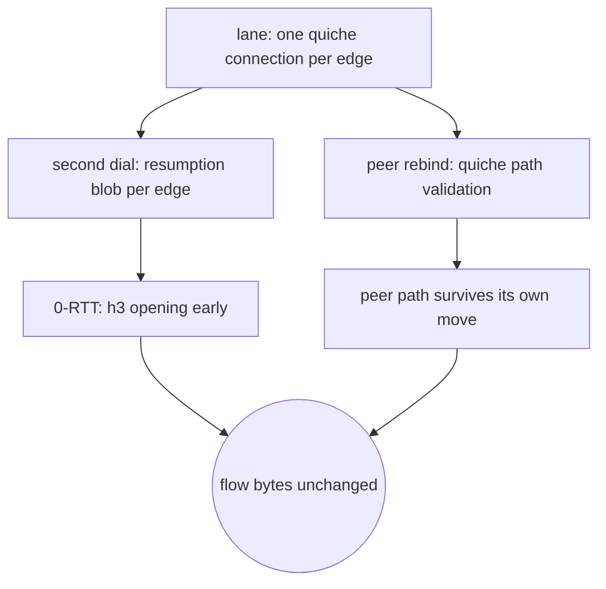

# Multipath QUIC

## Data path

The lane rides `carrier-quic`'s single connection: quiche validates the peer's next path, the dialer resumes a session per edge, and early data is in the plan only when an edge already sent a ticket. There is no second path here to draw.

<!-- counts:begin -->
| key | value | checked by |
| --- | --- | --- |
| ops-retired-instructions | UNBLESSED | scripts/count-ops.sh |
| syscalls-per-relayed-megabyte | UNBLESSED | scripts/count-ops.sh |
| relay-staging-copies-per-byte | UNBLESSED | not measured |
| seconds-per-relayed-megabyte | UNBLESSED | .github/workflows/bench.yml |
<!-- counts:end -->

## Time

**Not measured yet; this is an open high-priority slice, not a refusal.** Row 78 asks for a connection carrying several paths, the reference being draft-quic-multipath (PATH_ID, ADD_PATH/RETIRE_PATH, multipath transport parameters) as realized by `mqvpn`'s xquic fork or SlipStream's picoquic mode. The pinned quiche has no multipath API — `grep -rni multipath upstream/quiche/quiche/src/` finds nothing — so the next slice implements a synchronous Rust multipath lane and takes the wire shape from those references; quiche remains the control for everything below the multipath seam, not the thing that proves the new wire.

What is already in the tree is row 79's single-path floor, both roles: `QuicStream::migrate_source` walks the client onto a new local source without re-handshaking (`a_stream_migrates_its_connection_to_a_new_local`), the server validates a peer's rebound path (`a_peer_rebind_keeps_the_quic_lane`), key updates ride the established connection, 0-RTT resumes by one blob per edge, and batched datagrams run on Linux. The lane's page [`carrier-quic`](carrier-quic.md) names those checks. The missing pieces for row 78 are the multipath wire and scheduler, not another single-path carrier.

No duration is claimed until a CI cell exists; the counts above stay `UNBLESSED` until `scripts/count-ops.sh` and a named `bench.yml` or `parity.yml` cell cover the implemented lane.

<!-- scope:begin -->
- paths: -
<!-- scope:end -->
