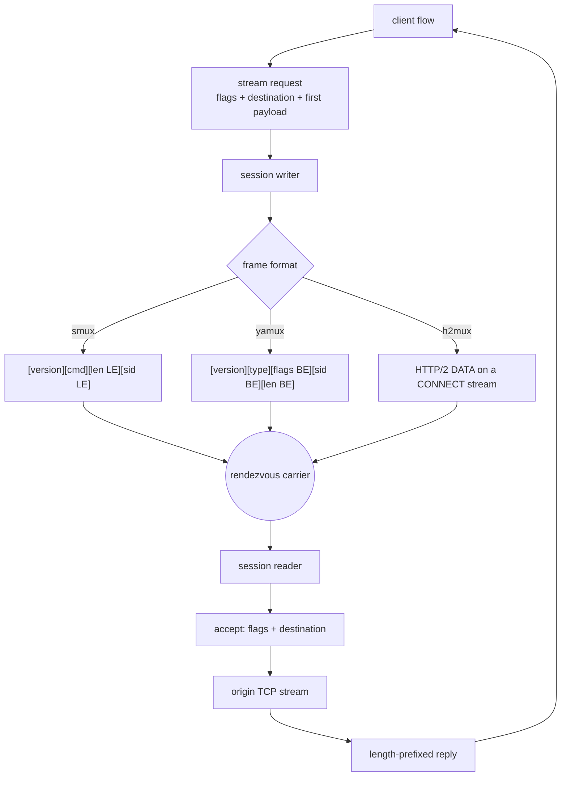

# Mux variants

The three sing-mux sessions are one stream layer with three frame formats. `smux` and `yamux` frame a byte stream by session id; `h2mux` wraps the same stream requests in HTTP/2 CONNECT frames. The session request is the reference's own: `[version][protocol]`, with version 1 adding a padding flag and a length-prefixed pad. Nothing in the carried stream is rewritten.

`mux.protocol` absent is xray's Mux.Cool, byte for byte. An explicit `smux`, `yamux` or `h2mux` names the rendezvous `sp.mux.sing-box.arpa:444`; the outer VLESS, Trojan, Shadowsocks or VMess request reaches that target, then the carrier carries the sing-mux session. A TCP stream's success byte comes before either side frames it; a datagram flow's success byte arrives with its first reply.

## Data path

## Measured

<!-- counts:begin -->
| key | value | checked by |
| --- | --- | --- |
| ops-retired-instructions | UNBLESSED | scripts/count-ops.sh |
| syscalls-per-session | UNBLESSED | scripts/count-ops.sh |
| user-space-copies-per-byte-written | UNBLESSED | no copy checker yet |
| seconds-per-megabyte | UNBLESSED | CI parity.yml (no cell yet) |
| tcp-protocols-round-trip | 3 | ferrox-app-singmux::tests::streams_round_trip_over_each_protocol |
| udp-protocols-round-trip | 3 | ferrox-app-singmux::tests::datagrams_round_trip_over_each_protocol |
| padding-protocols-round-trip | 3 | ferrox-app-singmux::tests::padding_round_trips_over_each_protocol |
| packet-addr-protocols-round-trip | 3 | ferrox-app-singmux::tests::packet_addr_frames_each_datagram_with_its_destination |
| carrier-protocols-round-trip | 3 | ferrox-app-proxy::tests::a_vless_singmux_carries_a_tcp_stream_on_each_protocol |
| absent-protocol-keeps-mux-cool | 1 | ferrox-app-proxy::tests::an_absent_mux_protocol_keeps_mux_cool_and_an_explicit_one_selects_singmux |
| frame-buffer-allocations-per-frame | 0 | ferrox-app-singmux::tests::a_mux_frame_is_read_into_the_sessions_own_buffer |
| carrier-writes-per-frame | 1 | ferrox-app-singmux::tests::a_frame_reaches_the_carrier_in_one_vector |
| udp-packet-buffer-allocations-per-packet | 0 | ferrox-app-singmux::tests::a_mux_udp_packet_is_read_into_the_sessions_own_buffer |
| udp-datagram-read-allocations-per-established-lane | 0 | ferrox-app-proxy::datagram_room_tests::a_datagram_read_reuses_one_room_over_a_stream |
<!-- counts:end -->

## Ops

**Not measured yet.** `scripts/count-ops.sh` has no session probe for this module, so the row stays `UNBLESSED` rather than quoting the harness. The behaviour rows above are the local gates: all three formats round-trip one TCP stream, one connected datagram flow and one full-cone datagram flow each, padding round-trips over every format including h2mux, the three formats ride the VLESS raw carrier in both roles, and the absent-protocol case proves Mux.Cool is still selected.

## Time

**Not measured yet.** The clock is CI's `parity.yml`; no artefact has been read. This page makes no duration claim.

## What was not removed

- **Connected datagrams still use one flow per destination.** Connected UDP is carried with `[u16 len][payload]` in both directions and the success byte on the first reply; the client pool never opens the full-cone form. The server accepts a `flagAddr` request, binds one wildcard socket, and frames every packet as `address | u16 len | payload` in both directions, with the success byte on the first reply.
- **The h2mux write path splits the first request.** The request is now written through the same stream and connection window as a data frame, so a small first window sends part of it and the next frame carries the rest; the server's request reader joins the pieces, and the bytes on the wire are unchanged.
- **A frame is read into the session's own buffer, but a delivered payload is still copied.** The smux, yamux and h2mux loops used to build a fresh vector per frame (`vec![0u8; len]`), so every frame read cost one allocation; each now reads into one buffer per session, grown to the largest frame seen and reused across frames, and the UDP reader does the same for its datagram. `a_mux_frame_is_read_into_the_sessions_own_buffer` doubles eight frames to sixteen for each protocol and finds the allocation count unmoved by the second eight (`frame-buffer-allocations-per-frame` 0), where the old shape built one vector per frame, and `a_mux_udp_packet_is_read_into_the_sessions_own_buffer` does the same for the reader and checks every payload's bytes off the callback (`udp-packet-buffer-allocations-per-packet` 0). What remains, named: the queue takes an owned message, so a delivered payload is still copied once, and the first queued message grows the stream's own queue.
- **Padding is not free.** The first sixteen writes stage `[u16 data][u16 pad]` in one buffer and send it in one call, as the reference does; the allocation and the payload copy are still paid on each of those writes. The gate covers smux, yamux and h2mux, including the HTTP/2 preface and settings frames.
- **smux v1 has no receive-window frame.** The reference's default smux version is 1, so there is no `cmdUPD`; the 64 KiB stream queue is the local `MaxStreamBuffer` backpressure, and a 1,024-stream admission cap bounds the aggregate. yamux and h2mux return credit only when the consumer drains a message, so their queues are bounded by the advertised 256 KiB and 4 MiB windows; a stalled reader stops both protocols at the window, not at process memory.
- **No conformance arm.** The pinned sing-mux tree has no test suite and no seam that injects `ferrox-app`, so `conformance.yml` has nothing to run for this row; the round trips prove this tree against itself, not against sing-mux.

## References

| what | where |
| --- | --- |
| stream request, padding, protocol names | `upstream/sing-box/common/mux/`, `sagernet/sing-mux` |
| smux frame layout | `sagernet/smux` |
| yamux frame layout | `hashicorp/yamux` |
| h2mux CONNECT framing | `sagernet/sing-mux/h2mux.go` |

<!-- scope:begin -->
- paths: crates/ferrox-app/src/singmux.rs
- symbols: singmux, serve_singmux_tunnel, spawn_singmux_halves, spawn_singmux_connection, tcp_pool, udp_pool, mux_pool_downlink, PooledFlow, PooledReplies, relay_pool_flow, Mux
- go: ./common/mux/...
<!-- scope:end -->
