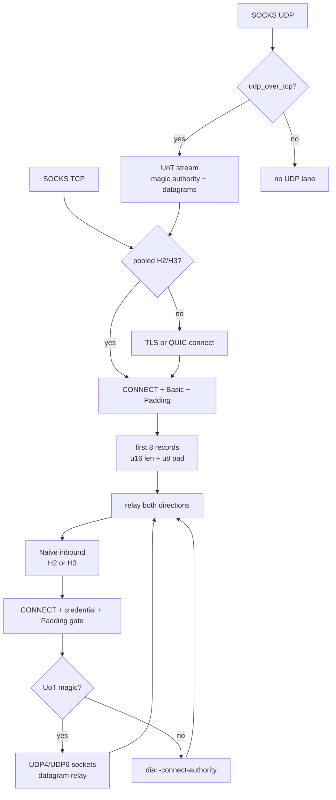

# NaïveProxy

NaïveProxy is an HTTP `CONNECT` tunnel with a Basic credential and a padding header. Both roles are served: a `protocol: naive` inbound reads `settings.users`, the flat `settings.username`/`settings.password`, or top-level `users`, and an outbound reads the first `settings.servers` entry or the flat settings. The outbound requires TLS. The inbound serves plaintext HTTP/2 when security is empty or `none`, serves TLS only when security is `tls`, and refuses any other value; HTTP/3 needs TLS.

Plaintext HTTP/2 carries the Basic credential in clear, so it is for a trusted link, never a direct client over an untrusted network. The request is `CONNECT <authority>`, with `Proxy-Authorization: Basic base64(user:password)`, a generated `Padding` header, and `-connect-authority`. The server refuses a missing or wrong credential with `407`, a missing method or padding with `400`, and an unfreedom target with `502`; a successful tunnel answers `200` with its own `Padding` header. When the response carries a `Padding` header, the first eight wire records in each direction carry a three-byte header (u16 payload length, u8 padding length) and that many zero bytes; a write may produce several records and a read may return part of one, so the boundary is counted in records, not calls. After eight records the tunnel is raw. A response without `Padding` uses raw framing in both directions. Padding lengths are random, so only the structure is claimed, never the bytes.

HTTP/2 outbounds open streams across `insecure_concurrency` pooled connections and add another until that limit is reached; HTTP/3 outbounds do the same across pooled QUIC connections and use QPACK fields. A full stream table opens another connection when the pool limit permits and otherwise waits for capacity instead of refusing the flow, and a dead or `GOAWAY` connection is dropped without closing the streams still using it. The server speaks raw HTTP/3 rather than the xHTTP service. `stream_receive_window` sets the H2 connection window (each stream gets half, the order Cronet's `SetHTTP2Options(session, initial)` takes) and the H3 stream credit, `quic_session_receive_window` sets the H3 connection credit, and `quic_congestion_control` installs `reno`, `cubic`, or `bbr`/`bbr2` (quiche's BBR2) on the outbound; the inbound accepts `reno`, `cubic`, or `bbr` and refuses `bbr2`. The inbound defaults to BBR, while an outbound with no name keeps Chromium's CUBIC default. With neither window named, the outbound keeps the reference client's defaults: 128 MiB of H2 connection credit with 64 MiB streams, 4 MiB of H2 connection credit with 2 MiB streams on iOS, 6 MiB of H3 stream credit, and 15 MiB of H3 session credit.

`udp_over_tcp` carries UDP on its own stream, version 2 by default or version 1 when named. The outbound opens one stream per destination and source to `sp.v2.udp-over-tcp.arpa` (or `sp.udp-over-tcp.arpa` for v1); v2 sends the reference's request header before its u16-length datagrams, while v1 sends datagrams directly after the stream opens, and replies come back as SOCKS5 UDP; the inbound recognises the same magic authority and relays the stream's datagrams over the IPv4 and IPv6 sockets it binds for that stream. A v2 request names its destination with SOCKS address types (`1` IPv4, `4` IPv6, `3` name); a v1 or unconnected v2 datagram names it with UoT's own family bytes (`0`, `1`, `2`), while a connected v2 datagram carries only its u16 length and payload. The association's control connection is polled with a bounded timeout while its lane runs, so a closed client ends the lane instead of leaving it sending to a dead port. A v2 connected request connects its UDP socket to the resolved peer, so replies from any other source are rejected. The option accepts `true`, `false`, or `{enabled, version}`. With it, `udp_lane_supported` is true and the outbound's datagram lane is open; without it, UDP is not advertised.

## Data path

## Measured

<!-- counts:begin -->
| key | value | checked by |
| --- | --- | --- |
| ops-retired-instructions | UNBLESSED | scripts/count-ops.sh |
| syscalls-per-connect | UNBLESSED | no per-connect syscall checker yet |
| user-space-copies-per-byte-relayed | UNBLESSED | no copy checker yet |
| seconds-per-relayed-megabyte | UNBLESSED | CI bench.yml (no tunnel cell yet) |
<!-- counts:end -->

## What was removed

The pinned Xray-core and ZeroNet trees carry no NaiveProxy method, so the comparison is sing-box's `protocol/naive/` and its `cronet-go` client. Against those, this is a rewrite: one `NaiveStream` serves both roles and both transports, and the HTTP/2 and HTTP/3 lanes reuse the existing `H2Client`/`H2Service` and `H3Reader`/`H3Writer` framing instead of adding a second HTTP stack. The server keeps one HTTP/2 connection per accepted socket and one QUIC connection per H3 session; the outbound spreads flows across up to `insecure_concurrency` pooled connections, so reusing an existing connection avoids a handshake, while a new connection — the first or one added as the pool grows — pays TLS or QUIC before its CONNECT. The reference's padding arithmetic is reproduced exactly: eight wire records in each direction, a u16 payload length, a u8 padding length, zero fill, a split at 65,535 bytes, and a 30–61 byte header whose first 16 bytes come from the reference alphabet. The client does not copy the request head into an intermediate HTTP writer; it builds the QPACK or HPACK block and opens the stream directly.

What is not removed: TLS and the Basic credential remain, the padding header and eight padded records remain, H2/H3 connection pools remain, and every flow still pays one CONNECT head and one response head. UoT adds one stream and one request head per destination, and its datagrams pay a u16 length prefix (plus an address in version 1 or an unconnected version 2 datagram); the outbound relays through the association's one socket, and the inbound binds one IPv4 and one IPv6 UDP socket per stream when the host has each and polls them at the relay budget. The ops row above stays `UNBLESSED` until an `ops.yml` run measures this page, and the syscall row stays `UNBLESSED` until a checker keys a syscall count to one connect instead of a whole test process. The copy row stays `UNBLESSED` until a pointer-identity checker observes the relay, and the time row stays `UNBLESSED` until a CI tunnel cell measures it; neither value is quoted from a local run.

## Time

No CI benchmark measures a NaïveProxy tunnel yet, so no time is quoted and no local duration is used.

<!-- scope:begin -->
- paths: crates/ferrox-app/src/naive.rs
- symbols: naive
<!-- scope:end -->
