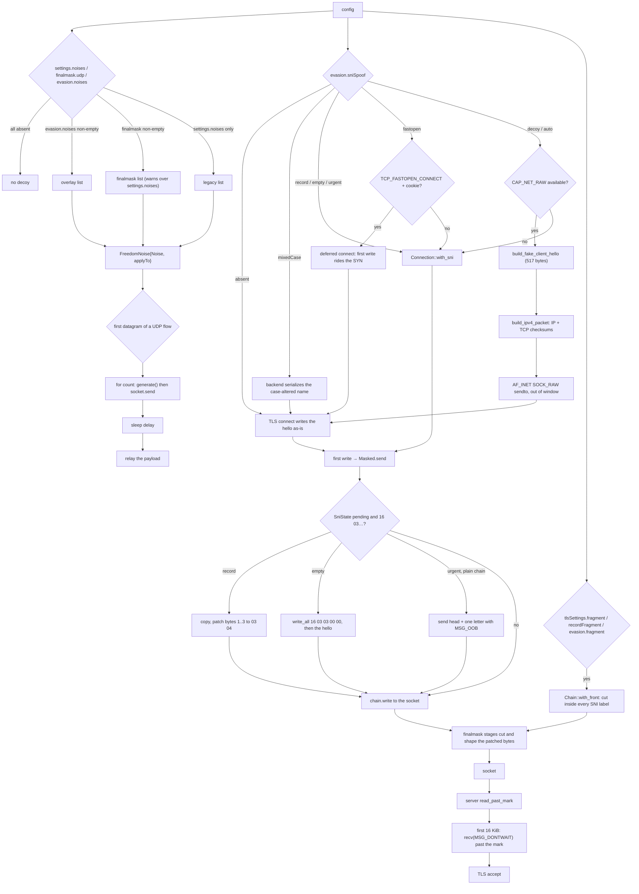

# Evasion on TCP/TLS: noise, fake-SNI, fragmentation and the urgent byte

The reference's `zero-evasion` layer hides a flow from a filter that reads it, and this tree
carries its TCP/TLS knobs alongside the UDP decoys. A freedom outbound's UDP lane sends a
configured decoy list before its first datagram; a TLS outbound's `evasion.sniSpoof` sends a
decoy `ClientHello`, or cuts the real one with the record, empty-record, urgent-byte or
mixed-case name; and `tlsSettings.fragment` / `recordFragment` cut the `ClientHello` into TLS
records whose boundaries sit inside the server name. The no-root fake-ClientHello lane is
`obfs-sni-spoof` (README row 114) and is not claimed here. Handshake noise profiles are row 194.

Keepalive shaping on this lane has no application frame to spend: a raw TLS stream cannot carry
a legal no-op, and TLS 1.3 forbids a zero-length application record. The shipped forms are the
ones that already exist — the TCP keepalive socket options (`sockopt.rs`,
`tcpKeepAliveIdle`/`tcpKeepAliveInterval`) on raw carriers, and the WebSocket heartbeat
(`heartbeatPeriod`, an `OP_PING` in `ws.rs`) on the WS carrier. An adaptive schedule and a
cellular-handover rebind are row 173.

A `noise` list reaches the UDP writer through three spellings, read in the reference's order:
`settings.noises` (the legacy freedom schema), `finalmask.udp[type=noise].settings.noise`, and
an outbound-level `evasion.noises` overlay. A non-empty `evasion.noises` replaces the other two,
a non-empty `finalmask` list replaces `settings.noises`, and a config that names both
`settings.noises` and `finalmask` gets one warning and the finalmask list, which is the
reference's own verdict rather than a refusal. Every entry keeps its `type` (`rand`, `str`,
`hex`, `base64`, `array`, `quic`), its `packet`/`rand`/`randRange` bytes, its `delay`, its
`count` (default one) and its `applyTo` family filter. `rand` draws a length in `packet`'s
half-open range and fills it with bytes from `randRange` (default `0-255`); `quic` draws from
`packet` (default `5-10`) but never sends fewer than 25 bytes, the smallest long-header Initial
its fixed fields need, and writes that shape; the fixed types write their own bytes. A drawn
length whose upper end can exceed the family's UDP payload limit is refused at parse time, as is
a fixed packet longer than it, and `count` sends that many datagrams per entry, each followed by
the entry's wait.

`sniSpoof` is an outbound-level `evasion.sniSpoof` block on a TLS outbound. `method` is `auto`,
`decoy`, `urgent`, `fastopen`/`tfo`, `record`/`recordversion` or `empty`/`emptyrecord`;
`fakeSni` (or `fake_sni`) is 1..=219 visible bytes and defaults to `www.speedtest.net` for the
methods that need no decoy, where `?`, `#` and `*` draw a letter, a digit or either once per
dial; `sequence` is the decoy segment's sequence number; `fooling` is `auto`, `md5` or `ttl`, and
a `ttl` fooling takes `ttl` (default 8, and zero is refused). `mixedCase` (also `mixed_case` and
`mixedCaseSni`) hands the dial's TLS backend a case-altered name to serialize: the first letter
of each label is upper case and every other letter draws its case, so the name is the same string
to the server (DNS is case-insensitive), keeps its length, and is a fresh string to a filter that
matches a lower-case name. The rewrite happens before the backend builds the hello, never in the
record below it, because the peer's handshake check covers the bytes the backend hashes. The decoy is a fixed 517-byte `ClientHello` naming `fakeSni`, built
with five cipher suites and the SNI, groups, point formats, signature algorithms, supported
versions and a key-share extension, then padded; the IPv4 packet and TCP checksums are computed
over the segment, and it leaves a fresh `AF_INET`/`IPPROTO_RAW` socket that copies the dialled
socket's mark and bound device, so the decoy takes the same route as the real hello. `auto` and
`md5` add the 18-byte TCP signature option (kind 19), signed with no key, which a peer that never
agreed on one drops; `ttl` leaves the option out and writes the hop limit into the IPv4 header,
because a raw socket with a supplied header sends that header rather than the socket's `IP_TTL`,
and recomputes the header checksum.

The `urgent` method sends the hello's first part with one extra random letter marked urgent at
the end, cut in the middle of the name. The peer's kernel removes the extra byte from the
ordinary stream, so the TLS server reassembles the hello byte for byte; a filter that rebuilds
the stream without honouring the mark keeps the letter and sees a name it does not know. Linux
and Android send it with `MSG_OOB | MSG_NOSIGNAL` in one `send`; every other platform, and a
dial whose first write has to pass a `finalmask` chain, an `xmc` session or a header handshake
first, keeps the record fallback below and prints no warning, because the byte cannot be placed
on the wire from where the wrapper sits. The urgent byte is only ever an *extra* byte: a kernel
that takes less than the whole first part fails the connection rather than letting a real byte
carry the mark and be lost.

Where the kernel lets the process send a raw segment (Linux with `CAP_NET_RAW`), `auto` and
`decoy` send the fake hello outside the connection's sequence window before the handshake and
write the real hello untouched. Where it does not, and on every other platform, both fall back to
the `record` rewrite and print one warning per process. `fastopen` arms `TCP_FASTOPEN_CONNECT` on
a direct Linux/Android leg, makes a first connect that asks the server for a cookie and a second
one that carries it, and keeps the deferred socket, so the handshake's first write — the
ClientHello, or the decoy a `finalmask` puts in front of it — rides the SYN. A kernel that lacks the option or a server that sends no cookie
keeps the record rewrite and prints one warning per process; a `dialerProxy` hop never arms the
option on this leg — the inner dial owns the hello — and rewrites the record without a warning. The record rewrite
is armed on the same `Connection` the handshake writes through, ahead of the `finalmask` chain and
of an `xmc` session's payload write, and pads the version in the first TLS record header from
`03 01`/`03 03` to `03 04` once per stream; a write that does not open a TLS handshake record is
left alone and leaves the rewrite armed for the next one, so a one-byte cut cannot spend it. The
`empty` method writes one five-byte empty handshake record (`16 03 03 00 00`) ahead of the hello
instead; the decoy spends no hello slot, so a fragment stage behind it still cuts the real hello.

`tlsSettings.fragment` cuts the first write at one random width in `1..=64` octets, below the
smallest `ClientHello` body, so a config that asked for a cut gets one on the first record; a
width that covers a shorter write ends the run there, as the reference's clamp does;
`recordFragment` places one record boundary inside every label of the server name, one fresh
random byte per label, the top-level label included. Both set the SNI cut, and
`fragmentFallbackDelay` (a bare millisecond number or a string with `ms`, `s`, `m` or `h`) is the
pause between those records; a delay alone is inert. `evasion.fragment` takes the finalmask
spelling instead (`packets: "tlssni"`, `lengths`, `delays`, `maxSplit`) and wins over the TLS
settings. The stage is built in `dial_tls_session` and placed in front of the mask chain with
`Chain::with_front`, under the handshake, so a raw TLS dial and a TLS-carried lane (the WebSocket
carrier) take the same cut; one zero delay merges the records into a single `writev`, with a
record that rides behind the hello in the same gather, and a sink that refuses part of the burst
has the remainder retained for the next write, with each configured delay still falling between
the records it spaces. A write that carries no server name falls back to the width cut instead of
going out whole. Only the first complete handshake record is re-framed: a record whose body is
still arriving is forwarded to its declared end and closes the slot, so its continuation is never
read as a hello of its own.

The server side of the urgent byte is `Connection::read_past_mark`, armed on every TLS accept. A
blocking read stops at an urgent mark even when bytes have arrived behind it, and the next read
then waits for a segment that never comes. In the first 16 KiB, after every read that made
progress, the stream asks `recv(MSG_DONTWAIT)` again and drains whatever lies past the mark; the
bytes go to the same buffer the TLS decoder is filling. After the window the drain is a
comparison, so bulk traffic is untouched. This is zeronet's `ReadPastMark` policy, and it is
applied to every accepted TCP connection because the server cannot know which client used the
method.

The record shape lives in `Connection::Masked` (`crates/ferrox-app/src/conn.rs`) as an
`Arc<SniState>` shared by every handle of the stream. The record is shaped before the chain — or
an `xmc` session — sees it, so a stage that cuts the hello still sends the patched header, and a
relay leg that cloned the mask keeps the same one-shot state. The mixed-case name is the one
exception: it rides in `TlsConfig.server_name`, because the backend hashes the hello it builds. A config naming no `finalmask` still gets the
wrapper, with an empty chain, because the rewrite is a property of the dial rather than of a
mask.

## Data path

## Measured

<!-- counts:begin -->
| key | value | checked by |
| --- | --- | --- |
| fake-hello-octets | 517 | ferrox-core-evasion::tests::a_fake_hello_is_the_fixed_packet_and_carries_its_name |
| fake-sni-max-bytes | 219 | ferrox-core-evasion::tests::a_fake_name_outside_the_bound_is_refused |
| decoy-segment-checksums | 2 | ferrox-core-evasion::tests::a_decoy_packet_has_both_checksums_right |
| noise-packets-per-count | 3 | ferrox-app-proxy::tests::a_noise_count_sends_that_many_packets |
| noise-entry-kinds-parsed | 5 | ferrox-app-proxy::tests::a_freedom_noise_keeps_its_packet_and_family |
| noise-overlay-precedence | 1 | ferrox-app-proxy::tests::a_finalmask_noise_wins_over_the_legacy_list |
| record-header-version-bytes | 2 | ferrox-app-conn::tests::a_record_shape_rewrites_one_header |
| sni-label-cuts | 4 | ferrox-core-evasion::tests::every_label_of_a_name_takes_a_cut_inside_it |
| mixed-case-name-octets | 15 | ferrox-core-evasion::tests::a_mixed_case_name_is_the_same_name_to_the_server |
| sni-record-count | 5 | ferrox-core-finalmask::tests::an_sni_record_is_cut_inside_the_name_and_arrives_whole |
| empty-record-octets | 5 | ferrox-app-conn::tests::an_empty_shape_precedes_one_record |
| noise-ops-retired-instructions | UNBLESSED | scripts/count-ops.sh |
| decoy-ops-retired-instructions | UNBLESSED | scripts/count-ops.sh |
| noise-syscalls-per-flow | UNBLESSED | scripts/count-ops.sh |
| decoy-syscalls-per-hello | UNBLESSED | scripts/count-ops.sh |
| noise-copies-per-packet | UNBLESSED | scripts/count-ops.sh |
| evasion-time | UNBLESSED | bench.yml |
<!-- counts:end -->

## Ops

`fake-hello-octets`, `fake-sni-max-bytes`, `decoy-segment-checksums`, `noise-packets-per-count`,
`noise-entry-kinds-parsed`, `noise-overlay-precedence`, `record-header-version-bytes`,
`sni-label-cuts`, `mixed-case-name-octets`, `sni-record-count` and `empty-record-octets` are
quantities the named tests assert themselves: the builder's fixed length, its name bound, the two
checksums a decoy segment carries, the datagrams a `count` sends, the five kinds one parser test
feeds, the one list that wins an overlay, the two version bytes a record rewrite replaces, the
one cut inside each of the four labels of `www.example.co.uk`, the fifteen name octets mixed case
leaves unchanged, the five records the four-label name becomes (one per label and the tail), and
the five bytes of the empty record. None is a syscall or an instruction count.

The urgent method has no local count: the extra byte exists only on Linux and Android, and this
page's tests run on macOS too, where the shape falls back to the record rewrite. Its Linux wire
is covered by zeronet's own urgent suite, not by a number here; the extra octet belongs in that
suite's prose, not in this table.

`noise-ops-retired-instructions` and `decoy-ops-retired-instructions` stay `UNBLESSED`: no
valgrind probe prices either path yet, and `ops.yml` is the only reader that could turn them into
numbers. `noise-syscalls-per-flow` is `UNBLESSED` for the same reason, and because a flow's
`count` and `delay` are the config's own schedule, so a measurement must drive a fixed list
rather than a config. `decoy-syscalls-per-hello` is `UNBLESSED`: the decoy needs a Linux kernel
that grants `CAP_NET_RAW`, which no local run in this tree has. `noise-copies-per-packet` is
`UNBLESSED`: the fixed kinds hand back their own bytes by clone, and the drawn kinds build their
buffer from entropy, so the interesting copy is the UDP writer's, which is not yet priced.

The server drain is a real read-granularity change and belongs on the page, not in the table yet:
in the first 16 KiB of a TLS accept, a read that made progress is followed by one nonblocking
`recv`, and a peer with data already buffered receives it in the same call. After 16 KiB the
window costs a comparison and no syscall. The counts are `UNBLESSED` until `ops.yml` prices the
server accept; the client-side fragment is one `writev` for a zero delay and one `write` per
record otherwise, which is the same count the `tlssni` stage already documents in
`obfs-fragment-tlssni`.

## Time

**No row measures this lane.** `evasion-time` is `UNBLESSED` by `bench.yml`: neither `bench.yml`
nor `parity.yml` has an evasion cell, and a noise entry's `delay` is a sleep the config asked for,
so timing the path would price the schedule and the tunnel, not the code. The decoy's only
duration is the raw `sendto`, which is one segment either way. What the slice is gated on instead
is byte-identity and refusal: the checksum test holds the segment's bytes to the RFC's own
checksum vector, the fragment tests hold the handshake to its original bytes after the records are
reassembled, and the parser tests hold every accepted form and its refusal.

## What each reference gave

- **zeronet** `zero-evasion/src/sni_desync.rs`, `decoy.rs`, `record.rs`, `urgent.rs`,
  `fragment.rs`, `noise.rs`, `rand_between.rs` and `zero-config/src/xray_json.rs` — the
  `sniSpoof` field set and its defaults, the five methods, the 517-byte fixed decoy hello with
  wildcard names, the record version rewrite, the empty record, the urgent byte and its
  `ReadPastMark` server drain, the label-boundary `tlssni` cut, the noise kinds, `count`,
  `randRange`, `quic`, the `finalmask.udp` spelling and the `RandBetween` bounds.
- **xray-core** `transport/internet/finalmask` and `infra/conf/transport_finalmask.go` — the
  `finalmask.udp[type=noise]` container that `finalmask.md` already owns, the `settings.noises`
  freedom schema this tree's parser already read, and the `Fragment` stage the TLS cut reuses.
- **sing-box** `common/tlsfragment` and `option/tls.go` — `splitRecord`'s one boundary per SNI
  label and `fragmentFallbackDelay`, taken as the `recordFragment`/`fragment` spelling above TLS
  and moved under the backend so the cut lands on the ClientHello records themselves.
- **LxBox** `docs/spec/features/016-DPI_HARDENING/` — the mixed-case name that accompanies a cut,
  first letter upper and the rest drawn, which this tree applies in place and shares with every
  shape.
- **aether, xray-core-rust, xray-rust** — nothing taken for this row; their handshake noise
  profiles and conformance seams belong to the rows named above.

## What we removed

- **A `ClientHello` builder per dial.** The reference assembles the decoy template into a fresh
  `Vec` for every connection. This tree builds the same 517 bytes from one function into one
  buffer whose capacity is the fixed packet length, draws the random and session id in place, and
  pads to the bound, so the decoy's size is a constant rather than a function of the name.
- **A decoy on a route of its own.** A synthetic segment leaves through its own raw socket, and
  a raw socket with no mark or bound device can exit where the real hello does not. This tree
  copies the dialled socket's `SO_MARK` and `SO_BINDTODEVICE` first, and when either copy is
  refused it sends no decoy rather than one a mark or interface rule would sort differently.
- **A per-stream wrapper for the record rewrite, and a second one for the urgent byte.** The
  reference wraps the connection twice, once for the desync and once for the urgent stream. This
  tree stores one `Arc<SniState>` on the existing `Connection::Masked`, sends the urgent byte
  through that same struct's raw descriptor, and shapes the record before the chain, so an
  unconfigured connection pays no wrapper, a configured one pays one atomic swap, a fragmenting
  stage cannot spend the rewrite on a short cut, and a cloned relay leg shares the same one-shot
  state.
- **The urgent byte and the hello in the SYN.** Both ship on Linux and Android. Fast Open costs
  the deferred connect nothing beyond one throwaway handshake per dial until the kernel caches a
  cookie; a server that never sends one pays it on every dial. The record rewrite stands in where
  the kernel refuses the option or the server sends no cookie, with one warning per process, and
  silently behind a `dialerProxy` because the inner leg owns the hello. Neither is silently
  skipped: a config that asks for fast open still sends a hello.
- **A second handshake parser for the cut.** The fragment stage and the mixed-case rewrite read
  the same `server_name_range` the record decoy already needed, so the bound checks (record
  length, handshake length, version, extensions) exist once and a truncated record can never
  yield a guessed range.
- **A refusal where the reference warns.** The reference refuses a config that names both
  `settings.noises` and `finalmask.udp` noise. This tree warns in one line and prefers the
  finalmask list, because the drop-in rule says a working config keeps working.

<!-- scope:begin -->
- paths: crates/ferrox-core/src/evasion.rs
- symbols: evasion, arm_sni, warn_sni, inject_sni_decoy, fastopen, FreedomNoise, parse_freedom_noises, parse_noise_list, parse_finalmask_noises, parse_freedom_noise, freedom_base64, freedom_byte_range, freedom_array, outbound_sni_spoof
- scenarios: vless-tls-raw
<!-- scope:end -->
