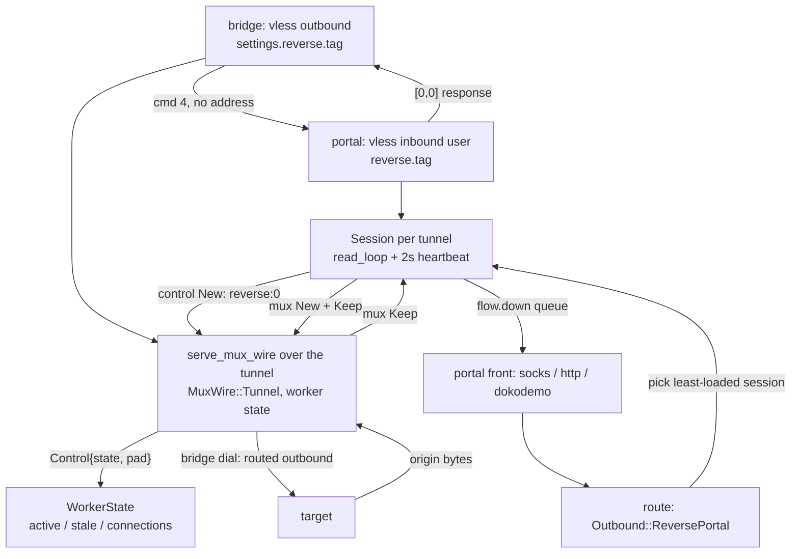

# The reverse tunnel: bridge and portal

A bridge behind a NAT opens a VLESS request with command 4 — the header names no address — and the portal answers with the empty response header and treats the rest of that connection as a mux session. The portal then picks that session for any flow its rules send to the inbound user's `reverse.tag`, and the bridge dials the target on the portal's behalf. Both roles are the pinned reference's modern VLESS reverse: there is no separate reverse inbound, outbound or dispatcher any more, and no `rvs` control socket.

The control stream is a mux UDP flow to the internal domain `reverse`. A protobuf `Control` carries `state` (0 `ACTIVE`, 1 `DRAIN`) and a random pad; the portal sends one every two seconds, but only when the counter is 1 or the session is draining, and the bridge decodes it into `WorkerState`. A session drains once it has carried 256 flows; the picker prefers the least-loaded live session, skips a draining one until nothing else is left, and a bridge monitor opens another session when none is live or the live ones average more than sixteen flows each. A session whose control stream is silent for 60 seconds is closed by the monitor.

Both roles carry every VLESS transport that exposes a stream: raw, TLS, REALITY, WebSocket, gRPC, HTTPUpgrade, HTTPHeader, xHTTP, QUIC, KCP, hysteria and xdrive. A bridge flow then leaves through any outbound the config's rules name, not just `freedom` or `blackhole`; the bridge hands that outbound a loopback stream, the same hop every front uses when a lane returns a relay instead of a socket. UDP bridge flows still use the direct `freedom` lane.

What refuses, by name at startup: a bridge whose carrier has no stream to hand the mux (MASQUE, plain HTTP, or an unknown network), a bridge or portal user whose flow is `xtls-rprx-vision`, a reverse user opening anything but command 4, and a forward user opening command 4.

## Data path



## Measured

<!-- counts:begin -->
| key | value | checked by |
| --- | --- | --- |
| ops-retired-instructions | 80066 | scripts/count-ops.sh |
| tcp-echo-bytes-preserved | 5 | ferrox-app-proxy::reverse_tests::a_portal_flow_reaches_the_bridge_and_comes_back |
<!-- counts:end -->

Syscalls: one loopback `connect` plus one `accept` per bridge worker at startup, one more pair per flow that leaves through a non-freedom outbound, one mux frame write per uplink chunk, one outbound `connect` per flow the bridge dials, and the relay's own reads and writes — no checker counts this yet.

Copies: a whole downlink frame is parsed where the read landed it and copied once, into the flow's queue (`data.to_vec()`), because the queue is what lets a slow consumer cost only its own flow. Only a frame that straddles two reads is copied into a carry first. The uplink copies nothing: the header is built in the session's scratch and the caller's payload is written with one `writev`, the same two-part write a direct mux session makes. A pointer-identity test does not exist for either arm yet, so both stay prose rather than manifest rows.

## Ops

```bash
./scripts/count-ops.sh report \
  proxy::reverse_tests::a_sixteen_kib_downlink_is_echoed_whole 'reverse::Session::read_loop'
```

**80,066 retired instructions** for a 16 KiB downlink (two 8 KiB mux frames), from CI `ops` run 40137286906; the same downlink cost **109,108** before the read loop parsed it in place (run 40130833832), so the copy and the common drain removal is **-29,042 instructions (-26.6%)**. Three after runs read 79,952, 80,066 and 80,534: the socket's frame split moves this informational row by about 0.7%, so it is not a blessed gate. The 5-byte echo is correctness, not a priced downlink.

## Time

**Not measured yet.** Durations in this repository come from CI runners (`bench.yml`, `parity.yml`); no CI artefact has been read, and a laptop behind a VPN measures a tunnel either way.

## What we removed

**The downlink's second copy of a whole frame.** `read_loop` read into a 32 KiB `chunk`, extended a `buf` with the whole chunk, parsed it, then `drain`ed the consumed prefix — so a whole frame crossed user space twice before the flow queue copied its payload. The loop now parses the read where it landed; only a frame that straddles two reads is copied into a carry. A 16 KiB downlink (two 8 KiB mux frames) costs **80,066 Ir**, down from **109,108** (**-29,042, -26.6%**), in CI `ops` runs 40137286906 and 40130833832; the 16 KiB echo test holds the bytes, and the 5-byte flow still passes.

The reference's separate dispatcher and its own mux client. Xray used to serve reverse through `app/reverse`'s inbound/outbound pair and, in ZeroNet, through a `reverse.rs` that implemented Mux.cool framing again. Here the portal registers one `Outbound::ReversePortal` inside the route registry the config already built, the session is a mux client used by nothing else, and the bridge serves the portal's flows through the same `serve_mux_wire` a VLESS mux inbound uses. The three command-4 checks (header, user, flow) live in one `reverse_ask`, so no carrier can grow its own. sing-box has no VLESS reverse portal or bridge at this pin, so there is no shape of its to compare.

## What was not removed

The local hop. A bridge still needs a stream that `dial_vless` returns, and that function relays a `Connection`, so each worker opens an extra loopback TCP pair — one connect, one accept, two sockets the reference does not need — and a flow's bytes cross it. Removing that is a `dial_vless` that hands back its relayed halves instead of pumping them, and it is the largest cost on this page.

A bridge flow that leaves through an outbound other than `freedom` adds a loopback TCP pair the reference does not need: one connect, one accept, two sockets, and a relay between them. The direct `freedom` lane keeps the shorter path. Draining closes the control writer and the tunnel but sends `End` for the control id rather than interrupting the reader the way the reference does; the bytes differ on that teardown only. Per-flow queued downlink is a fixed 32 KiB, not the policy `bufferSize`. UDP bridge flows still use the direct `freedom` socket, so a datagram routed to another outbound is dropped.

## Pins

| what | where |
| --- | --- |
| command 4 header, empty response, portal handler over mux | `upstream/xray-core/proxy/vless/encoding/encoding.go`, `upstream/xray-core/proxy/vless/inbound/inbound.go`, `upstream/xray-core/proxy/vless/outbound/outbound.go` |
| built-in reverse config: inbound `reverse.tag`, outbound simplified style, sniffing refused | `upstream/xray-core/infra/conf/vless.go`, `upstream/xray-core/proxy/vless/account.go` |
| `Control{state, pad}`, 2s heartbeat, drain past 256, picker, 16-flow monitor | `upstream/xray-core/app/reverse/portal.go`, `upstream/xray-core/app/reverse/bridge.go`, `upstream/xray-core/app/reverse/reverse.go` |
| the ZeroNet shape this row was written against | `upstream/zeronet/crates/zero-runtime/src/reverse.rs` |

<!-- scope:begin -->
- paths: crates/ferrox-app/src/reverse.rs
- symbols: reverse_portals, reverse_carried, reverse_ask, ReverseAsk, attach_reverse, attach_reverse_session, serve_reverse_tcp, vless_reverse_header, BridgeLane, bridge_tunnel, serve_bridge_mux, start_bridges, find_bridges, dial_vless_reverse, dial_vless_kcp_header, dial_vless_xdrive_header, reverse_tests, portal_echo, a_portal_flow_reaches_the_bridge_and_comes_back, a_sixteen_kib_downlink_is_echoed_whole, a_reverse_account_attaches_a_kcp_session_without_freedom, a_bridge_lane_routes_a_flow_through_a_socks_outbound, connection_closer, into_tunnel
- go: ./proxy/vless/..., ./app/reverse/...
<!-- scope:end -->
