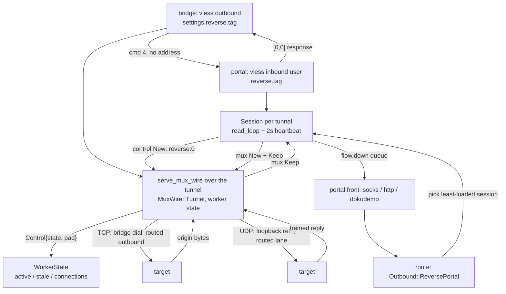

# The reverse tunnel: bridge and portal

A bridge behind NAT opens a VLESS request with command 4; the header names no address. The portal answers with an empty header and treats the rest as a mux session. The portal picks that session for any flow its rules send to the inbound user's `reverse.tag`, and the bridge dials on the portal's behalf. Both roles are the pinned reference's modern VLESS reverse: no separate inbound/outbound/dispatcher and no `rvs` socket.

Control is a mux UDP flow to the internal domain `reverse`. A protobuf `Control` carries `state` (0 `ACTIVE`, 1 `DRAIN`) and random pad; the portal sends one every 2 s only when the counter is 1 or the session is draining, and the bridge decodes it into `WorkerState`. A session drains after 256 flows; the picker prefers the least-loaded live session, skips a draining one until nothing else is left, and a bridge monitor opens another when none is live or live ones average more than 16 flows. A control stream silent for 60 s is closed.

Both roles carry every VLESS transport that exposes a stream: raw, TLS, REALITY, WebSocket, gRPC, HTTPUpgrade, HTTPHeader, xHTTP, QUIC, KCP, hysteria and xdrive. A bridge flow leaves through any routed outbound that serves its network, not just `freedom` or `blackhole`. A TCP flow gets a loopback stream; a UDP flow gets a loopback relay, the bridge frames each datagram with its destination, routes it to the rule-picked tag, and forwards the framed reply. A name stays a name through SOCKS5, an empty datagram is carried, and the relay stop flag cancels the lane worker when the mux flow ends. A bridge with one fixed `freedom` outbound keeps the direct socket.

Startup refusals by name: a bridge carrier with no stream to hand the mux (MASQUE, plain HTTP, unknown network), a bridge/portal user whose flow is `xtls-rprx-vision`, a reverse user opening anything but command 4, and a forward user opening command 4.

## Data path



## Measured

<!-- counts:begin -->
| key | value | checked by |
| --- | --- | --- |
| ops-retired-instructions | 80066 | scripts/count-ops.sh |
| tcp-echo-bytes-preserved | 5 | ferrox-app-proxy::reverse_tests::a_portal_flow_reaches_the_bridge_and_comes_back |
| fixed-bridge-route-allocations-per-datagram | 0 | ferrox-app-proxy::tests::a_bridge_datagram_route_borrows_its_lane |
<!-- counts:end -->

Syscalls: one loopback `connect`/`accept` per bridge worker at startup, one more pair per TCP flow through a non-`freedom` outbound, one mux frame write per uplink chunk, one outbound `connect` per bridged TCP flow, plus relay reads/writes. A routed UDP flow adds a loopback relay pair, a read/write per datagram, and one lane per tag. A fixed-`freedom` bridge keeps the direct socket. No checker counts this yet.

Copies: a whole downlink frame is parsed in place and copied once into the flow queue (`data.to_vec()`), so a slow consumer costs only its flow; only a straddling frame is carried. The uplink copies nothing: the header is built in session scratch and the payload written with one `writev`. A routed UDP datagram copies once into the SOCKS5 frame; the reply is parsed in place and written into the mux frame. No pointer-identity test exists, so both stay prose.

## Ops

```bash
./scripts/count-ops.sh report \
  proxy::reverse_tests::a_sixteen_kib_downlink_is_echoed_whole 'reverse::Session::read_loop'
```
./scripts/count-ops.sh report \
  proxy::reverse_tests::a_sixteen_kib_downlink_is_echoed_whole 'reverse::Session::read_loop'
```

**80,066 retired instructions** for a 16 KiB downlink (two 8 KiB mux frames), down from **109,108** — **-29,042 (-26.6%)**. Three runs read 79,952, 80,066, 80,534; the socket's frame split moves this informational row ~0.7%, so it is not a blessed gate. The 5-byte echo is correctness, not a priced downlink.

## Time

**Not measured.** Durations come from CI runners (`bench.yml`, `parity.yml`); a laptop behind a VPN measures a tunnel.

## What we removed

**The downlink's second copy of a whole frame.** `read_loop` parses in place; only a straddling frame is carried. 80,066 Ir vs 109,108 (-29,042, -26.6%); the 16 KiB echo and 5-byte flow hold the bytes.

**The reference's separate dispatcher and mux client.** The portal registers one `Outbound::ReversePortal` in the config's route registry; the session is a mux client used by nothing else; the bridge serves portal flows through the same `serve_mux_wire` as a VLESS mux inbound. The three command-4 checks (header, user, flow) live in one `reverse_ask`. sing-box has no VLESS reverse at this pin.

**The outbound clone behind every routed UDP datagram.** `BridgeLane::udp_route` took the routing answer by value, so a plan-backed datagram cloned the whole `Outbound` config and its tag `String` before the lane was even consulted, and the fixed-`freedom` bridge cloned its outbound too. The route now returns the borrowed `Picked` and the plan's own `Cow`, and the owned clone happens once, in the lane spawn. `a_bridge_datagram_route_borrows_its_lane` measures a fixed `Dns` outbound: the route allocates nothing, while the old by-value answer cloned that outbound; a plan-backed route keeps the plan's own `Cow` instead of taking a `String` (`fixed-bridge-route-allocations-per-datagram 0`). A plan-backed route still returns an owned tag per datagram — the route plan builds it — so the row is scoped to the fixed outbound and the plan path is not claimed.

## What was not removed

The local hop: `dial_vless` returns a relayed `Connection`, so each worker opens an extra loopback TCP pair and bytes cross it; removing it means a `dial_vless` that hands back its halves instead of pumping them, and it is the largest cost here.

A TCP bridge flow through a non-`freedom` outbound adds a loopback pair and relay; direct `freedom` keeps the shorter path. A routed UDP flow adds a loopback relay pair and one lane per tag; fixed-`freedom` keeps only the mux socket. A lane lives until its idle budget or flow end, so a silent datagram flow holds it; a replaced outbound opens a fresh lane, a dynamic outbound carries a never-reused generation, and finished obsolete/default lanes are reaped on the next datagram. Draining closes the control writer and tunnel but sends `End` for the control id rather than interrupting the reader, so bytes differ on that teardown only. Per-flow queued downlink is a fixed 32 KiB, not `bufferSize`.

## Pins

| what | where |
| --- | --- |
| command 4 header, empty response, portal handler over mux | `upstream/xray-core/proxy/vless/encoding/encoding.go`, `upstream/xray-core/proxy/vless/inbound/inbound.go`, `upstream/xray-core/proxy/vless/outbound/outbound.go` |
| built-in reverse config: inbound `reverse.tag`, outbound simplified style, sniffing refused | `upstream/xray-core/infra/conf/vless.go`, `upstream/xray-core/proxy/vless/account.go` |
| `Control{state, pad}`, 2s heartbeat, drain past 256, picker, 16-flow monitor | `upstream/xray-core/app/reverse/portal.go`, `upstream/xray-core/app/reverse/bridge.go`, `upstream/xray-core/app/reverse/reverse.go` |
| the ZeroNet shape this row was written against | `upstream/zeronet/crates/zero-runtime/src/reverse.rs` |

<!-- scope:begin -->
- paths: crates/ferrox-app/src/reverse.rs
- symbols: reverse_portals, reverse_carried, reverse_ask, ReverseAsk, attach_reverse, attach_reverse_session, serve_reverse_tcp, vless_reverse_header, BridgeLane, bridge_tunnel, serve_bridge_mux, serve_bridge_udp, reap_finished_lanes, udp_route, recv_mux_udp, UdpMux, start_bridges, find_bridges, dial_vless_reverse, dial_vless_kcp_header, dial_vless_xdrive_header, reverse_tests, portal_echo, a_portal_flow_reaches_the_bridge_and_comes_back, a_sixteen_kib_downlink_is_echoed_whole, a_reverse_account_attaches_a_kcp_session_without_freedom, a_bridge_lane_routes_a_flow_through_a_socks_outbound, a_bridge_udp_name_crosses_a_socks_outbound_unresolved, a_bridge_udp_flow_reaches_an_echo_through_a_non_freedom_outbound, connection_closer, into_tunnel
- go: ./proxy/vless/..., ./app/reverse/...
<!-- scope:end -->
