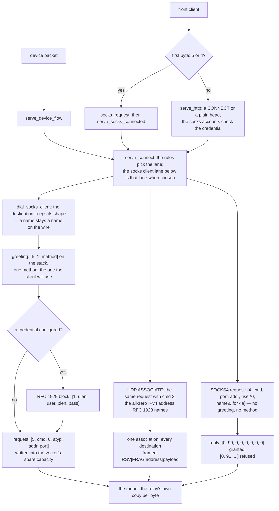

# SOCKS5, both roles
Row 26: the `socks` protocol is served by the tree's front and dialled by it. The client writes the three stages a SOCKS5 client writes — greeting, RFC 1929 credential exchange when configured, and request — as a lane in the front layer, not a second dialer: the device inbound hands its flows to `serve_device_flow`, which asks the routing rules for the lane and calls `serve_connect`, the same entry the `socks` and `http` fronts reach. The front reads its accounts from `settings.accounts`, or xray's `users` alias when absent; the `mixed` front's HTTP side reads the same list. The datagram half is one `UDP ASSOCIATE` association per upstream, every datagram framed as RFC 1928 frames it. A greeting whose first byte is neither `5` nor `4` goes to `serve_http`, the same HTTP front the `http` inbound uses.

## Byte-identity

The client's bytes are the pinned references' bytes, checked by a differential. `scripts/socks5-oracle` drives pinned `xray-core`'s `ClientHandshake` and `EncodeUDPPacket` over an in-memory pipe and prints every octet; the Rust side replays the same `script.txt` and the runs are compared octet for octet: six handshakes (no-auth and credentialed, over IPv4, domain, IPv6 and a name spelling an IPv4 address) and four datagram frames. The oracle is a Go program over the pinned module, so it is a reference and not a copy.

The one place the tree diverges is the method list. The pinned writers offer exactly the one method they will use — `[5, 1, 0]` without a credential, `[5, 1, 2]` with one — and so does this client. `zeronet`'s `connect_socks5` offers two (`[5, 2, 0, 2]`), which reaches one more server; this tree's front answers `[5, 2]` when configured with accounts and `[5, 0]` when not. One method is what the references write.

## Data path


## Measured

<!-- counts:begin -->
| key | value | checked by |
| --- | --- | --- |
| ops-retired-instructions | 895 | scripts/count-ops.sh |
| socks-raw-down-8-client-mib-per-second | 2658 | CI benchmark-matrix.yml run 43292720499 |
| socks-raw-down-8-server-mib-per-second | 2808 | CI benchmark-matrix.yml run 43292720499 |
| oracle-lines-matching-the-pinned-go | 10 | ferrox-core-socks::tests::the_client_writes_the_bytes_the_pinned_go_writes |
| methods-offered-in-the-greeting | 1 | ferrox-core-socks::tests::the_greeting_is_the_bytes_the_pinned_writer_writes |
| request-bytes-per-tcp-dial | 10 | ferrox-core-socks::tests::the_request_is_the_bytes_the_pinned_writer_writes |
| credential-bytes-per-authenticated-dial | 5 | ferrox-core-socks::tests::the_user_pass_block_is_rfc_1929 |
| datagram-frame-bytes-overhead | 10 | ferrox-core-socks::tests::the_datagram_frame_is_rfc_1928 |
| servers-answering-another-method-refused | 1 | ferrox-app-socks::tests::a_credentialed_session_refuses_a_server_that_answers_no_auth |
| device-flows-leaving-through-the-client-lane | 1 | ferrox-app-tun::tests::a_device_flow_leaves_through_the_socks_client_lane |
| tcp-tunnels-through-the-front | 1 | ferrox-app-proxy::tests::a_socks_client_dials_the_front_and_carries_an_echo |
| datagrams-through-the-front | 1 | ferrox-app-proxy::tests::a_socks_client_carries_a_datagram_through_the_front |
| datagram-payload-copies-per-forwarded-datagram | 0 | ferrox-app-proxy::tests::a_forwarded_datagram_is_the_frame_the_client_framed |
| datagram-frame-allocations-per-frame | 0 | ferrox-app-proxy::tests::a_forwarded_datagram_is_the_frame_the_client_framed |
| front-name-zero-filled-bytes | 12 | ferrox-app-proxy::tests::a_socks_front_zeroes_the_name_once |
| datagram-rebuild-copies-per-reframed-datagram | 1 | ferrox-app-proxy::tests::a_datagram_naming_a_host_is_reframed_around_its_payload |
| client-datagram-payload-copies | 0 | ferrox-app-proxy::tests::a_client_datagram_hands_its_payload_over_by_pointer |
| device-datagram-payload-copies | 0 | ferrox-app-tun::tests::a_device_datagram_hands_the_payload_over_by_pointer |
| device-datagram-head-reallocations-after-the-first | 0 | ferrox-app-tun::tests::a_device_datagram_hands_the_payload_over_by_pointer |
| device-datagram-head-bytes | 22 | ferrox-app-tun::tests::a_device_datagram_hands_the_payload_over_by_pointer |
| datagram-frames-the-client-framed | 1 | ferrox-app-proxy::tests::a_forwarded_datagram_is_the_frame_the_client_framed |
| datagram-ipv6-literal-destinations-answered | 1 | ferrox-app-proxy::tests::a_destination_naming_an_ipv6_literal_is_the_address_it_named |
| credentialed-tunnels-through-the-front | 1 | ferrox-app-proxy::tests::a_socks_client_offers_the_credential_the_front_asks_for |
| credentials-the-front-refuses | 1 | ferrox-app-proxy::tests::a_front_refuses_a_credential_it_does_not_know |
| config-lanes-named | 1 | ferrox-app-proxy::tests::a_socks_outbound_names_its_server_and_credential |
| pb-scenario-sides-decoded | 2 | ferrox-app-xray_pb::tests::a_socks_scenario_decodes_both_sides |
| socks4-handshake-allocations | 0 | ferrox-app-proxy::tests::a_socks4_handshake_costs_no_heap_buffer |
| socks4a-handshake-allocations | 1 | ferrox-app-proxy::tests::a_socks4a_handshake_costs_one_heap_buffer |
| credentialed-literal-handshake-allocations | 0 | ferrox-app-proxy::tests::a_credentialed_literal_handshake_costs_no_heap_buffer |
| socks4-reply-bytes | 8 | ferrox-core-socks::tests::the_socks4_reply_is_the_bytes_the_pinned_server_writes |
| socks4-client-request-buffers | 0 | ferrox-app-socks::tests::a_socks4_connect_takes_no_heap_buffer |
| socks4-request-zero-filled-bytes | 0 | ferrox-core-socks::tests::the_socks4_request_is_one_unzeroed_buffer |
| socks4a-client-request-buffers | 0 | ferrox-app-socks::tests::a_socks4a_connect_takes_no_heap_buffer |
| socks5-connect-write-calls | 2 | ferrox-app-socks::tests::a_no_auth_connect_writes_the_greeting_then_the_request |
| socks5-connect-read-calls | 3 | ferrox-app-socks::tests::a_no_auth_connect_writes_the_greeting_then_the_request |
| socks5-connect-allocations | 0 | ferrox-app-socks::tests::a_no_auth_connect_writes_the_greeting_then_the_request |
| socks5-credentialed-connect-write-calls | 3 | ferrox-app-socks::tests::a_credentialed_connect_writes_the_greeting_credential_and_request |
| socks5-credentialed-connect-read-calls | 4 | ferrox-app-socks::tests::a_credentialed_connect_writes_the_greeting_credential_and_request |
| socks5-credentialed-connect-allocations | 0 | ferrox-app-socks::tests::a_credentialed_connect_writes_the_greeting_credential_and_request |
| socks5-long-connect-allocations | 0 | ferrox-app-socks::tests::a_long_destination_and_a_long_bound_name_take_no_heap_buffer |
| socks5-long-connect-read-calls | 4 | ferrox-app-socks::tests::a_long_destination_and_a_long_bound_name_take_no_heap_buffer |
| socks5-association-bound-name-allocations | 0 | ferrox-app-socks::tests::an_association_bound_name_is_read_without_a_heap_buffer |
| socks4-requests-a-credential-front-refuses | 1 | ferrox-app-proxy::tests::a_front_that_asks_for_a_credential_refuses_a_socks4_request |
| socks4-xray-scenario-tests-passing | 1 | scripts/run-upstream-suite.sh |
| http-fallback-requests-served | 1 | ferrox-app-proxy::tests::a_socks_front_serves_an_http_outbound_that_offers_its_account |
| http-fallback-scenario-tests-passing | 1 | scripts/run-upstream-suite.sh |
| reply-head-allocations-per-reply-datagram | 0 | ferrox-app-proxy::tests::a_reply_head_is_written_without_a_buffer |
| reply-ns-per-reply | 2.3 | .github/workflows/bench.yml |
<!-- counts:end -->

The first row after ops is the identity claim: ten recorded runs compared octet for octet against the pinned Go writer. The greeting row is the one-method rule pinned as bytes (`[5, 1, 0]` and `[5, 1, 2]`), not a count of what the code sends. A `CONNECT` for an IPv4 literal is ten octets; the RFC 1929 block for a one-byte name and password is five; the datagram frame's overhead is ten octets before the payload.

The client datagram rows are the frame itself. A literal-address frame goes on as it arrived, its payload uncopied: the writer gets the client's own base pointer, the frame costs no allocation, and the caller's buffer neither moves nor grows (`a_forwarded_datagram_is_the_frame_the_client_framed`). A frame that named a host is rebuilt around its payload once (`a_datagram_naming_a_host_is_reframed_around_its_payload`). The device front's datagram is a 22-byte head plus the device's own payload by pointer (`sendmsg`/`WSASend`), so the payload is not copied and the head's base and capacity hold over a push/drain cycle (`a_device_datagram_hands_the_payload_over_by_pointer`). The refusal row is the client's half of negotiation: a server answering a method the client did not offer is refused (`"auth method not supported."`), and a half-written credential refuses rather than downgrading. The four end-to-end rows cover the device's TCP flow, an echo through the tree's own front, a datagram through it, and a credentialed echo through a front that asks for the credential.

## HTTP fallback

A front configured for socks answers HTTP too. `serve_socks` peeks the first byte: `5` or `4` takes the SOCKS path, anything else goes unread to `serve_http`, which parses a `CONNECT` or a plain forwarded head and, when the inbound names accounts, checks `Proxy-Authorization: Basic` against the same list. A missing or unknown credential gets xray's 407; an accepted one is dropped before the origin sees it. `a_socks_front_serves_an_http_outbound_that_offers_its_account` drives the whole shape through a real socket, and `TestSocksWithHttpRequest` is the same shape in the pinned suite. The reference's `xray.proxy.http.ClientConfig` protobuf decodes to the JSON `http` outbound: one `ServerEndpoint` and the repeated `Header` list as the hop's fields (`a_socks_http_fallback_scenario_decodes_both_sides`).

## SOCKS4

The older protocol, in both roles. A request is one block: version, command, port, address, user id and NUL — and, for SOCKS4a, the name and its NUL; there is no greeting or method. The front answers with the pinned server's eight bytes: `[0, 90, 0, 0, 0, 0, 0, 0]` granted and `[0, 91, ...]` refused, with port and address written as `net.AnyIP` and port 0. A front that asks for a credential refuses a SOCKS4 request, because the protocol carries a user id and no password.

The client speaks SOCKS4 when the config names `version: "4"`; a name rides SOCKS4a with the `0.0.0.1` marker, so the server resolves it, and an IPv6 address is refused. The request is one stack block — nine bytes with no user id, the 520-byte form only when a user id or name needs it — so a SOCKS4 or SOCKS4a dial allocates none (`a_socks4_connect_takes_no_heap_buffer`, `a_socks4a_connect_takes_no_heap_buffer`).

The pinned Go server reads the user id one byte per call with `ReadUntilNull`, allocates a `String` no front here reads, reads the SOCKS4a domain the same way, parses it into an address, allocates the request header, and writes the reply through a pooled buffer: two heap buffers for SOCKS4, three for SOCKS4a. This tree allocates none of those on the front: the user id is stepped over in a stack buffer, the reply is a static array, and a SOCKS4a name is the one buffer that must outlive the read. The name is read in at most three calls (first byte, then a peek and one read) rather than n+1; the empty name costs one in both. The client is one block and one eight-byte reply, leaner than this tree's own SOCKS5 client's two or three writes.

What is not proved here: the syscall count is arithmetic, not a loopback gate; durations are CI-only; no pinned tree ships a SOCKS4 client whose bytes can be read here, so the client's claim is against this tree's own SOCKS5 client and the server's against the pinned Go server; `TestSocksConformanceMod` exercises SOCKS4 in the pin's gate.

A datagram must come from the IP that opened the control association (RFC 1928 §7); a frame from any other host is dropped before its header is parsed. A lane that keeps one reply source pins the first UDP source; Shadowsocks keeps one uplink per source and the portal one lane per destination. `a_udp_lane_drops_a_datagram_from_another_host`, `a_udp_lane_keeps_replying_to_the_first_source` and `socks_associate_keeps_each_udp_source_on_its_own_reply` gate it. A literal-header datagram goes on as framed; a rebuilt one is two parts — the head in a reused buffer and the client's payload — sent by `send_two`/`send_to_two` (`sendmsg` on unix, `WSASend`/`WSASendTo` on Windows), so no payload is copied. A named destination is still resolved per datagram by the system resolver (row 126); the reference resolves once per destination and holds a DNS client of its own.

A no-auth TCP dial writes twice (greeting, then request) and reads three; a credentialed dial writes three and reads four, counted by an in-memory server (`a_no_auth_connect_writes_the_greeting_then_the_request`, `a_credentialed_connect_writes_the_greeting_credential_and_request`), not by a loopback duration. The handshake's bytes are built once — greeting on the stack, credential block and request in one buffer each — and the address goes into the request vector's spare capacity with one `copy_nonoverlapping` per field; the copy is one block, not a byte loop. The payload is the relay's own copy; on the device front it goes to the socket by pointer.

## Ops

```bash
./scripts/count-ops.sh report \
  socks::tests::the_client_writes_the_bytes_the_pinned_go_writes 'ferrox_core::socks::request'
```

The oracle's sixth handshake line carries one more `request` through `encode_into`, so the row read **889** after that line and **895** today (six added by main's name-length guards #145), against **758** at five lines and **929** on main's run `43253246183`. The report also holds `datagram` at **701** against **1006** on main; the per-byte `MaybeUninit::write` loop before this slice reported **762**. `Target::encode_into` is inlined into both callers (`inlined-not-a-frame`), so the request and datagram frames carry its match. macOS/aarch64 has no `valgrind`, so the gate runs in CI; `scripts/expected-ops.txt` holds the compared number.

## Time

The matrix's `socks-raw-down-8` cell is 8 concurrent 256 MiB downloads through one SOCKS server with 64 KiB reads; it prices bulk throughput, not a single dial. On `benchmark-matrix.yml` run `43292720499` (tier `standard`, 3 repeats, commit `8a714d3`, AMD EPYC 7763, load 2.08) this tree moved **2658 MiB/s** through the pinned `xray-core` server and **2808 MiB/s** as the server under the pinned client, against **1913** and **1913**: **1.39x** client and **1.47x** server. `sing-box` led the cell at **2933** and **3321**. This tree's CPU cost is **160 ms/GiB** against `xray-core`'s **880**. Absolute medians follow the runner (4442/4446 MiB/s on run `43275405213`'s Xeon 6973P), so the ratio is the gated number; the handshake is amortised, so these bound a relay regression, not per-dial latency.

The reply head's bench cell times the removed one-buffer shape against the shipped head-in-a-22-byte-room shape, with the two heads compared byte for byte first. `bench.yml` run `44899712863` read linux x86_64 **28.1 → 2.3 ns/reply**, linux aarch64 **51.9 → 4.3**, macos aarch64 **43.2 → 2.9**, windows x86_64 **60.8 → 4.3** (12x to 15x). The old shape paid the 1200-byte payload copy and the buffer's allocation and free; the cell does not separate the two, so the ratio is attributed to both.

## What we removed

- **Two matches per address write and a per-byte initialization loop.** `Target::encode_into` and `Bound::encode_into` matched the variant three times; one match now writes the type byte, the address and the port, and one `copy_nonoverlapping` per field replaces the `MaybeUninit::write` loop. The request fell from **929** on main to **758**, and the datagram's three frames from **762** to **701** (run `43358662526`); main's name-length guards then add six, so the current row is 895. The copy is one block per field, not removed; every byte is still initialized before the length is raised. The bytes are the oracle's.

- **The datagram writer's staging scratch and zero pass.** `datagram` built the address into a zeroed 260-byte stack buffer and copied it into the caller's vector. It writes into the vector's own room now, so the scratch and the copy are gone; the header room is initialized by that write, so the zero pass went too. The write goes through spare capacity as `MaybeUninit` bytes, so no reference is formed over uninitialized memory; run `43358662526` reports **701** against **1006** on main. The frame is the oracle's.

- **Owned names and keys on the association paths.** `associate` parsed the bound address into a `Bound` whose name arm owned a `String`; it reads IPv4, IPv6 and a domain into stack blocks now and hands the name to the resolver as `&str` (`socks5-association-bound-name-allocations` 0). `serve_socks_udp_split` borrows the routing key and moves the destination instead of cloning it per datagram. `read_exact_within` probes the clock once per read instead of after every outcome; the bytes and call counts are unchanged.

- **A second dialer in the device front.** `accept_flow` opens a loopback pair and calls `serve_device_flow`, which asks the rules for the lane and then calls the same `serve_connect` every other front reaches. The device's destination keeps its shape down to the request bytes, so a name stays a name in the `CONNECT`; `is_device` refuses `utun`/`wintun`/`tun2socks` as protocol names while serving `tun` with all three device spellings.

- **The greeting's, request's and SOCKS4 request's heap buffers.** The greeting is three bytes on the stack; the credential block and request are written where they are read, with a literal or short name in the inline block and the address written by `encode_into`. The SOCKS4 request is a stack block, with nine bytes when no user id is present, and reserves the exact length it writes, so no zero pass runs (`the_socks4_request_is_one_unzeroed_buffer`). Both SOCKS5 dials and both SOCKS4 dials hold zero heap buffers (`socks5-connect-allocations`, `socks5-credentialed-connect-allocations`, `a_socks4_connect_takes_no_heap_buffer`, `a_socks4a_connect_takes_no_heap_buffer`).

- **The credential block, the password and the account clone in the front's handshake.** The front reads the RFC 1929 user and password into stack blocks the read fills, and the `Handshake` borrows the account for the session's life (`credentialed-literal-handshake-allocations` 0). A request naming a host still allocates the one `String` the front keeps for routing.

- **The client lane's and the device front's datagram payload copies.** A literal-header frame goes on as it arrived; a rebuilt frame is two parts — the head in the lane's reused buffer and the client's payload — sent by `send_two`/`send_to_two`, so the tail is the caller's own pointer (`a_client_datagram_hands_its_payload_over_by_pointer`). The device front builds only the 22-byte head into its reused buffer and sends the device's payload by pointer (`a_device_datagram_hands_the_payload_over_by_pointer`). The bytes on the wire are unchanged.

- **A buffer and a `String` for a bound address nobody reads.** A granted `CONNECT` reply names the server's bound address, and a TCP tunnel uses none of it; the client read it into a fresh `Vec` and a name into a `String` only to drop both. The octets are consumed now — fixed blocks for a literal, a 257-byte stack window for a name — so the stream sits at the tunnel's first octet and the handshake allocates nothing for the address (`socks5-long-connect-allocations` 0, `socks5-long-connect-read-calls` 4).

- **Ten copies of one frame and a frame buffer per datagram.** The RFC 1928 frame was written out in the door, the freedom lane, the SOCKS client's legs and each protocol lane's answer; one writer now (`socks_udp_frame`) writes the oracle's frame. The door's uplink and the freedom lane's answer each keep one frame buffer for the lane's life, so framing allocates nothing.

- **The authority the datagram named, spelled out.** A named destination's authority was copied into a string before the resolver; the name and port go to the resolver as they are now, so the datagram's own bytes are not copied, and an IPv6 literal is the address and port it named (`a_destination_naming_an_ipv6_literal_is_the_address_it_named`).

## What was not removed

- **The greeting and the request are separate writes.** The reference waits for the method reply before writing the request; Psiphon's Go SOCKS server rejects a pipelined request, so the pipelined form this lane tried was given back. A no-auth dial pays two writes and three reads; a credentialed dial three writes and four reads, in the reference's order. The Psiphon lane is the exception: its loopback listener is exempt from RFC 1929 and answers over SOCKS4a, so a loopback IPv4 or named destination pays one request and one reply; an IPv6 destination and a non-loopback listener keep the SOCKS5 shape.

- **The client offers exactly one method.** `[5, 1, 0]` without a credential and `[5, 1, 2]` with one, because that is what the pinned writers write. Offering both would reach one more server at the cost of one greeting byte; the reference's one-method rule is the one this tree keeps.

- **A credential that cannot be spelled refuses the lane.** A name or password over 255 bytes, or a half-written credential, refuses the session rather than falling back to no authentication; a silent downgrade would hand the server a tunnel the operator asked to be authenticated. The pinned Go client would send a zero-length name instead.

- **The bound address is read and dropped, and the datagram lane is one association for every destination.** The reply's octets are consumed so the stream sits where the tunnel begins; all three RFC 1928 forms are accepted. The control leg is held for the association's life, dropping it ends the association, and the frame carries an address, never a name. The BIND command is refused with the protocol's own rejection code.

- **The front peeks one byte and zeroes a name once.** `serve_socks` issues one non-consuming peek to choose the lane, leaving the byte for the greeting or head to read again; no test counts the front's reads, so that extra read stays `UNBLESSED`. `read_socks_named` opens `vec![0u8; len]` and the read fills every byte, so the zero pass is retained (`a_socks_front_zeroes_the_name_once`, twelve bytes for a twelve-byte name). The front has no datagram switch; the pinned `udp_enabled` flag is read and dropped, and this front always carries datagrams.

- **The credential block's slow path and the device's answer direction.** A name and password that fit 64 bytes share the inline block; the RFC's longest pair takes a 513-byte stack block, zeroed only when that arm runs. The device's answer direction still gathers its IP/UDP packet around the payload and writes it with `write_all`; a TUN device write is not the connected datagram call this slice changed.

## Conformance

`conformance.yml`'s scenario-map job runs every test in pinned `xray-core`'s `testing/scenarios` against `ferrox-app`, and the pin's gate names the ones that must be green. `TestSocksBridgeTCP` — a credentialed socks inbound, a socks outbound offering one, and a `dokodemo` front rewriting every flow to an echo server — runs unmodified through `scripts/xray-scenarios.sh`; the bridge carries `xray.proxy.socks.ServerConfig` (auth type, account map, address and datagram flag read and dropped) and `ClientConfig` (one endpoint, credential when named). A user level is refused by name. `TestSocksBridageUDP` and `TestSocksBridageUDPWithRouting` pass with the `dokodemo-door` datagram and the router's tag and port selectors; `TestSocksConformanceMod` dials the front with `socks4.Dial`; `TestSocksWithHttpRequest` exercises the CONNECT fallback and the `xray.proxy.http.ClientConfig` outbound. The map at this pin is 44 of 73 green and the socks family 5 of 5; the run is informational.

## Pins

| what | where |
| --- | --- |
| the client handshake, the credential block and the datagram frame | `upstream/xray-core/proxy/socks/protocol.go` |
| the server side: the account map, the method refusal, the HTTP sniff | `upstream/xray-core/proxy/socks/server.go` |
| the Go core's one-method greeting and its request writer | `upstream/pattng` — the `hev-socks5-tunnel` submodule that carries `heiher/hev-socks5-core` is not fetched at this pin |
| the outbound's own handshake | `upstream/sing-box/protocol/socks/outbound.go` |
| the two-method greeting this tree does not copy | `upstream/zeronet/crates/zero-protocol/src/socks.rs` |
| the recorder that produced `expected.txt` | `scripts/socks5-oracle/main.go` |
## CI scope

What a change here owes, read by `scripts/ci-scope.py`; see [`docs/ci-scope.md`](../ci-scope.md).

<!-- scope:begin -->
- paths: crates/ferrox-core/src/socks.rs, crates/ferrox-app/src/socks.rs
- symbols: socks
- oracle: socks
- go: ./proxy/socks/...
<!-- scope:end -->
