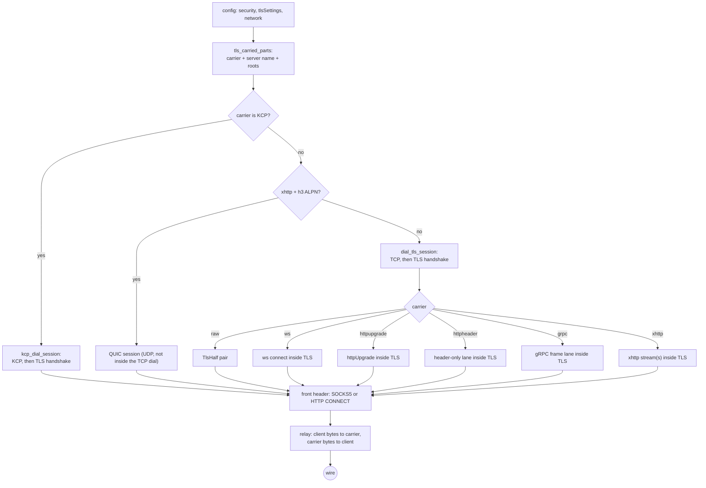

# TLS client from config

One dial owns the session: the transport is opened (TCP for the stream carriers, KCP over UDP for KCP), the configured TLS handshake runs inside it, and the protocol header then travels inside that session.  The same shape serves every stream front that reads `tlsSettings`; the SOCKS and HTTP outbounds now join VLESS, VMess, Trojan and Shadowsocks instead of dialling their configured transport as a bare TCP socket.

`tls_carried_parts` reads `streamSettings.security = "tls"` into `(Carrier, server name, TlsConfig)`.  The carrier set is raw TCP, `ws`, `httpupgrade`, `grpc`, `xhttp`, the TCP `http` header and KCP; an `xhttp` carrier whose ALPN list is exactly `["h3"]` leaves as QUIC instead of inside `dial_tls_session`; the SOCKS and HTTP outbound parsers refuse `quic`, `hysteria`, `masque`, `xdrive` and unknown networks rather than silently dialling them raw.  KCP carries the session over UDP, so its TLS handshake runs inside the KCP connection and the front's header travels inside that session.  VLESS, VMess and Trojan keep the same `tls_carried_parts` path, and Shadowsocks its own KCP TLS lane.  The client loads named roots from `caCertFile` and `certificates`. It also loads system roots unless `disableSystemRoot` or `allowInsecure` is set, or a certificate pin is configured.  Without a certificate pin, `allowInsecure` skips certificate chain and name verification.  A plain `network: "tcp"` with no `security` stays a plain dial; only the configured TLS arm changes.

## Data path



## Measured

<!-- counts:begin -->
| key | value | checked by |
| --- | --- | --- |
| ops-retired-instructions | UNBLESSED | scripts/count-ops.sh |
| syscalls-per-relayed-megabyte | UNBLESSED | scripts/count-ops.sh |
| relay-staging-copies-per-byte | UNBLESSED | not measured |
| seconds-per-relayed-megabyte | UNBLESSED | .github/workflows/bench.yml |
| socks-tls-carriers-parsed | 7 | ferrox-app-proxy::tests::socks_tls_outbound_parses_diallable_carriers |
| http-tls-carriers-parsed | 7 | ferrox-app-proxy::tests::http_tls_outbound_parses_diallable_carriers |
| socks-tls-raw-echo-round-trips | 1 | ferrox-app-proxy::tests::socks_tls_over_raw_reaches_echo |
| socks-tls-ws-echo-round-trips | 1 | ferrox-app-proxy::tests::socks_tls_over_ws_reaches_echo |
| socks-tls-kcp-echo-round-trips | 1 | ferrox-app-proxy::tests::socks_tls_over_kcp_reaches_echo |
| http-tls-raw-echo-round-trips | 1 | ferrox-app-proxy::tests::http_tls_over_raw_reaches_echo |
| http-tls-ws-echo-round-trips | 1 | ferrox-app-proxy::tests::http_tls_over_ws_reaches_echo |
| http-tls-kcp-echo-round-trips | 1 | ferrox-app-proxy::tests::http_tls_over_kcp_reaches_echo |
<!-- counts:end -->

The two parse rows are the seven carrier forms in `tls_stream_cases`: raw, `kcp`, `ws`, `grpc`, `xhttp`, `httpupgrade` and the TCP `http` header.  For the SOCKS and HTTP parsers the same test holds `quic` and `hysteria` refused; KCP is carried by `kcp_dial_session` and `kcp_tls_connect`, the same pair the VLESS, VMess, Trojan and Shadowsocks lanes use.  The echo rows run the real `dial_socks_outbound` or `dial_http_outbound` over a TLS echo listener; the carried rows reach the listener through a WebSocket upgrade or a TLS session inside KCP, not through a raw TCP re-dial.

## Ops

```bash
./scripts/count-ops.sh report \
  socks_tls_over_ws_reaches_echo 'proxy::tests::socks_tls_over_ws_reaches_echo'
```

`UNBLESSED`.  The dial and first handshake happen once per flow; no instruction count has been read for this path, so none is quoted.  The relay's own cost is the existing lane path, not new crypto in this change.

## Time

The matrix has no SOCKS-over-TLS or HTTP-over-TLS cell in its tier, so one was tried for this row and is not kept: `benchmark-matrix.yml` run 44110457162 measured `socks-tls-raw-down-8` (8 flows, 256 iterations, 64 KiB, three pairs, `ubuntu-latest`) and lost the cell on its served leg.  The client leg ran: ferrox **815.5 MiB/s** against `xray-core`'s **694.9** — 1.169x, interval [1.102x, 1.209x] — and `zeronet`'s **858.4**, which is 0.95x, interval [0.920x, 0.982x] and below the ratio floor, so it is a defect named rather than a variance noted: on the same bytes the client spends 2.002x less cpu per GiB and 4.405x fewer kernel calls than `xray-core`, so what it loses to `zeronet` is not system calls, and the profile that prices a byte path is CI's (`bench.yml`).  The served leg moved nothing: every client failed with zero bytes, because this tree serves a `socks` inbound as plain TCP — `inbound_role` wraps only a PROXY header — so `streamSettings.security: "tls"` on a SOCKS, HTTP or mixed inbound is a silent no-op where the reference handshakes.  That lane is this row's open work and the reason the three arms the trial used are not in `scripts/lib-matrix.sh`.

`bench.yml` run 44231388219 priced the one lever that could have explained the upload-heavy cells this row loses: the record layer's AEAD.  Gate 10b — `ferrox-bench --bin record-aead`, its own binary so linking `ring` cannot move the rows `ferrox-bench` itself gates (run 44220454910 first put it in the gate binary, which pushed `aes-128-gcm, 64B` to 0.68x on `macos aarch64` while the same process's in-place row stayed at 50 ns; the separate binary reads the gate rows exactly as `main` does) — seals and opens a record with the fused AES-128-GCM engine beside `ring`'s own AES-128-GCM at the three lengths a record carries. On `linux x86_64` the fused engine spends 1.57x ring's time at 16 383 bytes (**4866.7 ns** against **3108.9**), 1.51x at 8192 and 1.43x at 4096; on `macos aarch64` the same rows read 1.12x, 0.98x and 1.01x, a tie rather than a win. So a provider built on it would be a regression where the traffic mix runs and a wash on Apple silicon, and the record layer keeps `ring`.  That closes a hypothesis rather than the gap: `vless-tls-raw-up-1` at 0.98x `xray-core-rust` and `vless-tls-raw-duplex-8` at 0.90x `xray-rust` (nightly run 44018646109) do not lose to a slower cipher primitive here.  The candidate this row can still move is granularity, and it is the change `reality-tls` carries: the driven scratch was half a relay window, so a 64 KiB window cost two transport reads; it now costs one, and the opens stay one per record.

`benchmark-matrix.yml` run 44224991870 measured that change on `linux x86_64` (`ubuntu26`, AMD EPYC 9V74, 4 cpus, load 1.90, three repeats, commit `eeafcfe`) and both cells this row lost now read at parity or better: `vless-tls-raw-up-1` with the `xray-core` server is ferrox **747.1 MiB/s** against `xray-core-rust`'s **729.3** (1.03x) and `xray-rust`'s **733.4**, and `vless-tls-raw-duplex-8` with the `xray-core` server is **939.0** against `xray-rust`'s **949.3** (0.99x, interval across three runs 896–944 against 929–1014), so the duplex gap that read 0.90x on the nightly is inside the repeat spread here rather than closed by it: three repeats on one runner cannot separate 0.99x from parity, and the nightly's five-run median is the reading that decides whether the row still loses.  Every row the run priced carries ferrox first or within 1.01x of the leader, on both servers: `down-8` 1034.2 against a best of 984.5 as a client of the `xray-core` server, and 1635.6 against 1330.1 as a client of its own.

`benchmark-matrix.yml` runs 44262966328 (this branch, head `337ce11`) and 44262449133 (`main`, `6e93173`) then re-measured the same two cells with five repeats each, and both trees read the same: `vless-tls-raw-up-1` against `xray-rust` is **0.89x** here and **0.87x** on `main`, and `vless-tls-raw-duplex-8` against `xray-rust` is **0.91x** here and **0.95x** on `main` — so neither reading is this branch's, the leg fell off its blessed gap (`0.93` in `scripts/comparator-gaps.txt`) between `ce26e56` and `df21ac7`, where `#171` rewrote the CLI's `lane` and `proxy` drivers and `#172`/`#175` moved the relay's splice lanes, and both runs fail the bundle's comparator ratchet on `main` itself. The change this row carries is neutral across that: it is the same read per window on both trees, and it is the comparator leg that moved.

## What we removed

- **The silent raw fallback.**  A SOCKS outbound with `security: "tls"` used to ignore the field and dial plain TCP; an HTTP outbound with a carrier used to keep the TLS config but dial its transport raw, so a `ws` config reached the server as a TLS ClientHello on the bare socket.  Both now hand the carrier to the session. `socks_tls_over_raw_reaches_echo`, `socks_tls_over_ws_reaches_echo`, `http_tls_over_raw_reaches_echo` and `http_tls_over_ws_reaches_echo` are the witnesses.
- **The KCP refusal.** SOCKS and HTTP outbounds with `security: "tls"` and `network: "kcp"` used to be refused at parse time. They now dial KCP, run TLS inside it, and relay the front header inside that session; `socks_tls_over_kcp_reaches_echo` and `http_tls_over_kcp_reaches_echo` are the witnesses.
- **The second relay shape.** The carried SOCKS and HTTP fronts split the session into one reader and one writer and hand it to `relay_sink`, so one direction's read cannot hold the other direction's write behind a shared lock. The raw branch uses the same split. The tests drive both branches; the point is structural, not a new copy count, so `relay-staging-copies-per-byte` stays `UNBLESSED`.
- **The single-read SOCKS handshake.** The TLS session polls its transport on a 1 ms quantum; a handshake read that took the first `WouldBlock` for a refusal reset a flow under load. The SOCKS greeting, request and bound-address reads now wait out the poll under the handshake budget, and `a_handshake_read_waits_out_a_polled_transport` is the deterministic witness.

The bullets above are removals against earlier Ferrox, not against the references. Against Xray-core no instruction, syscall or copy removal is claimed: it also dials TLS and hands it to the carrier.  The one ratio this page carries is the trial's client leg above, where the same bytes cost 2.002x less cpu and 4.405x fewer kernel calls; the two parse rows and six echo rows are correctness witnesses, and the four cost rows stay `UNBLESSED`.

## Pins

| what | where |
| --- | --- |
| carrier selection and TLS fields | `upstream/xray-core/transport/internet/tls/config.go` |
| SOCKS outbound request on the stream | `upstream/xray-core/proxy/socks/client.go` |
| HTTP CONNECT on the stream | `upstream/xray-core/proxy/http/client.go` |
| WS carrier inside TLS | `upstream/xray-core/transport/internet/websocket/` |

## CI scope

<!-- scope:begin -->
- paths: -
- symbols: dial_socks_tls_client, dial_http_outbound, dial_tls_carried_stream, kcp_tls_connect, relay_kcp_under, RelayWrite, socks_tls_outbound_parses_diallable_carriers, http_tls_outbound_parses_diallable_carriers, socks_tls_over_raw_reaches_echo, socks_tls_over_ws_reaches_echo, socks_tls_over_kcp_reaches_echo, http_tls_over_raw_reaches_echo, http_tls_over_ws_reaches_echo, http_tls_over_kcp_reaches_echo
- go: ./transport/internet/tls/..., ./proxy/socks/..., ./proxy/http/...
<!-- scope:end -->
