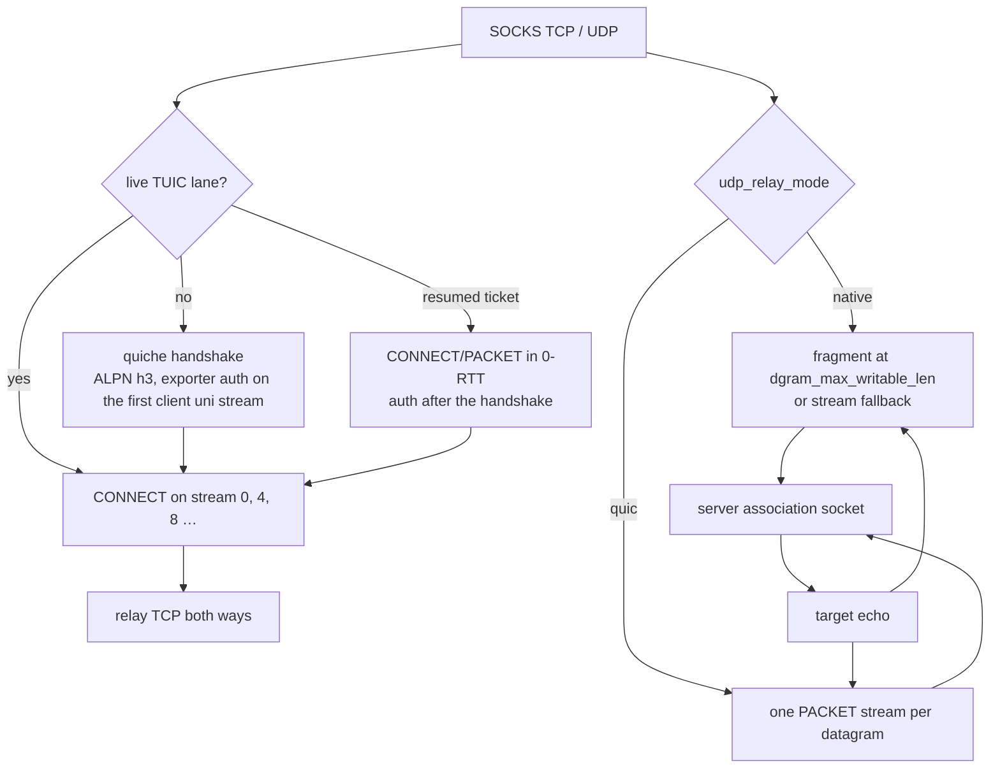

# TUIC v5 over QUIC

TUIC v5 is a QUIC protocol with one authenticated unidirectional stream, bidirectional CONNECT streams and a PACKET lane. Both roles are served: a `protocol: tuic` inbound reads `settings.users`/`clients`, while an outbound reads the first `settings.servers` entry or the settings themselves. The ALPN is `h3`; the authentication token is the TLS exporter keyed by the raw 16-byte UUID with the password as context.

The UDP lane has two shapes. `native` fragments a PACKET into QUIC datagrams at `dgram_max_writable_len()`, and falls back to a unidirectional stream when the peer advertises no datagram. `quic` always writes each PACKET to its own stream. sing-box's UoT `udp_over_stream` is not carried, so it is refused with a one-line error instead of silently running the wrong UDP lane. A stream command takes a numbered id only when the peer advertises uni credit, so a peer's `StreamLimit` leaves the frame queued instead of consuming an id; `native` stops the fragment run on the first failed datagram rather than sending a packet with a hole. The server numbers its own replies, reuses one association across destinations and keeps the mode of the association's first packet. It heartbeats every ten seconds and closes a connection that has not authenticated within three, both configurable. DISSOCIATE removes the association.

The server runs QUIC timers and flushes the socket before the established guard, so a handshake is retransmitted on the same clock as application traffic. Both QUIC lane sockets read a queued burst through `recv_batch`, so GRO stays on and a coalesced read is cut back into wire datagrams before quiche sees it; the driver stops every header worker and waits for its claim on the listener's socket before the listener reports closed, while a relay lane leaves on the stream's own stop. UDP associations are capped per session and the sockets they open are capped across the server; a listener sweep reads at most 256 replies and 32 per association, resumes after the last association it served and alternates the family it reads first, so neither a busy association nor a full v4 queue can starve the rest or shutdown. A destination name is resolved on a bounded worker pool, never on the listener under the connection lock, and each pending lookup holds at most four payloads while the reply is applied when it lands; the first PACKET names the association's reply mode before its name resolves. A CONNECT that does not finish its header within ten seconds is reset. DISSOCIATE and idle expiry both drop the association and its pending lookups, and a recreated association takes a new session-wide generation, so a late completion cannot recreate the association. The client binds its UDP reply socket to the first source that parses, and a subsequent source is dropped.

The dial keeps up to eight authenticated connections per outbound and gives each a driver thread that feeds every received datagram into quiche, so CONNECT responses and both UDP shapes share a pump and concurrent flows do not serialize on one connection lock. An idle lane is reused, a new one is dialled only while fewer than eight are live, and a pooled connection is redialled when it closes. Lane creation is serialized, so two CONNECTs cannot replace a connection under a live flow. A resumed lane returns before the handshake when the saved ticket starts early data, so its first CONNECT or PACKET rides 0-RTT; the driver finishes the handshake, exports the token and sends authentication on the first client uni stream. Authentication follows the handshake because the TLS exporter key does not exist until then, which is also sing-quic's ordering. TLS reads the reference spellings and a `pinnedPeerCertSha256` pin is the handshake's verifier, so a chain that does not match never reaches the exporter key and a correct pin completes the handshake even when the device trust store cannot build the chain.

## Data path

## Measured

<!-- counts:begin -->
| key | value | checked by |
| --- | --- | --- |
| ops-retired-instructions | UNBLESSED | scripts/count-ops.sh |
| syscalls-per-connect | UNBLESSED | scripts/count-ops.sh |
| packet-run-clock-reads | 1 | ferrox-app-tuic::tests::a_packet_run_stamps_its_associations_from_one_clock |
| single-fragment-payload-copies-per-packet | 0 | ferrox-app-tuic::tests::a_single_fragment_packet_payload_is_not_copied |
| ordered-reassembly-handover-allocations | 0 | ferrox-app-tuic::tests::an_ordered_reassembly_hands_over_the_fragments_own_buffer |
| nanoseconds-per-packet | 13.8 | .github/workflows/bench.yml |
| burst-walk-ns-per-frame | 9.7 | .github/workflows/bench.yml |
| sweep-dedupe-ns-per-session | 15.6 | .github/workflows/bench.yml |
| sink-lookup-ns-per-datagram | 4.7 | .github/workflows/bench.yml |
| address-families | 3 | ferrox-core-tuic::tests::the_three_address_families_match_the_wire |
| outbound-spellings-parsed | 1 | ferrox-app-tuic::tests::a_tuic_outbound_reads_the_reference_spellings |
| uni-read-buffer-allocations-per-run | 1 | ferrox-app-tuic::tests::a_uni_run_is_one_allocation |
| uni-read-copies-per-packet | 0 | ferrox-app-tuic::tests::a_uni_run_shares_one_buffer_across_its_packets |
| uni-read-first-frame-tail-allocations | 0 | ferrox-app-tuic::tests::a_uni_run_keeps_only_the_partial_tail |
| expiry-map-passes-per-sweep | 2 | ferrox-app-tuic::tests::every_expired_association_costs_one_pass_per_map |
<!-- counts:end -->

## What was removed

Against sing-box and ZeroNet this is a rewrite, not a port: no upstream line or test enters this tree. One wire codec and one association table serve both roles, where the references keep separate inbound and outbound framing. Against Xray-core no removal is claimed: the pinned tree carries no TUIC transport to compare with.

- **The 5 ms flow-control wait.** A stream writer that found its send window closed slept five milliseconds before asking quiche again, so the ceiling was window per quantum: `tuic-raw-up-1` sat at 0.29x of sing-box (146 against 502 MiB/s) on the run before this change and at 0.93-0.96x (245-257 against 266-275) after it, on the same tier. The quantum is 250 µs now; the stream waits on the same window and reports the same bytes.
- **The grain a lane's empty stream read slept.** A `QuicStream` read that found nothing in the stream slept a 1 ms grain before returning `WouldBlock`, so every relay buffer the lane moved cost a millisecond inside a pool worker before the lane could park and be re-run. A read inside a relay step now returns `WouldBlock` on its first empty attempt and hands the lane back to the pool's readiness wait; the readers outside a lane (the handshake, `SealHandshake`) keep the wait they had. The same-run pair `44848463372` (`a1689fd`) then `44848473350` (`5e82c19`) at three repeats reads `tuic-raw-down-8` at ferrox/sing-box **0.987 → 1.109** against the ferrox server and **0.912 → 1.161** against sing-box's, with ferrox at 205 → 469 and 191 → 447 MiB/s while the `vless-raw-down-8` control's own ferrox leg moved 2747 → 2947 and 1767 → 2100; `tuic-raw-duplex-8` reads 0.987 → 1.031 and 0.908 → 0.934. The bytes on the wire are unchanged, and a lane with nothing to read pays one `stream_recv` and a park instead of a sleep.
- **The clock behind that parked read.** The empty read above handed the lane back, and the lane then waited a 1 ms poll grain for its next turn: a stream's own readiness is invisible to the kernel, so a flow could not move more than one window per grain. The read that finds nothing now names the lane's datagram socket, and the pool parks the lane on that descriptor, so the batch that filled the stream is what wakes it; a wake meant for another stream on the lane costs one `stream_recv` that says done, and a lane outside a relay step keeps the wait it had. `an_empty_relay_read_waits_on_the_lane_socket` pins the named descriptor, and a lane whose socket cannot answer for its reads keeps the timer. Nothing on the wire changes.
- **Coalesced reads under the batched reader.** The lane's socket is bound with `UDP_GRO`, which hands back several wire datagrams in one read; the TUIC reader now feeds each packet from that read to quiche separately, so the socket keeps GRO on without handing quiche a burst as one datagram. `a_gso_burst_arrives_as_its_segments` asserts the coalesced read is cut into two packets with their own bytes, and the batched read hands a queued burst over in one call. On the same tier and host model, five repeats, pool-only run `45072955236` read `tuic-raw-down-8` at 255/286 MiB/s against sing-box 207/212 and `tuic-raw-duplex-8` at 457/592 against 394/413; GRO run `45081351032` read 363/435 against 207/211 and 300/395 against 219/223. The wire bytes are unchanged.
- **The lane's per-packet receive turn, on both roles.** Each inbound datagram paid one blocking `recv_from`, one connection lock, a source-name scan, a `readable()` sweep, the stream reads behind it and an egress flush. The client's driver and the inbound's listener now take one `recvmmsg` over the queued burst and one turn over it; the listener additionally parsed the header and grew the routing map once per datagram, and now feeds the whole burst to quiche before taking one turn per session it touched. Against the ferrox server `tuic-raw-up-1` went 99.4 to 258.0 MiB/s (sing-box 113.0 to 240.0 in the same cell, 7120 to 3920 ms/GiB), `tuic-raw-duplex-8` 54.9 to 356.6 (78.9 to 350.5, 17 760 to 2960 ms/GiB) and `tuic-raw-down-8` 323.2 to 415.2 (307.2 to 371.2); against the sing-box server, where this listener is not in the path, the same cells held their ratio (0.99 duplex, 0.95 up-1). A masked lane keeps the one-datagram read, because its wire bytes are rewritten before quiche sees them and the kernel cannot hand back a batch.
- **The client lane's per-packet send.** The client lane bound its datagram socket to one `send_to` per QUIC packet while the server side and every other quiche lane already took the batched write; it now takes the same path, so a burst of up to 64 datagrams leaves in one `sendmmsg`-style call. The wire bytes are unchanged, and a coalesced read is one quiche `recv` because consecutive QUIC packets in one UDP datagram are the coalescing quiche already parses.
- **The stream lane's second parse, on the server.** A uni-stream PACKET on the serving side was parsed for its prefix and then parsed again as a packet; the prefix parse now yields the packet the dispatch uses, so a served stream PACKET takes one parse rather than two. The client takes the other trade: `share_uni_packets` parses the prefix once to find each frame's bounds and hands its slice over, a read that ends inside its first frame keeps that read's own allocation rather than copying its tail, and the reply worker parses the packet once more, so a client stream packet pays two parses and no per-packet copy. A full reply queue waits in the driver after the connection guard is dropped, so a slow name resolution in the forwarder never holds the lock, and only QUIC datagrams may drop. The stream rows in `## Time` price both shapes, and the relay bytes are unchanged.
- **The stream lane's per-frame tail shift.** A uni-stream PACKET burst drained the front of its stream buffer for every frame, so a burst of k frames moved the remaining tail k times. Both the client's driver and the server's stream turn now walk an offset and drain once, so the tail moves once; the frames, their order and the bytes on the wire are unchanged, and the burst rows in `## Time` price the removed shifts.
- **The new fragment's second walk of the reassembly map.** A fragmented PACKET for a key the map did not hold first dropped expired pieces with `retain` and then walked the survivors again to count the association's live pieces and their retained bytes, so a new key paid two passes over every incomplete assembly. The drop and both counts are one `retain` now: a survivor adds its association match and its buffer length before it is kept, an expired piece is dropped without touching either. The survivors, the caps and the refusal are unchanged; `a_new_reassembly_sweeps_and_counts_in_one_pass` holds the per-association cap at `MAX_REASSEMBLIES_PER_ASSOC` live pieces and shows another association still has room. No row: the walk count is not a counter the tree keeps, and the sweep's own rows price the session dedupe, not this pass.
- **The worker's sweep dedupe.** A worker's routing map holds one entry per source id, and its periodic tick, its batch turn and its teardown each walked a list of the sessions they had seen with an `Arc::ptr_eq` per entry, so n entries over s sessions cost O(n·s) pointer compares and an `Arc` clone per visit. All three now mark visited identities in one reused set, O(n), and the dead sweep keeps the identities it found instead of a second list of `Arc`s. The visits, their order and every action taken are unchanged. `tuicbench` reads the sweep at the worker's 1024-session cap, clearing and reusing the buffers the worker holds, so the timed window prices the sweep rather than an allocation; a duplicate-suppressing input (`65, 129, 65, 193, 129` visiting three) is asserted outside the window, because a distinct-id timing input never reaches the branch aliases depend on. The sweep rows in `## Time` price the removed compares.
- **The client lane's per-datagram tap lookup.** A reply datagram found its UDP association by scanning every registered tap and then made the reply's `send_to` while holding the taps lock, so a lane with n associations paid n compares and a syscall's worth of lock hold per datagram. The taps are keyed by association now, so one lookup finds the tap and the guard is dropped before the reply is sent; the association set, the numeric assignment, its uniqueness rule and the drop are unchanged. `tuicbench` prices the lookup itself at 256 taps, the per-session association cap the serving side enforces, scanned against mapped, and `sink-lookup-ns-per-datagram` is the section's own number: `bench.yml` run 44819763985 reads **24.9 → 4.7 ns/datagram** on linux x86_64, with 6.8 on linux aarch64, 6.1 on macos aarch64 and 9.0 on windows x86_64.
- **The fragmented packet's per-fragment copy and assembly alloc.** A PACKET split over several datagrams kept each fragment in its own `Vec` and then copied every one of them again into the assembled payload, so a k-fragment datagram paid k allocations and k copies beyond the arrival copy. The fragments now grow one buffer, and a datagram whose fragments arrived in packet order is handed over as that buffer: the handover moves it, so it copies nothing and asks the allocator for nothing, and the payload keeps the buffer's pointer, which `an_ordered_reassembly_hands_over_the_fragments_own_buffer` asserts beside a zero allocation delta. The appends that filled the buffer are still the only writes, and one that outgrows it is still one realloc: the witness supplies the room the earlier appends left, so what it prices at zero is the completing fragment's appends and handover, not a promise that a reallocating piece never allocates. Out-of-order fragments are still put back in packet order with one copy per fragment, and the bytes are the same either way. The client's reassembly map also sweeps expired pieces before it refuses a new fragment, so 64 abandoned fragments can no longer hold the lane shut; `expired_reassemblies_do_not_hold_the_client_back` is the witness.
- **The sink's two locks per reply and per sweep.** A reply datagram found its `UdpSink` and then took one lock to read the source and another to stamp activity, and the idle sweep took the same activity lock per sink. The source is a `OnceLock` the first reply pins, and the stamp is one atomic of milliseconds since the sink's own `Instant`, so a reply does one clock read and one store and the sweep one load, with no lock on either path. `a_delivered_reply_refreshes_the_sink_activity` builds a sink born before `UDP_IDLE` with a zero stamp, shows the sweep calls it idle, and shows the reply move it out of the window. No row: a lock is not a counter the tree keeps.

- **The clock read per packet of a run.** A uni-stream PACKET run is parsed frame by frame inside one stream read, and every delivered packet took its own `Instant::now()` to stamp the association it refreshed; a datagram ingress did the same per datagram behind the same turn. Both take the turn's stamp once: `read_packets` reads the clock before the first frame and `poll` before the datagram loop, so a run of k packets reads one clock rather than k, and the stamp a sweep writes is the sweep's own instant. `a_packet_run_stamps_its_associations_from_one_clock` delivers a two-packet run to a loopback sink and pins one read (`packet-run-clock-reads` 1), with a second run taking its own. A stamp is only ever compared against idle windows of seconds, so the coarser instant changes no verdict.

- **The idle sweep's per-association walks.** `expire_udp` dropped each expired association and then walked `reassembly` and `resolving` once per association with `retain`, so a sweep of k idle associations walked every entry of both maps k times. The sweep sorts the expired ids once and each map is one `retain` whose membership test is a `binary_search`, so a sweep costs two walks however many associations it reaps, and an empty sweep touches neither map: `every_expired_association_costs_one_pass_per_map` expires three associations at once and pins two passes (`expiry-map-passes-per-sweep 2`). The ids reaped, their order and every counter the reply path reads are unchanged.

What is not removed: QUIC still encrypts every datagram, the sending side still writes a native PACKET into a reusable frame before quiche encrypts it, reassembly still copies each fragment once and an out-of-order datagram into its assembled payload, authentication still follows the handshake, and the dial still reads xray-style TLS settings. A cancelled TUIC flow still resets its QUIC stream; only a graceful FIN skips the reset. `a_single_fragment_packet_payload_is_not_copied` gates the zero-copy single-fragment receive row by pointer identity and a zero allocation delta, including the direct `Destination` build that keeps a numeric address from a string round-trip; a fragmented packet pays one copy per fragment, and only an out-of-order arrival pays the assembled copy beside it, whose handover the completion row gates at zero only for the ordered case. The server's UDP sweep queues every reply and flushes egress only when the datagram queue cannot hold the next packet, so a 32-reply association no longer overruns the 64-frame queue; the client hands the SOCKS head and payload to `send_to_two` as two parts instead of joining them, and both roles build a destination into a stack buffer with no `Vec`.

## Time

CI's `bench.yml` run `43998600542` (`23ef3f4`) measured the PACKET parse at **13.8 ns** on linux x86_64, **18.5 ns** on linux aarch64, **9.5 ns** on macos aarch64 and **24.0 ns** on windows x86_64. The same run's stream section prices the removed second pass: one parse against two read **4.1** against **14.7 ns** on linux x86_64, **6.1** against **19.4** on linux aarch64, **4.0** against **10.5** on macos aarch64 and **7.7** against **27.8** on windows, so the one-parse path saves **10.6**, **13.3**, **6.5** and **20.1 ns** per packet. These are the codec's dispatch costs, not the QUIC/TLS relay; no local duration is quoted.

CI's `bench.yml` run `44694951611` prices the removed per-frame tail shift on a 512-frame, 1220-byte burst: the drain shape read **5179.7 ns/frame** against **9.7** for the offset walk on linux x86_64, **6992.3** against **6.4** on linux aarch64, **6487.1** against **11.9** on macos aarch64 and **2377.1** against **4.5** on windows x86_64. The offset row is the codec walk alone; the difference is the tail the old shape moved once per frame.

CI's `bench.yml` run `44783358849` sweeps a worker's 1024 sessions, the cap the map holds: scanning the touched list costs **98.6 ns** per session against **15.6** marking the identity set on linux x86_64, **90.2** against **13.7** on linux aarch64 and **85.8** against **12.5** on windows x86_64. The set's per-session cost is fixed overhead spread over the sweep, so the row reads the cap rather than a session count the map cannot reach; the visits and their order are the same in both shapes. That run's macos cell was cancelled by the runner, not by a failure.

<!-- scope:begin -->
- paths: crates/ferrox-app/src/tuic.rs, crates/ferrox-core/src/tuic.rs
- symbols: tuic
<!-- scope:end -->
