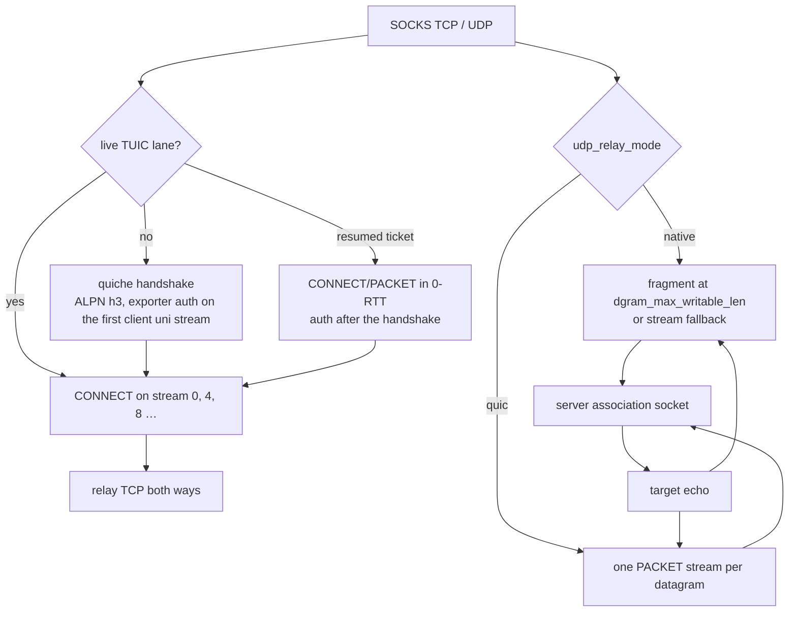

# TUIC v5 over QUIC

TUIC v5 is a QUIC protocol with one authenticated unidirectional stream, bidirectional CONNECT streams and a PACKET lane. Both roles are served: a `protocol: tuic` inbound reads `settings.users`/`clients`, while an outbound reads the first `settings.servers` entry or the settings themselves. The ALPN is `h3`; the authentication token is the TLS exporter keyed by the raw 16-byte UUID with the password as context.

The UDP lane has two shapes. `native` fragments a PACKET into QUIC datagrams at `dgram_max_writable_len()`, and falls back to a unidirectional stream when the peer advertises no datagram. `quic` always writes each PACKET to its own stream. sing-box's UoT `udp_over_stream` is not carried, so it is refused with a one-line error instead of silently running the wrong UDP lane. A stream command takes a numbered id only when the peer advertises uni credit, so a peer's `StreamLimit` leaves the frame queued instead of consuming an id; `native` stops the fragment run on the first failed datagram rather than sending a packet with a hole. The server numbers its own replies, reuses one association across destinations and keeps the mode of the association's first packet. It heartbeats every ten seconds and closes a connection that has not authenticated within three, both configurable. DISSOCIATE removes the association.

The server runs QUIC timers and flushes the socket before the established guard, so a handshake is retransmitted on the same clock as application traffic. Both QUIC lane sockets take one datagram per `recv_from`, so GRO stays off and the kernel never hands a coalesced burst to a reader that would truncate it; the driver stops every header worker and waits for its claim on the listener's socket before the listener reports closed, while a relay lane leaves on the stream's own stop. UDP associations are capped per session and the sockets they open are capped across the server; a listener sweep reads at most 256 replies and 32 per association, resumes after the last association it served and alternates the family it reads first, so neither a busy association nor a full v4 queue can starve the rest or shutdown. A destination name is resolved on a bounded worker pool, never on the listener under the connection lock, and each pending lookup holds at most four payloads while the reply is applied when it lands; the first PACKET names the association's reply mode before its name resolves. A CONNECT that does not finish its header within ten seconds is reset. DISSOCIATE and idle expiry both drop the association and its pending lookups, and a recreated association takes a new session-wide generation, so a late completion cannot recreate the association. The client binds its UDP reply socket to the first source that parses, and a subsequent source is dropped.

The dial keeps one authenticated connection per outbound and starts a driver thread that feeds every received datagram into quiche, so CONNECT responses and both UDP shapes share one pump. Lane creation is serialized, so two CONNECTs cannot replace the connection under a live flow; a pooled connection is redialled when it closes. A resumed lane returns before the handshake when the saved ticket starts early data, so its first CONNECT or PACKET rides 0-RTT; the driver finishes the handshake, exports the token and sends authentication on the first client uni stream. Authentication follows the handshake because the TLS exporter key does not exist until then, which is also sing-quic's ordering. TLS reads the reference spellings and a `pinnedPeerCertSha256` pin is the handshake's verifier, so a chain that does not match never reaches the exporter key and a correct pin completes the handshake even when the device trust store cannot build the chain.

## Data path

## Measured

<!-- counts:begin -->
| key | value | checked by |
| --- | --- | --- |
| ops-retired-instructions | UNBLESSED | scripts/count-ops.sh |
| syscalls-per-connect | UNBLESSED | scripts/count-ops.sh |
| single-fragment-payload-copies-per-packet | 0 | ferrox-app-tuic::tests::a_single_fragment_packet_payload_is_not_copied |
| nanoseconds-per-packet | 13.8 | .github/workflows/bench.yml |
| burst-walk-ns-per-frame | 9.7 | .github/workflows/bench.yml |
| sweep-dedupe-ns-per-session | 15.6 | .github/workflows/bench.yml |
| address-families | 3 | ferrox-core-tuic::tests::the_three_address_families_match_the_wire |
| outbound-spellings-parsed | 1 | ferrox-app-tuic::tests::a_tuic_outbound_reads_the_reference_spellings |
<!-- counts:end -->

## What was removed

Against sing-box and ZeroNet this is a rewrite, not a port: no upstream line or test enters this tree. One wire codec and one association table serve both roles, where the references keep separate inbound and outbound framing. Against Xray-core no removal is claimed: the pinned tree carries no TUIC transport to compare with.

- **The 5 ms flow-control wait.** A stream writer that found its send window closed slept five milliseconds before asking quiche again, so the ceiling was window per quantum: `tuic-raw-up-1` sat at 0.29x of sing-box (146 against 502 MiB/s) on the run before this change and at 0.93-0.96x (245-257 against 266-275) after it, on the same tier. The quantum is 250 µs now; the stream waits on the same window and reports the same bytes.
- **Coalesced reads under a reader that takes one datagram at a time.** The lane's socket is bound with `UDP_GRO`, which hands back several wire datagrams in one `recv_from`; the TUIC reader feeds one `recv_from` result to quiche as one datagram, so a coalesced burst had its tail dropped and retransmitted. The lane now leaves GRO off (both sides, and across a rebind) while keeping the batched send. Reads and bytes on the wire are unchanged; the batched read below hands a queued burst over in one call, and a queue holding one datagram still pays one.
- **The lane's per-packet receive turn, on both roles.** Each inbound datagram paid one blocking `recv_from`, one connection lock, a source-name scan, a `readable()` sweep, the stream reads behind it and an egress flush. The client's driver and the inbound's listener now take one `recvmmsg` over the queued burst and one turn over it; the listener additionally parsed the header and grew the routing map once per datagram, and now feeds the whole burst to quiche before taking one turn per session it touched. Against the ferrox server `tuic-raw-up-1` went 99.4 to 258.0 MiB/s (sing-box 113.0 to 240.0 in the same cell, 7120 to 3920 ms/GiB), `tuic-raw-duplex-8` 54.9 to 356.6 (78.9 to 350.5, 17 760 to 2960 ms/GiB) and `tuic-raw-down-8` 323.2 to 415.2 (307.2 to 371.2); against the sing-box server, where this listener is not in the path, the same cells held their ratio (0.99 duplex, 0.95 up-1). A masked lane keeps the one-datagram read, because its wire bytes are rewritten before quiche sees them and the kernel cannot hand back a batch.
- **The client lane's per-packet send.** The client lane bound its datagram socket to one `send_to` per QUIC packet while the server side and every other quiche lane already took the batched write; it now takes the same path, so a burst of up to 64 datagrams leaves in one `sendmmsg`-style call. The wire bytes are unchanged, and a coalesced read is one quiche `recv` because consecutive QUIC packets in one UDP datagram are the coalescing quiche already parses.
- **The stream lane's second parse.** A uni-stream PACKET was parsed for its prefix and then parsed again as a packet. The prefix parse now yields the packet the dispatch uses, so a stream PACKET takes one parse rather than two; the stream rows in `## Time` are the counterfactual that prices the removed pass, and the relay bytes are unchanged.
- **The stream lane's per-frame tail shift.** A uni-stream PACKET burst drained the front of its stream buffer for every frame, so a burst of k frames moved the remaining tail k times. Both the client's driver and the server's stream turn now walk an offset and drain once, so the tail moves once; the frames, their order and the bytes on the wire are unchanged, and the burst rows in `## Time` price the removed shifts.
- **The worker's sweep dedupe.** A worker's routing map holds one entry per source id, and its periodic tick, its batch turn and its teardown each walked a list of the sessions they had seen with an `Arc::ptr_eq` per entry, so n entries over s sessions cost O(n·s) pointer compares and an `Arc` clone per visit. All three now mark visited identities in one reused set, O(n), and the dead sweep keeps the identities it found instead of a second list of `Arc`s. The visits, their order and every action taken are unchanged. `tuicbench` reads the sweep at the worker's 1024-session cap, clearing and reusing the buffers the worker holds, so the timed window prices the sweep rather than an allocation; a duplicate-suppressing input (`65, 129, 65, 193, 129` visiting three) is asserted outside the window, because a distinct-id timing input never reaches the branch aliases depend on. The sweep rows in `## Time` price the removed compares.

What is not removed: QUIC still encrypts every datagram, the sending side still writes a native PACKET into a reusable frame before quiche encrypts it, reassembly still copies each fragment and then the assembled payload, authentication still follows the handshake, and the dial still reads xray-style TLS settings. A cancelled TUIC flow still resets its QUIC stream; only a graceful FIN skips the reset. `a_single_fragment_packet_payload_is_not_copied` gates the zero-copy single-fragment receive row by pointer identity and a zero allocation delta, including the direct `Destination` build that keeps a numeric address from a string round-trip; a fragmented packet pays one copy per fragment plus the reassembly copy, which no row claims. The server's UDP sweep queues every reply and flushes egress only when the datagram queue cannot hold the next packet, so a 32-reply association no longer overruns the 64-frame queue; the client hands the SOCKS head and payload to `send_to_two` as two parts instead of joining them, and both roles build a destination into a stack buffer with no `Vec`.

## Time

CI's `bench.yml` run `43998600542` (`23ef3f4`) measured the PACKET parse at **13.8 ns** on linux x86_64, **18.5 ns** on linux aarch64, **9.5 ns** on macos aarch64 and **24.0 ns** on windows x86_64. The same run's stream section prices the removed second pass: one parse against two read **4.1** against **14.7 ns** on linux x86_64, **6.1** against **19.4** on linux aarch64, **4.0** against **10.5** on macos aarch64 and **7.7** against **27.8** on windows, so the one-parse path saves **10.6**, **13.3**, **6.5** and **20.1 ns** per packet. These are the codec's dispatch costs, not the QUIC/TLS relay; no local duration is quoted.

CI's `bench.yml` run `44694951611` prices the removed per-frame tail shift on a 512-frame, 1220-byte burst: the drain shape read **5179.7 ns/frame** against **9.7** for the offset walk on linux x86_64, **6992.3** against **6.4** on linux aarch64, **6487.1** against **11.9** on macos aarch64 and **2377.1** against **4.5** on windows x86_64. The offset row is the codec walk alone; the difference is the tail the old shape moved once per frame.

CI's `bench.yml` run `44783358849` sweeps a worker's 1024 sessions, the cap the map holds: scanning the touched list costs **98.6 ns** per session against **15.6** marking the identity set on linux x86_64, **90.2** against **13.7** on linux aarch64 and **85.8** against **12.5** on windows x86_64. The set's per-session cost is fixed overhead spread over the sweep, so the row reads the cap rather than a session count the map cannot reach; the visits and their order are the same in both shapes. That run's macos cell was cancelled by the runner, not by a failure.

<!-- scope:begin -->
- paths: crates/ferrox-app/src/tuic.rs, crates/ferrox-core/src/tuic.rs
- symbols: tuic
<!-- scope:end -->
