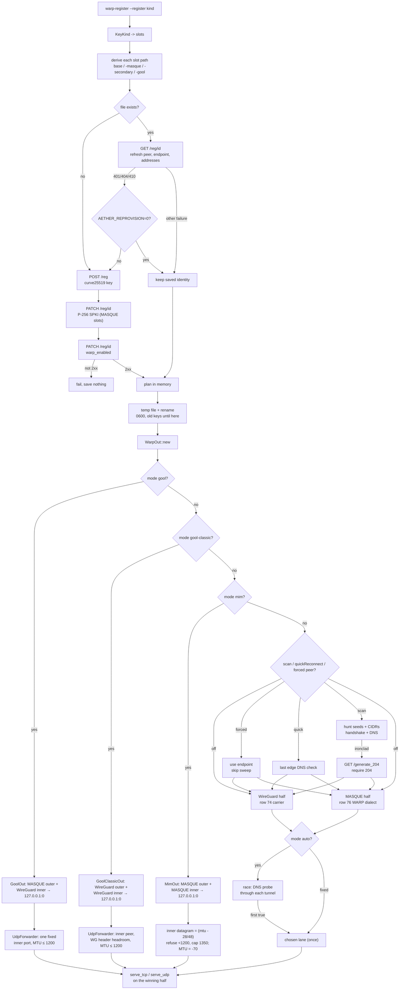

# WARP outbound

`protocol: warp` is Cloudflare WARP as one outbound: a device identity, the WireGuard half (row 74's carrier) and the MASQUE CONNECT-IP half (row 76's carrier), with `mode: auto` racing the two and the first real DNS answer deciding which carries the flows. `mode: wireguard` and `mode: masque` pin one half and never probe; an auto with only one built half takes it without a race. `mode: gool` carries a second WireGuard device inside the MASQUE half: the outer identity is the usual WARP one, the inner comes from `goolIdentity`/`goolIdentityFile` or `<identity>-masque-gool.json` (`goolIdentityFile` stands on its own, so an inline outer identity needs no `identityFile`; registered without a MASQUE enrollment when absent, read back and re-registered on a refusal, like the outer identity), and `goolPeer` (or that identity's endpoint) names the inner edge on port 2408. The inner hop is rewritten to a loopback forwarder that carries each datagram through the outer CONNECT-IP tunnel on one fixed inner source port, so the handshake and every transport packet reach the edge from the outer tunnel; the outer conversation is dialled on the forwarder's first datagram, so `warp` still loads while the edge is down. `mode: gool` builds neither standalone half and never races. The server side is the composition of a `masque` inbound and a `wireguard` inbound: the MASQUE server routes its inner UDP flow through a freedom redirect to the WireGuard listener, so this row adds no inbound. `mode: mim` carries one MASQUE conversation inside another on the same carrier: the outer identity is the usual enrolled WARP one, the inner comes from `mimIdentity`/`mimIdentityFile` or `<identity>-masque-secondary.json` (enrolled like the outer MASQUE identity when absent), and `mimOuter`/`AETHER_MIM_OUTER_PEER` and `mimInner`/`AETHER_MIM_INNER_PEER` name the hops (or `--mim-outer`/`--mim-inner` at registration). Without an inner edge the first known MASQUE candidate whose IP differs from the outer one is used, matching the reference's distinct-address rule. The outer conversation is dialled on the inner forwarder's first datagram; the inner datagram budget is `(mtu - 28 or 48)` when it reaches 1200, capped at 1350, and refused below 1200; the inner MTU is that less the 70-byte MASQUE overhead, clamped to 576..1500, so 1280 gives 1252 and 1182. `maxDatagram` caps the inner QUIC send and receive payload, so the inner peer never emits a datagram the outer hop cannot carry; `mode: mim` builds neither standalone half and never races. The server side is an outer `masque` inbound and an inner `masque` inbound, with the outer server's freedom outbound carrying the inner UDP flow to the inner listener; `ferrox-app-warp::tests::masque_rides_inside_masque` is the end-to-end checker, and `ferrox-app-warp::tests::the_mim_inner_budget_subtracts_the_headers_and_the_masque_overhead` gates the arithmetic.

`mode: gool-classic` is the older form: the outer half is a WireGuard tunnel and the inner identity comes from `goolIdentity`/`goolIdentityFile` or `<identity>-secondary.json` (the same slot `warp-register --register gool-classic` makes), also registered without a MASQUE enrollment. `wiwOuter`/`AETHER_WIW_OUTER_PEER` and `wiwInner`/`AETHER_WIW_INNER_PEER` name the two edges; with `scan` on, each hop is verified with its own key and the inner sweep rejects the outer edge's IP, so the two hops land on distinct edges. `WireGuardOut::udp_forwarder` moves the inner peer to a loopback socket and carries its datagrams through the outer WireGuard tunnel, reserving the WireGuard header's headroom; the inner MTU is capped at 1200 and the mode builds no standalone half. Its server side is an outer `wireguard` inbound whose freedom redirect carries the inner UDP flow to the inner `wireguard` listener; `ferrox-app-warp::tests::wireguard_rides_inside_wireguard` is the end-to-end checker. The identity comes from an inline `identity` block, a saved `identityFile`, or `register: true` which registers once and saves into `identityFile` — a restart reuses the file and never creates a second device. A saved file is read back from the API before it is used: the peer, endpoint, reserved bytes and addresses are refreshed in place, so a device whose edge moved keeps working. `ferrox-app warp-register [--register masque|wg|gool|gool-classic|mim|all] [-o|--config FILE] [--wg-config FILE] [--masque-config FILE] [--api URL] [--api-address ADDR] [--mode auto|wireguard|masque|gool|gool-classic|mim] [--gool-classic] [--wiw-outer ADDR] [--wiw-inner ADDR] [--mim-outer ADDR] [--mim-inner ADDR] [--noize off|light|firewall|balanced|gfw|aggressive] [--no-profile-retry] [--no-quic-v2]` is the form, and `--noize`/`--no-profile-retry`/`--no-quic-v2` are copied into the outbound it prints. Without `--register` it registers one combined device (both halves), saves the identity owner-only (0600 on Unix; on Windows it inherits the directory ACL), and prints the outbound config that references it; `--mode gool` and `--mode gool-classic` also register the inner WireGuard identity beside it, `--mode mim` registers the inner MASQUE identity beside it, and `--wiw-outer`/`--wiw-inner` and `--mim-outer`/`--mim-inner` pin the nested hops in the printed settings. With `--register` it makes the identities the kind names and prints one readiness line per file: `wg` is the WireGuard file, `masque` the MASQUE file beside it, `gool` is MASQUE plus the WireGuard identity it carries (`<masque>-gool`), `gool-classic` is WireGuard plus its second hop (`<config>-secondary`), `mim` is MASQUE plus its second hop, and `all` is all five in that order. `-o`/`--config` names the base identity file (default `warp-identity.json`); `--wg-config` and `--masque-config` move the WireGuard and MASQUE files, and every second hop is derived beside its own first: `<config>-secondary`, `<masque>-secondary`, `<masque>-gool`. The gool slot derives from the MASQUE file the plan names (`<masque>-gool`), so `--register gool --masque-config outer.json` writes `outer-gool.json` and a second run loads it instead of enrolling again. An identity file already there is kept and refreshed, never replaced while it works; a corrupt file is moved to `<name>.corrupt`, and a refused one is registered afresh unless `AETHER_REPROVISION` is `0`, `off` or `false`. An outbound replaces a refused saved file only when its own `register` is true; without it the file is reported and kept.

Registration is the three calls the pinned clients make: `POST /v0a4471/reg` with a fresh clamped Curve25519 key, `PATCH /reg/{id}` enrolling a P-256 SPKI for a MASQUE identity, and `PATCH /reg/{id}` with `{"warp_enabled":true}`. A WireGuard-only identity (the `wg`, `gool` and both `gool-classic` hops, and any outbound pinned to `mode: wireguard` or `mode: gool-classic`) skips the enrollment and makes two calls. The API hosts are tried in order (`api.devices.cloudflare.com`, then `api.cloudflareclient.com`); a failure before the device exists moves to the next host, a failure after it does not retry the POST, so a flaky plane cannot mint two accounts. The enable call must answer 2xx: the identity is saved only once WARP is enabled, so a refused enable fails the registration and leaves the previous keys where they were. A read-back answering 401 or 410, or a 404 in Cloudflare's own error envelope, is a refusal of that identity, not an outage; a 404 page from a front that knows only the other API name is not, and the next name is tried. Any other failure keeps the saved identity and says it was not checked. `--api-address` moves where the API is dialled while the TLS name and HTTP `Host` stay the origin's: an IP, a bracketed IPv6, or a domain, with or without a port (443 when absent).

The WireGuard endpoint reads the reply's `endpoint.v4` host with port 2408 when the reply lists it (the first listed port otherwise), the reserved bytes are the reply's `client_id`, and the tunnel addresses are the reply's interface v4/v6. The MASQUE half reuses the row 76 WARP dialect unchanged: the enrolled key mints the client certificate, the reply's server key is the SPKI pin, and the edge defaults to `cloudflareaccess.com` with SNI `consumer-masque.cloudflareclient.com`.

Every identity the kind names is made in memory before any file is written, so a later slot's refusal leaves all old keys in use; each save writes a temp file beside the target and renames it, so a reader never sees half an identity.

## Edge discovery

`scan` (or `AETHER_SCAN`) is off by default; `turbo`, `balanced`, `thorough`, `verified` and `ironclad` set the sweep's pace, and the reference's older spellings are accepted (`fast`, `deep`/`pro`, `proven`/`stealth`/`quiet`, `real`/`verify`/`guaranteed`). An unknown value becomes `balanced` rather than refusing the outbound. `scan: false`, `off` or `none` turns the sweep off. The scan is IPv4-only: row 207 owns `-4`/`-6`/`--dual`, so every candidate here is a v4 edge.

`noize` (or `AETHER_NOIZE`) shapes the handshake: `off`, `light`, `firewall`, `balanced`, `gfw` and `aggressive` are the names, with `firewall` the MASQUE default and `balanced` the WireGuard/gool default. A WireGuard sweep tries the primary profile, then `balanced`, `aggressive`, `light` and `off` when `noProfileRetry` is absent (`AETHER_WG_NO_PROFILE_RETRY`, in any value, turns the retries off), and the profile whose handshake and DNS answer pass is the one the built tunnel keeps. A forced `wgPeer` or `wiwOuter`/`wiwInner` skips the sweep and uses the profile it was given. `masqueSettings.noize` carries the profile into the HTTP/3 half; HTTP/2 and HTTP/1.1 have no pre-handshake datagrams and take none. `quicV2` (or `AETHER_QUIC_V2`) sends one 1200-byte QUIC v2 long-header before each HTTP/3 handshake: the client waits up to 600 ms, twice on a real dial and 500 ms once on a scan probe, for Version Negotiation, then runs the ordinary v1 handshake on the same socket. It is on by default, `--no-quic-v2` or `AETHER_QUIC_V2=0`/`off`/`false`/`no` turns it off, and HTTP/2 and HTTP/1.1 never send it; the MIM inner hop and `--h2` carry none. `firewall` is Aether's default because it survives a middlebox that drops a bare WireGuard initiation; `balanced` is the reference's default for its own WireGuard profile.

`peer`/`AETHER_PEER` forces the MASQUE edge and `wgPeer`/`AETHER_WG_PEER` forces the WireGuard endpoint; `endpoint` is treated the same way as `wgPeer`, `wiwOuter`/`AETHER_WIW_OUTER_PEER` and `wiwInner`/`AETHER_WIW_INNER_PEER` force the two classic WireGuard hops, and `mimOuter`/`AETHER_MIM_OUTER_PEER` and `mimInner`/`AETHER_MIM_INNER_PEER` (or the `AETHER_MIM_PEERS` list) force the two MASQUE hops. A forced half prints `[+] using forced peer IP:PORT (probe skipped)` and is not swept. `quickReconnect`/`AETHER_QUICK_RECONNECT` reads `lastEdge` (default `<identity stem>.lastconn.json`, or `warp-lastconn.json` without an identity file) first: each half's most recent edge is opened and asked the same DNS question, then a failed one is cooled down and the remaining half is scanned. `ironcladPort`/`AETHER_IRONCLAD_PORT` moves the port the real request uses, default 80. `cooldown`/`AETHER_WG_ENDPOINT_COOLDOWN_SECS` holds a failed cached edge out of the scan, default 300 s. `stale`/`AETHER_WG_STALE_SECS` may shorten a candidate's WireGuard handshake-and-DNS wait; it is capped at the mode's own timeout and is not the running tunnel's watchdog (row 211 owns that).

The WireGuard sweep starts from the five seeds in `warp_scan.rs` and samples the documented `/24`s, then waves each address across the reference's 54-port table. The MASQUE sweep starts from Cloudflare's documented seeds on 443, puts the same seeds on the reference's six alternate ports, and samples the MASQUE `/24`s on 443. `thorough` enumerates every host in a `/24`; the other modes take a stratified sample, because a full port/host cross-product is not a bounded startup. A candidate passes only when a tunnel is established and a DNS question sent through it answers: WireGuard uses `wg::verify_endpoint` (one handshake, inner UDP DNS queries, no stack), MASQUE uses `MasqueOut::probe`. `ironclad` then builds the proxy and sends `GET /generate_204` with `Host: www.gstatic.com` through it; only a `204` from the tunnel keeps the edge, and a tunnel that opens but carries no HTTP answer prints `[-] edge IP:PORT opened a tunnel but carried no HTTP answer` (or `gateway` for MASQUE). The chosen halves print `[+] selected WireGuard endpoint IP:PORT` and `[+] selected MASQUE gateway IP:PORT`, the lines PattNG reads; the cache keeps the newest edge per carrier, so one carrier failing does not discard the other's.

The race asks `one.one.one.one` through each half's own tunnel DNS (`WireGuardOut::probe`, `MasqueOut::probe`) and takes the first `true`. A `false` answer does not end the race: the other half may still carry, and the wait runs to the 8 s deadline; two failures or a silent pair fall back to WireGuard, the half a fixed config would have chosen. The choice is made once per outbound under one lock, so concurrent flows wait for the first flow's answer instead of probing again. `endpoint`, `mtu` (1280), `keepAlive` (25), `probe`, `probePort`, `dns`, `apiAddress`, and a `masque` block (`address`, `port`, `serverName`, `host`, `path`) override the WARP defaults; every one has the default WARP's own clients use, so the identity file is the whole config. In gool the inner hop's endpoint is the forwarder's loopback socket and its MTU is `min(mtu, 1200)`, the reference's rate for a WireGuard packet inside a MASQUE one; in gool-classic the inner endpoint is the forwarder's loopback socket and its MTU is the same cap, so the inner packet fits the outer hop's payload; in mim the inner endpoint is the forwarder's loopback socket and its QUIC payload is capped by the outer MTU's budget instead.

Against the references: ZeroNet's `warp.rs` races whole tunnels with a registry of keep-alive stacks and re-races on staleness; this races once per process and keeps the winner, because the carriers themselves already reconnect. Aether keeps one TOML identity per transport and re-registers a refused one through `api.rs`; the layout here is the same (base, `-masque`, `-secondary`, `-gool`) in JSON, because `ferrox-app` has no TOML reader, and the read-back is the same `GET /reg/{id}`. PattNG's WARP-keys page stages a renewal and keeps the old keys until the new ones answer; here that is the in-memory plan plus the temp-and-rename save. What was removed: the second registration on a stale tunnel, the rejected identity saved for a later resume (a refusal now fails cleanly and re-provisions in one act), and the async runtime the references carry — the race is two probe threads and a channel, and gool's forwarder is one thread per tunnel. What was not removed: the registration is still sequential HTTPS calls (the API requires the device id from the first), the per-slot read-back is one more call per existing file, and the losing probe thread runs to its own timeout — it is detached, not cancelled. In the scan, every candidate is IPv4; only `ironclad` sends HTTP, while the other modes trust a DNS answer through the tunnel; a cooldown lives for this startup, not across restarts; `stale` bounds discovery, not a running tunnel; and exit-location gating is row 196. Gool is Aether's second device and second WARP endpoint, not a key exchange of its own: this registers the inner identity the same way (two calls, no MASQUE enrollment), rebuilds the inner peer's endpoint to the forwarder, and caps the inner MTU at 1200, but it takes `goolPeer` or the identity's one endpoint instead of scanning candidates and remembering the one that answered (row 190). Gool-classic follows Aether's two-hop WireGuard form: each hop is scanned with the identity that owns its key and the inner sweep rejects the outer edge's IP, which is the distinct-IP rule the reference states; forced `wiwOuter`/`wiwInner` peers skip the sweep the same way a forced `wgPeer` does. Mim follows Aether's `mim_inner_budget`: the inner datagram is the outer MTU less the inner family's IP and UDP headers, capped at 1350 and refused when it falls below 1200, and the inner stack MTU is that less the 70-byte MASQUE overhead, clamped to 576..1500. The reference retries up to six inner candidates for twelve seconds; this takes the first candidate distinct from the outer edge, and a failed inner lane redials that same edge rather than walking to the next candidate, so a silent pick stays down until the config or the scan changes. The inner hop rides HTTP/3 over UDP; Aether's h2 inner form is not carried. Certificate renewal is not on this page; the last-connected edge cache and cooldowns are the edge-discovery section above (row 190), team enrollment is row 192, and the API cut is row 197. Noise follows Aether's `noize.rs` and `aethernoize.rs`: the six WireGuard shapes and four MASQUE shapes use the reference's junk ranges, `i1` is wrapped in an IKEv2 header with the handshake's own eight-byte initiator SPI, `i2..i5` are the reference's signature slots, and the retry order is the primary, `balanced`, `aggressive`, `light`, `off`. The pre-noise is sent once before the first initiation, the post-noise once after it, and keepalive junk when a transport keepalive is seen; MASQUE sends its junk and `i1`/`i2` before `quiche::connect`, so the QUIC ClientHello follows them. What was removed: the second obfuscator, because the profile table and the packet expansion are one function shared with Psiphon's QUIC carrier; the data path is byte-identical when `noize` is off. What was not removed: the profile junk is built per handshake and sleeps on the dial thread, the pre-noise reaches the configured endpoint but not every alternate multi-endpoint candidate, and the gool/gool-classic inner hop takes the selected profile rather than scanning its own list. Aether's zero-size padding switch is not carried; an empty profile is `off`. MASQUE over HTTP/2 and HTTP/1.1 is untouched, and the Tor/Psiphon carriers take no noise.

The checks are unit races rather than a network comparison: `noize::tests::six_wireguard_profiles_keep_six_shapes` and `noize::tests::four_masque_profiles_keep_four_shapes` count the distinct shapes, `noize::tests::a_scan_retries_the_fallback_profiles_once_each` pins the retry order, and `noize::tests::wireguard_signatures_are_sent_in_the_reference_order` and `noize::tests::masque_signatures_follow_the_reference_order` pin the datagram order. The WireGuard and MASQUE carriers' own pages own their data-path copies; the profile adds no payload copy once the handshake is up.

## Data path

## Ops

<!-- counts:begin -->
| key | value | checked by |
| --- | --- | --- |
| ops-retired-instructions | UNBLESSED | scripts/count-ops.sh |
| registration-api-calls | 3 | ferrox-app-warp::tests::a_registration_is_register_enroll_enable |
| registration-api-calls-wg | 2 | ferrox-app-warp::tests::a_wireguard_slot_registers_without_enrolling_masque |
| gool-second-run-enrollments | 0 | ferrox-app-warp::tests::a_second_gool_registration_finds_the_file_the_first_one_wrote |
| gool-identities-read-without-an-outer-file | 1 | ferrox-app-warp::tests::a_gool_identity_file_stands_without_an_outer_identity_file |
| register-kinds | 6 | ferrox-app-warp::tests::six_register_kinds_parse |
| identity-files-all | 5 | ferrox-app-warp::tests::every_slot_derives_beside_its_own_first_hop |
| tunnel-halves-built | 2 | ferrox-app-warp::tests::a_registered_identity_builds_both_tunnels |
| identity-file-mode | 600 | ferrox-app-warp::tests::an_identity_survives_a_save_and_load |
| api-address-dial-port | 8443 | ferrox-app-warp::tests::an_api_address_moves_the_dial_not_the_name |
| refused-statuses | 3 | ferrox-app-warp::tests::a_refused_read_back_is_told_apart_from_an_outage |
| reprovision-off-spellings | 3 | ferrox-app-warp::tests::three_spellings_turn_reprovisioning_off |
| race-first-winner | wireguard | ferrox-app-warp::tests::the_first_answering_half_wins_the_race |
| race-surviving-lane | masque | ferrox-app-warp::tests::a_failed_probe_does_not_end_the_race |
| race-fallback-lane | wireguard | ferrox-app-warp::tests::two_failed_probes_fall_back_to_wireguard |
| scan-mode-spellings | 14 | warp_scan::tests::every_reference_alias_names_its_mode |
| wg-sweep-seeds | 5 | warp_scan::tests::the_reference_sweep_counts_are_the_documented_ones |
| wg-sweep-ports | 54 | warp_scan::tests::the_reference_sweep_counts_are_the_documented_ones |
| masque-sweep-seeds | 10 | warp_scan::tests::the_reference_sweep_counts_are_the_documented_ones |
| masque-sweep-ports | 7 | warp_scan::tests::the_reference_sweep_counts_are_the_documented_ones |
| last-edge-cap | 8 | warp_scan::tests::the_last_edge_keeps_one_entry_per_carrier_and_is_bounded |
| ironclad-status | 204 | warp::tests::an_http_status_line_is_read_not_guessed |
| mim-inner-datagram-v4 | 1252 | ferrox-app-warp::tests::the_mim_inner_budget_subtracts_the_headers_and_the_masque_overhead |
| mim-inner-mtu-v4 | 1182 | ferrox-app-warp::tests::the_mim_inner_budget_subtracts_the_headers_and_the_masque_overhead |
| noize-wireguard-profiles | 6 | noize::tests::six_wireguard_profiles_keep_six_shapes |
| noize-masque-profiles | 4 | noize::tests::four_masque_profiles_keep_four_shapes |
| noize-retry-candidates | 4 | noize::tests::a_scan_retries_the_fallback_profiles_once_each |
| quic-v2-bait-bytes | 1200 | ferrox-app-masque::tests::the_bait_is_a_v2_versioned_long_header_of_the_minimum_size |
| quic-v2-bait-answer | consumed | ferrox-app-masque::tests::the_bait_triggers_a_version_negotiation_from_a_v1_only_server |
<!-- counts:end -->

## Syscalls

**Not measured.** The registration, read-back and probe paths reach real sockets and the API, so a loopback or mock test observes their bytes and call count, not the kernel calls behind them; `scripts/count-ops.sh` reports instructions rather than syscalls. The identity save and rename are file operations whose call count is the platform's, not this lane's. A noise profile adds one `send_to` per junk or signature datagram during the handshake; that count is the profile's own, not a claim about the running flow. No syscall row is claimed.

## Memory copies

**Not measured.** This page's counts are the control plane's: identity slots, API calls, scan bounds and the mim budget arithmetic. The bytes a flow carries are the carriers' own paths (rows 74 and 76), and their copy counts belong to [`carrier-masque`](carrier-masque.md) and [`wireguard`](wireguard.md); `mim_outbound` builds one JSON outbound per lane and copies no payload. A noise profile allocates each junk datagram and the IKEv2 header around `i1`; after the handshake it allocates nothing on the flow path. No memory-copy row is claimed.

## Time

No local duration is quoted: every contributor dials through a VPN, so a local race measures the tunnel. The scan's bounds are nominal per-mode deadlines (turbo 45 s, balanced 120 s, thorough 300 s, verified 60 s, ironclad 180 s) with a per-candidate verify timeout of 6/6/10/5/15 s (or a shorter `stale`) and a 6 s ironclad HTTP wait; a worker already in a probe can run one timeout past the deadline. These are bounds, not measured durations. The race's bound is the 8 s `RACE_DEADLINE`; `a_silent_pair_falls_back_at_the_deadline` exercises the same fallback at a 50 ms deadline so the suite does not wait it out; throughput of the two halves is the carriers' own CI cells (rows 74 and 76), and every WARP data plane is compared in the benchmark matrix's WARP rows against Aether in the same cell: `warp-masque-down-8`, `warp-gool-down-8`, `warp-gool-classic-down-8` and `warp-mim-down-8` in standard, with `-down-16`, `-down-64` and `-duplex-64` lanes in full. Each nested scenario composes a ferrox server from the outer inbound and an inner listener (WireGuard or MASQUE), and the Aether adapter derives the second identity beside the first, so a gool cell no longer needs a second WARP device. ZeroNet is skipped with a reason: its WARP client drops `ADDRESS_ASSIGN` and dials from its configured address, which a shared server's pool has already assigned to another tunnel. A host where the external leg did not build skips the WARP cell with that reason instead of reporting a one-engine comparison.

## CI scope

What a change here owes, read by `scripts/ci-scope.py`; see [`docs/ci-scope.md`](../ci-scope.md). The dial-side of the row is this page's own unit races, and the throughput comparison is the matrix's WARP rows (`warp-masque-*`, `warp-gool-*`, `warp-gool-classic-*`, `warp-mim-*`): ferrox's warp outbound against Aether in the same cell, which runs only in CI because everything beyond loopback is.

<!-- scope:begin -->
- paths: crates/ferrox-app/src/warp.rs, crates/ferrox-app/src/warp_scan.rs, crates/ferrox-app/src/noize.rs
- symbols: find_warp_outbound
- scenarios: warp-masque, warp-gool, warp-gool-classic, warp-mim
- engines: xray-core, aether, zeronet
<!-- scope:end -->
