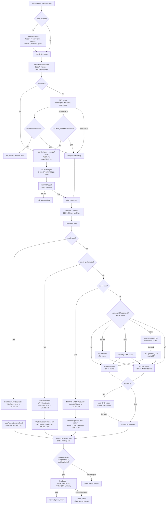

# WARP outbound

`protocol: warp` is Cloudflare WARP as one outbound: a device identity, the WireGuard half (row 81) and the MASQUE CONNECT-IP half (row 83), with `mode: auto` racing the two and the first real DNS answer deciding which carries the flows. `mode: wireguard` and `mode: masque` pin one half and never probe; an auto with only one built half takes it without a race. `mode: gool` carries a second WireGuard device inside the MASQUE half: the outer identity is the usual WARP one, the inner comes from `goolIdentity`/`goolIdentityFile` or `<identity>-masque-gool.json`, and `goolPeer` (or that identity's endpoint) names the inner edge on port 2408. The inner hop is rewritten to a loopback forwarder that carries each datagram through the outer CONNECT-IP tunnel on one fixed inner source port, so the handshake and every transport packet reach the edge from the outer tunnel; the outer conversation is dialled on the forwarder's first datagram, so `warp` still loads while the edge is down. `mode: gool` builds neither standalone half and never races. The server side is a `masque` inbound plus a `wireguard` inbound, the MASQUE server routing its inner UDP flow through a freedom redirect to the WireGuard listener, so this row adds no inbound.

`mode: mim` carries one MASQUE conversation inside another: the outer identity is the enrolled WARP one, the inner comes from `mimIdentity`/`mimIdentityFile` or `<identity>-masque-secondary.json`, and `mimOuter`/`mimInner` (or `AETHER_MIM_OUTER_PEER`/`AETHER_MIM_INNER_PEER`) name the hops. `mode: gool-classic` is the older form: the outer half is a WireGuard tunnel and the inner identity comes from `goolIdentity`/`goolIdentityFile` or `<identity>-secondary.json`; `wiwOuter`/`wiwInner` name the two edges, and with `scan` on each hop is verified with its own key and the inner sweep rejects the outer edge's IP. `WireGuardOut::udp_forwarder` moves the inner peer to a loopback socket and carries its datagrams through the outer WireGuard tunnel, reserving the WireGuard header's headroom; the inner MTU is capped at 1200. Its server side is an outer `wireguard` inbound whose freedom redirect carries the inner UDP flow to the inner `wireguard` listener (`wireguard_rides_inside_wireguard`).

A `team`/`--team` name (or `AETHER_TEAM` when the flag is omitted) enrols a managed device instead. The name is normalised from a bare subdomain, a full `<team>.cloudflareaccess.com` domain or an enrolment URL, and the sign-in order is the reference's: a supplied JWT (`accessToken`/`--access-token`/`AETHER_ACCESS_TOKEN`, checked for shape and `exp`), then a service token (`accessClientId`+`accessClientSecret`/`--access-id`+`--access-secret`, read from the `CF_Authorization` cookie or the page's `token=`), then an emailed one-time code (`accessEmail`/`--access-email`, three attempts). The access flow follows up to ten redirects, keeps its cookies, resolves relative `Location`s, reads `action=` from the TOTP form, and takes the nonce from the verify reply's URL. One JWT is cached per process, so `--register all` asks once. The JWT is sent only on `POST /reg` as `CF-Access-Jwt-Assertion`; the enrollment, enable and read-back carry the device bearer alone. A team registration posts `key`, `install_id`, `fcm_token`, `tos`, `model`, `name`, `serial_number` and `locale`, with `name` and `serial_number` the 22-character install id, and no `key_type`, `tunnel_type` or `os_version`. The team identity is saved beside the personal one, `<base>-team-<team>~` (or its slot siblings), unless `-o`/`--config`/`--identity`/`--out` names a path. A saved matching team is read back without sign-in; the token flow runs only when the device is registered or replaced.

`gateway`/`--gateway` sends HTTP and HTTPS through the organization's `config.services.http_proxy`, saved as `gatewayProxy` in the identity. For each 80/443 flow the tunnel opens the proxy, writes `CONNECT <authority> HTTP/1.1` with the reference's `WARP for Android` agent, waits up to 5 s for a complete head, and requires a 2xx before forwarding the client's buffered bytes; the first refusal, timeout, closed socket or malformed head retires the proxy for the life of the process and that flow goes straight through the tunnel. A destination that is not a valid authority, and any flow outside the gateway's TCP ports, goes direct without retiring a working proxy. A saved proxy with `gateway` absent prints the address without using it; `gateway: true` with no published proxy says so and carries direct. Every other port, and every UDP flow, ignores the gateway.

The identity comes from an inline `identity` block, a saved `identityFile`, or `register: true`, which registers once and saves into `identityFile`; a restart reuses the file and never creates a second device. A saved file is read back from the API before use: the peer, endpoint, reserved bytes and addresses are refreshed in place, so a device whose edge moved keeps working. `ferrox-app warp-register [--register masque|wg|gool|gool-classic|mim|all] ...` is the form, and `--noize`/`--no-profile-retry`/`--no-quic-v2` are copied into the outbound it prints. Without `--register` it registers one combined device (both halves), saves the identity owner-only (0600 on Unix), and writes the config.

Registration is the three calls the pinned clients make: `POST /v0a4471/reg` with a fresh clamped Curve25519 key, `PATCH /reg/{id}` enrolling a P-256 SPKI for a MASQUE identity, and `PATCH /reg/{id}` with `{"warp_enabled":true}`. A WireGuard-only identity skips the enrollment and makes two calls. The API hosts are tried in order (`api.devices.cloudflare.com`, then `api.cloudflareclient.com`); a failure before the device exists moves to the next host, a failure after it does not retry the POST, so a flaky plane cannot mint two accounts. The enable call must answer 2xx; the identity is saved only once WARP is enabled. A read-back answering 401 or 410, or a 404 in Cloudflare's own error envelope, is a refusal of that identity, not an outage; a 404 page from a front that knows only the other API name is not, and the next name is tried. Any other failure keeps the saved identity and says it was not checked. `--api-address` moves where the API is dialled while the TLS name and HTTP `Host` stay the origin's: an IP, a bracketed IPv6, or a domain, with or without a port (443 when absent).

The WireGuard endpoint reads the reply's `endpoint.v4` host with port 2408 when listed (the first listed port otherwise), the reserved bytes are the reply's `client_id`, and the tunnel addresses are the reply's interface v4/v6. The MASQUE half reuses the row 83 WARP dialect: the enrolled key mints the client certificate, the reply's server key is the SPKI pin, and the edge defaults to `cloudflareaccess.com` with SNI `consumer-masque.cloudflareclient.com`. Every identity the kind names is made in memory before any file is written, so a later slot's refusal leaves all old keys in use; each save writes a temp file beside the target and renames it.

## WARP TLS shaping

`--fragment` cuts the WARP API `ClientHello` and the MASQUE HTTP/2 hello into the reference's 8–16-byte pieces, 2–10 ms apart, for a network that resets a whole hello whose SNI ends in `cloudflareclient.com`; `--fragment-size` and `--fragment-delay` take one value or an inclusive `min-max`. The cut rides the same `finalmask::Fragment` the outbound's `tlsSettings.fragment` builds, applied under the stream before `ferrox_core::tls::connect`, so the API origin and the h2 carrier cut once each and the MASQUE QUIC carrier is untouched. `tlsSettings.fingerprint: chrome_plain` is the base hello: Chrome's TLS 1.2 list and P-256/X25519/P-384 order. `--tls-ciphers` keeps the GREASE slot and Chrome's TLS 1.3 trio and appends the BoringSSL list's TLS 1.2 suites; `--tls-groups` replaces the group order, and a numeric `tlsGroups` entry is accepted only when the shaped key generator has an arm for it, so P-521 is refused by value; `--disable-grease` drops every `0x0a0a` from the suites, extension kinds, groups, key shares and versions. The h2 handshake passes its clock to the fragment stage, so a configured delay cannot outlive the connection deadline. `--ech auto` resolves `cloudflare-ech.com` through Cloudflare's UDP resolver, with `--ech-domain`/`--ech-dns` overriding the name and the resolver, into the hello's ECH config list; an explicit base64 list is decoded directly. `--masque-sni` moves the MASQUE SNI from `consumer-masque.cloudflareclient.com`; the existing default name is kept so row 83's SNI does not move, while the hello's base table becomes `chrome_plain`, Aether's Chrome (nine signature algorithms, a P-256 key share) in place of the tree's `chrome` default (eight, plus the older TLS 1.2 extension shape). A generated `warp` outbound carries the flags as `fragment`, `fragmentSize`, `fragmentDelay`, `tlsCiphers`, `tlsGroups`, `disableGrease`, `ech`, and its MASQUE half carries the parsed ids and stage as `masqueSettings.warpTls`.

Against the references: Aether's `fragment.rs` draws the same inclusive bounds, `tls.rs` builds Chrome's TLS 1.2 list with `SSL_CTX_set_strict_cipher_list` and groups `P-256:X25519:P-384`, and `dns.rs` resolves the `--ech auto` name; this reuses the tree's shaped hello and `finalmask` instead of a second BoringSSL client. Removed: a per-dial BoringSSL `SslContext`, the QUIC carrier's fragment (the row names h2), and the second cipher/group parser. Not removed: `--tls-ciphers` and `--tls-groups` still validate through a BoringSSL builder, and an unknown group name is refused rather than silently dropped; a custom profile is leaked once per outbound, not per handshake.

The checks are unit counts of the derived table: `warp_tls::tests::the_fragment_default_size_and_delay_match_aether` pins the inclusive 8/16 and 2/10 bounds, `a_fragment_range_is_inclusive_at_both_ends` pins a reversed range and a single value, `the_default_profile_carries_chromes_tls12_suites` counts Chrome's 12 default TLS 1.2 suites, `a_cipher_list_follows_chromes_tls13_trio` pins a configured list's place after GREASE and TLS 1.3, and `disabling_grease_removes_every_sentinel` walks the suites, extension kinds, groups, key shares and versions. `the_group_list_keeps_boringssls_order`, `a_numeric_group_list_rejects_a_group_with_no_shaped_share`, `a_numeric_group_list_keeps_every_group_with_a_shaped_share` and `a_warp_tls_block_round_trips_through_its_json` cover the group order, the numeric ids and the `warp`-to-`masque` block. No byte-identity check against Aether's BoringSSL hello exists in this tree; the tests name the fields and order, not the wire bytes.

## Edge discovery

`scan` (or `AETHER_SCAN`) is off by default; `turbo`, `balanced`, `thorough`, `verified` and `ironclad` set the sweep's pace, and the reference's older spellings are accepted (`fast`, `deep`/`pro`, `proven`/`stealth`/`quiet`, `real`/`verify`/`guaranteed`). An unknown value becomes `balanced`; `scan: false`, `off` or `none` turns the sweep off. The scan is IPv4-only: row 215 owns `-4`/`-6`/`--dual`.

`noize` shapes the handshake: `off`, `light`, `firewall`, `balanced`, `gfw` and `aggressive`, with `firewall` the MASQUE default and `balanced` the WireGuard/gool default. A WireGuard sweep tries the primary profile, then `balanced`, `aggressive`, `light` and `off` when `noProfileRetry` is absent, and the profile whose handshake and DNS answer pass is the one the tunnel keeps. A forced `wgPeer` or `wiwOuter`/`wiwInner` skips the sweep. `masqueSettings.noize` carries the profile into the HTTP/3 half; HTTP/2 and HTTP/1.1 take none. `quicV2` sends one 1200-byte QUIC v2 long-header before each HTTP/3 handshake, waits up to 600 ms (twice on a real dial, 500 ms once on a scan probe) for Version Negotiation, then runs the ordinary v1 handshake on the same socket. It is on by default; `--no-quic-v2` turns it off, and HTTP/2, HTTP/1.1 and the MIM inner hop never send it. `firewall` is Aether's default because it survives a middlebox that drops a bare WireGuard initiation; `balanced` is the reference's default for its own WireGuard profile.

`peer`/`AETHER_PEER` forces the MASQUE edge and `wgPeer`/`AETHER_WG_PEER` the WireGuard endpoint; `endpoint` is treated like `wgPeer`, `wiwOuter`/`wiwInner` force the classic WireGuard hops, and `mimOuter`/`mimInner` force the MASQUE hops. A forced half prints `[+] using forced peer IP:PORT (probe skipped)` and is not swept. `quickReconnect` reads `lastEdge` first: each half's most recent edge is opened and asked the same DNS question, then a failed one is cooled down and the remaining half is scanned. `ironcladPort` moves the port the real request uses, default 80. `cooldown` holds a failed cached edge out of the scan, default 300 s. `stale` may shorten a candidate's WireGuard handshake-and-DNS wait; it is capped at the mode's own timeout and is not the running tunnel's watchdog (row 219).

The WireGuard sweep starts from five seeds and samples the documented `/24`s, then waves each address across the reference's 54-port table. The MASQUE sweep starts from Cloudflare's documented seeds on 443, puts the same seeds on six alternate ports, and samples the MASQUE `/24`s on 443. `thorough` enumerates every host in a `/24`; the others take a stratified sample, because a full port/host cross-product is not a bounded startup. A candidate passes only when a tunnel is established and a DNS question through it answers: WireGuard uses `wg::verify_endpoint`, MASQUE uses `MasqueOut::probe`. `ironclad` then sends `GET /generate_204` with `Host: www.gstatic.com`; only a 204 keeps the edge, and a tunnel that opens without an HTTP answer prints `[-] edge IP:PORT opened a tunnel but carried no HTTP answer`. The chosen halves print `[+] selected WireGuard endpoint IP:PORT` and `[+] selected MASQUE gateway IP:PORT`, the lines PattNG reads; the cache keeps the newest edge per carrier.

The race asks `one.one.one.one` through each half's own tunnel DNS and takes the first `true`. A `false` does not end the race: the other half may still carry, and the wait runs to the 8 s deadline; two failures or a silent pair fall back to WireGuard. The choice is made once per outbound under one lock, so concurrent flows wait for the first flow's answer. `endpoint`, `mtu` (1280), `keepAlive` (25), `probe`, `probePort`, `dns`, `apiAddress` and a `masque` block override the WARP defaults, so the identity file is the whole config. In gool the inner endpoint is the forwarder's loopback socket and its MTU is `min(mtu, 1200)`; in gool-classic the same cap keeps the inner packet inside the outer hop; in mim the inner QUIC payload is capped by the outer MTU's budget.

Against the references: ZeroNet's `warp.rs` races whole tunnels with a registry of keep-alive stacks and re-races on staleness; this races once per process and keeps the winner, because the carriers already reconnect. Aether keeps one TOML identity per transport and re-registers a refused one; the layout here is the same (base, `-masque`, `-secondary`, `-gool`) in JSON, because `ferrox-app` has no TOML reader, and the read-back is the same `GET /reg/{id}`. PattNG stages a renewal and keeps the old keys until the new ones answer; here that is the in-memory plan plus the temp-and-rename save. Removed: the second registration on a stale tunnel, the rejected identity saved for a later resume, and the async runtime — the race is two probe threads and a channel, and gool's forwarder is one thread per tunnel. Not removed: registration is still sequential HTTPS calls, the per-slot read-back is one more call per existing file, and the losing probe thread runs to its own timeout, detached not cancelled. Every scan candidate is IPv4; only `ironclad` sends HTTP, while the others trust a DNS answer; a cooldown lives for this startup, not across restarts; `stale` bounds discovery, not a running tunnel; exit-location gating is row 204. Gool registers the inner identity the same way (two calls, no MASQUE enrollment), rebuilds the inner peer's endpoint to the forwarder, and caps the inner MTU at 1200, but takes `goolPeer` or the identity's one endpoint instead of scanning and remembering the answer (row 198). Aether's Zero Trust sign-in disables certificate verification; here the access and API planes verify against the system roots, and a service token is read from the cookie or the body the same way. Aether opens the gateway on its existing session; this hands the HTTP flow to the tunnel over one loopback pair per flow, so a hundred HTTP flows hold a hundred local pairs until they close, the same count a SOCKS accept already holds. The Aether pin has `test_enabled = false`, so `conformance.yml` has no Zero Trust flow to run; the unit checks are the seam instead.

The checks are unit races rather than a network comparison: `noize::tests::six_wireguard_profiles_keep_six_shapes` and `four_masque_profiles_keep_four_shapes` count the distinct shapes, `a_scan_retries_the_fallback_profiles_once_each` pins the retry order, and `wireguard_signatures_are_sent_in_the_reference_order` and `masque_signatures_follow_the_reference_order` pin the datagram order. The carriers' own pages own their data-path copies; the profile adds no payload copy once the handshake is up.

## Data path

## Ops

<!-- counts:begin -->
| key | value | checked by |
| --- | --- | --- |
| ops-retired-instructions | UNBLESSED | scripts/count-ops.sh |
| registration-api-calls | 3 | ferrox-app-warp::tests::a_registration_is_register_enroll_enable |
| registration-api-calls-wg | 2 | ferrox-app-warp::tests::a_wireguard_slot_registers_without_enrolling_masque |
| gool-second-run-enrollments | 0 | ferrox-app-warp::tests::a_second_gool_registration_finds_the_file_the_first_one_wrote |
| gool-identities-read-without-an-outer-file | 1 | ferrox-app-warp::tests::a_gool_identity_file_stands_without_an_outer_identity_file |
| register-kinds | 6 | ferrox-app-warp::tests::six_register_kinds_parse |
| identity-files-all | 5 | ferrox-app-warp::tests::every_slot_derives_beside_its_own_first_hop |
| tunnel-halves-built | 2 | ferrox-app-warp::tests::a_registered_identity_builds_both_tunnels |
| identity-file-mode | 600 | ferrox-app-warp::tests::an_identity_survives_a_save_and_load |
| api-address-dial-port | 8443 | ferrox-app-warp::tests::an_api_address_moves_the_dial_not_the_name |
| chrome-fragment-size-min | 8 | warp_tls::tests::the_fragment_default_size_and_delay_match_aether |
| chrome-fragment-size-max | 16 | warp_tls::tests::the_fragment_default_size_and_delay_match_aether |
| chrome-fragment-delay-min | 2 | warp_tls::tests::the_fragment_default_size_and_delay_match_aether |
| chrome-fragment-delay-max | 10 | warp_tls::tests::the_fragment_default_size_and_delay_match_aether |
| chrome-tls12-suites | 12 | warp_tls::tests::the_default_profile_carries_chromes_tls12_suites |
| chrome-grease-sentinels | 0 | warp_tls::tests::disabling_grease_removes_every_sentinel |
| refused-statuses | 3 | ferrox-app-warp::tests::a_refused_read_back_is_told_apart_from_an_outage |
| reprovision-off-spellings | 3 | ferrox-app-warp::tests::three_spellings_turn_reprovisioning_off |
| race-first-winner | wireguard | ferrox-app-warp::tests::the_first_answering_half_wins_the_race |
| race-surviving-lane | masque | ferrox-app-warp::tests::a_failed_probe_does_not_end_the_race |
| race-fallback-lane | wireguard | ferrox-app-warp::tests::two_failed_probes_fall_back_to_wireguard |
| scan-mode-spellings | 14 | warp_scan::tests::every_reference_alias_names_its_mode |
| wg-sweep-seeds | 5 | warp_scan::tests::the_reference_sweep_counts_are_the_documented_ones |
| wg-sweep-ports | 54 | warp_scan::tests::the_reference_sweep_counts_are_the_documented_ones |
| masque-sweep-seeds | 10 | warp_scan::tests::the_reference_sweep_counts_are_the_documented_ones |
| masque-sweep-ports | 7 | warp_scan::tests::the_reference_sweep_counts_are_the_documented_ones |
| last-edge-cap | 8 | warp_scan::tests::the_last_edge_keeps_one_entry_per_carrier_and_is_bounded |
| ironclad-status | 204 | warp::tests::an_http_status_line_is_read_not_guessed |
| mim-inner-datagram-v4 | 1252 | ferrox-app-warp::tests::the_mim_inner_budget_subtracts_the_headers_and_the_masque_overhead |
| mim-inner-mtu-v4 | 1182 | ferrox-app-warp::tests::the_mim_inner_budget_subtracts_the_headers_and_the_masque_overhead |
| noize-wireguard-profiles | 6 | noize::tests::six_wireguard_profiles_keep_six_shapes |
| noize-masque-profiles | 4 | noize::tests::four_masque_profiles_keep_four_shapes |
| noize-retry-candidates | 4 | noize::tests::a_scan_retries_the_fallback_profiles_once_each |
| quic-v2-bait-bytes | 1200 | ferrox-app-masque::tests::the_bait_is_a_v2_versioned_long_header_of_the_minimum_size |
| quic-v2-bait-answer | consumed | ferrox-app-masque::tests::the_bait_triggers_a_version_negotiation_from_a_v1_only_server |
| team-code-attempts | 3 | zerotrust::tests::a_rejected_code_is_tried_three_times |
| team-install-id-length | 22 | zerotrust::tests::an_install_id_is_twenty_two_alphanumerics |
| team-registration-fields | 8 | warp::tests::a_team_registration_posts_the_managed_shape |
| gateway-ports | 2 | warp::tests::only_http_and_https_use_the_gateway |
| gateway-connect-status | 200 | warp::tests::a_connect_status_line_is_read_not_guessed |
| gateway-proxy-key | gatewayProxy | warp::tests::a_team_identity_keeps_the_gateway_across_a_save |
<!-- counts:end -->

## Syscalls

**Not measured.** The registration, read-back and probe paths reach real sockets and the API, so a loopback or mock test observes their bytes and call count, not the kernel calls behind them; `scripts/count-ops.sh` reports instructions rather than syscalls. The identity save and rename are file operations whose call count is the platform's, not this lane's. A noise profile adds one `send_to` per junk or signature datagram during the handshake; that count is the profile's own, not a claim about the running flow. No syscall row is claimed.

## Memory copies

**Not measured.** This page's counts are the control plane's: identity slots, API calls, scan bounds and the mim budget arithmetic. The bytes a flow carries are the carriers' own paths (rows 81 and 83), and their copy counts belong to [`carrier-masque`](carrier-masque.md) and [`wireguard`](wireguard.md); `mim_outbound` builds one JSON outbound per lane and copies no payload. A noise profile allocates each junk datagram and the IKEv2 header around `i1`; after the handshake it allocates nothing on the flow path. No memory-copy row is claimed.
## Time

No local duration is quoted: every contributor dials through a VPN, so a local race measures the tunnel. The scan's bounds are nominal per-mode deadlines (turbo 45 s, balanced 120 s, thorough 300 s, verified 60 s, ironclad 180 s) with a per-candidate verify timeout of 6/6/10/5/15 s (or a shorter `stale`) and a 6 s ironclad HTTP wait; a worker already in a probe can run one timeout past the deadline. These are bounds, not measured durations. The race's bound is the 8 s `RACE_DEADLINE`; `a_silent_pair_falls_back_at_the_deadline` exercises the same fallback at a 50 ms deadline. Throughput of the two halves is the carriers' own CI cells (rows 81 and 83), and every WARP data plane is compared in the matrix's WARP rows against Aether in the same cell: `warp-masque-down-8`, `warp-gool-down-8`, `warp-gool-classic-down-8` and `warp-mim-down-8` in standard, with `-down-16`, `-down-64` and `-duplex-64` lanes in full. Each nested scenario composes a ferrox server from the outer inbound and an inner listener, and the Aether adapter derives the second identity beside the first, so a gool cell needs no second WARP device. ZeroNet is skipped with a reason: its WARP client drops `ADDRESS_ASSIGN` and dials from its configured address, which a shared server's pool has already assigned to another tunnel. A host where the external leg did not build skips the WARP cell with that reason.

## CI scope

What a change here owes, read by `scripts/ci-scope.py`; see [`docs/ci-scope.md`](../ci-scope.md). The dial-side of the row is this page's own unit races, and the throughput comparison is the matrix's WARP rows (`warp-masque-*`, `warp-gool-*`, `warp-gool-classic-*`, `warp-mim-*`): ferrox's warp outbound against Aether in the same cell, which runs only in CI because everything beyond loopback is.

<!-- scope:begin -->
- paths: crates/ferrox-app/src/warp.rs, crates/ferrox-app/src/zerotrust.rs, crates/ferrox-app/src/warp_scan.rs, crates/ferrox-app/src/noize.rs
- symbols: find_warp_outbound
- scenarios: warp-masque, warp-gool, warp-gool-classic, warp-mim
- engines: xray-core, aether, zeronet
<!-- scope:end -->
