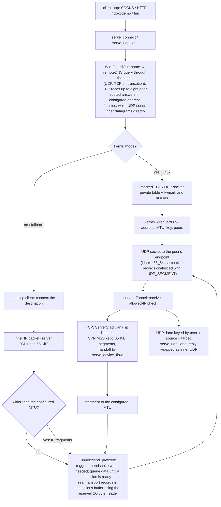

# The WireGuard tunnel, both roles

<!-- scope:begin -->
- paths: crates/ferrox-app/src/wg.rs, crates/ferrox-app/src/wg_kernel.rs, crates/ferrox-app/src/wg_stack.rs, crates/ferrox-app/src/wireguard.rs, crates/ferrox-core/src/wireguard/device.rs, crates/ferrox-core/src/wireguard/handshake.rs, crates/ferrox-core/src/wireguard/transport.rs
- symbols: find_wireguard_outbound, wireguard_settings, a_wireguard_server_datagram_takes_its_udp_lane_and_redirect
- scenarios: wireguard-raw, wireguard-kernel-raw
- engines: xray-core, sing-box
- go: ./proxy/wireguard/...
<!-- scope:end -->
Row 81: a `wireguard` handler carries IP packets over UDP. The outbound dials the peer's endpoint, raises a handshake on the first flow, and puts every inner packet through the tunnel; the inbound answers an initiation, routes the decrypted packet by the peer's allowed IPs, and hands a TCP flow to the tree's outbound or a datagram flow to the tree's lane. Both roles carry IPv4 and IPv6 TCP and UDP, and answer an ICMP echo to the device's own address at both families.

The wire is the reference's: a 16-byte transport header and tag, 148-byte initiations, 92-byte responses, and three reserved bytes where WARP writes its routing id. The reserved bytes are written after `mac1`/`mac2` and cleared before parsing, so a peer that fills them and one that zeroes them read the same. The handshake is Noise_IKpsk2 with an optional pre-shared key; the timers are five seconds, ninety seconds, two minutes, three minutes and ten seconds, and a replayed timestamp or counter is refused. A responder answers into a pending keypair and promotes it on the first authenticated transport record, so the old session stays send-capable until the initiator proves it received the response.

The config is xray's dialect plus `largeSegments`, a client opt-in: it advertises a 65 KiB MSS and reassembles the peer's fragments, so the peer must write and split those segments. On Linux, a successful kernel device bypasses the userspace stack, so `noKernelTun: true` (or `kernelMode: false`) is required to use it. `secretKey`, `address`, `peers`, `mtu`, `reserved`, `remoteDNS`, `noKernelTun` and `kernelMode` read with the reference's defaults: address `10.0.0.1` and `fd59:7153:2388:b5fd::1`, peer allowed IPs `0.0.0.0/0` and `::0/0`, MTU 1420, reserved empty or exactly three bytes, `remoteDNS` Cloudflare's four resolver addresses. Keys are 64 hex characters, or standard/URL-safe base64 with padding ignored. An endpoint naming a host keeps every answer it resolves to, up to eight, so both families are dialled. A server's `users[*].account` is the peer. The role comes from position; an explicit `isClient` that contradicts it is refused at startup.

The userspace stack is `smoltcp` 0.14 on both sides — one dependency for TCP, windows, retransmits and IPv6 instead of gVisor. The client connects a local flow to the chosen destination. The server reports a 65,535-byte inner MTU and keeps the MSS a peer advertises; a client opting into `largeSegments` advertises 65,495 (v4) or 65,475 (v6), so a 1 MiB send leaves as 65 KiB segments instead of 1,240-byte pieces waiting one acknowledgement per RTT. Without the opt-in the client reports the configured MTU, so its SYN advertises the tunnel MSS (1,380 v4 / 1,360 v6 at 1,420), and the SYN-ACK advertises the configured MTU less headers, so the client's direction stays inside one datagram. Every outgoing packet wider than the configured MTU is split into IPv4 or IPv6 fragments; the receiver reassembles them, and the tunnel's IPv4 identification is cleared on completion. An incomplete set is bounded to 8 MiB, 1,024 sets (64 and 512 KiB per peer), 256 ranges per set and 30 seconds.

On Linux, `noKernelTun: false` (or `kernelMode: true`) opens a real `wireguard` link through generic and route netlink. The link carries the address, MTU, private key and peers; a private routing table holds the default route, and two rules per family send marked sockets and reverse-path lookups into that table. The data path is the kernel's: a marked socket is routed into the device and the module encrypts it, so no userspace stack or inner-packet copy is in the flow. The link, addresses, routes and rules are removed on drop. A kernel refusing the device falls back to the userspace stack with one warning; the server role always uses that stack. `remoteDNS` is carried on both paths: a name becomes a DNS query through the tunnel to the configured server of the matching family, and up to eight peer-routed answers are raced; TCP prefers the primary candidate once established, and UDP sends to up to eight until one reply pins that name. A numeric target never asks. The answer is cached for the minimum record TTL, at most 300 seconds; a truncated answer is asked again over a TCP flow through the same tunnel. The protobuf seam decodes `xray.proxy.wireguard.DeviceConfig`, `PeerConfig` and a user's account into the same JSON the file form reads.

## Data path



## Measured

<!-- counts:begin -->
| key | value | checked by |
| --- | --- | --- |
| ops-retired-instructions | UNBLESSED | scripts/count-ops.sh |
| syscalls-per-transport-record | UNBLESSED | scripts/count-ops.sh |
| wireguard-raw-down-8-client-ubuntu-arm-mib-per-second | 220 | CI benchmark-matrix.yml run 43127254767 |
| seconds-per-relayed-megabyte | 0.0045 | CI benchmark-matrix.yml run 43127254767 (220 MiB/s down-8) |
| route-scan-instructions | 68609 | scripts/count-ops.sh |
| route-table-instructions | 585 | scripts/count-ops.sh |
| transport-header-bytes | 16 | ferrox-core-wireguard::tests::the_reference_message_sizes |
| initiation-bytes | 148 | ferrox-core-wireguard::tests::the_reference_message_sizes |
| response-bytes | 92 | ferrox-core-wireguard::tests::the_reference_message_sizes |
| default-mtu | 1420 | ferrox-app-wireguard::tests::the_defaults_are_the_reference_ones |
| inner-mtu-bytes | 65535 | ferrox-app-wg-stack::tests::a_client_cannot_narrow_the_server_mtu |
| tunnel-fragment-bytes | 1344 | ferrox-app-wg-stack::tests::a_large_inner_packet_fragments_to_the_tunnel_and_reassembles |
| wireguard-fragment-bytes | 1420 | ferrox-app-wg-stack::tests::the_fragment_limit_follows_the_carrier |
| reassembly-set-cap | 1024 | ferrox-app-wg-stack::tests::a_flood_of_first_fragments_is_bounded_by_count |
| reassembly-peer-set-cap | 64 | ferrox-app-wg-stack::tests::one_peers_fragments_do_not_evict_anothers |
| reassembly-peer-byte-cap | 524288 | ferrox-app-wg-stack::tests::a_peer_cannot_take_the_whole_reassembly_byte_budget |
| reassembly-range-cap | 256 | ferrox-app-wg-stack::tests::range_metadata_is_bounded |
| range-merge-allocations | 0 | ferrox-app-wg-stack::tests::merging_fragment_ranges_reuses_the_list |
| reassembly-clock-reads-per-fragment | 1 | ferrox-app-wg-stack::tests::a_fragment_stream_reads_one_clock_per_fragment |
| idle-turn-clock-reads | 0 | ferrox-app-wg-stack::tests::an_idle_turn_reads_no_clock |
| timeout-walks-per-unexpired-fragment | 0 | ferrox-app-wg-stack::tests::an_unexpired_fragment_does_not_walk_the_sets |
| reassembly-byte-cap | 8388608 | ferrox-app-wg-stack::tests::a_growing_set_cannot_exceed_the_reassembly_byte_cap |
| large-segment-fragments | 4 | ferrox-app-wg-stack::tests::a_large_inner_packet_fragments_to_the_tunnel_and_reassembles |
| ipv4-fragment-round-trips | 1 | ferrox-app-wg-stack::tests::a_large_inner_packet_fragments_to_the_tunnel_and_reassembles |
| download-bytes-reassembled | 16384 | ferrox-app-wg-stack::tests::a_server_download_leaves_as_fragments_the_client_reassembles |
| ipv6-fragment-round-trips | 1 | ferrox-app-wg-stack::tests::an_ipv6_packet_fragments_and_reassembles_without_its_fragment_header |
| syn-conservative-mss-bytes | 1380 | ferrox-app-wg-stack::tests::the_client_keeps_the_tunnel_mss_without_large_segments |
| syn-advertised-mss-bytes | 65495 | ferrox-app-wg-stack::tests::the_client_advertises_the_inner_mss |
| syn-ack-advertised-mss-bytes | 1380 | ferrox-app-wg-stack::tests::the_server_keeps_the_syn_mss_and_lowers_its_answer |
| tcp-bytes-echoed | 9 | ferrox-app-wg::tests::a_tcp_flow_crosses_the_tunnel_to_a_freedom_dial |
| client-datagram-bytes-echoed | 6 | ferrox-app-wg-stack::tests::a_client_datagram_lane_frames_and_unframes |
| server-datagram-bytes-echoed | 2 | ferrox-app-wg-stack::tests::a_server_datagram_lane_echoes_through_freedom |
| echo-answers-on-the-client | 2 | ferrox-app-wg-stack::tests::an_echo_to_the_devices_own_address_is_answered_on_the_tunnel |
| echo-answers-on-the-server | 1 | ferrox-app-wg-stack::tests::a_server_answers_an_echo_to_its_own_address |
| prefixed-record-allocations | 0 | ferrox-core-wireguard::tests::a_prefixed_record_reuses_the_stack_headroom |
| prefixed-record-zeroed-bytes | 0 | ferrox-core-wireguard::tests::a_prefixed_record_reuses_the_stack_headroom |
| received-record-copies | 0 | ferrox-core-wireguard::tests::an_owned_transport_record_keeps_the_received_allocation |
| kernel-rule-priority | 32765 | ferrox-app-wg-kernel::tests::the_rule_marks_the_table |
| kernel-iif-priority | 32764 | ferrox-app-wg-kernel::tests::the_iif_rule_keeps_the_reverse_path_inside_the_tunnel |
| routed-destination-list-allocations | 1 | ferrox-app-wg::tests::a_routed_destination_costs_one_list_and_a_cached_name_no_copy |
| cached-name-lookup-allocations | 0 | ferrox-app-wg::tests::a_routed_destination_costs_one_list_and_a_cached_name_no_copy |
| routed-lane-target-allocations | 0 | ferrox-app-wg-stack::tests::a_datagrams_targets_never_reach_the_allocator |
| routed-lane-targets-kept-in-answer-order | 2 | ferrox-app-wg-stack::tests::a_datagrams_targets_never_reach_the_allocator |
| routed-lane-datagram-copies-per-datagram | 0 | ferrox-app-wg::tests::a_routed_datagram_reaches_its_lane_in_the_readers_buffer |
| stack-reply-copies-per-datagram | 0 | ferrox-app-wg-stack::tests::a_reply_datagram_reaches_its_lane_in_the_readers_buffer |
| receiver-lookups-per-transport-packet | 1 | ferrox-app-wg::tests::a_learned_receiver_reaches_its_peer_without_a_walk |
| stale-receiver-hint-answers | 0 | ferrox-app-wg::tests::a_learned_receiver_reaches_its_peer_without_a_walk |
<!-- counts:end -->

The two routing rows are one test's two wrappers: `route_scan_once` calls the peer-by-peer longest-prefix scan and `route_table_once` the prefix table for the same destination, so the difference is the lookup. Over 512 peers, one lookup costs 68,609 retired instructions through the scan and 585 through the table, 117x fewer. A config with more than 32 allowed prefixes in total and at least one IPv4 prefix builds the IPv4 table; more than 128 and at least one IPv6 prefix builds the IPv6 table. These are chosen thresholds, not a measured crossover; below them the scan stays, and the build is outside the measured wrapper. The differential covers an exact `/32`, a `/8` tie, a miss, an exact `/128`, a `/8` tie and a miss, and asserts the table and scan agree. The echo rows are bytes, not durations: a TCP flow crosses both directions, the smoltcp handoff, the freedom dial and a loopback echo with nine bytes unchanged; a client lane frames a six-byte answer and unframes it; a server lane frames a two-byte answer through `serve_udp_lane` and wraps the reply; the stack answers an echo to its own address at both families and refuses another destination. The rule rows are the two kernel priorities; the privileged link test is `#[ignore]`d for `CAP_NET_ADMIN`. `TestWireguard` is green in `conformance.yml` at this pin.

The reassembly clock is read once per fragment, not twice, and not at all on an idle turn. A fragment used to read `StdInstant::now()` inside `expire` and again for the set a first fragment admits, so a four-fragment segment paid eight reads; `accept` takes one stamp and hands it to both (`reassembly-clock-reads-per-fragment` 1, no timeout walk). `expire_due` checks the earliest expiry first, so a turn with no set reads no clock (`idle-turn-clock-reads` 0). Both stamps feed the same 30 s timeout and `next_expiry`; only a fragment reaches either path.

An extending fragment used to probe the set map five times — `contains_key`, a `get_mut` for the stamp, a `get` for the length, a `get_mut` to resize and a last `get_mut` for the payload — plus the peer row's probe. `accept` now takes one `get` for the length, admits a first fragment in place, and re-fetches only after the growth room is decided, so the path to an extending fragment's payload is three lookups, not five; a fragment that completes the segment adds the one `remove` it always paid. No mutable borrow is held across the admission or the growth. No row: the hash probe is not a counter the tree keeps, and the fragment suites assert the bytes and the caps, not the probe count.

## Ops

```bash
./scripts/count-ops.sh report wireguard::device::tests::a_replayed_transport_counter_is_refused 'wireguard::device::Tunnel::send'
```

`UNBLESSED`. `scripts/count-ops.sh` needs valgrind, absent on macOS/aarch64, so this count is CI-only (`ops.yml`) and nothing quotes it until the artefact is read.

The two routing-table paths are measured together, so their difference is one run on one binary:

```bash
./scripts/count-ops.sh report wg::tests::a_prefix_table_picks_the_peer_the_scan_picks \
  ferrox_app::wg::tests::route_scan_once ferrox_app::wg::tests::route_table_once
```

## Syscalls

**Not measured.** The userspace send path reaches a real UDP socket, and a loopback test cannot witness a syscall count. The Linux writer coalesces equal-sized records for one endpoint into one `sendmsg` with `UDP_SEGMENT` on x86_64, capped at 65,507 bytes over IPv4 or 65,527 over IPv6; an initiation, a new endpoint, an unsupported kernel or a refused batch falls back to `sendmmsg`, a partial batch resumes at the next whole segment or falls back to `send_to`, and every other platform keeps `send_to` per record. The kernel path uses the kernel module's own socket, which a loopback test also cannot count. `a_batch_sends_every_transport_packet_in_order` and `a_batch_keeps_each_packet_size_after_segmentation` prove bytes, order and segment sizes, not calls.

## Memory copies

Zero extra copies on the stack send path. Every producer reserves the 16-byte transport header, and `Tunnel::send_prefixed` seals the record where the packet lies (`prefixed-record-allocations` 0, `prefixed-record-zeroed-bytes` 0; `a_prefixed_record_reuses_the_stack_headroom` asserts the returned base is the caller's, the pointer does not move and capacity does not grow, and the peer decrypts it). A caller without headroom still takes the old path: `send_owned` seals in place from offset zero, while `send(&[u8])` allocates one buffer and copies once. The server datagram lane hands its payload to the loopback relay by pointer (`socks_udp_parts` plus one `sendmsg`/`WSASend`), and `a_udp_reply_hands_the_payload_over_by_pointer` is the witness; the per-datagram `Vec` is gone. The Linux batch names each record by its existing buffer in the `sendmsg` iovecs, and the pending-record `Vec` is reused (`a_batch_reuses_its_pending_buffer`). `ServerStack::datagram` inlines in the counted build, so no instruction count is claimed. On receive, the Linux batch path hands the decrypted record's allocation to the stack instead of copying its payload; the macOS and Windows loops keep the old copy.

## Time

`benchmark-matrix.yml` measures both paths. The userspace cells set `noKernelTun: true`; the Linux kernel cells set it false and run only the ferrox client, while xray-core and sing-box still serve; a runner without the module skips the cell. The numbers below are the userspace cells: tier `full`, five repeats on 2026-11-11 (`ubuntu-24.04-arm`, `wireguard-raw-*`, run `43127254767`). Legs are ferrox against xray-core in the same cell: down-8 client 1.20x and server 1.03x; duplex-8 client 1.33x and server 1.22x; up-1 client 1.25x and server 1.12x. The median throughputs are 220/184, 209/190, 229/172, 222/211, 238/190 and 230/213 MiB/s. A server leg normalises each side by its own raw-pipe ceiling, so the 1.22x duplex server leg is ceiling-corrected while 222/211 is the raw pair. Ferrox is best on four of the nine priced rows and 0.99x on the third down cell; the remaining deficits are against sing-box's kernel-TCP client (up 0.71-0.94x) and its duplex cell, filed under 1214. That duplex cell is bimodal in both trees: main (run `43231758915`, nine repeats) split 183-194 MiB/s in five repeats and 53-102 in four, this branch (run `43234775695`, nine repeats) 179-260 in four and 100-115 in five, all at 4.6-6.0 s CPU per GiB, so the median is the count of slow repeats. Client CPU per GiB through the xray-core server is 5.36 s against 8.00 for down-8, 5.12 against 8.56 for duplex-8, and 4.72 against 8.80 for up-1; client peak RSS is 13-34 MiB against 49-69 MiB. The down-8 server leg's xray client is bimodal on arm: 74/189/190/192/194 against the ferrox server in this run and 69/74/74/75/192 in run `43155796255`, while the ferrox server held 208-213.

## What we removed

- **The peer walk a transport packet paid.** A datagram names only the receiver index it answers to, so the reader asked every peer whether it owned the index, up to four comparisons each. A 64-slot direct-mapped memory now holds the peer that answered an index, believed only while that peer still owns the index, so the packets after the first are one comparison, a session rotation falls back to the walk, and a stale entry can never name a peer that does not own the index (`a_learned_receiver_reaches_its_peer_without_a_walk` counts two probes for the first packet and one for each of the next 64, checks the memory against the walk, and plants a wrong entry to prove it falls through). The walk still fills the memory on the first packet of every index, so a peer whose sessions rotate pays one walk per session; an index colliding in its low six bits replaces the learned entry.

- **The per-packet peer-by-peer longest-prefix scan.** The client's outbound lookup and the server's source-owner check now walk one bit trie per family, so a packet costs at most 32 or 128 bit steps instead of a full scan of every peer's allowed list. The scan remains below the 32/128-prefix thresholds, and the table preserves its deepest-prefix choice and last-peer tie.

- **The iptables control plane.** The upstream kernel-mode work installs mangle rules, toggles `src_valid_mark`, and vendors an iptables runner; this tree writes route and generic netlink only, uses a private table with `SO_MARK` on the inner sockets, and adds an `iif` rule so the reverse-path lookup stays on the link. No firewall chain, global sysctl or `SO_BINDTODEVICE` is touched, and the link, table and rules are removed on drop.

- **The host resolver for a client name.** The query rides the tunnel against `remoteDNS`, so the name and answer are not visible to the host's resolver. The reserved bytes are handled in one place — after the MACs are computed, before any parse, and put back when a record is refused — so WARP and vanilla are one code path.

- **The per-stack 64 KiB staging buffer on the userspace TCP path.** `pump` read the local stream into that buffer and copied it into the transmit ring, and read the receive ring into it before writing the local stream; `upload` and `download` now hand the ring's slice to `Read` and `Write` directly. A connect's request prefix is still a `Vec` written with `send_slice`, and a full local stream pulls up to 64 KiB into a per-flow spill under backpressure.

- **The lists a routed datagram's targets and every destination built, and the lowercase key per cached name.** `lane_targets` built a one-element list and filtered it into a second; both are an array of `RACES` slots and a length now, so the lane allocates nothing of its own, keeps answer order and drops unrouted answers (`a_datagrams_targets_never_reach_the_allocator`). `destinations` filters a routed literal where it sits and builds no list at all for an unrouted one, and the kernel path's host-local filter does the same. `lookup` shares a cached answer behind an `Arc` and borrows the trimmed name when it is already lowercase, copying only for an uppercase one (`a_routed_destination_costs_one_list_and_a_cached_name_no_copy`: one allocation for a routed literal, none for an unrouted one or a lower-case hit, one when the key must be lowered). A miss still collects its answers into one list and then copies them into the shared slice, so a miss pays one extra allocation and copy; the returned destination list is still an allocation.

- **The second list every fragment merge built.** `merge_ranges` compacts the sorted range list in place, so the merge allocates nothing; payload and range-list growth may still allocate during `accept` (`merging_fragment_ranges_reuses_the_list`). The peer-scoped byte and set counts are a table keyed by peer, so `peer_usage` is one lookup instead of a scan (`the_peer_table_agrees_with_the_sets`). The timeout sweep compares against the earliest set's expiry, so an unexpired fragment does not walk the sets (`an_unexpired_fragment_does_not_walk_the_sets`).

- **The first IPv4 fragment's second buffer.** `fragment_packet_owned` rewrites the caller's `Vec` in place for fragment zero and copies only the later pieces, so a fragmented inner packet no longer allocates a fresh buffer for its first fragment; `a_fragmented_packet_keeps_its_first_buffer` holds the pointer and capacity. The IPv6 path still builds every fragment fresh, and the later pieces are still copied.

- **The per-datagram frame on the server datagram lane.** Its head is the lane's reused buffer and its payload the second iovec of one `sendmsg`, so the relay gets the SOCKS frame without a new `Vec` or copying the inner payload; on Windows the connected lane's `WSASend` does the same. The client lane still builds its reply in its reused buffer.

- **The reference's GSO-only segmenter and the acknowledgement clock it leaves on a userspace stack.** xray splits a large write only when its TUN exposes `IFF_VNET_HDR`; this tree's client advertises the inner MSS when `largeSegments` is set, the server keeps it, smoltcp writes 65 KiB segments, and the tunnel fragments them, so the server leg no longer waits one RTT per 1,240 bytes. Without `largeSegments` the default path keeps the old segment size; reassembly copies each received fragment into its set, and an incomplete set holds up to 8 MiB for 30 seconds. The timeout check still reads the clock on every fragment; only the walk is gone.

- **The per-record `send_to` on the Linux writer's transport path.** A run of equal-sized records to one endpoint rides one `sendmsg` with `UDP_SEGMENT` on x86_64, and stays `sendmmsg` on aarch64 where the super-packet collapses the arm reference client; handshakes, new endpoints, unsupported kernels and refused batches fall back as named under Syscalls.

- **The gVisor dependency.** The reference's netstack pulls gVisor's `tcpip`; this tree's `smoltcp` is one small crate, whose only new transitive licence is `0BSD` (`managed`), now in `deny.toml`. It is a dependency change, not a speed claim.

- **The socket-family lookup on every initiation.** `handle_initiation` asked `local_addr` once for a cookie reply and again for the handshake flush; it now takes the `ipv6` the receive loop already holds, so an initiation pays no address lookup. The handshake tests hold the reply bytes; the removed `local_addr` calls are a syscall count no loopback test may claim, so the count stays `UNBLESSED` and no number is claimed here. What is **not** removed: the cookie reply still costs its `send_to`, and the flush still writes the same packets.

Against sing-box, nothing is removed: its pinned WireGuard endpoint is a separate implementation, now the matrix's third server, and the translator maps this row's xray-shaped config onto it. ZeroNet's pin carries no WireGuard lane. The pinned AmneziaWG device is a third implementation of the same wire format, not the source of this row.

## What was not removed

No syscall claim is made. The batch is Linux-only, so the per-record `send_to` remains on Windows, macOS and the fallback. On transmit, non-prefixed userspace paths copy or shift an inner packet into a transport record; the prefixed stack path reuses the caller's buffer, seals in place and writes the record without zero-filling it. On receive, the Linux batch path moves the opened record instead of copying its payload; the macOS and Windows loops and any Linux batch that has spent its spare-buffer budget keep the old copy. The stack owns a 1 MiB receive and a 1 MiB send buffer per connected flow and up to eight such pairs while a TCP flow races resolved answers; a server datagram lane owns a loopback relay and two threads, reclaimed after the UDP idle budget within the 4096 cap. Remote DNS races up to eight peer-routed answers: TCP prefers its primary candidate once established, UDP sends to up to eight until one name's reply pins that name, and the kernel lane stops at 64 connected sockets. Kernel mode is Linux-only and needs `CAP_NET_ADMIN` and the `wireguard` module; when unavailable the userspace stack serves the same config, and the server role always uses it. A non-zero `reserved` also stays on the userspace stack, because the kernel device has no field for WARP's routing id. An explicit `isClient` that contradicts the handler's position is a startup refusal. A client whose peers name endpoints in both families binds one dual-stack UDP socket and maps IPv4 endpoints through it; when the host cannot open it, it falls back to IPv4 and skips IPv6 candidates.

The handshake-noise hook is WARP's (row 202): `WireGuardOut::with_noise` carries a profile into `io`, where the first initiation is preceded by that profile's IKEv2-framed `i1` and junk, followed by post-handshake junk, and a transport keepalive by its own junk. The default is `off`, the WebSocket carrier and every ordinary `wireguard` outbound keep their bytes, and a Linux kernel device cannot carry the hook, so an enabled profile serves the userspace stack and says so once. The profile's datagrams are additional handshake writes, not a changed transport record; the server role takes none.

## Pins

| what | where |
| --- | --- |
| the device config, peers, users and role | `upstream/xray-core/proxy/wireguard/`, `upstream/xray-core/infra/conf/wireguard.go` |
| the JSON defaults and key parsing | `upstream/xray-core/infra/conf/wireguard.go` |
| the netstack the userspace stack replaces | `upstream/xray-core/proxy/wireguard/netstack.go` |
| the scenario both roles answer | `upstream/xray-core/testing/scenarios/wireguard_test.go` |
| the endpoint the matrix translates to | `upstream/sing-box/option/wireguard.go`, `upstream/sing-box/transport/wireguard/endpoint.go` |
| the smoltcp stack and its device trait | `upstream/` nothing vendored; crate `smoltcp` 0.14 |
